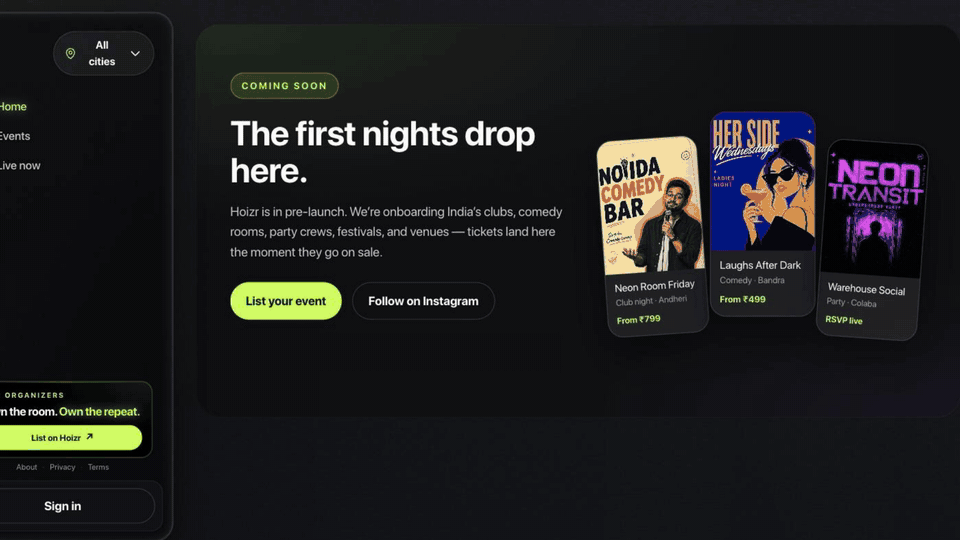
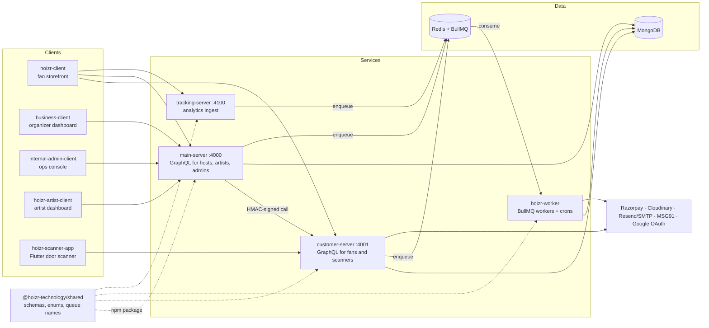
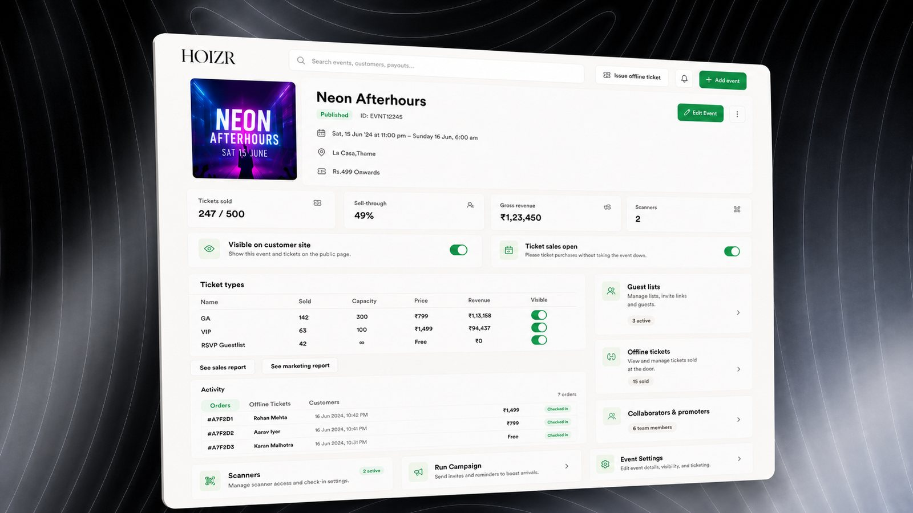
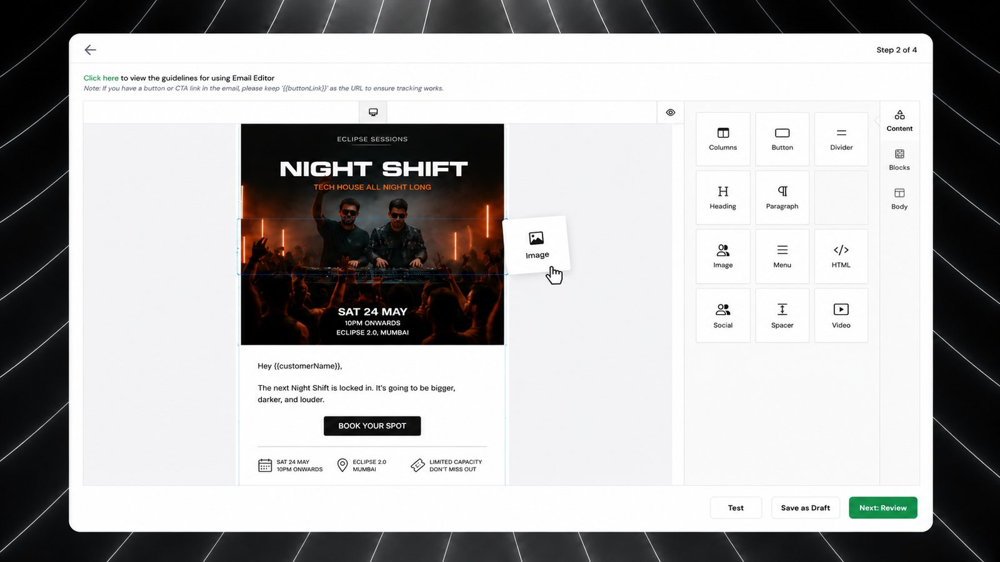
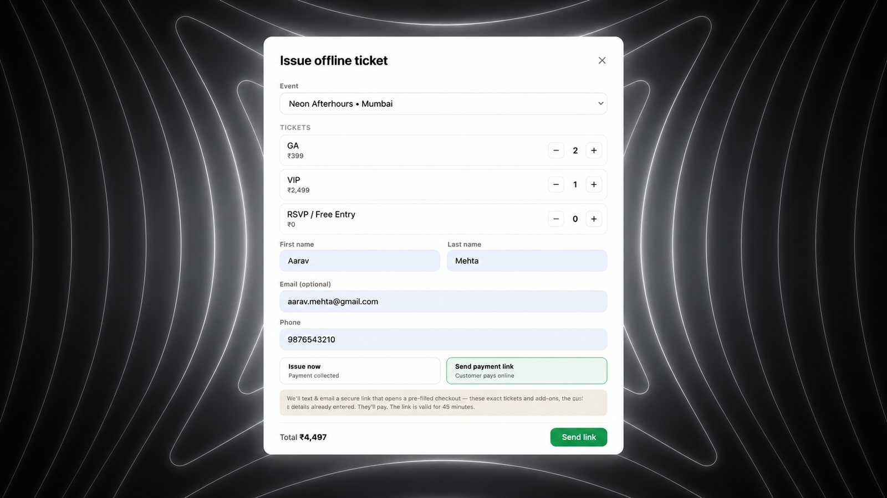

<div align="center">

# Hoizr

**Ticketing, fan CRM, marketing and door scanning for live events in India: a guided tour of the whole codebase.**

[Website](https://business.hoizr.com) · [Architecture](docs/01-system-architecture.md) · [Run it locally](docs/09-local-development.md) · [Contribute](docs/12-known-gaps-and-roadmap.md)


</div>



<p align="center"><sub>One ticket, end to end: storefront checkout → BullMQ fan-out → double-entry ledger → organizer dashboard → door scanner.</sub></p>

## What is Hoizr?

Hoizr is a pre-launch SaaS for Indian live events: club nights, comedy rooms, festivals, concerts and house parties. Venues and event organizers sell tickets online or at the door, keep every buyer in their own fan CRM, market to them, and settle payouts. All of it runs on one platform made of ten repositories.

| Who | What they get |
|---|---|
| **Fans** | Event discovery, a server-locked cart, Razorpay checkout, QR e-tickets, guestlist golden passes, waitlists |
| **Venues and event organizers** | Event builder (multi-day, ticket types, add-ons), orders and customers, guestlists, email and WhatsApp campaigns, automations, door-scanner management, reports, payouts |
| **Artists** | A public link-in-bio page, show confirmations, guestlist management, merch |
| **Door staff** | A Flutter scanner that keeps admitting guests offline and syncs when the network returns |
| **Hoizr ops** | An internal console for organizer verification, commission per event, manual settlement, refunds, ledger and GST reconciliation |

## Why this repository exists

Hoizr was open-sourced so anyone can study how a near-production, multi-service SaaS is put together: service boundaries, RBAC, Redis and BullMQ, idempotent payments and a first-party tracking pipeline. This repository holds no application code. It is the map and the guidebook for the ten code repositories.

| If you have... | Read this |
|---|---|
| **5 minutes** (recruiter or curious engineer) | This page, then [Engineering decisions](docs/11-engineering-decisions.md) |
| **An hour to understand the architecture** | [01 System architecture](docs/01-system-architecture.md) → [03 Auth and RBAC](docs/03-auth-and-rbac.md) → [04 Background jobs](docs/04-background-jobs-bullmq.md) → [05 Redis and concurrency](docs/05-redis-and-concurrency.md) → [06 Payments](docs/06-payments-and-money.md) |
| **An afternoon to run it** | [09 Running Hoizr locally](docs/09-local-development.md) |
| **The urge to contribute** | [12 Known gaps, roadmap and good first issues](docs/12-known-gaps-and-roadmap.md) and [CONTRIBUTING](https://github.com/roop37/hoizr-dotgithub/blob/main/CONTRIBUTING.md) |

## Architecture at a glance



There are two GraphQL APIs, split by audience. `main-server` serves organizers, their teams, artists and internal admins. `customer-server` serves fans and door scanners and is the only service that creates ticket orders. Slow or failure-prone side effects (payment finalisation, emails, WhatsApp and SMS, PDFs, ledger posts, campaigns, scheduled jobs) run in `hoizr-worker` through BullMQ queues on Redis. All backends share one MongoDB database and one Redis, and the `@hoizr-technology/shared` package is the contract between them. Full detail: [System architecture](docs/01-system-architecture.md).

## The repositories

| Repository | What it does | Stack | Dev port |
|---|---|---|---|
| [main-server](https://github.com/roop37/main-server) | Organizer, team, artist and admin GraphQL API | Fastify, Mercurius, TypeGraphQL, Typegoose | 4000 |
| [customer-server](https://github.com/roop37/customer-server) | Fan and scanner GraphQL API: cart, checkout, Razorpay webhooks, orders | Fastify, Mercurius, TypeGraphQL, Redis | 4001 |
| [hoizr-worker](https://github.com/roop37/hoizr-worker) | Every async side effect: BullMQ workers and node-cron jobs (Asia/Kolkata) | BullMQ, node-cron, Nodemailer, Handlebars | none |
| [tracking-server](https://github.com/roop37/tracking-server) | Write-only analytics ingest that queues events | Fastify, BullMQ | 4100 |
| [hoizr-shared](https://github.com/roop37/hoizr-shared) | `@hoizr-technology/shared`: domain model, enums, queue names, ledger, HMAC | Typegoose, TypeGraphQL | npm package |
| [hoizr-client](https://github.com/roop37/hoizr-client) | Fan storefront | Next.js 14 App Router, Tailwind | 3009 |
| [business-client](https://github.com/roop37/business-client) | Organizer dashboard + business.hoizr.com marketing site | Next.js 14 (App + Pages Router), shadcn/ui | 3000 |
| [internal-admin-client](https://github.com/roop37/internal-admin-client) | Internal operations console | Next.js 14 App Router, MUI, shadcn/ui | 5000 |
| [hoizr-artist-client](https://github.com/roop37/hoizr-artist-client) | Artist dashboard + editorial landing | Next.js 14 App Router | 3004 |
| [hoizr-scanner-app](https://github.com/roop37/hoizr-scanner-app) | Offline-capable door check-in app | Flutter, SQLite, mobile_scanner | n/a |

## Engineering highlights

- **Composable GraphQL guards with tenant scoping.** Chains such as `isAuthenticated → isUser → loadPermissions → isAdminVerifiedHost` run before a resolver. The selected organization comes from a cookie and is only honoured if it appears in the user's own memberships. → [Auth and RBAC](docs/03-auth-and-rbac.md)
- **One token design across six identity realms.** RS256 access and refresh JWTs in HttpOnly cookies (Bearer for the scanner), refresh tokens allow-listed per device in Redis, and a version counter that revokes every session with one write. → [Auth and RBAC](docs/03-auth-and-rbac.md)
- **No overselling, by construction.** A Redis Lua script holds cart quantities so the storefront can say "sold out" early, but the seat is only taken by a conditional `$inc` guarded by `$expr` inside a MongoDB transaction. → [Redis and concurrency](docs/05-redis-and-concurrency.md)
- **Idempotent webhooks at three layers.** BullMQ job ids, a webhook inbox with a unique provider event id, and status-guarded handlers. The browser's confirm call and Razorpay's webhook can race, and the second arrival is a no-op. → [Payments and money](docs/06-payments-and-money.md)
- **Integer-paise pricing on the server only.** The client sends ticket ids, quantities and a coupon code, never a price. Every money movement posts a balanced double-entry ledger transaction with a unique idempotency key. → [Payments and money](docs/06-payments-and-money.md)
- **A dedicated worker process with single-flight crons.** Queue names live in one shared registry, and each cron tick takes a minute-bucketed Redis `SET NX` lock so only one instance runs it. → [Background jobs](docs/04-background-jobs-bullmq.md)
- **First-party, privacy-respecting analytics.** A dependency-free beacon SDK, a write-only ingest that drops Do-Not-Track and bot traffic, allow-listed fields and a salted visitor hash that rotates daily. The events feed abandoned-cart automations and organizer reports. → [Tracking and analytics](docs/07-tracking-and-analytics.md)
- **One class, two contracts.** Each shared Typegoose class is both the MongoDB schema and the GraphQL type, so the database and the API cannot drift apart. → [Domain model](docs/02-domain-model.md)
- **Typed GraphQL clients with automatic token refresh.** Every web app generates a typed SDK with GraphQL Code Generator, and a custom `fetch` refreshes the session on 401 and retries once. → [Frontend architecture](docs/08-frontend-architecture.md)
- **An offline-first door scanner.** The Flutter app caches the event's ticket list in SQLite, admits guests offline, and replays queued check-ins when the network returns. → [Frontend architecture](docs/08-frontend-architecture.md)

## Screenshots

All screens use demo data.

<table>
  <tr>
    <td width="50%"></td>
    <td width="50%"></td>
  </tr>
  <tr>
    <td align="center">Organizer dashboard (<code>business-client</code>)</td>
    <td align="center">Manage Event (<code>business-client</code>)</td>
  </tr>
  <tr>
    <td width="50%"></td>
    <td width="50%"></td>
  </tr>
  <tr>
    <td align="center">Email campaign editor (<code>business-client</code>)</td>
    <td align="center">Offline tickets and payment links (<code>business-client</code>)</td>
  </tr>
  <tr>
    <td width="50%"></td>
    <td width="50%"></td>
  </tr>
  <tr>
    <td align="center">Fan storefront (<code>hoizr-client</code>)</td>
    <td align="center">Artist landing (<code>hoizr-artist-client</code>)</td>
  </tr>
</table>

## The walkthrough

| # | Chapter | What you will learn |
|---|---|---|
| 01 | [System architecture](docs/01-system-architecture.md) | The ten repos, two APIs, the worker and the tracking ingest, and how they talk |
| 02 | [Domain model and glossary](docs/02-domain-model.md) | Core entities, tenancy, money and time conventions, Hoizr vocabulary |
| 03 | [Authentication and RBAC](docs/03-auth-and-rbac.md) | Six identity realms, token design, the guard chain, the verification gate |
| 04 | [Background jobs: BullMQ workers and crons](docs/04-background-jobs-bullmq.md) | Every queue and cron, the paid-order fan-out, notifications, automations |
| 05 | [Redis, concurrency and consistency](docs/05-redis-and-concurrency.md) | Cart holds, oversell protection, idempotency, rate limits, locks |
| 06 | [Payments and money flow](docs/06-payments-and-money.md) | Order lifecycle, pricing, Razorpay, refunds, ledger, manual settlement |
| 07 | [Tracking and analytics pipeline](docs/07-tracking-and-analytics.md) | Beacon SDK, ingest hardening, event taxonomy, what analytics drive |
| 08 | [Frontend architecture](docs/08-frontend-architecture.md) | Four Next.js apps, codegen, token refresh, SSR guards, the Flutter scanner |
| 09 | [Running Hoizr locally](docs/09-local-development.md) | Full-stack bring-up, env vars, the shared-package token, troubleshooting |
| 10 | [Deployment and operations](docs/10-deployment-and-operations.md) | Environments, CI/CD, publishing the shared package, ops tooling |
| 11 | [Engineering decisions](docs/11-engineering-decisions.md) | An ADR log of the choices that shaped the system and their trade-offs |
| 12 | [Known gaps, roadmap and how to contribute](docs/12-known-gaps-and-roadmap.md) | Honest status, gaps by theme, good first issues |
| 13 | [Third-party services and stack reference](docs/13-third-party-services.md) | Every library and service, with versions and official docs |

## Tech stack

- **Backend:** [Node.js](https://nodejs.org/) · [TypeScript](https://www.typescriptlang.org/) · [Fastify](https://fastify.dev/) · [Mercurius](https://mercurius.dev/) · [TypeGraphQL](https://typegraphql.com/) · [Typegoose](https://typegoose.github.io/typegoose/) · [Zod](https://zod.dev/)
- **Data and queues:** [MongoDB](https://www.mongodb.com/docs/) · [Redis](https://redis.io/docs/) · [BullMQ](https://docs.bullmq.io/) · [node-cron](https://github.com/node-cron/node-cron)
- **Frontend:** [Next.js 14](https://nextjs.org/docs) · [Tailwind CSS](https://tailwindcss.com/) · [shadcn/ui](https://ui.shadcn.com/) · [MUI](https://mui.com/) · [Zustand](https://zustand.docs.pmnd.rs/) · [GraphQL Code Generator](https://the-guild.dev/graphql/codegen)
- **Mobile:** [Flutter](https://docs.flutter.dev/) · [mobile_scanner](https://pub.dev/packages/mobile_scanner)
- **Services:** [Razorpay](https://razorpay.com/docs/) · [Cloudinary](https://cloudinary.com/documentation) · [Resend](https://resend.com/docs) · [MSG91](https://docs.msg91.com/) · [Google Identity](https://developers.google.com/identity)

Versions and status per service: [Third-party services and stack reference](docs/13-third-party-services.md).

## Run it locally

```bash
mkdir hoizr && cd hoizr
for r in main-server customer-server hoizr-worker tracking-server hoizr-shared \
         hoizr-client business-client internal-admin-client hoizr-artist-client hoizr-scanner-app; do
  git clone https://github.com/roop37/$r.git
done
```

You need Node.js 20+, MongoDB and Redis. The backends install `@hoizr-technology/shared` from GitHub Packages, which requires a GitHub token with `read:packages` even though the package is public. The [local development guide](docs/09-local-development.md) covers the token, env files, start order and troubleshooting.

## Project status and known gaps

The core ticketing loop is built end to end: events, the Redis-held cart, Razorpay checkout finalised by webhook, e-tickets, online and offline door scanning, guestlists, campaigns, automations, manual payout settlement and a double-entry ledger. Some integrations (SMS and WhatsApp through MSG91, web push) are built but stay off until configured.

The biggest gaps are in engineering hygiene rather than features: there is no CI job for tests, lint or type checks, test coverage is thin, there is no docker-compose stack yet, and the Next.js apps are on 14.x. All of this is listed in [Known gaps and roadmap](docs/12-known-gaps-and-roadmap.md).

## Contributing

Hoizr was built and rebuilt over many revisions by a very small team, and there are gaps. The goal of open-sourcing it is to grow it with the community, so issues, ideas and pull requests are all welcome.

- Start with [CONTRIBUTING.md](https://github.com/roop37/hoizr-dotgithub/blob/main/CONTRIBUTING.md) and the [good first issues](docs/12-known-gaps-and-roadmap.md).
- Follow the [Code of Conduct](https://github.com/roop37/hoizr-dotgithub/blob/main/CODE_OF_CONDUCT.md).
- Report vulnerabilities privately as described in [SECURITY.md](https://github.com/roop37/hoizr-dotgithub/blob/main/SECURITY.md), never in a public issue.

## Author

Built by [@roop37](https://github.com/roop37). Hoizr went through several architecture revisions on its way to launch: a fork of an earlier point-of-sale codebase, a split into audience-specific APIs, a move of every side effect into a worker process, and a rework of payouts into a manually verified settlement model. Questions and collaboration ideas are welcome through GitHub.

## License

The documentation in this repository is released under the [MIT License](LICENSE). The Hoizr name, logo, screenshots and brand assets are not covered by the license.
