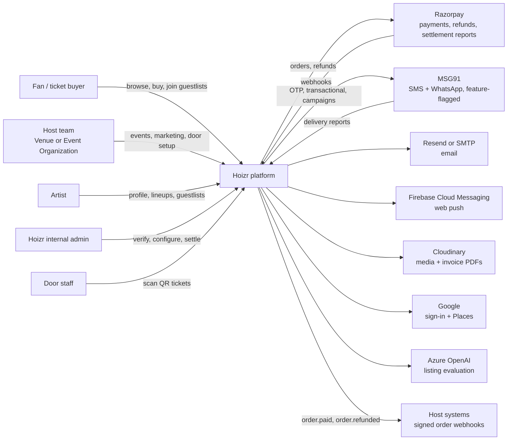
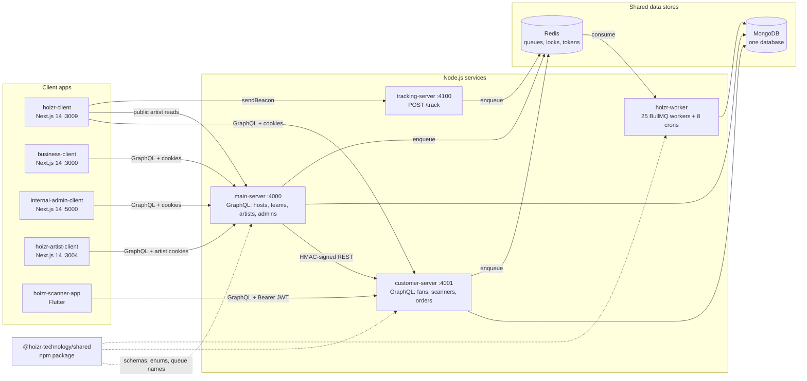
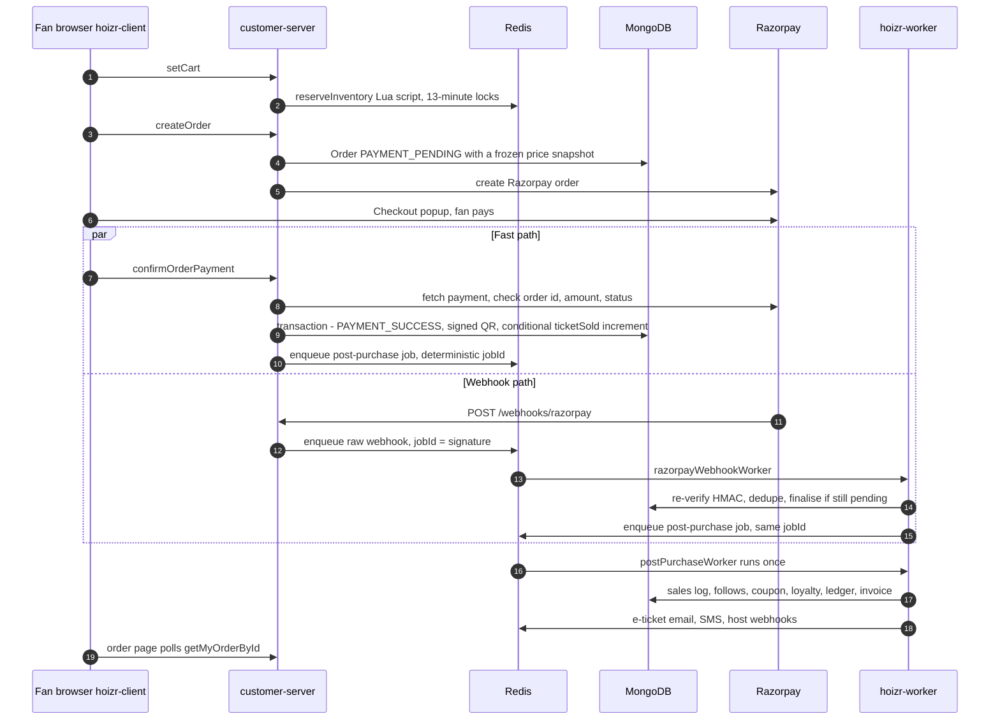
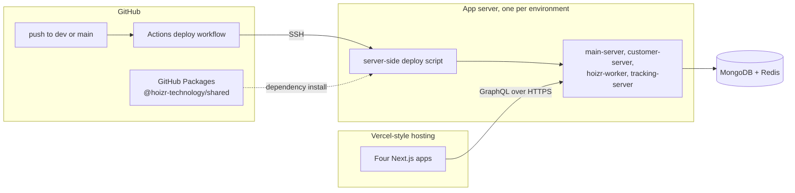

# System architecture

This chapter puts the whole Hoizr system on one page. You will see who uses it, which deployable pieces make it up, how those pieces talk to each other, what the shared MongoDB and Redis hold, and what happens between a fan pressing "Pay" and a QR ticket arriving in their inbox. Later chapters zoom into each part; this one is the map.

## TL;DR

- Hoizr is **ten repositories**: four Node.js backends, one shared npm package, four Next.js 14 frontends and a Flutter door-scanner app.
- There are **two GraphQL APIs, split by audience**. [`main-server`](https://github.com/roop37/main-server) serves hosts, their teams, artists and internal admins. [`customer-server`](https://github.com/roop37/customer-server) serves fans and door scanners, and it is the only service that creates ticket orders.
- **Most slow or failure-prone side effects run in [`hoizr-worker`](https://github.com/roop37/hoizr-worker)**: webhook-driven payment finalisation, emails, SMS and WhatsApp, PDF tickets and invoices, ledger posts, campaigns, host webhooks and scheduled jobs. The APIs hand that work over through BullMQ queues on Redis.
- A write-only **[`tracking-server`](https://github.com/roop37/tracking-server)** accepts analytics beacons from the storefront and queues them. It never connects to MongoDB.
- All backends share **one MongoDB database and one Redis**. The package [`@hoizr-technology/shared`](https://github.com/roop37/hoizr-shared) is the contract between them: schema classes, enums, queue names, and the ledger and HMAC helpers.
- Backends deploy from **GitHub Actions over SSH** when `dev` or `main` changes (tracking-server's production deploy is manual). The Next.js apps target Vercel-style hosting.

## Contents

- [What Hoizr is](#what-hoizr-is)
- [System context](#system-context)
- [Containers](#containers)
- [Why the backend is split this way](#why-the-backend-is-split-this-way)
- [Communication edges](#communication-edges)
- [Shared MongoDB and Redis](#shared-mongodb-and-redis)
- [The shared package is the contract](#the-shared-package-is-the-contract)
- [Walkthrough: a fan buys a ticket](#walkthrough-a-fan-buys-a-ticket)
- [Deployment shape](#deployment-shape)
- [Known limitations at this level](#known-limitations-at-this-level)
- [Where to go next](#where-to-go-next)

## What Hoizr is

Hoizr is a ticketing, fan CRM, marketing and door-operations platform for live events in India. Venues and event organisations create events, sell tickets, run email and push campaigns (plus WhatsApp campaigns, which are feature-flagged), switch on marketing automations, issue box-office tickets, manage guestlists and give their door staff a scanner login. The code calls these businesses **hosts**. The UI calls them a "Venue" or an "Event Organization". Fans discover events and buy tickets on `hoizr.com`. Artists keep a link-in-bio profile and accept or decline lineup invitations. A small internal team verifies hosts and payout accounts, edits platform configuration and settles payouts with hosts.

The codebase is a set of ten independent Git repositories with no workspace root. Each repository has its own lockfile and its own environment variables, and each one is built and deployed on its own. Hoizr is pre-launch and was built by a very small team over many revisions. This walkthrough describes the code as it stands, rough edges included.


## System context

Five kinds of people use Hoizr, and it depends on a handful of external services. The diagram treats Hoizr as one box. The next section opens it up.



| Person | App they use | Repository | Backend it calls |
|---|---|---|---|
| Fan / ticket buyer | Customer storefront at `hoizr.com` | [`hoizr-client`](https://github.com/roop37/hoizr-client) | customer-server (plus main-server for public artist data and a fallback city list, plus tracking-server for analytics) |
| Host owner and team members | Organizer dashboard and marketing site at `business.hoizr.com` | [`business-client`](https://github.com/roop37/business-client) | main-server |
| Artist | Artist dashboard and editorial landing page on its own subdomain | [`hoizr-artist-client`](https://github.com/roop37/hoizr-artist-client) | main-server |
| Hoizr internal admin | Ops console on an internal subdomain | [`internal-admin-client`](https://github.com/roop37/internal-admin-client) | main-server |
| Door staff | Flutter app for Android and iOS | [`hoizr-scanner-app`](https://github.com/roop37/hoizr-scanner-app) | customer-server |

A few notes on the external services:

- **Razorpay** is the only payment gateway. Fans pay for tickets through it, and hosts use it to top up a prepaid marketing-credit wallet. Payouts to hosts are settled manually by an admin. Nothing in the code moves money to a host account.
- **MSG91** carries SMS and WhatsApp. Both channels sit behind env flags (`SMS_ENABLED`, `WHATSAPP_ENABLED`). With a flag off, the worker logs the message instead of sending it ([`msg91.client.ts`](https://github.com/roop37/hoizr-worker/blob/main/src/msg91/msg91.client.ts), [`whatsapp.client.ts`](https://github.com/roop37/hoizr-worker/blob/main/src/msg91/whatsapp.client.ts)).
- **Azure OpenAI** scores event listings and drafts descriptions. When it is not configured, a heuristic fallback takes over.
- The storefront, organizer and artist apps can also load [PostHog](https://posthog.com/docs) for product analytics when a key is set. Hoizr's own analytics pipeline is separate (see [chapter 07](./07-tracking-and-analytics.md)).
- Some integrations ship dark behind flags that default to off: a customer Instagram connect, and an optional, feature-flagged restaurant-reservation integration over Swiggy's MCP API. Sign in with Apple is scaffolded, not enabled.

## Containers

Opening the box shows nine deployables plus the shared package. The Node.js services share one MongoDB database and one Redis instance.



| Container | Runtime and stack | Dev port | Responsibility | Data stores |
|---|---|---|---|---|
| [main-server](https://github.com/roop37/main-server) | Node.js, Fastify 5, Mercurius, TypeGraphQL 2 (release candidate), Typegoose on Mongoose 8 | 4000 | Business-side GraphQL API: host onboarding and admin verification, events, guestlists, box-office tickets, campaigns, automations, teams and permissions, reports, payout accounts and settlements, artist accounts, the admin console. 175 queries and 163 mutations. Also receives marketing-credit payment webhooks and WhatsApp delivery reports, and serves email open, click and unsubscribe routes. | MongoDB; Redis for queues, refresh-token hashes, rate limits and master-data caches |
| [customer-server](https://github.com/roop37/customer-server) | Same stack | 4001 | Customer and scanner GraphQL API: phone OTP and Google sign-in, public event and venue discovery, the Redis-locked cart, Razorpay checkout, orders and invoices, guestlists, waitlists, loyalty rewards, and door scanning with an offline manifest. 44 queries and 37 mutations. Receives ticket-payment webhooks and the internal offline-order call. | MongoDB; Redis for queues, cart locks, refresh-token hashes, rate limits and a config cache |
| [hoizr-worker](https://github.com/roop37/hoizr-worker) | Node.js, BullMQ 5, node-cron, Nodemailer with Handlebars, pdfkit, firebase-admin | none (no HTTP server) | All asynchronous side effects. One process registers 25 workers ([`src/index.ts`](https://github.com/roop37/hoizr-worker/blob/main/src/index.ts)) and 8 cron schedules in `Asia/Kolkata` ([`cron.scheduler.ts`](https://github.com/roop37/hoizr-worker/blob/main/src/workers/crons/cron.scheduler.ts)). | MongoDB, Redis |
| [tracking-server](https://github.com/roop37/tracking-server) | Node.js, Fastify 5, BullMQ producer, ua-parser-js | 4100 | Write-only analytics ingest for the storefront: drops Do-Not-Track and bot traffic, allow-lists six event types, hashes IP and User-Agent, enqueues. | Redis only |
| [hoizr-client](https://github.com/roop37/hoizr-client) | Next.js 14 App Router | 3009 | Customer storefront | none (browser) |
| [business-client](https://github.com/roop37/business-client) | Next.js 14, Pages Router for most of the dashboard, App Router for the marketing site, sign-in, the dashboard home and lead forms | 3000 | Organizer dashboard and `business.hoizr.com` marketing site | none |
| [internal-admin-client](https://github.com/roop37/internal-admin-client) | Next.js 14 App Router | 5000 | Internal ops console | none |
| [hoizr-artist-client](https://github.com/roop37/hoizr-artist-client) | Next.js 14 App Router | 3004 | Artist dashboard and landing page | none |
| [hoizr-scanner-app](https://github.com/roop37/hoizr-scanner-app) | Flutter, `mobile_scanner`, `sqflite` | n/a | Door check-in, online and offline | On-device SQLite cache of the event manifest |
| [hoizr-shared](https://github.com/roop37/hoizr-shared) | TypeScript library published to GitHub Packages | n/a | The domain model and cross-service contracts | n/a |


## Why the backend is split this way

### Two GraphQL APIs, split by audience

Hoizr has two kinds of signed-in party with almost nothing in common. Hosts, their team members, artists and admins manage things. Fans and door scanners consume things. The split follows that line, and you can see it in the code in four places.

**Separate identities and token checks.** Each server builds its GraphQL context from its own tokens. main-server reads the host and admin session cookies (the role inside the token tells them apart) and a separate artist cookie scope ([`src/index.ts`](https://github.com/roop37/main-server/blob/main/src/index.ts)). customer-server knows nothing about hosts. It checks for a scanner token first, because the Flutter app sends a Bearer header and never sends cookies, and only then falls back to the customer token:

```ts
        // The scanner app sends Authorization: Bearer <scannerJwt>. We try
        // scanner auth first because Flutter clients never send cookies;
        // if no scanner token, fall back to customer cookie/bearer auth.
        const scannerToken = readTokenFromRequest(
          request,
          ScannerCookieKeys.ACCESS_TOKEN
        );
        if (scannerToken) {
          const scanner = await verifyScannerAccessToken(scannerToken);
          if (scanner) {
            context.scannerId = scanner.scanner;
            context.scannerEventId = scanner.eventId;
            context.scannerBusinessId = scanner.businessId;
            return context;
          }
        }
        // ...
```
<sub>Source: [`customer-server/src/index.ts`](https://github.com/roop37/customer-server/blob/main/src/index.ts)</sub>

**One ordering authority.** Only customer-server creates scannable orders. When a host sells a ticket at the box office, main-server does not write the order itself. It asks customer-server over a signed internal call. The client file describes customer-server as "the ordering authority" ([`internal-client.ts`](https://github.com/roop37/main-server/blob/main/src/utils/internal-client.ts)). Pricing, inventory checks, QR signing and the post-purchase fan-out therefore live in one place.

**Different browser origins.** main-server's CORS allowlist covers the storefront, organizer, admin and artist origins. customer-server's allowlist covers the storefront. The storefront calls main-server only for public reads (artist profiles, artist guestlists and a fallback city list), through a separate read client ([`graphql-main.ts`](https://github.com/roop37/hoizr-client/blob/main/src/lib/graphql-main.ts)).

**Different size and blast radius.** The business API is large (338 operations). The customer API is small (81 operations) and sits on the checkout hot path. Because they are separate repositories with separate deploy workflows, a dashboard change doesn't redeploy checkout.

The cost of the split is shared configuration. Both servers point at the same database, and some secrets must match across services. For example, ticket QR codes are signed with `ENCRYPTION_KEY` by both customer-server (fast path) and hoizr-worker (webhook path), and customer-server verifies them at the door, so the value must match on both. Likewise `INTERNAL_SERVICE_SECRET` must be identical on main-server and customer-server. [Chapter 09](./09-local-development.md) lists every value that has to line up.

### A separate worker process

For most side effects, the API servers accept a request, record intent and enqueue a job, and the slow, retryable or third-party work happens in hoizr-worker. The exceptions are calls the user is waiting on, such as the checkout fast path's Razorpay payment fetch, Google Places lookups and the Azure OpenAI listing evaluation. The Razorpay webhook route in customer-server states the rule in a comment:

```ts
/**
 * Razorpay webhook receiver. We do the minimum work synchronously
 * (verify HMAC + enqueue) and return 200 immediately so the gateway
 * doesn't retry on slow downstream processing. The hoizr-workers
 * razorpay-webhook worker handles the order finalisation, QR generation,
 * post-purchase fan-out, and confirmation comms.
 */
// ...
        await getQueue().add(
          "RAZORPAY_WEBHOOK",
          { rawBody: bodyStr, signature },
          { jobId: signature }
        );
        return reply.status(200).send({ received: true });
```
<sub>Source: [`customer-server/src/routes/razorpay-webhook.route.ts`](https://github.com/roop37/customer-server/blob/main/src/routes/razorpay-webhook.route.ts)</sub>

That gives three properties. A slow email provider or PDF render never holds an HTTP request open. Each queue has its own retry and backoff policy. And a deterministic `jobId` (here, the webhook signature) collapses duplicate deliveries that arrive while the first job is still queued. Completed jobs are removed, so later replays are caught by the worker, which persists each Razorpay event id and skips duplicates.

The worker process also owns the scheduled jobs: marking ended events complete, re-enqueuing any post-purchase fan-out that a crash lost, abandoned-cart retargeting, WhatsApp template status sync, and a daily Razorpay settlement import into the ledger. The worker is meant to run as a single instance, but every cron tick takes a Redis lock first, so a second replica cannot double-fire a job:

```ts
const runCronTickExclusive = async (
  name: string,
  ttlSeconds: number,
  fn: () => Promise<void>
): Promise<void> => {
  const redis = RedisClient.getInstance();
  // Minute-bucketed key so the same scheduled tick across replicas maps
  // to one claim, while the next scheduled tick gets a fresh key.
  const minuteBucket = Math.floor(Date.now() / 60000);
  const lockKey = `cron_tick_lock:${name}:${minuteBucket}`;
  const claimed = await redis.set(lockKey, "1", "EX", ttlSeconds, "NX");
  if (claimed !== "OK") {
    logger.info(
      `Cron tick ${name} already claimed by another worker instance; skipping`
    );
    return;
  }
  await fn();
};
```
<sub>Source: [`hoizr-worker/src/workers/crons/cron.scheduler.ts`](https://github.com/roop37/hoizr-worker/blob/main/src/workers/crons/cron.scheduler.ts)</sub>

### A separate tracking ingest

The analytics edge is its own process for reasons the author wrote into the file header:

```ts
 * Deliberately a separate Node process from main-server / customer-server
 * because (a) it's a high-write, no-read surface and shouldn't share the
 * GraphQL server's hot path, (b) it must keep accepting writes during a
 * GraphQL deploy, (c) it sees raw IPs and we want a tight allow-list of
 * what it accepts.
```
<sub>Source: [`tracking-server/src/index.ts`](https://github.com/roop37/tracking-server/blob/main/src/index.ts)</sub>

It needs only Redis. It doesn't import the shared package at runtime either: the package's entry point pulls in `type-graphql`, which this small service doesn't install, so it keeps the queue name as a local string that must match the shared one ([`src/utils/queue.ts`](https://github.com/roop37/tracking-server/blob/main/src/utils/queue.ts)). [Chapter 07](./07-tracking-and-analytics.md) covers the pipeline end to end.

## Communication edges

Every arrow in the container diagram uses one of five mechanisms: GraphQL, a REST webhook, a BullMQ queue, an HMAC-signed internal call, or an HTTP beacon.

| From | To | Mechanism | Authentication / integrity | Where to look |
|---|---|---|---|---|
| hoizr-client | customer-server | GraphQL `POST /graphql` | HTTP-only customer cookies; a Bearer header is also accepted | [`src/lib/graphql.ts`](https://github.com/roop37/hoizr-client/blob/main/src/lib/graphql.ts) |
| hoizr-client | main-server | GraphQL, public artist reads only | none needed for public operations | [`src/lib/graphql-main.ts`](https://github.com/roop37/hoizr-client/blob/main/src/lib/graphql-main.ts) |
| hoizr-client | tracking-server | HTTP beacon: `navigator.sendBeacon` to `POST /track`, `fetch` with `keepalive` as fallback | unauthenticated by design; CORS, Do-Not-Track and bot filtering | [`src/lib/tracker.ts`](https://github.com/roop37/hoizr-client/blob/main/src/lib/tracker.ts) |
| business-client | main-server | GraphQL | host cookies; on a 401 the client calls `tokensRefresh` and retries | [`utils/graphqlClient.ts`](https://github.com/roop37/business-client/blob/main/utils/graphqlClient.ts) |
| internal-admin-client | main-server | GraphQL | admin cookies | [`util/graphqlClient.ts`](https://github.com/roop37/internal-admin-client/blob/main/util/graphqlClient.ts) |
| hoizr-artist-client | main-server | GraphQL | separate artist cookie scope | [`src/lib/graphql.ts`](https://github.com/roop37/hoizr-artist-client/blob/main/src/lib/graphql.ts) |
| hoizr-scanner-app | customer-server | GraphQL over a plain HTTP client | `Authorization: Bearer` scanner JWT | [`lib/services/graphql_service.dart`](https://github.com/roop37/hoizr-scanner-app/blob/main/lib/services/graphql_service.dart) |
| main-server | customer-server | HMAC-signed internal REST: `POST /internal/offline-order/issue` | HMAC-SHA256 over `${timestamp}.${rawBody}`, 5-minute replay window | [`internal-client.ts`](https://github.com/roop37/main-server/blob/main/src/utils/internal-client.ts), [`internal-offline-order.route.ts`](https://github.com/roop37/customer-server/blob/main/src/routes/internal-offline-order.route.ts) |
| Razorpay | customer-server | REST webhook `POST /webhooks/razorpay` (ticket payments, refunds, disputes) | `x-razorpay-signature` HMAC over the raw body | [`razorpay-webhook.route.ts`](https://github.com/roop37/customer-server/blob/main/src/routes/razorpay-webhook.route.ts) |
| Razorpay | main-server | REST webhook `POST /webhooks/razorpay` (marketing-credit top-ups) | same HMAC check, plus a persisted event id for dedupe | [`razorpay-webhook.route.ts`](https://github.com/roop37/main-server/blob/main/src/routes/razorpay-webhook.route.ts) |
| MSG91 | main-server | REST webhook `GET`/`POST /webhooks/whatsapp` (delivery reports, STOP replies) | shared-secret header | [`whatsapp-webhook.route.ts`](https://github.com/roop37/main-server/blob/main/src/routes/whatsapp-webhook.route.ts) |
| Email recipients | main-server | `GET` open pixel, click redirect and unsubscribe routes | HMAC token on unsubscribe links | [`src/routes/`](https://github.com/roop37/main-server/tree/main/src/routes) |
| main-server | hoizr-worker | BullMQ queues: OTP and transactional email, SMS, WhatsApp, campaigns, activity log, media cleanup, new-event announcements | Redis | [`src/utils/lifecycle.queue.ts`](https://github.com/roop37/main-server/blob/main/src/utils/lifecycle.queue.ts) |
| customer-server | hoizr-worker | BullMQ queues: webhook payloads, post-purchase fan-out, sold-out checks, OTP SMS and WhatsApp, lifecycle email, `orderPlaced` analytics, avatar mirroring | Redis | [`order.service.ts`](https://github.com/roop37/customer-server/blob/main/src/modules/order/service/order.service.ts) |
| tracking-server | hoizr-worker | BullMQ queue `{analytics-events-queue}` | Redis | [`src/utils/queue.ts`](https://github.com/roop37/tracking-server/blob/main/src/utils/queue.ts) |
| hoizr-worker | hoizr-worker | BullMQ: webhook finaliser to post-purchase, post-purchase to lifecycle email, sold-out check to the selling-fast automation, crons to their own queues | Redis | [`paid-order-fanout.ts`](https://github.com/roop37/hoizr-worker/blob/main/src/utils/paid-order-fanout.ts) |
| hoizr-worker | Host endpoints | Signed HTTPS `POST` with retries; the URL is re-checked against private and loopback addresses before every delivery | `x-hoizr-signature: sha256=<HMAC>` with the endpoint's own secret | webhook-delivery worker in `src/workers/` |
| hoizr-worker | Razorpay, MSG91, Resend or SMTP, FCM, Cloudinary | Outbound API calls | provider credentials | [`src/workers/`](https://github.com/roop37/hoizr-worker/tree/main/src/workers) |

The only synchronous service-to-service call is main-server to customer-server. Both ends use the same helper from the shared package, so the signing code exists once:

```ts
const sign = (secret: string, timestamp: string, rawBody: string): string =>
  crypto
    .createHmac("sha256", secret)
    .update(`${timestamp}.${rawBody}`)
    .digest("hex");

export const signInternalRequest = (
  secret: string,
  rawBody: string
): { timestamp: string; signature: string } => {
  const timestamp = String(Date.now());
  return { timestamp, signature: sign(secret, timestamp, rawBody) };
};
```
<sub>Source: [`hoizr-shared/src/utils/internal-auth.ts`](https://github.com/roop37/hoizr-shared/blob/main/src/utils/internal-auth.ts)</sub>

The verifier in the same file rejects a missing secret, a stale timestamp and a wrong signature, using a constant-time compare. If main-server's call fails, it marks its pending `OfflineOrder` as cancelled, so a retry starts clean ([`offline-ticket.service.ts`](https://github.com/roop37/main-server/blob/main/src/modules/offlineTicket/service/offline-ticket.service.ts)).

## Shared MongoDB and Redis

### MongoDB: one database, three writers

main-server, customer-server and hoizr-worker connect to the same database, named by `DB_URI` and `DB_NAME`. tracking-server never connects. Ownership is by convention rather than by separate databases:

- **main-server** writes the host side: users and teams, hosts, events, guestlists, coupons, scanner accounts, campaigns, automation settings, payout accounts and settlements, and the marketing-credit wallet.
- **customer-server** writes the fan side: customers, orders, guestlist entries, waitlist entries, loyalty claims and feedback. It reads events, hosts, coupons and scanner accounts that main-server owns.
- **hoizr-worker** writes the results of side effects: the denormalised sales log on each event, follows, double-entry ledger transactions, invoices, campaign send records, analytics events and webhook delivery records.

Multi-document transactions are used on the money paths (order finalisation, ledger posting, loyalty claims, marketing-credit top-ups), so MongoDB must run as a replica set, even in local development. Most foreign keys are plain string ids rather than ObjectId references, a detail that matters when you write aggregations. [Chapter 02](./02-domain-model.md) covers the model.

### Redis: transport, locks and short-lived state

Redis does more than carry queues. Every key family below was found in code.

| Key family | Owner | What it holds |
|---|---|---|
| BullMQ queues such as `{post-purchase-queue}` | all four backends | Job transport. The braces are Redis Cluster hash tags, so each queue's keys share a slot. |
| `customer_cart:<customer>:<event>`, `ticket_lock:<event>:<ticket>` | customer-server | The cart and its seat reservations, held for 13 minutes. A Lua script reserves every line atomically and rolls back if any line would oversell ([`src/utils/redis.ts`](https://github.com/roop37/customer-server/blob/main/src/utils/redis.ts)). |
| `refreshToken:<user>:<device>`, `adminRefreshToken:<admin>:<device>` | main-server | SHA-256 hashes of host and admin refresh tokens, so a Redis dump doesn't leak usable tokens ([`src/utils/jwt.ts`](https://github.com/roop37/main-server/blob/main/src/utils/jwt.ts)). |
| `customerRefreshToken:<customer>:<device>`, `scannerRefreshToken:<scanner>` | customer-server | Hashed refresh-token allowlists for fans, plus one active session per door scanner ([`src/utils/jwt.ts`](https://github.com/roop37/customer-server/blob/main/src/utils/jwt.ts)). |
| `login:<identifier>` and Lua rate-limit counters | both API servers | OTP and login attempt limits with exponential lockout. customer-server adds fixed-window budgets per IP and per event. |
| `customerPendingSignup:<hash>` | customer-server | A Google sign-in waiting for its mandatory phone OTP, kept for 10 minutes. |
| Config and master-data caches | both API servers | Platform `Config` values cached for 5 minutes on the checkout path ([`configs-cache.ts`](https://github.com/roop37/customer-server/blob/main/src/utils/configs-cache.ts)), and master lists such as cities and categories on main-server. |
| `cron_tick_lock:<name>:<minute>` and per-recipient claims | hoizr-worker | Single-flight cron ticks and "send at most once" markers for automations. |

[Chapter 05](./05-redis-and-concurrency.md) walks through the locking and rate-limiting code.

## The shared package is the contract

[`@hoizr-technology/shared`](https://github.com/roop37/hoizr-shared) (version 0.1.121) is a TypeScript library with no runtime of its own. main-server, customer-server and hoizr-worker depend on it. It contains:

- **The domain model.** 61 schema files of classes decorated for both Typegoose (`@prop`) and TypeGraphQL (`@Field`), so the MongoDB schema and the GraphQL type cannot drift apart. Fields that must never leave the server, such as hashed API keys and token versions, carry `@prop` only. Each consumer registers its own Mongoose models with `getModelForClass()` on its own connection ([`src/schemas/`](https://github.com/roop37/hoizr-shared/tree/main/src/schemas)).
- **Enums** for every status and type that crosses a service boundary ([`src/enums/`](https://github.com/roop37/hoizr-shared/tree/main/src/enums)).
- **Queue names.** `QueueNames` declares 24 queue names. Producers and consumers import the same constant, so a typo can't silently split a queue in two:

```ts
  // Razorpay webhook: customer-server enqueues raw payload, worker
  // verifies signature again and runs the full finalisation flow.
  static readonly razorpayWebhookQueue = "{razorpay-webhook-queue}";

  // Lifecycle / post-purchase fan-out: pushes EventTicketSale, applies
  // auto-follows, enqueues confirmation comms after a successful order.
  static readonly postPurchaseQueue = "{post-purchase-queue}";
```
<sub>Source: [`hoizr-shared/src/queue/queue.ts`](https://github.com/roop37/hoizr-shared/blob/main/src/queue/queue.ts)</sub>

- **Money helpers.** `postLedgerTransaction` writes a balanced double-entry transaction atomically and idempotently ([`post-transaction.ts`](https://github.com/roop37/hoizr-shared/blob/main/src/ledger/post-transaction.ts)). The payout-settlement calculator sits next to it.
- **Cross-service helpers.** The internal HMAC signer and verifier shown above, multi-day event helpers (`resolveCurrentDayId`, `ticketAdmitsDay`), and E.164 phone and GSTIN format validators.

The frontends don't depend on the package. They get typed SDKs by running GraphQL code generation against a running server ([chapter 08](./08-frontend-architecture.md)).

A contract change travels like this: edit `hoizr-shared/src`, build, bump the version by hand, `npm publish` to GitHub Packages, bump the range in each backend, redeploy the backends, and re-run frontend codegen if a GraphQL type changed.

> [!NOTE]
> GitHub Packages requires a token even to install a public package, so contributors need a classic personal access token with `read:packages` before `npm install` works in any backend. [Chapter 09](./09-local-development.md) shows the `.npmrc` setup, and the alternative of building `hoizr-shared` locally and linking it. If you link it, two copies of `graphql`, `type-graphql` or `mongoose` break `instanceof` checks at schema build. main-server, customer-server and hoizr-worker each run `scripts/dedupe-shared-deps.js` before building and starting to prevent that.

## Walkthrough: a fan buys a ticket

This is the most important flow in the system, at the level of "which service does what". The detailed chapters are [04 (background jobs)](./04-background-jobs-bullmq.md), [05 (Redis and concurrency)](./05-redis-and-concurrency.md) and [06 (payments and money)](./06-payments-and-money.md).



1. **Reserve.** The ticket page calls `setCart`. customer-server checks the event is on sale, then runs one Lua script that reserves every ticket line in Redis at once, or none. Locks expire with the cart after 13 minutes ([`cart.service.ts`](https://github.com/roop37/customer-server/blob/main/src/modules/cart/service/cart.service.ts)).
2. **Price and create.** `createOrder` re-checks every line, prices the order in integer paise ([`cart-pricing.ts`](https://github.com/roop37/customer-server/blob/main/src/modules/cart/service/cart-pricing.ts)), freezes the fee and tax rates onto the order, saves it as `PAYMENT_PENDING` and creates a matching Razorpay order.
3. **Pay.** The browser opens Razorpay Checkout. Once Razorpay's success handler fires, the storefront always clears the cart and redirects to `/orders/<id>?just_paid=1`, even if the next step fails, so a retry can never charge twice ([`CheckoutClient.tsx`](https://github.com/roop37/hoizr-client/blob/main/src/app/checkout/CheckoutClient.tsx)).
4. **Finalise, twice, safely.** Two paths race to finalise the order:
   - **Fast path.** The browser calls `confirmOrderPayment`. customer-server verifies the checkout signature, fetches the payment from Razorpay, checks the amount to the paisa, and in one MongoDB transaction flips the order to `PAYMENT_SUCCESS`, signs the QR and increments `ticketSold` only if capacity remains.
   - **Webhook path.** Razorpay calls `/webhooks/razorpay`. customer-server verifies the signature and enqueues the raw payload. `razorpayWebhookWorker` verifies the signature again, records the event id to drop replays, and finalises the order if the fast path hasn't already.

   Whichever path arrives second sees that `qrCodeData` is already set and stops. Both then enqueue the same follow-up job with the same id, so the fan-out runs once:

   ```ts
     // Sharing this with customer-server's confirmPayment fast-path means
     // both entry points trigger identical downstream behaviour without
     // duplicating the dispatch logic.
     await postPurchaseQueue.add(
       "APPLY_FOLLOWS_AND_SALES_LOG",
       { orderId: processedOrder._id.toString() },
       {
         jobId: `post_purchase:${processedOrder._id.toString()}`,
         attempts: 3,
         backoff: { type: "exponential", delay: 5000 },
       }
     );
   ```
   <sub>Source: [`hoizr-worker/src/workers/razorpay-webhook/razorpay-webhook.process.ts`](https://github.com/roop37/hoizr-worker/blob/main/src/workers/razorpay-webhook/razorpay-webhook.process.ts)</sub>

5. **Fan out.** `postPurchaseWorker` appends the sale to the event's sales log, makes the fan follow the host, collaborators and lineup artists, records coupon use and loyalty points, then calls `runPaidOrderFanout`. That posts the `ORDER_PAID` ledger transaction, generates the booking-fee tax invoice, queues the e-ticket email with its QR and PDF, queues the SMS and notifies the host's webhook endpoints ([`paid-order-fanout.ts`](https://github.com/roop37/hoizr-worker/blob/main/src/utils/paid-order-fanout.ts)). Each step is idempotent on the order id. A 15-minute cron re-enqueues the job for any paid order that still has no ledger entry, which covers a crash between commit and enqueue ([`fanout-reconciliation.cron.ts`](https://github.com/roop37/hoizr-worker/blob/main/src/workers/crons/fanout-reconciliation.cron.ts)).
6. **Confirm.** The order page polls `getMyOrderById` until the order shows `PAYMENT_SUCCESS` and the QR appears.
7. **Scan.** On the night, the scanner app sends the QR to `scanTicket` on customer-server. The server checks the signature, the event, the day (for multi-day events) and the refund state, then claims the check-in with one atomic update, so two doors scanning the same ticket can't both admit it ([`scanner.service.ts`](https://github.com/roop37/customer-server/blob/main/src/modules/scanner/service/scanner.service.ts)). If the venue's connection drops, the app works from a cached manifest and syncs its scans later.

While this happens, the storefront has also sent `pageView`, `cartCreated` and `paymentStarted` beacons to tracking-server. [Chapter 07](./07-tracking-and-analytics.md) follows those.

<!-- SCREENSHOT: customer-checkout | Storefront checkout with the cart timer and price breakdown -->
<!-- SCREENSHOT: customer-eticket | Order page showing the QR e-ticket after payment -->
<!-- SCREENSHOT: scanner-scan-result | Scanner app result screen after a successful check-in -->

## Deployment shape

This section stays at a public-safe level: no hosts, addresses or server paths.



- **Backends.** main-server, customer-server, hoizr-worker and tracking-server each have two workflows in `.github/workflows/`. `deploy-dev.yml` runs on every push to `dev`. `deploy.yml` runs on every push to `main`, except in tracking-server, where the production deploy is manual (`workflow_dispatch`). Each workflow checks that its secrets are present, connects over SSH with `appleboy/ssh-action`, and runs a deploy script that lives on the server, not in the repository ([main-server `deploy.yml`](https://github.com/roop37/main-server/blob/main/.github/workflows/deploy.yml)). A code comment in tracking-server's [`queue.ts`](https://github.com/roop37/tracking-server/blob/main/src/utils/queue.ts) suggests the services run under a Node process manager behind a reverse proxy.
- **Containers.** main-server and hoizr-worker include multi-stage Dockerfiles (`node:23-alpine`, non-root user), but no workflow builds them, and they predate the current package scope. customer-server and tracking-server have none. Containerising all four backends and building images in CI is an open contribution.
- **Frontends.** The Next.js apps commit no deploy configuration. The storefront checks `process.env.VERCEL` to tell a hosted build from a local one ([`graphql-main.ts`](https://github.com/roop37/hoizr-client/blob/main/src/lib/graphql-main.ts)), which points to Vercel-style hosting. Contributors should use Node.js 20 or later (the Dockerfiles use Node 23).
- **Shared package.** Published to GitHub Packages by hand with `npm publish`. A publish workflow exists, but it sits at `.github/build.yaml`, outside `.github/workflows/`, so GitHub Actions never runs it.
- **Scanner app.** Built locally with `flutter build`, passing the customer API URL through `--dart-define=CUSTOMER_API_URL=...`.
- **Environments.** The `dev` branch deploys to a development environment and `main` to production. Each backend reads its environment from env vars. main-server and customer-server validate theirs with Zod at boot and exit if one is missing.

[Chapter 10](./10-deployment-and-operations.md) covers operations in more depth.

## Known limitations at this level

These are the architecture-level gaps a new contributor should know about. Each one is a contribution opportunity, and [chapter 12](./12-known-gaps-and-roadmap.md) tracks them all.

- **No automated quality gate.** All CI workflows deploy; none runs tests, type-checks or lint on pull requests. A broken build is first caught by the deploy script.
- **The contract ships by hand.** Shared-package releases are manual and sit behind a token-protected registry. tracking-server and the frontends copy a few constants rather than importing them, because the package's single entry point pulls in `type-graphql`. A decorator-free subpath export would fix both.
- **Ownership of collections is by convention.** Three services write to one database. Nothing stops a service from writing a collection another one owns, so schema changes need care across repos.
- **No container images in CI.** See [Deployment shape](#deployment-shape).

## Where to go next

- [02 Domain model](./02-domain-model.md): the entities behind every arrow on this page, and the string-id conventions.
- [03 Auth and RBAC](./03-auth-and-rbac.md): five identity types, RS256 tokens in cookies, team permissions and the host verification gate.
- [04 Background jobs with BullMQ](./04-background-jobs-bullmq.md): every queue, worker and cron, and how idempotency is built in.
- [05 Redis and concurrency](./05-redis-and-concurrency.md): cart locks, rate limiters, single-flight crons and atomic MongoDB updates.
- [06 Payments and money](./06-payments-and-money.md): Razorpay checkout, refunds, the double-entry ledger and manual settlement.
- [07 Tracking and analytics](./07-tracking-and-analytics.md): the beacon-to-MongoDB pipeline.
- [08 Frontend architecture](./08-frontend-architecture.md): the four Next.js apps, codegen and token refresh.
- [09 Local development](./09-local-development.md): running the stack on your machine.
- [10 Deployment and operations](./10-deployment-and-operations.md): environments, deploys and day-two operations.
- [11 Engineering decisions](./11-engineering-decisions.md): why things are built the way they are.
- [12 Known gaps and roadmap](./12-known-gaps-and-roadmap.md): what is unfinished and where help is welcome.
- [13 Third-party services](./13-third-party-services.md): every external dependency and what it is used for.

---

Related chapters: [Domain model](./02-domain-model.md) · [Auth and RBAC](./03-auth-and-rbac.md) · [Background jobs with BullMQ](./04-background-jobs-bullmq.md) · [Redis and concurrency](./05-redis-and-concurrency.md) · [Payments and money](./06-payments-and-money.md) · [Tracking and analytics](./07-tracking-and-analytics.md) · [Deployment and operations](./10-deployment-and-operations.md)

[Back to the walkthrough](../README.md)
