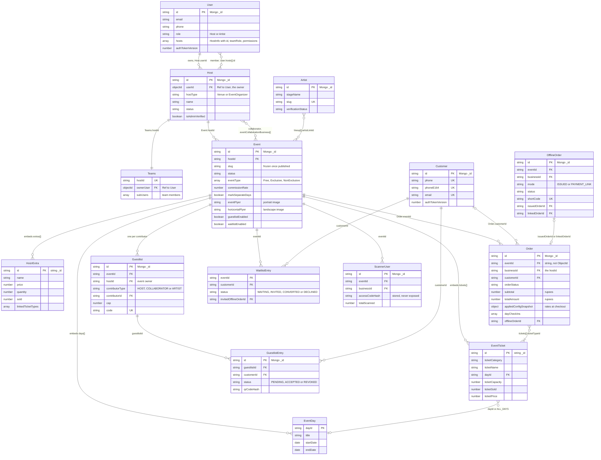
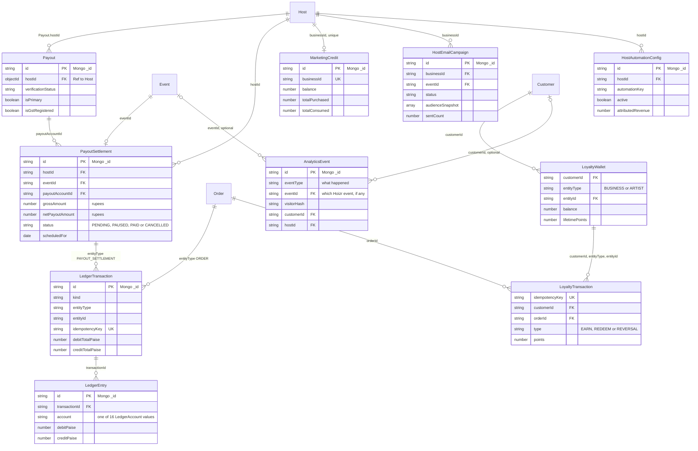

# Domain model and glossary

This chapter covers the data behind Hoizr: how each domain class is written once and reused by every backend, how the core entities relate, and how tenant data is kept apart. It then lists the conventions behind most "why does this query return nothing" bugs. It closes with a glossary, because the UI and the code often use different words for the same thing.

## TL;DR

- Each class in [`@hoizr-technology/shared`](https://github.com/roop37/hoizr-shared) carries a Typegoose `@prop` and a TypeGraphQL `@Field` on the same property. One class defines both the Mongo schema and the GraphQL type, and each service registers its own Mongoose model from it with `getModelForClass`.
- The tenant is the **Host** (a Venue or an Event Organizer). A signed-in `User` picks a host through a cookie, and the server refuses to act on that host unless it appears in the user's own `hosts[]` list.
- Most foreign keys are plain strings, not ObjectIds. That includes `Order.eventId` and the `_id` of embedded ticket and add-on subdocuments, so aggregation pipelines must match them as strings.
- The pricing engine and the double-entry ledger work in integer paise. Orders and settlements store rupee numbers.
- Times are stored as true UTC. Hosts enter them, and every surface displays them, in `Asia/Kolkata`.

## Contents

- [One class, two schemas](#one-class-two-schemas)
- [Entity-relationship diagrams](#entity-relationship-diagrams)
- [Entity reference](#entity-reference)
- [Multi-tenancy: hosts, collaborators and artists](#multi-tenancy-hosts-collaborators-and-artists)
- [Conventions and traps](#conventions-and-traps)
- [Glossary](#glossary)

## One class, two schemas

[`hoizr-shared`](https://github.com/roop37/hoizr-shared) is a TypeScript library published to GitHub Packages as `@hoizr-technology/shared`. Its [`src/schemas/`](https://github.com/roop37/hoizr-shared/tree/main/src/schemas) barrel, [`index.schema.ts`](https://github.com/roop37/hoizr-shared/blob/main/src/schemas/index.schema.ts), re-exports 60 schema files. Together they define 139 classes: top-level documents plus the sub-documents embedded in them.

Each class is decorated twice. `@prop` (Typegoose) describes the MongoDB path, and `@Field` (TypeGraphQL) describes the GraphQL field. Here is the door-scanner login, trimmed:

```ts
@ObjectType()
export class ScannerUser {
  @Field(() => ID)
  _id: string;
  // ...
  @Field(() => String)
  @prop({ required: true, index: true })
  businessId: string; // The host

  @Field(() => String)
  @prop({ required: true, index: true })
  eventId: string; // The specific event this scanner is for

  // Bcrypt-hashed access code. The plain code is generated once on creation
  // and returned in the mutation response — never queryable thereafter.
  @prop({ required: true })
  accessCodeHash: string;
  // ...
  @prop({ default: 0 })
  authTokenVersion: number;
```

Source: [`hoizr-shared/src/schemas/scanner-user.schema.ts`](https://github.com/roop37/hoizr-shared/blob/main/src/schemas/scanner-user.schema.ts)

Three things follow from this pattern:

1. **The database and the API cannot drift.** Renaming a field changes both the GraphQL type and the stored path in one edit.
2. **Some fields are stored but never exposed.** `accessCodeHash` and `authTokenVersion` above have `@prop` and no `@Field`, so no GraphQL query can select them. The same technique keeps `Order.paymentMeta` and the denormalised `Event.eventTicketSales` log out of the schema that clients can introspect ([`order.schema.ts`](https://github.com/roop37/hoizr-shared/blob/main/src/schemas/order.schema.ts), [`event.schema.ts`](https://github.com/roop37/hoizr-shared/blob/main/src/schemas/event.schema.ts)).
3. **The class lives here and the model lives in each consumer.** The package defines classes only. Each service registers a model on its own Mongoose connection and chooses the collection name:

```ts
import { ScannerUser } from "@hoizr-technology/shared";
import { getModelForClass } from "@typegoose/typegoose";

const ScannerUserModel = getModelForClass(ScannerUser, {
  schemaOptions: { timestamps: true, collection: "scannerusers" },
});

export { ScannerUser, ScannerUserModel };
```

Source: [`main-server/src/modules/scanner/schema/scanner-user.schema.ts`](https://github.com/roop37/main-server/blob/main/src/modules/scanner/schema/scanner-user.schema.ts). customer-server has an identical file, and the [`hoizr-worker`](https://github.com/roop37/hoizr-worker) repo registers its models in [`src/models/index.ts`](https://github.com/roop37/hoizr-worker/blob/main/src/models/index.ts).

The package never connects to a database itself. The one exception is `ActivityLogModel`, which is built inside [`activity-log.schema.ts`](https://github.com/roop37/hoizr-shared/blob/main/src/schemas/activity-log.schema.ts).

> [!NOTE]
> Only the three Node backends (main-server, customer-server, hoizr-worker) import the package at runtime. The Next.js apps get their types from GraphQL codegen instead, and copy the few constants they need, for example `ALL_DAYS_TICKET` in [`hoizr-client/src/lib/event-days.ts`](https://github.com/roop37/hoizr-client/blob/main/src/lib/event-days.ts). tracking-server hard-codes its one queue name for the same reason: the package barrel pulls in `type-graphql`, which that service does not install ([`src/utils/queue.ts`](https://github.com/roop37/tracking-server/blob/main/src/utils/queue.ts)).

## Entity-relationship diagrams

The model is split across two diagrams so each stays readable. Field names are the real property names, and `id PK` stands for Mongo's `_id`. "embeds" marks a sub-document array stored inside the parent document, not a separate collection.

### Tenancy, events and tickets



`Event` is the hub. Days, ticket types, add-ons (`HoizrExtra`), the lineup and the collaborator list are all embedded in it. Guestlists and waitlist entries live in their own collections; as the header comment in [`guestlist.schema.ts`](https://github.com/roop37/hoizr-shared/blob/main/src/schemas/guestlist.schema.ts) explains, that way an event edit can never wipe them.

### Money, marketing and engagement



Two naming notes. A `Payout` is the host's bank and GST profile, while a `PayoutSettlement` is one event's payout computation. In `AnalyticsEvent`, `eventType` is the kind of analytics event (`pageView`, `cartCreated` and so on), while `eventId` points at a Hoizr `Event`.

## Entity reference

"Owned by" lists the repos that register a model for the class with `getModelForClass`. Collection names come from that consumer code. Where no consumer sets one, Mongoose derives a default by lowercasing and pluralising the class name (marked \*); the masters module documents this rule in [`main-server/src/modules/masters/schema/index.schema.ts`](https://github.com/roop37/main-server/blob/main/src/modules/masters/schema/index.schema.ts).

| Entity | Collection | Owned by | Purpose |
|---|---|---|---|
| `User` | `users`\* | main-server, hoizr-worker | A person on the business side: an owner or a team member. `hosts[]` lists every organization they can act for, each with a `teamRole` and permissions. |
| `Teams` | `teams`\* | main-server, hoizr-worker | Per-host roster: `ownerUser` plus `subUsers[]`. |
| `Host` | `hosts`\* | main-server, customer-server, hoizr-worker | The tenant: a Venue or an Event Organizer (`hostType`). Blocked from operating until an admin sets `isAdminVerified`. |
| `Payout` | `payouts` | main-server, customer-server, hoizr-worker | The host's bank and GST profile. Checkout pricing reads it to decide whether ticket GST can be collected. |
| `Event` | `events` | main-server, customer-server, hoizr-worker | An event, with its days, tickets, add-ons, lineup, collaborators and denormalised sales log embedded. |
| `Customer` | `customers` | customer-server, main-server, hoizr-worker | A ticket buyer. Customers are platform-wide, not per host; `phone` is required and unique. |
| `Artist`, `PhantomArtist` | `artists`\*, `phantomartists`\* | main-server, customer-server (`Artist` also in hoizr-worker) | A performer account, and an off-platform placeholder used in a lineup. |
| `Order` | `orders` | customer-server, main-server, hoizr-worker | A ticket purchase: lines, pricing breakdown, config snapshot, Razorpay ids, QR hash, check-ins. |
| `OfflineOrder` | `offline_orders` | main-server, customer-server, hoizr-worker | A host-initiated sale: a cash ticket or a payment link. |
| `Coupon` | `coupons` | main-server, customer-server, hoizr-worker | A host promo code, unique per (`host`, `code`). Loyalty rewards also mint personal coupons here. |
| `Guestlist`, `GuestlistEntry` | `guestlists`, `guestlist_entries` | main-server, customer-server | One list per (event, contributor), and one entry per guest with its own QR. |
| `WaitlistEntry` | `waitlist_entries` | main-server, customer-server, hoizr-worker | One per (event, customer), enforced by a unique index on the pair. |
| `ScannerUser` | `scannerusers` | main-server, customer-server, hoizr-worker | A per-event door login with a hashed one-time access code. |
| `LedgerTransaction`, `LedgerEntry` | `ledger_transactions`, `ledger_entries` | main-server, hoizr-worker | Append-only double-entry ledger in paise. `idempotencyKey` is unique. |
| `PayoutSettlement` | `payout_settlements` | main-server, hoizr-worker | One event's payout computation and its manual-settlement status. |
| `Invoice` | `invoices` | main-server, customer-server, hoizr-worker | Tax documents with `*Paise` amounts and a unique `invoiceNumber`. |
| `MarketingCredit` | `marketingcredits`\* | main-server, hoizr-worker | The host's prepaid marketing wallet, one per host. |
| `HostEmailCampaign` | `hostemailcampaigns`\* | main-server, hoizr-worker | Email campaign with an `audienceSnapshot[]` and a `sentCount` resume cursor. WhatsApp (`host_whatsapp_campaigns`) and push campaigns follow the same shape. |
| `HostAutomationConfig` | `host_automation_configs` | main-server, hoizr-worker | Per-host switch and channel toggles for each built-in automation, unique per (`hostId`, `automationKey`). |
| `LoyaltyWallet` | `loyalty_wallets` | main-server, customer-server, hoizr-worker | Points balance per (customer, BUSINESS or ARTIST, entity). |
| `LoyaltyTransaction` | `loyalty_transactions` | customer-server, hoizr-worker | Points ledger row (EARN, REDEEM, REVERSAL) with a unique `idempotencyKey`. |
| `LoyaltyReward` | `loyalty_rewards` | main-server, customer-server | A host-defined reward that is redeemed into a personal coupon. |
| `AnalyticsEvent` | `analytics_events` (set in the shared class) | hoizr-worker (writes), main-server (reads) | Append-only behaviour events from the storefront and the order path. |
| `Config` | `configs`\* | main-server, customer-server, hoizr-worker | Admin-editable tunables (fees, commission defaults, refund window, per-send marketing rates), keyed by `ConfigTypeEnum`. |

> [!WARNING]
> When several services register the same class, they must agree on the collection name. If one sets `collection:` and another does not, they silently read and write two different collections. Marketing credits once hit this: main-server pinned a snake_case name, hoizr-worker used the default, and every host campaign failed with "insufficient marketing credit". Every service now uses the default, and a one-off script moved the old data ([`marketing-credit.schema.ts`](https://github.com/roop37/main-server/blob/main/src/modules/marketingCredit/schema/marketing-credit.schema.ts), [`scripts/migrate-marketing-credit-collections.ts`](https://github.com/roop37/main-server/blob/main/scripts/migrate-marketing-credit-collections.ts)).

## Multi-tenancy: hosts, collaborators and artists

All services share one database. Isolation is enforced in application code by scoping every query to a tenant id.

### The host is the tenant

Host-owned documents carry the host's id. The field name varies for historical reasons: `Event.hostId`, `Guestlist.hostId`, `PayoutSettlement.hostId`, `HostAutomationConfig.hostId`, `Coupon.host`, and `businessId` on `Order`, `OfflineOrder`, `ScannerUser`, `MarketingCredit` and campaigns. `businessId` always holds the host's id.

A business user can belong to several hosts. The selected host travels in an HTTP-only cookie, and main-server copies it into `ctx.hostId` when it builds the GraphQL context ([`main-server/src/index.ts`](https://github.com/roop37/main-server/blob/main/src/index.ts)). The cookie alone grants nothing. Host-scoped resolvers pass through middleware (`hasHostAccess`, `loadPermissions`), and both call `getCurrentHostContext`, which only accepts a host listed in the user's own membership:

```ts
  const hostInfo = (user.hosts ?? []).find(
    (host) =>
      getHostInfoId(host) === ctx.hostId &&
      host.isDeleted !== true &&
      host.isActive !== false
  );

  if (!hostInfo) {
    throw new ErrorWithProps(unauthorisedErrMessage);
  }
```

Source: [`main-server/src/utils/hostContext.ts`](https://github.com/roop37/main-server/blob/main/src/utils/hostContext.ts)

The same lookup returns the member's `teamRole` (Owner, Manager, Marketing, Staff) and permission list, drawn from 11 permission types such as `Events`, `Orders` and `Marketing` ([`master.enum.ts`](https://github.com/roop37/hoizr-shared/blob/main/src/enums/master.enum.ts)). A second gate, `isAdminVerifiedHost` in [`authorisation.ts`](https://github.com/roop37/main-server/blob/main/src/middlewares/authorisation.ts), blocks operational mutations until an internal admin has verified the selected host. [Auth and RBAC](./03-auth-and-rbac.md) covers both layers in depth.

### Collaborators share an event, not a tenant

A collaborator is another host invited onto one event. The link is an `EventBusinessPartner` entry in `Event.eventCollaborationBusiness[]`, keyed by `businessLinkId`. It has a `collaborationStatus` (Invited, Confirmed or Declined, defaulting to Confirmed) and capability flags set by the event owner: `canSeeMetrics`, `canRunCampaigns`, `allowIssuingOfflineTickets`, `requestCustomerListAccess` and others. Services check the flag for the action at hand:

```ts
    const isOwner = String(event.hostId) === String(hostId);
    // A collaborator may issue ONLY if the owner granted them
    // allowIssuingOfflineTickets (and they're a confirmed collaborator).
    const myCollab = (event.eventCollaborationBusiness ?? []).find(
      (p: any) => String(p?.businessLinkId) === String(hostId)
    );
    const isCollaborator = Boolean(myCollab);
    const collabCanIssue =
      isCollaborator && myCollab?.allowIssuingOfflineTickets === true;
    if (!isOwner && !collabCanIssue) {
      throw new ErrorWithProps(
        "You don't have permission to issue offline tickets for this event"
      );
    }
```

Source: [`main-server/src/modules/offlineTicket/service/offline-ticket.service.ts`](https://github.com/roop37/main-server/blob/main/src/modules/offlineTicket/service/offline-ticket.service.ts)

### Artists, customers and scanners

- **Artists** have their own collection and their own cookie scope (`ctx.artistId` in [`context.type.ts`](https://github.com/roop37/main-server/blob/main/src/types/context.type.ts)). An artist sees an event only when their id is in that event's lineup (`"lineup.artistLinkId": artistId` in [`artist-lineup.service.ts`](https://github.com/roop37/main-server/blob/main/src/modules/artistAccount/service/artist-lineup.service.ts)), and manages only the guestlist whose `contributorType` is `ARTIST` and whose `contributorId` is theirs.
- **Customers** are global: a customer has no `hostId`. A host's customer list is the set of customers who follow it (`Customer.followingBusiness[].targetId`). The post-purchase worker adds that follow automatically after a paid order, and spend figures are aggregated only over the host's own orders ([`host-customer.service.ts`](https://github.com/roop37/main-server/blob/main/src/modules/hostCustomers/service/host-customer.service.ts)).
- **Scanners** are the narrowest scope. A `ScannerUser` is bound to one `eventId` and one `businessId`, and customer-server carries both as `scannerEventId` and `scannerBusinessId` on its context ([`customer-server/src/types/context.type.ts`](https://github.com/roop37/customer-server/blob/main/src/types/context.type.ts)).

## Conventions and traps

Most of these stay invisible until a query quietly returns zero rows, so read them before you write one.

### Money: paise for arithmetic, rupees on orders

The checkout pricing engine converts every amount to integer paise, does all its arithmetic there, rounds each percentage step to the nearest paise, and converts back only at the end:

```ts
// rupees → integer paise (nearest paise; handles any fractional input).
const toPaise = (rupees: number): number => Math.round(Number(rupees) * 100);
// integer paise → rupees, exact for a paise integer.
const toRupees = (paise: number): number => paise / 100;
```

Source: [`customer-server/src/modules/cart/service/cart-pricing.ts`](https://github.com/roop37/customer-server/blob/main/src/modules/cart/service/cart-pricing.ts). The same function throws if the components do not sum exactly to the total.

Storage is mixed, so check which unit you are in:

| Where | Unit | Fields |
|---|---|---|
| `Order`, `PayoutSettlement`, `MarketingCredit` | rupees (JS number) | `subtotal`, `platformFee`, `totalAmount`, `netPayoutAmount`, `balance` |
| `LedgerTransaction`, `LedgerEntry`, `Invoice` | integer paise | `debitTotalPaise`, `debitPaise`, `creditPaise`, `totalAmountPaise` |

The ledger poster coerces every line to a non-negative integer and rejects a transaction whose debits and credits differ ([`post-transaction.ts`](https://github.com/roop37/hoizr-shared/blob/main/src/ledger/post-transaction.ts)). Each order also carries a required `appliedConfigSnapshot` of the fee, GST and commission rates in force at checkout, so the order's own breakdown never changes when an admin edits `Config`. Settlement does not read that snapshot yet: it recomputes commission from the event's current `commissionRate`, which is a known limitation. [Payments and money](./06-payments-and-money.md) walks through the full math.

### Time: store UTC, enter and display IST

India has one time zone and no daylight saving. The rule: store true UTC instants, and convert to and from `Asia/Kolkata` at every human boundary. On save, the host's wall-clock input goes through `fromZonedTime(value, IST_TZ)`. On read, the stored instant goes through `formatInTimeZone`. The two calls are always used as a pair:

```ts
// Platform timezone. Hosts enter event wall-clock times in IST and we store true
// UTC instants; every interpret/display goes through this single zone (India has
// no DST). See toDateTimeInput / fromZonedTime usages below.
const IST_TZ = "Asia/Kolkata";
// ...
// Convert a stored UTC instant into the "YYYY-MM-DDTHH:mm" wall-clock string the
// datetime pickers expect, rendered in IST. Pairs with the fromZonedTime(...,IST)
// conversions on save: an instant of 2026-06-26T13:15Z reads back as the IST
// wall-clock "2026-06-26T18:45" — matching what the customer site shows.
const toDateTimeInput = (value?: string | Date | null) => {
  if (!value) return "";
  const date = new Date(value);
  if (Number.isNaN(date.getTime())) return "";
  return formatInTimeZone(date, IST_TZ, "yyyy-MM-dd'T'HH:mm");
};
```

Source: [`business-client/components/modules/events/EventJourney.tsx`](https://github.com/roop37/business-client/blob/main/components/modules/events/EventJourney.tsx)

The same zone drives the storefront's date rendering, the worker cron scheduler (`CRON_TIMEZONE` in [`cron.scheduler.ts`](https://github.com/roop37/hoizr-worker/blob/main/src/workers/crons/cron.scheduler.ts)) and the scanner app ([`lib/utils/ist_time.dart`](https://github.com/roop37/hoizr-scanner-app/blob/main/lib/utils/ist_time.dart)). Parse a picker value with a bare `new Date()` and it is read in the browser's zone, which shifts the event.

### Subdocument `_id`s are strings

`EventTicket._id` and `HoizrExtra._id` are declared `@prop({ auto: true }) _id: string`, and main-server mints them as `new Types.ObjectId().toString()`. They look like ObjectIds but are stored as 24-character strings. Orders refer to them as `tickets[].ticketTypeId` and `extras[].extraId`. Every comparison has to use the string, especially inside `$expr`, where nothing casts for you. The inventory update that finalises a free order shows the pattern:

```ts
        for (const line of orderTickets) {
          const ticketId = String(line.ticketTypeId);
          const r = await EventModel.updateOne(
            {
              _id: event._id,
              "tickets._id": ticketId,
              $expr: {
                $let: {
                  vars: { t: { $arrayElemAt: [{ $filter: { input: "$tickets", as: "t", cond: { $eq: ["$$t._id", ticketId] } } }, 0] } },
                  in: { $lte: [{ $add: ["$$t.ticketSold", Number(line.quantity)] }, "$$t.ticketCapacity"] },
                },
              },
            },
            { $inc: { "tickets.$.ticketSold": Number(line.quantity) } },
            { session }
          );
          if (r.matchedCount === 0) {
            throw new ErrorWithProps(`${line.ticketName ?? "Ticket"} is no longer available`);
          }
```

Source: [`customer-server/src/modules/order/service/order.service.ts`](https://github.com/roop37/customer-server/blob/main/src/modules/order/service/order.service.ts). Wrap the id in `new ObjectId(...)` and the `$eq` never matches, so every sale fails as "no longer available". The same filter also enforces capacity atomically: the increment applies only while `ticketSold + quantity <= ticketCapacity`.

### `orders.eventId` is a string

`Order.eventId` is declared `string` ([`order.schema.ts`](https://github.com/roop37/hoizr-shared/blob/main/src/schemas/order.schema.ts)). So are `Event.hostId`, `Order.businessId`, `Guestlist.eventId` and most other references. Only a few older fields are real ObjectId refs (`Host.userId`, `Payout.hostId`, `Teams.ownerUser`). Mongoose casts `find()` filters to the schema type, so a `find` with an ObjectId usually still works. It does **not** cast `aggregate()` pipelines, so `$match: { eventId: new ObjectId(id) }` against `orders` returns zero rows and no error. Pass `String(event._id)`, as the services do throughout ([`guestlist.service.ts`](https://github.com/roop37/main-server/blob/main/src/modules/guestlist/service/guestlist.service.ts) is a good example). Note too that the status field on an order is `orderStatus`, not `status`.

### GraphQL sends enum keys, MongoDB stores enum values

TypeGraphQL serialises an enum by its **key**. Older Hoizr enums have keys that differ from their stored values:

```ts
export enum OrderStatus {
  PAYMENT_PENDING = "PaymentPending",
  PAYMENT_SUCCESS = "PaymentSuccess",
  // ...
}
registerEnumType(OrderStatus, { name: "OrderStatus" });
```

Source: [`hoizr-shared/src/enums/ticket.enum.ts`](https://github.com/roop37/hoizr-shared/blob/main/src/enums/ticket.enum.ts). The generated client type shows what actually arrives over the wire:

```ts
export enum OrderStatus {
  // ...
  PaymentPending = 'PAYMENT_PENDING',
  PaymentSuccess = 'PAYMENT_SUCCESS',
```

Source: [`hoizr-client/src/generated/graphql.ts`](https://github.com/roop37/hoizr-client/blob/main/src/generated/graphql.ts)

So MongoDB holds `"PaymentSuccess"` while a browser receives `"PAYMENT_SUCCESS"`. Compare against the generated enum on the client and the shared enum on the server, never against a hand-typed string. Newer enums avoid the problem by making each value equal to its key: `EventLineupArtistStatus` (the comment in [`event.enum.ts`](https://github.com/roop37/hoizr-shared/blob/main/src/enums/event.enum.ts) explains why), plus the guestlist, waitlist, loyalty and settlement enums.

### Slugs are permanent once an event is published

Shared links, search results and QR landing pages all point at `/events/<slug>`. The slug is generated from the title, made unique by appending `-1`, `-2` and so on, and regenerated on a title change **only while the event is Draft or Pending**:

```ts
        // A published event's slug is PERMANENT — shared links, SEO, and QR
        // landing pages all point at it. Regenerating it on a title tweak
        // (even a capitalization fix) 404s the live page. Only (re)generate the
        // slug while the event is still pre-publish (Draft/Pending), and exclude
        // this event from the uniqueness check so it can't collide with itself.
        const isPrePublish =
          !existing?.status ||
          existing.status === EventStatus.DRAFT ||
          existing.status === EventStatus.PENDING;
```

Source: [`main-server/src/modules/event/service/event.service.ts`](https://github.com/roop37/main-server/blob/main/src/modules/event/service/event.service.ts). Uniqueness comes from a lookup loop in `generateUniqueSlug` rather than a unique index on `Event.slug`; adding that index is a small hardening opportunity.

## Glossary

The UI and the code use different words for several of the same concepts. This table maps between them.

| Term | Meaning in Hoizr |
|---|---|
| **Host** (code) / **Venue**, **Event Organizer** (UI) | The business account and tenant. Code says `Host` and `hostId`; user-facing copy avoids the word "host". Onboarding offers "Venue" and "Event Organizer" ([`hostTypeSelection.tsx`](https://github.com/roop37/business-client/blob/main/components/modules/onboarding/hostTypeSelection.tsx)), which map to `HostType.VENUE` and `HostType.EVENT_ORG` ([`host.enum.ts`](https://github.com/roop37/hoizr-shared/blob/main/src/enums/host.enum.ts)). Some dashboard copy, such as the login carousel, says "event organizations", and the internal admin console lists hosts under "Organizers". |
| **`businessId`** | Another name for the host's id, used on orders, offline orders, scanners, marketing credit and campaigns. |
| **User / Customer / Artist / Admin / ScannerUser** | Five separate identity collections: business-side people, ticket buyers, performers, internal staff and per-event door logins. Each has its own `authTokenVersion` for global sign-out. |
| **Team member** | A `User` attached to a host with a `TeamRole` (Owner, Manager, Marketing, Staff) and per-permission toggles. |
| **Collaborator** | Another host co-presenting an event: an `EventBusinessPartner` entry with an owner-controlled capability flag for each sensitive action. |
| **Lineup** | `Event.lineup[]`. Each entry points at an on-platform `Artist` (`artistLinkId`) or a `PhantomArtist` placeholder (`tempArtistId`). New entries are auto-accepted, and the artist can reject from their dashboard (`EventLineupArtistStatus`). |
| **Contributor** | The owner of a guestlist on an event: `HOST`, `COLLABORATOR` or `ARTIST` (`GuestlistContributorType`). |
| **Guestlist** | One `Guestlist` per (event, contributor), with a `cap`, a private join `code` and `isPublic`, `isOpen`, `manageEnabled` and `isHighlighted` switches. Not to be confused with `TicketCategory.GUESTLIST`, a category on a ticket type. |
| **Golden pass** (also "golden ticket") | An `ACCEPTED` `GuestlistEntry`. It carries its own QR and triggers the "guestlist accepted" email ([`guestlist-accepted.hbs`](https://github.com/roop37/hoizr-worker/blob/main/src/email/templates/transactional/lifecycle/guestlist-accepted.hbs)). It can be revoked until 2 hours before the event starts (`REVOKE_CUTOFF_MS` in [`guestlist.service.ts`](https://github.com/roop37/main-server/blob/main/src/modules/guestlist/service/guestlist.service.ts)). |
| **Multi-day event, `EventDay`, `dayId`** | `Event.days[]` is present only when `markSeparateDays` is on and the event spans more than one day. A ticket's `dayId` is one specific day, the sentinel `ALL_DAYS` for a festival pass ([`constants/event-days.ts`](https://github.com/roop37/hoizr-shared/blob/main/src/constants/event-days.ts)), or null on a single-day event. Orders snapshot `dayId` per line and record `dayCheckIns[]`. A ticket scanned on the wrong day returns `WRONG_DAY`, one of 12 `ScanResultStatus` values ([`scanner.objects.ts`](https://github.com/roop37/customer-server/blob/main/src/modules/scanner/interfaces/scanner.objects.ts)). Helpers live in [`utils/event-days.ts`](https://github.com/roop37/hoizr-shared/blob/main/src/utils/event-days.ts). |
| **Landscape image** (UI) / **`horizontalFlyer`** (field) | The 16:9 hero and social-preview image, cropped to 1600×900. `eventFlyer` is the portrait card image, cropped to 3:4 (900×1200). The UI renamed "horizontal flyer" to "landscape image" and kept the field name for compatibility (`flyerCropTargets` in [`EventJourney.tsx`](https://github.com/roop37/business-client/blob/main/components/modules/events/EventJourney.tsx)). |
| **Extras** | `HoizrExtra` add-ons (upgrades, merch, food and drink) sold alongside tickets. `linkedTicketTypes` can limit an extra to certain tickets. |
| **Event type** | `EventType`: `Free`, `Exclusive` (tickets sold only on Hoizr) or `NonExclusive` (also sold on other platforms). The type picks the default commission rate. |
| **RSVP / free order** | "RSVP" is the UI label for two things: a `Free`-type event, and the `GUESTLIST` ticket category in the host's ticket form. The storefront shows "RSVP" instead of "Free" ([`event-display.ts`](https://github.com/roop37/hoizr-client/blob/main/src/lib/event-display.ts)). Any order whose total is zero, whether an RSVP or a coupon covering the whole price, goes through `finalizeFreeOrder`: it is marked paid at once with a `free_<orderId>` payment id, and the worker writes an audit-only `ORDER_FREE_ISSUED` ledger row with no money lines. |
| **Offline ticket** | An `OfflineOrder` created by the host, or by a collaborator with `allowIssuingOfflineTickets`. In `ISSUED` mode the cash was collected in person: main-server makes an HMAC-signed call and customer-server creates a scannable order immediately, recording the buyer in `Order.guestInfo` and linking a customer account only if one already exists. In `PAYMENT_LINK` mode the customer signs in and pays through a short link at `hoizr.com/t/<shortCode>` ([`page.tsx`](https://github.com/roop37/hoizr-client/blob/main/src/app/t/%5BshortCode%5D/page.tsx)) using the normal checkout. Either way, only customer-server creates an `Order`. |
| **Superseded order** | When a customer creates or completes an order for an event, their other pending orders for that event move to `SUPERSEDED`. |
| **Waitlist** | `WaitlistEntry` per (event, customer): WAITING, then INVITED (the host sends a payment link), then CONVERTED, or else DECLINED. `Event.waitlistOnly` hides normal checkout. Unrelated to the pre-launch marketing waitlist. |
| **Platform fee vs commission** | The platform fee (plus GST on it) is added to the **customer's** total at checkout. Commission (`Event.commissionRate`) is deducted from the **host's** payout. The rate is stamped at publish from an admin config by event type, and an admin can change it until the event starts. |
| **Settlement** | A `PayoutSettlement` row per event. An admin computes it from Razorpay-paid orders (offline cash and fully refunded orders are excluded). It falls due at event end plus a configurable refund window plus one buffer day. The admin transfers the money outside the platform, then marks the row `PAID`, which posts `SETTLEMENT_COMMISSION` and `PAYOUT_RELEASED` ledger transactions. The schema comment puts it plainly: "NO code moves money" ([`payout-settlement.schema.ts`](https://github.com/roop37/hoizr-shared/blob/main/src/schemas/payout-settlement.schema.ts)). |
| **Marketing credit** | A prepaid wallet per host (`MarketingCredit.balance`), topped up through Razorpay. WhatsApp campaign sends (through MSG91, feature-flagged) debit the host that created the campaign, `campaign.businessId` ([`host-whatsapp-campaigns.process.ts`](https://github.com/roop37/hoizr-worker/blob/main/src/workers/host-whatsapp-campaigns/host-whatsapp-campaigns.process.ts)). Paid automation sends debit the event's owner, `event.hostId` (for example [`selling-fast.worker.ts`](https://github.com/roop37/hoizr-worker/blob/main/src/workers/selling-fast/selling-fast.worker.ts)), at per-channel rates read from `Config` ([`marketing-credit-charge.ts`](https://github.com/roop37/hoizr-worker/blob/main/src/utils/marketing-credit-charge.ts)). |
| **Automation key** | The id of a built-in automation in [`registry.ts`](https://github.com/roop37/main-server/blob/main/src/modules/automations/registry.ts): `waitlist_tickets_open`, `retarget_abandoned`, `selling_fast`, `milestone_message`, `new_event_to_followers`. |
| **Loyalty points** | Points earned per paid order, credited separately to the host, to each on-platform collaborator and to each on-platform lineup artist (`LoyaltyEntityType` BUSINESS or ARTIST; see [`loyalty-accrual.ts`](https://github.com/roop37/hoizr-worker/blob/main/src/utils/loyalty-accrual.ts)). Customers redeem them for a host-defined `LoyaltyReward`, which mints a single-use coupon bound to that customer. |
| **Masters / Config** | Admin-managed lookup data (cities, categories, genres, languages, prohibited items) and runtime tunables stored as `Config` rows. |
| **Scanner access code** | A one-time code the host generates for each scanner. It is stored only as a bcrypt hash and exchanged for a scanner JWT at the door. |

<!-- SCREENSHOT: business-event-create | Event creation journey showing the portrait flyer crop and the landscape image (16:9) upload side by side -->

---

Related chapters: [System architecture](./01-system-architecture.md) · [Auth and RBAC](./03-auth-and-rbac.md) · [Background jobs with BullMQ](./04-background-jobs-bullmq.md) · [Redis and concurrency](./05-redis-and-concurrency.md) · [Payments and money](./06-payments-and-money.md) · [Tracking and analytics](./07-tracking-and-analytics.md) · [Frontend architecture](./08-frontend-architecture.md) · [Engineering decisions](./11-engineering-decisions.md) · [Known gaps and roadmap](./12-known-gaps-and-roadmap.md)

[Back to the walkthrough](../README.md)
