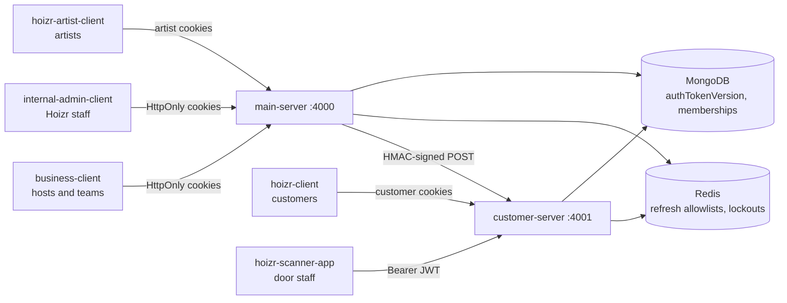
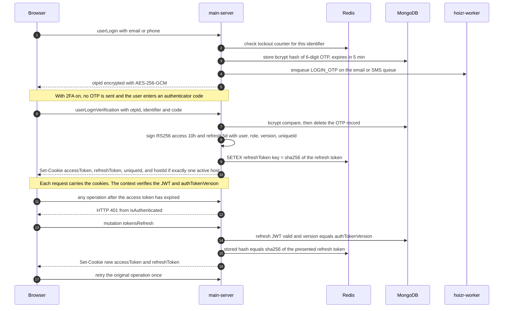
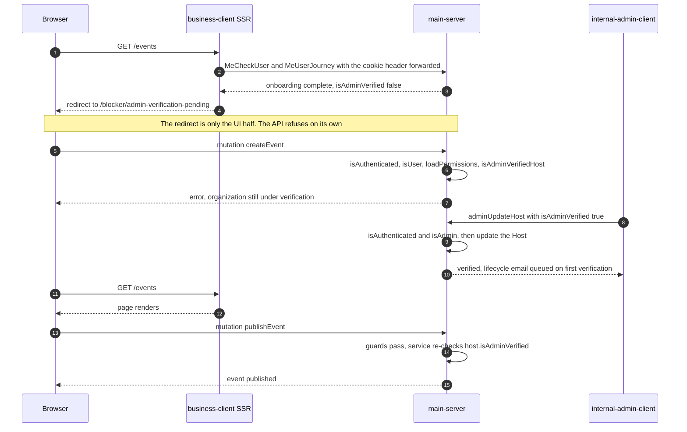
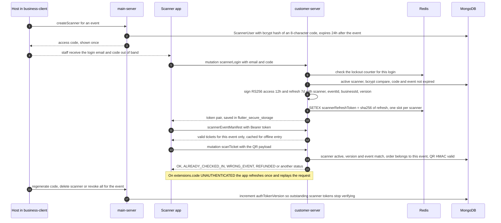

# Authentication and RBAC

Hoizr has six kinds of principal spread across two GraphQL APIs: host users and their teams, internal admins, artists, customers, door-scanner devices, and one backend service calling another. This chapter shows how each one signs in, how tokens are minted, stored and revoked, and how a composable guard chain plus tenant-scoped queries decide what each principal may touch. Every mechanism links to the file that implements it.

## TL;DR

- **Two APIs, six realms.** [`main-server`](https://github.com/roop37/main-server) serves hosts, their teams, internal admins and artists. [`customer-server`](https://github.com/roop37/customer-server) serves customers and scanner devices, and accepts one HMAC-signed internal call from main-server.
- **One token design.** Every session is an RS256 access/refresh JWT pair, delivered as HttpOnly cookies (or a Bearer token for the Flutter scanner). A per-principal `authTokenVersion` counter revokes every outstanding token with one write.
- **Refresh tokens are allow-listed in Redis per device**, mostly as SHA-256 hashes.
- **Authorization is a guard chain plus scoped queries.** `@UseMiddleware` chains such as `isAuthenticated → isUser → loadPermissions → isAdminVerifiedHost` run first, then services check granular permissions and put the tenant id inside every MongoDB filter.
- **New organizations are gated until an admin verifies them**: a dashboard redirect for the UI, and 62 GraphQL operations that refuse on their own.

## Contents

- [Identity realms](#identity-realms)
- [Token design](#token-design)
- [GraphQL context and the guard chain](#graphql-context-and-the-guard-chain)
- [Roles and permissions](#roles-and-permissions)
- [Multi-tenant scoping and IDOR protection](#multi-tenant-scoping-and-idor-protection)
- [Host verification gate](#host-verification-gate)
- [Client-side enforcement](#client-side-enforcement)
- [Scanner authentication](#scanner-authentication)
- [Service-to-service HMAC](#service-to-service-hmac)
- [Hardening roadmap](#hardening-roadmap)

## Identity realms

| Realm | Who | API | How they sign in | Session transport | Entry guard |
|---|---|---|---|---|---|
| Host user | Venue or organizer owner (`User`, role `Host`) | main-server | 6-digit OTP by email or by SMS (MSG91). A TOTP code replaces the OTP when 2FA is on | HttpOnly cookies `accessToken`, `refreshToken`, `uniqueId`, plus the tenant selector `hostId` | `isAuthenticated`, `isUser` |
| Team member | Another `User` with a `TeamRole` and per-host permissions | main-server | Emailed RS256 verification link (24 hours), then the host login | Same cookies | Same, plus `loadPermissions` |
| Internal admin | Hoizr staff (`Admin`, with an `AdminRole`) | main-server | Email OTP | Same cookie names. The token's role picks the `Admin` collection | `isAuthenticated`, `isAdmin` |
| Artist | Performer (`Artist`) | main-server | SMS OTP | Separate `artistAccessToken`, `artistRefreshToken`, `artistUniqueId`, `artistId` cookies | `isArtistAuthenticated` |
| Customer | Ticket buyer (`Customer`) | customer-server | Phone OTP by SMS, plus WhatsApp when that flagged channel is live. Or a Google ID token, with a phone OTP for new accounts. Sign in with Apple is scaffolded, not enabled | `customerAccessToken`, `customerRefreshToken`, `customerUniqueId` cookies, or a Bearer header | `isCustomerAuthenticated` |
| Scanner device | Door staff for one event (`ScannerUser`) | customer-server | Name-derived login email plus a one-time 8-character access code | `Authorization: Bearer <jwt>` from `flutter_secure_storage` | `isScannerAuthenticated` |
| Service | main-server calling customer-server | customer-server `/internal/*` | HMAC-SHA256 over `timestamp.rawBody` | `x-hoizr-internal-ts`, `x-hoizr-internal-sig` headers | `verifyInternalRequest` |



Guests never authenticate. They hold a bearer artifact, such as an HMAC-signed ticket QR code or a guestlist pass. Buying a ticket always requires a signed-in customer, even from a host's offline payment link ([`order.resolver.ts`](https://github.com/roop37/customer-server/blob/main/src/modules/order/resolver/order.resolver.ts)).

## Token design

### One keypair, claim-shaped realms

All JWTs are signed with [jsonwebtoken](https://github.com/auth0/node-jsonwebtoken) using RS256, and every verifier pins `algorithms: ["RS256"]`. Each realm has its own claims:

| Realm | Claims | Signed in |
|---|---|---|
| Host user, admin | `{user, role, version, uniqueId}` | [`main-server/src/utils/jwt.ts`](https://github.com/roop37/main-server/blob/main/src/utils/jwt.ts) |
| Artist | `{artistId, version, uniqueId}` | [`main-server/src/utils/jwt-artist.ts`](https://github.com/roop37/main-server/blob/main/src/utils/jwt-artist.ts) |
| Customer | `{customer, version, uniqueId}` | [`customer-server/src/utils/jwt.ts`](https://github.com/roop37/customer-server/blob/main/src/utils/jwt.ts) |
| Scanner | `{scanner, eventId, businessId, version}` | same file |

Each verifier reads only its own claims and reloads the subject from its own collection, so a customer token never resolves to a host.

> [!IMPORTANT]
> `PUBLIC_KEY` and `PRIVATE_KEY` hold the **base64 encoding of the PEM**, because the code decodes them with `Buffer.from(value, "base64")`. main-server and customer-server must use the same pair, and `ENCRYPTION_KEY` and `INTERNAL_SERVICE_SECRET` must also match across the two services.

### Lifetimes and the refresh allowlist

| Realm | Access | Refresh | Redis allowlist key | Stored value |
|---|---|---|---|---|
| Host user | 10 h | 5 d | `refreshToken:<userId>:<uniqueId>` | SHA-256 hash |
| Internal admin | 10 h | 5 d | `adminRefreshToken:<adminId>:<uniqueId>` | SHA-256 hash |
| Artist | 10 h | 30 d | `artistRefreshToken:<artistId>:<uniqueId>` | Token value |
| Customer | 10 h | 90 d | `customerRefreshToken:<customerId>:<uniqueId>` | SHA-256 hash |
| Scanner | 12 h | 7 d | `scannerRefreshToken:<scannerId>` (one slot) | SHA-256 hash, rotated on every refresh |

A refresh token works only while its signature verifies, its `version` claim equals the principal's `authTokenVersion`, and Redis holds a matching entry for that device. Storing a hash means a Redis dump hands out no usable sessions. The host check in `refreshAuthTokens` ([`jwt.ts`](https://github.com/roop37/main-server/blob/main/src/utils/jwt.ts)):

```ts
const hashToken = (token: string): string =>
  crypto.createHash("sha256").update(token).digest("hex");
// ...
      if (!user || user.authTokenVersion !== payload.version) {
        return null;
      }

      const storedHash = await redisClient.get(
        `${tokenName}:${user._id}:${payload.uniqueId}`
      );
      if (!storedHash || storedHash !== hashToken(rToken)) {
        return null;
      }
```

The `tokensRefresh` mutation ([`auth.service.ts`](https://github.com/roop37/main-server/blob/main/src/modules/auth/service/auth.service.ts)) runs this only after confirming the current access token no longer verifies, then sets fresh cookies.

### Cookies

In production, or whenever `COOKIE_DOMAIN` is set (for example `.hoizr.com`, so the API and dashboards share cookies), every auth cookie is `HttpOnly; Secure; SameSite=None; Path=/` plus that domain. Locally it is `HttpOnly; Path=/`, and customer-server adds `SameSite=Lax` ([main-server `cookie.ts`](https://github.com/roop37/main-server/blob/main/src/utils/cookie.ts), [customer-server `cookie.ts`](https://github.com/roop37/customer-server/blob/main/src/utils/cookie.ts)). Cookie max-age equals the refresh-token lifetime; a comment records that an earlier value of roughly 1,000 years outlived the tokens inside. When `COOKIE_DOMAIN` is set, the setter first clears any host-only copy, so the browser never sends two values under one name. Both flag sets are pinned by assert-based tests ([main-server](https://github.com/roop37/main-server/blob/main/src/tests/cookie-options.test.ts), [customer-server](https://github.com/roop37/customer-server/blob/main/src/tests/cookie-options.test.ts)).

### Per-device ids and global revocation

Every host login mints a `uniqueId` with `nanoid(8)`. It goes into the token, the `uniqueId` cookie, and the user's `accessHistory` with the parsed device and browser ([`user.service.ts`](https://github.com/roop37/main-server/blob/main/src/modules/user/services/user.service.ts)). That gives three levels of sign-out:

| Action | Effect |
|---|---|
| `userLogout` | Deletes this device's Redis key and clears the cookies |
| `userLogoutFromEverywhere` | Deletes every other device's key, increments `authTokenVersion`, then reissues tokens for the current device only |
| Bump `authTokenVersion` | Every access and refresh token for that principal fails on its next use |

Every verifier reloads the principal and compares `payload.version` with `authTokenVersion`: one indexed read per request, in exchange for revocation on the next request rather than at expiry. The counter is also bumped by admin access revocation in [`admin.service.ts`](https://github.com/roop37/main-server/blob/main/src/modules/admin/service/admin.service.ts) (whose block and role-change paths also clear refresh keys) and by the scanner revocation paths [below](#scanner-authentication).

### OTP hashing and lockout

OTPs are handled in [`main-server/.../otp.service.ts`](https://github.com/roop37/main-server/blob/main/src/modules/otp/services/otp.service.ts) and [`customer-server/.../otp.service.ts`](https://github.com/roop37/customer-server/blob/main/src/modules/otp/service/otp.service.ts):

- The code is 6 digits from `crypto.randomInt`. Only a **bcrypt hash** (cost 10) is stored, with a 5-minute expiry.
- A new request deletes older codes for that identifier, and a successful check deletes the record, so each code works once.
- The client gets an `otpId` encrypted with AES-256-GCM ([`crypt.ts`](https://github.com/roop37/main-server/blob/main/src/utils/crypt.ts)), never the raw record id.
- Delivery is a queued email or SMS job sent by [`hoizr-worker`](https://github.com/roop37/hoizr-worker). A fixed development code works only when `SERVER_ENV=development`.

Brute force is throttled by a per-identifier Redis counter ([`rateLimit.ts`](https://github.com/roop37/main-server/blob/main/src/utils/rateLimit.ts)) with a one-hour window. At the fifth failure the key's TTL becomes a 15-minute lockout that doubles with every further failure. It guards host login, signup, admin login and artist OTP. customer-server runs the same backoff as an atomic Lua script for customer OTP and scanner login, plus fixed-window per-IP and platform-wide caps on OTP sends ([`rateLimit.ts`](https://github.com/roop37/customer-server/blob/main/src/utils/rateLimit.ts), tested in [`rate-limit-enforce.test.ts`](https://github.com/roop37/customer-server/blob/main/src/tests/rate-limit-enforce.test.ts)). See [Redis and concurrency](./05-redis-and-concurrency.md#rate-limiting) for why there are two limiter shapes.

### TOTP two-factor authentication

Host users can enrol an authenticator app ([`two-factor-auth.service.ts`](https://github.com/roop37/main-server/blob/main/src/modules/otp/services/two-factor-auth.service.ts)). `enable2FA` generates an [otplib](https://github.com/yeojz/otplib) secret, returns an enrolment QR code and stores the secret AES-256-GCM encrypted. Once `verify2FASetup` succeeds, login skips the OTP and checks the authenticator code instead.

### Login and refresh, end to end



## GraphQL context and the guard chain

### Building the context

Both servers run [Mercurius](https://mercurius.dev/) on Fastify, and the context function runs once per request. On main-server ([`src/index.ts`](https://github.com/roop37/main-server/blob/main/src/index.ts), type in [`context.type.ts`](https://github.com/roop37/main-server/blob/main/src/types/context.type.ts)) it fills in the user, role and selected host:

```ts
        const cookie = request.cookies;
        const accessToken = cookie[CookieKeys.ACCESS_TOKEN];
        const refreshToken = cookie[CookieKeys.REFRESH_TOKEN];

        if (accessToken && refreshToken) {
          const user = await verifyAccessToken(accessToken);
          if (user !== null) {
            context.user = user._id.toString();
            context.role = user.role;
          }
        }

        if (cookie[CookieKeys.HOST_ID_ONBOARDING]) {
          context.hostId = cookie[CookieKeys.HOST_ID_ONBOARDING];
        }

        if (cookie[CookieKeys.HOST_ID]) {
          context.hostId = cookie[CookieKeys.HOST_ID];
        }
```

`user` and `role` come from a verified token and the database (the role is read from the stored document, not the JWT). `hostId` is only a **selector** until a guard checks it against the user's memberships ([Multi-tenant scoping](#multi-tenant-scoping-and-idor-protection)). The same function verifies the artist cookie into `context.artistId`, and guards fill in `permissions` and `accountOwner`.

customer-server ([`src/index.ts`](https://github.com/roop37/customer-server/blob/main/src/index.ts)) tries a scanner token first, because the Flutter app never sends cookies, then a customer token. `readTokenFromRequest` prefers an `Authorization: Bearer` header over the cookie. A scanner token yields a context only when the scanner is active, on the current `authTokenVersion`, and still assigned to the event named in the token.

### The guards

Every guard is a TypeGraphQL `MiddlewareFn<Context>` attached per operation with `@UseMiddleware`. They run left to right and the first one that throws stops the request. There is no `@Authorized` decorator and no global auth checker.

| Guard | File | What it checks |
|---|---|---|
| `isAuthenticated` | [`authentication.ts`](https://github.com/roop37/main-server/blob/main/src/middlewares/authentication.ts) | `context.user` is set. Throws HTTP **401** when an access cookie is present but no longer verifies (the client's cue to refresh) |
| `isUser` | [`authorisation.ts`](https://github.com/roop37/main-server/blob/main/src/middlewares/authorisation.ts) | An `Active` `User` exists for `context.user` |
| `isAdmin` | same file | An `Active` `Admin` exists for `context.user` |
| `hasHostAccess` | same file | A `hostId` is selected and the user is an active member of it |
| `isAdminVerifiedHost` | same file | The selected host has `isAdminVerified === true` |
| `loadPermissions` | [`loader.ts`](https://github.com/roop37/main-server/blob/main/src/middlewares/loader.ts) | With a selected host, resolves the membership (throws if not a member) and sets `permissions` and `accountOwner` |
| `loadAccountOwner` | same file | Sets `accountOwner` |
| `isArtistAuthenticated` | [`artist-authentication.ts`](https://github.com/roop37/main-server/blob/main/src/middlewares/artist-authentication.ts) | `context.artistId` is set, otherwise HTTP 401 |
| `isCustomerAuthenticated` | [`customer-auth.ts`](https://github.com/roop37/customer-server/blob/main/src/middlewares/customer-auth.ts) | `context.customerId` is set, otherwise `code: "UNAUTHENTICATED"` |
| `isScannerAuthenticated` | [`scanner-auth.ts`](https://github.com/roop37/customer-server/blob/main/src/middlewares/scanner-auth.ts) | `scannerId` and `scannerEventId` are set, otherwise `code: "UNAUTHENTICATED"` |

A typical host write stacks four guards. This is `publishEvent` in [`event.resolver.ts`](https://github.com/roop37/main-server/blob/main/src/modules/event/resolver/event.resolver.ts):

```ts
  @Mutation(() => Event)
  @UseMiddleware([isAuthenticated, isUser, loadPermissions, isAdminVerifiedHost])
  async publishEvent(
    @Arg("id") id: string,
    @Ctx() ctx: Context
  ): Promise<Event> {
    return await this.service.publishEvent(id, ctx);
  }
```

The guards prove an active user, a valid membership and a verified organization. The service then decides whether this member may do this particular thing: `publishEvent` calls `requireEventManagement` (the `Events` permission) and loads the event with a filter that includes the selected `hostId` ([`event.service.ts`](https://github.com/roop37/main-server/blob/main/src/modules/event/service/event.service.ts)). `userHasPermission` ([`helper.ts`](https://github.com/roop37/main-server/blob/main/src/utils/helper.ts)) accepts only entries with `status: true` and maps renamed permissions to their older names, so older team-member records keep working.

### Chains in practice

main-server's 338 `Query` and `Mutation` fields, grouped by guard chain (counted from the resolver decorators):

| Chain | Ops | Used for |
|---|---|---|
| none | 27 | Sign-in flows, `tokensRefresh`, public event and artist reads |
| `isAuthenticated, isAdmin` | 108 | The internal admin console |
| `isArtistAuthenticated` | 31 | Artist self-service |
| `isAuthenticated, isUser, loadPermissions` | 61 | Host reads |
| `isAuthenticated, isUser, loadPermissions, isAdminVerifiedHost` | 44 | Host writes: events, coupons, campaigns, guestlists, refunds |
| `isAuthenticated, isUser, hasHostAccess, loadPermissions` (+ `isAdminVerifiedHost`) | 9 + 8 | Scanners, payout accounts, settlements, event evaluation |
| `isAuthenticated, hasHostAccess` (+ `isAdminVerifiedHost`) | 5 + 7 | API keys, outbound webhooks, dashboard summary |
| `isAuthenticated, isUser, loadPermissions, loadAccountOwner` (+ `isAdminVerifiedHost`) | 4 + 3 | Team management, user profile |
| `isAuthenticated, isUser` | 7 | 2FA, organization selection, "log out everywhere" |
| `isAuthenticated, loadPermissions` | 2 | Listing the user's organizations, collaborator search |
| `isAuthenticated` only | 22 | Session and onboarding: `meUser`, `userLogout`, creating a host, master data |

customer-server has 81 operations: 45 behind `isCustomerAuthenticated`, 4 behind `isScannerAuthenticated` and 32 public.

**Error semantics.** main-server's `errorFormatter` returns the HTTP status an `ErrorWithProps` carries, defaulting to 200. Only an expired or invalid access token (and a missing artist session) yields HTTP 401, so the client refreshes only when refreshing can help. Membership and permission failures return HTTP 200 with a GraphQL error. customer-server marks auth failures with `extensions.code: "UNAUTHENTICATED"`, which the scanner app keys on.

## Roles and permissions

### The enums

These live in [`hoizr-shared`](https://github.com/roop37/hoizr-shared), so every service and the generated client types agree on them.

| Enum | File | Values |
|---|---|---|
| `UserRole` | [`user.enum.ts`](https://github.com/roop37/hoizr-shared/blob/main/src/enums/user.enum.ts) | `Host`, `Artist` (artists sign in through their own `Artist` model) |
| `AdminRole` | same file | `SuperAdmin`, `Master`, `Admin`, `Normal` |
| `TeamRole` | same file | `Owner`, `Manager`, `Marketing`, `Staff` |
| `PermissionTypeEnum` | [`master.enum.ts`](https://github.com/roop37/hoizr-shared/blob/main/src/enums/master.enum.ts) | `UpdateHost`, `PayoutManagement`, `TeamManagement`, `Events`, `Tickets`, `Offers`, `Reports`, `DownloadReports`, `Customers`, `Orders`, `Marketing` |

Permissions are stored as `{id, type, status}` entries on the user and on each `User.hosts[]` membership ([`user.schema.ts`](https://github.com/roop37/hoizr-shared/blob/main/src/schemas/user.schema.ts)). The master list is an admin-editable `permissions` collection, and a new host owner gets every permission it pre-selects.

### TeamRole is a template, not a gate

`TeamRole` only decides which boxes are ticked by default when the owner invites someone ([`permission-preselect.ts`](https://github.com/roop37/main-server/blob/main/src/modules/masters/utils/permission-preselect.ts), tested in [`permission-preselect.test.ts`](https://github.com/roop37/main-server/blob/main/src/tests/permission-preselect.test.ts)). The owner can change any box, and enforcement reads the resulting `permissions[]` plus the owner check, never the role name.

| Permission | Owner | Manager | Marketing | Staff |
|---|---|---|---|---|
| `UpdateHost` | ✓ | | | |
| `PayoutManagement` | ✓ | ✓ | | |
| `TeamManagement` | ✓ | ✓ | | |
| `Events` | ✓ | ✓ | | ✓ |
| `Tickets` | ✓ | ✓ | | ✓ |
| `Offers` | ✓ | ✓ | ✓ | |
| `Reports` | ✓ | ✓ | ✓ | |
| `DownloadReports` | ✓ | | ✓ | |
| `Customers` | ✓ | ✓ | ✓ | ✓ |
| `Orders` | ✓ | ✓ | | ✓ |
| `Marketing` | ✓ | | ✓ | |

### Where permissions are checked

Service-level checks, all made with `userHasPermission(ctx.permissions, …)`:

| Permission | Checked in (main-server) |
|---|---|
| `Events` | [`event.service.ts`](https://github.com/roop37/main-server/blob/main/src/modules/event/service/event.service.ts) (create, update, publish, duplicate, delete), [`artist.service.ts`](https://github.com/roop37/main-server/blob/main/src/modules/artist/service/artist.service.ts) (lineup search), [`scanner.service.ts`](https://github.com/roop37/main-server/blob/main/src/modules/scanner/service/scanner.service.ts) (all scanner management) |
| `Offers` | [`coupon.service.ts`](https://github.com/roop37/main-server/blob/main/src/modules/coupon/service/coupon.service.ts), [`loyalty.service.ts`](https://github.com/roop37/main-server/blob/main/src/modules/loyalty/service/loyalty.service.ts) |
| `Marketing` | Email, WhatsApp and push campaign services, WhatsApp template authoring, marketing-credit top-ups |
| `PayoutManagement` | [`payout.service.ts`](https://github.com/roop37/main-server/blob/main/src/modules/payout/service/payout.service.ts) |
| `TeamManagement` | [`teams.service.ts`](https://github.com/roop37/main-server/blob/main/src/modules/teams/service/teams.service.ts), `getUser` in `user.service.ts` |
| `UpdateHost` | `updateUserDetails` in `user.service.ts`, activity-log reads |

Two rules sit on top:

- **Owner-only actions.** `isHostOwner(ctx)` ([`refund-guards.ts`](https://github.com/roop37/main-server/blob/main/src/utils/refund-guards.ts)) compares `ctx.accountOwner` with `ctx.user`. Only the owner can refund an order ([`host-order.service.ts`](https://github.com/roop37/main-server/blob/main/src/modules/hostOrders/service/host-order.service.ts)).
- **No escalation through invites.** A non-owner can grant only what they hold, and nobody can invite the owner or change the owner's (or their own) role and permissions ([`teams.service.ts`](https://github.com/roop37/main-server/blob/main/src/modules/teams/service/teams.service.ts)):

```ts
  private assertCanGrantPermissions(
    ctx: Context,
    granted: { type: string; status?: boolean }[]
  ): void {
    const actorIsOwner =
      !!ctx.user && !!ctx.accountOwner && ctx.user === ctx.accountOwner;
    if (actorIsOwner) return;
    for (const permission of granted) {
      if (!permission.status) continue;
      if (!userHasPermission(ctx.permissions, permission.type)) {
        throw new ErrorWithProps(
          "You can only grant permissions that you currently hold."
        );
      }
    }
  }
```

On the internal side, any active admin passes `isAdmin`. Admin and user management (block, reject, CSV export) also require `Master` or `SuperAdmin`, checked in the services.

### Capability matrix

✓ = allowed. P(x) = allowed when the member holds permission x. V = only after the organization is admin-verified. ✗ = no access.

| Capability | Host owner | Team member | Internal admin | Artist | Customer | Scanner |
|---|---|---|---|---|---|---|
| Create, edit, publish events | ✓ V | P(Events) V | Admin overrides | Accept or decline own lineup slot | Read published events | ✗ |
| Door scanners and access codes | ✓ V | P(Events) V | ✗ | ✗ | ✗ | ✗ |
| Coupons and loyalty rewards | ✓ V | P(Offers) V | ✗ | ✗ | Preview coupons, claim rewards | ✗ |
| Email and WhatsApp campaigns | ✓ V | P(Marketing) V | Platform campaigns, template review | ✗ | ✗ | ✗ |
| Payout accounts | ✓ | P(PayoutManagement) | Verify or reject | ✗ | ✗ | ✗ |
| Team and permissions | ✓, V for invites and changes | P(TeamManagement), only permissions they hold | ✗ | ✗ | ✗ | ✗ |
| Refund an order | ✓ V, owner only | ✗ | Late-capture refunds | ✗ | Request a refund on own order | ✗ |
| Check tickets in | Reverse a check-in | Reverse a check-in, P(Events) | ✗ | ✗ | ✗ | Own event only |
| Verify hosts, master data, ledger, settlements | ✗ | ✗ | ✓ | ✗ | ✗ | ✗ |
| Manage admins, block users | ✗ | ✗ | `Master` or `SuperAdmin` | ✗ | ✗ | ✗ |

## Multi-tenant scoping and IDOR protection

### The selected host

One user can belong to several organizations, so the tenant is a per-session choice held in the `hostId` cookie. At login, `setSelectedHostCookie` sets it automatically when the user has exactly one active membership; otherwise the dashboard routes to `/select-host`. There, `setHostIdAsCookie(hostId)` checks that the id is alphanumeric, that the user's `hosts[]` holds it as an active, non-deleted membership, and that the host exists before writing the cookie ([`user.service.ts`](https://github.com/roop37/main-server/blob/main/src/modules/user/services/user.service.ts)).

> [!NOTE]
> `hostId` is a plain, unsigned cookie value. Treat it as a request for a tenant, not as proof of one. `loadPermissions` and `hasHostAccess` re-check it against the user's memberships on every call.

Both guards call `getCurrentHostContext` ([`hostContext.ts`](https://github.com/roop37/main-server/blob/main/src/utils/hostContext.ts)). It finds the active `User.hosts[]` entry matching `ctx.hostId` (or throws), loads the `Host`, resolves the account owner, and returns the member's permissions and team role **for that host**. One person can be an owner in one organization and `Staff` in another.

### Ownership lives in the query filter

Services do not load a record and then ask who owns it. The owner condition goes into the MongoDB filter, so another tenant's record is never found ([`event.service.ts`](https://github.com/roop37/main-server/blob/main/src/modules/event/service/event.service.ts)):

```ts
  private async findOwnedEvent(id: string, ctx: Context): Promise<Event> {
    if (!isAlphanumeric(id)) {
      throw new ErrorWithProps("Invalid event ID");
    }
    const event = await EventModel.findOne({
      _id: id,
      hostId: ctx.hostId,
      isDeleted: false,
    }).lean<Event>();
    if (!event) {
      throw new ErrorWithProps("Event not found");
    }
    return event;
  }
```

Missing and not-yours return the same error, so a response never confirms that another tenant's id exists. The pattern repeats:

- **Filters cannot widen scope.** List queries spread the user-supplied filter **before** `hostId` (`{ ...filterQuery, hostId, isDeleted: false }`), so a crafted filter cannot overwrite the tenant condition.
- **Orders and customers** are keyed by `businessId: hostId`. Scanner accounts are loaded through the owned event.
- **Customers.** `getMyOrderById` queries `{ _id: orderId, customerId, isDeleted: false }` ([`order.service.ts`](https://github.com/roop37/customer-server/blob/main/src/modules/order/service/order.service.ts)).
- **Artists.** Lineup actions filter on `lineup.artistLinkId` ([`artist-lineup.service.ts`](https://github.com/roop37/main-server/blob/main/src/modules/artistAccount/service/artist-lineup.service.ts)). Links, merch and riders are keyed by `ctx.artistId`.
- **Scanners.** Each scan loads the event from `ctx.scannerEventId`. An order for another event returns `WRONG_EVENT`.

**Collaborating organizations.** An event can list other organizations as collaborators, each with a status and capability flags such as `canSeeMetrics` and `allowIssuingOfflineTickets`. Reads use `findOwnedOrCollaboratedEvent`, which admits the owner or a confirmed collaborator inside one `findOne` filter. Writes such as `updateEvent` and `publishEvent` use `findOwnedEvent` and stay owner-only. `allowIssuingOfflineTickets` is enforced on the server ([`offline-ticket.service.ts`](https://github.com/roop37/main-server/blob/main/src/modules/offlineTicket/service/offline-ticket.service.ts)), and collaborators never see the owner's orders or customers, which are keyed by the owner's `businessId`.

## Host verification gate

Finishing onboarding is not enough to sell tickets. An internal admin reviews the organization and sets `isAdminVerified` on the `Host`. The gate has two halves:

| Half | Where | Behavior |
|---|---|---|
| UI (fail-open) | business-client SSR: [`verificationGate.ts`](https://github.com/roop37/business-client/blob/main/lib/auth/verificationGate.ts) | An onboarded host without `isAdminVerified` is redirected to `/blocker/admin-verification-pending`. 24 Pages Router pages call it and the App Router dashboard repeats the check |
| API (fail-closed) | `isAdminVerifiedHost` in [`authorisation.ts`](https://github.com/roop37/main-server/blob/main/src/middlewares/authorisation.ts) | 62 operations refuse until the selected host is verified, whatever the UI does |

The API half is one indexed read:

```ts
export const isAdminVerifiedHost: MiddlewareFn<Context> = async (
  { context },
  next
) => {
  // ...
  const host = await HostModel.findOne({
    _id: context.hostId,
    isDeleted: false,
  })
    .select("isAdminVerified")
    .lean<{ isAdminVerified?: boolean }>();

  if (!host || host.isAdminVerified !== true) {
    throw new ErrorWithProps(
      // ...
    );
  }

  return await next();
};
```

Design choices:

- **Per selected host.** A user with one verified and one pending organization is gated only while the pending one is selected.
- **Deliberately not gated:** onboarding, profile edits and payout setup, so a pending host can prepare. The blocker page offers "Add payout details".
- **Defense in depth.** `publishEvent` re-reads `host.isAdminVerified` in the service after the middleware ran.
- **One verification email.** `adminUpdateHost` ([`host.service.ts`](https://github.com/roop37/main-server/blob/main/src/modules/host/service/host.service.ts)) sends the "profile verified" email only on the false-to-true transition, and a rejection with a reason sends a rejection email.



## Client-side enforcement

On the host, admin and artist sides the browser never sees a token. Clients only react to what the API says.

### Refresh on 401, then retry once

business-client wraps its codegen SDK around a `graphql-request` client with a custom `fetch` ([`utils/graphqlClient.ts`](https://github.com/roop37/business-client/blob/main/utils/graphqlClient.ts)), so every generated operation inherits the behavior:

```ts
const graphQLClient = new GraphQLClient(endpoint, {
  credentials: "include",
  fetch: async (input: RequestInfo | URL, init?: RequestInit): Promise<Response> => {
    let response = await fetch(input, init);

    if (response.status === 401) {
      try {
        const client = new GraphQLClient(endpoint, { credentials: "include" });
        await client.request(TOKEN_REFRESH_QUERY, {}, init?.headers);
        response = await fetch(input, init);
      } catch (error) {
        console.error("Error refreshing tokens:", error);
        if (typeof window !== "undefined" && window.location.pathname !== "/login") {
          window.location.href = "/login";
        }
      }
    }

    return response;
  // ...
```

The retry happens once, and the redirect to `/login` happens only when the refresh request itself throws. The internal admin console ([`util/graphqlClient.ts`](https://github.com/roop37/internal-admin-client/blob/main/util/graphqlClient.ts)) uses the same pattern. The artist client ([`src/lib/graphql.ts`](https://github.com/roop37/hoizr-artist-client/blob/main/src/lib/graphql.ts)) calls `artistTokenRefresh` and retries only when the server reports `success: true`.

### Server-side guards in Next.js

business-client has no Next.js middleware file; each protected page checks the session on the server.

- **Pages Router.** 45 pages define `getServerSideProps`. The canonical one, [`pages/orders/index.tsx`](https://github.com/roop37/business-client/blob/main/pages/orders/index.tsx), checks for an access cookie, calls `MeCheckUser` and `MeUserJourney` with the cookie header forwarded, routes incomplete onboarding, applies `verificationGateRedirect`, then checks a page permission with `hasAccess` ([`hasAccess.tsx`](https://github.com/roop37/business-client/blob/main/utils/hasAccess.tsx), mirroring the server's alias table). Any exception sends the user to `/login`.
- **App Router.** [`lib/auth/serverAuth.ts`](https://github.com/roop37/business-client/blob/main/lib/auth/serverAuth.ts) provides `requireAuthenticatedServer` (the authenticated layout) and `redirectIfAuthenticated` (`/login`, `/signup`). Next.js signals `redirect()` by throwing `NEXT_REDIRECT`, so both re-throw it from their `catch` blocks. A comment records the bug this fixed: a broad `catch` swallowed the redirect and left signed-in users looping on `/login`. The admin console has matching helpers ([`serverAuth.ts`](https://github.com/roop37/internal-admin-client/blob/main/lib/auth/serverAuth.ts)).

These SSR checks exist for user experience; the API's guard chain enforces authentication, membership and verification again.

### Cookie-set-then-hard-navigate

After a GraphQL call that writes a scope cookie, the client navigates with `window.location.assign` instead of `router.replace`. The reasoning sits next to the code ([`SelectHostClient.tsx`](https://github.com/roop37/business-client/blob/main/app/%28auth%29/select-host/SelectHostClient.tsx)):

```ts
  const handleSelect = useCallback(async (hostId: string) => {
    try {
      setSelectingId(hostId);
      await sdk.SetHostIdAsCookie({ hostId });
      const journey = await sdk.MeUserJourney();
      const target =
        journey.meUserJourney.suggestedRoute || "/dashboard";
      // Hard-navigate instead of router.replace. The cookie set by the
      // GraphQL response above must be committed by the browser before
      // the destination page's SSR runs — Next.js soft navigation can
      // dispatch the RSC fetch from a prefetched cache that races the
      // cookie commit, leaving meUserJourney on the dashboard SSR with
      // empty ctx.hostId, which bounces the user right back to
      // /select-host and the click appears to do nothing.
      if (typeof window !== "undefined") {
        window.location.assign(target);
      }
    } catch (err) {
      // ...
```

The sidebar's organization switcher and logout use the same pattern ([`sidebar.tsx`](https://github.com/roop37/business-client/blob/main/components/navigation/sidebar.tsx)).

## Scanner authentication

Door staff should not need a Hoizr account, and a lost phone should be cut off with one click. Scanner identities are cheap, scoped to one event, and revocable in one write.

**Issuing (main-server).** A host creates a scanner behind `isAuthenticated, isUser, hasHostAccess, loadPermissions, isAdminVerifiedHost`, and the service also requires the `Events` permission ([`scanner.service.ts`](https://github.com/roop37/main-server/blob/main/src/modules/scanner/service/scanner.service.ts)). The login email is derived from the scanner's name. The access code is 8 characters drawn with `crypto.randomInt` from a 31-symbol alphabet without look-alikes (`0`, `O`, `1`, `I`). Only a bcrypt hash is stored, the code expires 24 hours after the event ends (30 days if no end date is set), and the host sees it once.

<!-- SCREENSHOT: business-scanners | Event scanners panel showing the one-time access code modal after creating a scanner -->

**Signing in (customer-server).** `scannerLogin` ([`scanner.service.ts`](https://github.com/roop37/customer-server/blob/main/src/modules/scanner/service/scanner.service.ts)) checks the lockout counter, bcrypt-compares the code, refuses expired codes and events that ended over 24 hours ago, and issues a 12-hour access token and a 7-day refresh token carrying `{scanner, eventId, businessId, version}`.

**One refresh slot per scanner.** Every refresh overwrites the scanner's single Redis entry with the new token's hash (`refreshScannerAuthTokens` in [`jwt.ts`](https://github.com/roop37/customer-server/blob/main/src/utils/jwt.ts)), so a copied refresh token dies at the device's next refresh. The refresh endpoint is rate limited too, keyed on a prefix of the token's hash.

**In the app.** [`graphql_service.dart`](https://github.com/roop37/hoizr-scanner-app/blob/main/lib/services/graphql_service.dart) keys on the GraphQL error code, not the message text: on `UNAUTHENTICATED` (or `TOKEN_EXPIRED`) it calls `scannerTokenRefresh` once and replays the request. Tokens live in `flutter_secure_storage` ([`auth_service.dart`](https://github.com/roop37/hoizr-scanner-app/blob/main/lib/services/auth_service.dart)).

**Revocation.** `regenerateScannerAccessCode`, `deleteScanner` and the emergency `hostRevokeAllScannersForEvent` all increment `authTokenVersion`, so every outstanding scanner token fails on its next request.

**Scanning.** `scanTicket` checks that the order belongs to the scanner's event and verifies the QR code's HMAC with a versioned key ([`qr-hash.ts`](https://github.com/roop37/customer-server/blob/main/src/utils/qr-hash.ts)); an unknown key version maps to an empty key, so verification fails closed. The check-in is an atomic conditional update on `checkedIn: false`, so two doors cannot admit the same ticket ([Redis and concurrency](./05-redis-and-concurrency.md)).



<!-- SCREENSHOT: scanner-scan-result | Scanner app showing a green admit verdict with the order's tickets after a successful scan -->

## Service-to-service HMAC

customer-server owns orders, so when a host issues a box-office ticket, main-server asks it to create the real, scannable order through `POST /internal/offline-order/issue`. Both sides use the helpers in [`hoizr-shared/src/utils/internal-auth.ts`](https://github.com/roop37/hoizr-shared/blob/main/src/utils/internal-auth.ts). The caller ([`internal-client.ts`](https://github.com/roop37/main-server/blob/main/src/utils/internal-client.ts)) signs `${timestamp}.${rawBody}` with HMAC-SHA256 and `INTERNAL_SERVICE_SECRET`. The receiver ([`internal-offline-order.route.ts`](https://github.com/roop37/customer-server/blob/main/src/routes/internal-offline-order.route.ts)) verifies against the raw body, captured by `fastify-raw-body` only for this route and the Razorpay webhook:

```ts
export const verifyInternalRequest = (input: {
  // ...
}): boolean => {
  const { secret, rawBody, timestamp, signature } = input;
  if (!secret || !timestamp || !signature) return false;

  const ts = Number(timestamp);
  if (!Number.isFinite(ts)) return false;
  const skew = Math.abs(Date.now() - ts);
  if (skew > (input.maxSkewMs ?? 5 * 60 * 1000)) return false;

  const expected = sign(secret, timestamp, rawBody);
  // Constant-time compare; lengths must match for timingSafeEqual.
  if (expected.length !== signature.length) return false;
  return crypto.timingSafeEqual(
    Buffer.from(expected, "hex"),
    Buffer.from(signature, "hex")
  );
};
```

What this gives you:

- **Fails closed.** A missing secret, timestamp or signature returns `false` and the route answers 401. main-server will not call at all without its secret.
- **Exact-bytes integrity.** The signature covers the raw body, so key order or whitespace cannot cause false mismatches.
- **A 5-minute replay window**, checked against clock skew in both directions.
- **Idempotency instead of a nonce store.** An offline order that already has an `issuedOrderId` returns it, and the claim is an atomic update filtered on `issuedOrderId: {$exists: false}`, so a replay inside the window gets the same order back.

Inbound Razorpay webhooks use the same principle and are covered in [Payments and money](./06-payments-and-money.md).

## Hardening roadmap

Hoizr is pre-launch. These generic improvements are open for contribution:

- Add token-type and audience claims to every JWT and check them in each verifier, or give each realm its own signing key.
- Persist the rotated refresh-token hash on every refresh and hash refresh tokens in every realm. The scanner flow is the reference.
- Enforce every granular permission in the service layer, so dashboard SSR checks are a convenience rather than a control.
- Resolve the selected organization once in the GraphQL context, after the membership check, and expose only that verified value to resolvers.
- Revoke sessions on every account status change, and introduce finer-grained internal admin roles.
- Harden browser sessions: cookie-only token delivery, a mutation for every state change, and CSRF defenses on the GraphQL endpoints.
- Register an app-wide rate limiter for public operations (`@fastify/rate-limit` is already a main-server dependency).
- Return HTTP 401 with the `UNAUTHENTICATED` code on customer-server so the storefront's refresh-on-401 handler fires, and hard-navigate on every login success path.
- Encrypt the scanner app's offline cache at rest, add a nonce store before any non-idempotent internal endpoint ships, and use Redis `SCAN` instead of `KEYS` when revoking refresh tokens.
- Add integration tests for the guard chains. Today's tests cover cookie options, permission pre-selection and the rate limiter.

The platform-wide list is in [Known gaps and roadmap](./12-known-gaps-and-roadmap.md).

---

**Related chapters:** [System architecture](./01-system-architecture.md) · [Domain model](./02-domain-model.md) · [Background jobs with BullMQ](./04-background-jobs-bullmq.md) · [Redis and concurrency](./05-redis-and-concurrency.md) · [Payments and money](./06-payments-and-money.md) · [Tracking and analytics](./07-tracking-and-analytics.md) · [Frontend architecture](./08-frontend-architecture.md) · [Local development](./09-local-development.md) · [Deployment and operations](./10-deployment-and-operations.md) · [Engineering decisions](./11-engineering-decisions.md) · [Known gaps and roadmap](./12-known-gaps-and-roadmap.md) · [Third-party services](./13-third-party-services.md)

[Back to the walkthrough](../README.md)
