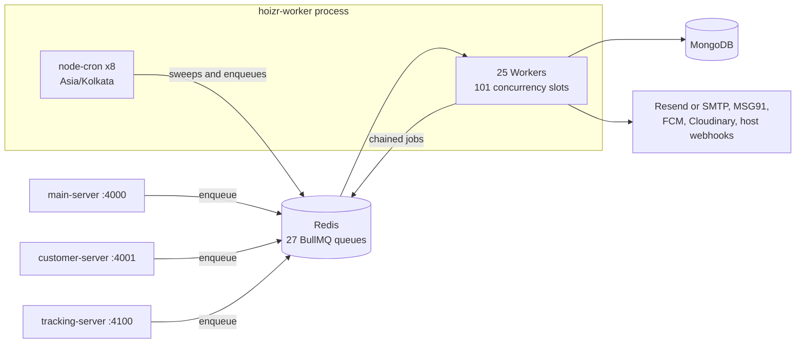
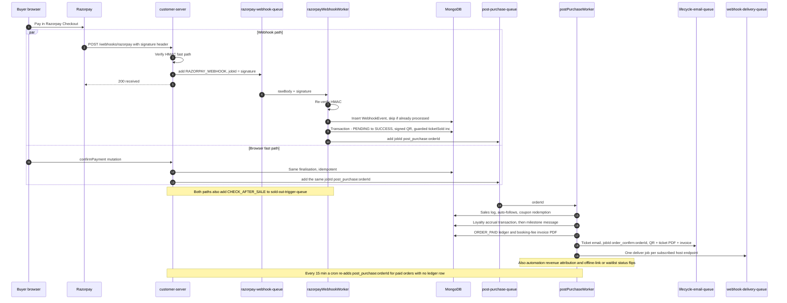
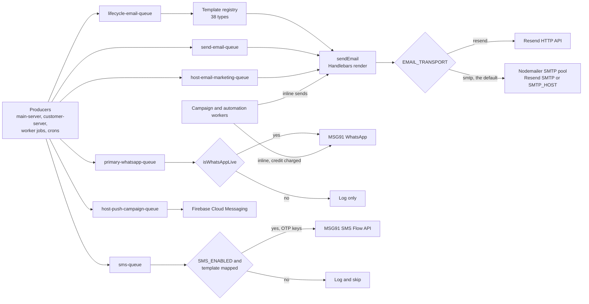

# Background jobs: BullMQ workers and crons

Almost every side effect in Hoizr that does not have to finish before an API responds runs in one process: [`hoizr-worker`](https://github.com/roop37/hoizr-worker). That covers ticket emails, order ledger posting, campaign sends, signed host webhooks and analytics inserts. This chapter covers how the API services hand work to it over BullMQ, how queue names stay in sync across repos, what runs on a schedule, how retries and duplicates are handled, and where the design is still thin.

**TL;DR**

- `main-server`, `customer-server` and `tracking-server` only **produce** jobs. One headless Node process **consumes** them: 25 BullMQ Workers with 101 concurrency slots, plus 8 `node-cron` schedules in `Asia/Kolkata`.
- There are 27 queue names. 24 come from a shared `QueueNames` registry and 3 are string literals. Every name is wrapped in `{…}`, the Redis Cluster hash-tag syntax.
- A paid order flows through a chain: verify webhook, enqueue, finalise in a Mongo transaction, fan out. The webhook path and the browser fast-path share one deterministic `jobId`.
- Idempotency has four layers: `jobId`s, Mongo unique keys, Redis `SET NX` claims and conditional updates.
- Cron ticks are single-flighted across replicas with a per-minute Redis lock. There are no BullMQ repeatable jobs.
- Open gaps: inconsistent retention and retry options, no dead-letter tooling, no graceful shutdown, partial monitoring.

## Contents

- [Why a separate worker process](#why-a-separate-worker-process)
- [How queue names stay in sync](#how-queue-names-stay-in-sync)
- [Redis connection settings for BullMQ](#redis-connection-settings-for-bullmq)
- [Master queue table](#master-queue-table)
- [Concurrency model](#concurrency-model)
- [Scheduled jobs](#scheduled-jobs)
- [The paid-order fan-out](#the-paid-order-fan-out)
- [Notifications pipeline](#notifications-pipeline)
- [Marketing automations and campaigns](#marketing-automations-and-campaigns)
- [Failure handling, retries and idempotency](#failure-handling-retries-and-idempotency)
- [Recipe: add a new queue and worker](#recipe-add-a-new-queue-and-worker)
- [Known limitations](#known-limitations)

## Why a separate worker process

Much of what follows a user action is slow, flaky or both: rendering a PDF ticket, calling an email API, posting to a host's endpoint, messaging thousands of followers. A queue gives the API servers three things:

1. **Fast acknowledgements.** The Razorpay webhook route verifies the signature, enqueues the raw body and returns `200` ([`razorpay-webhook.route.ts`](https://github.com/roop37/customer-server/blob/main/src/routes/razorpay-webhook.route.ts)).
2. **Retries with backoff.** A transient SMTP, MSG91 or Cloudinary error becomes a BullMQ retry, not a failed request.
3. **One home for post-sale side effects.** Order ledger posting, booking-fee invoices, campaign and automation credit debits, and outbound host webhooks run in the worker, so both API servers trigger identical behaviour after a sale.

`hoizr-worker` has no HTTP server. [`src/index.ts`](https://github.com/roop37/hoizr-worker/blob/main/src/index.ts) connects the Redis and MongoDB singletons, imports every Worker module, attaches a `failed` logger to each and calls `startCronJobs()`. BullMQ Workers start consuming when constructed (`autorun` defaults to `true`), so importing a worker module is what switches it on.



## How queue names stay in sync

A producer and a consumer meet only if they agree on a string. Hoizr keeps those strings in three kinds of place.

**The shared registry (the default).** [`hoizr-shared/src/queue/queue.ts`](https://github.com/roop37/hoizr-shared/blob/main/src/queue/queue.ts) declares `class QueueNames` with 30 static members. Six are aliases, leaving 24 distinct names. It ships in `@hoizr-technology/shared`. main-server re-exports it from [`src/utils/queue.ts`](https://github.com/roop37/main-server/blob/main/src/utils/queue.ts), the worker from [`src/utils/queue-names.ts`](https://github.com/roop37/hoizr-worker/blob/main/src/utils/queue-names.ts), and customer-server imports it directly. Renaming a queue means rebuild, publish and bump the dependency everywhere.

**Literals that cross repos.** These skip the republish, but nothing checks them:

- tracking-server hard-codes `{analytics-events-queue}` in [`src/utils/queue.ts`](https://github.com/roop37/tracking-server/blob/main/src/utils/queue.ts) on purpose. The shared barrel export pulls in `type-graphql`, which this small ingest service does not install.
- `{new-event-followers-queue}` is duplicated in main-server's [`lifecycle.queue.ts`](https://github.com/roop37/main-server/blob/main/src/utils/lifecycle.queue.ts) and the worker's [`event-followers.constants.ts`](https://github.com/roop37/hoizr-worker/blob/main/src/workers/event-followers/event-followers.constants.ts), each with a "keep in sync" comment.
- Three consumers (webhook delivery, Cloudinary deletion, profile-picture mirror) use a literal while their producers use `QueueNames`.

**Worker-only names.** When both ends live in the worker, the name is a local constant: `{selling-fast-queue}` ([`selling-fast.constants.ts`](https://github.com/roop37/hoizr-worker/blob/main/src/workers/selling-fast/selling-fast.constants.ts)) and `{waitlist-open-queue}`.

That gives **27 distinct queue names**, of which **25 have a consumer**. Payload types are shared less often. `LifecycleEmailJob`, `LifecycleEmailType`, `LifecycleSmsType` and `CustomerProfilePicMirrorJob` live in [`queue/lifecycle.ts`](https://github.com/roop37/hoizr-shared/blob/main/src/queue/lifecycle.ts). Others, such as the WhatsApp job union, are re-declared per repo.

### Why every name has braces

In Redis Cluster, when a key contains `{…}`, only the text inside the braces is hashed to choose the slot ([hash tags](https://redis.io/docs/latest/operate/oss_and_stack/reference/cluster-spec/#hash-tags)). BullMQ spreads one queue over many keys (`bull:{post-purchase-queue}:wait`, `:active`, `:delayed` and so on) and updates several of them atomically in Lua scripts. On a cluster, a multi-key script fails unless every key sits in the same slot, and the braces guarantee that.

Today every repo uses a plain `ioredis` client (main-server keeps a commented-out `Redis.Cluster` variant in [`src/utils/redis.ts`](https://github.com/roop37/main-server/blob/main/src/utils/redis.ts)). The braces cost nothing on a single node and turn a future move to Cluster into a config change rather than a rename. No custom BullMQ `prefix` is set, so keys start with `bull:`.

## Redis connection settings for BullMQ

All four Node services build their client with the same core options. This is the worker's singleton ([`redis-connection.ts`](https://github.com/roop37/hoizr-worker/blob/main/src/utils/redis-connection.ts)):

```ts
      RedisClient.instance = new Redis({
        host: process.env.REDIS_HOST,
        port: parseInt(process.env.REDIS_PORT ?? "6379") ?? 6379,
        maxRetriesPerRequest: null,
        enableReadyCheck: false,
        ...(process.env.REDIS_TLS === "true" && { tls: {} }),
      });
```

- **`maxRetriesPerRequest: null`.** Workers block on Redis while waiting for jobs. If ioredis gave up after N retries, that blocking call would reject on a short network blip. A Worker throws if it is handed an ioredis instance with any other value (for plain connection options, BullMQ warns and overrides it). The trade-off is that commands wait for a reconnect during an outage instead of failing fast. The API servers share the same client for request-path work (cart Lua, rate limits), so they inherit that behaviour. [Chapter 05](./05-redis-and-concurrency.md) goes deeper.
- **`enableReadyCheck: false`.** Commands are sent as soon as the socket connects, without waiting for the `INFO` ready check.
- **`tls`.** Added only when `REDIS_TLS` is `"true"`, so managed TLS Redis and a local plain Redis share one code path.
- **One client per process.** Every `Queue` and `Worker` receives the singleton. BullMQ still opens its own blocking connection per Worker.

Installed BullMQ versions differ by repo: 5.34.5 (main-server), 5.76.7 (customer-server), 5.56.4 (hoizr-worker) and 5.76.8 (tracking-server).

## Master queue table

How to read the tables:

- `att` = attempts, `exp Ns` = exponential backoff base, `rOC`/`rOF` = `removeOnComplete`/`removeOnFail`. The number after a worker name is its concurrency.
- BullMQ merges the producing `Queue`'s `defaultJobOptions` with each `add()`'s options. One queue can therefore get different settings depending on which repo enqueued the job.
- Any option left unset falls back to BullMQ's default: one attempt, and the job is never removed from Redis. Most worker-side producers leave retention unset.

### Payments and orders

| Queue | Producer(s) | Consumer | What it does | Key options |
|---|---|---|---|---|
| `{razorpay-webhook-queue}` | customer-server webhook route | [`razorpayWebhookWorker`](https://github.com/roop37/hoizr-worker/blob/main/src/workers/razorpay-webhook/razorpay-webhook.worker.ts) · 3 | Re-verifies the HMAC, dedupes via a `WebhookEvent` inbox, finalises the order, enqueues the fan-out. Also refunds, disputes, merch. | att 5, exp 5s, rOC true, rOF 100, **`jobId` = signature** |
| `{post-purchase-queue}` | customer-server (free, cash, `confirmPayment`, invoice); worker (webhook, reconciliation cron) | [`postPurchaseWorker`](https://github.com/roop37/hoizr-worker/blob/main/src/workers/post-purchase/post-purchase.worker.ts) · 5 | Sales log, follows, coupon, loyalty, then the paid fan-out. `GENERATE_CUSTOMER_INVOICE` builds only the invoice. | att 3, exp 5s (invoice: 3s); `post_purchase:<orderId>` on the paid and reconciliation paths, `invoice:<orderId>`; free and cash adds set no `jobId` |
| `{sold-out-trigger-queue}` | customer-server, worker webhook | [`soldOutTriggerWorker`](https://github.com/roop37/hoizr-worker/blob/main/src/workers/sold-out-trigger/sold-out-trigger.worker.ts) · 3 | 80% "selling fast" check, sold-out alerts to the host. | att 2, no `jobId` |
| `{selling-fast-queue}` | `soldOutTriggerWorker` | [`sellingFastWorker`](https://github.com/roop37/hoizr-worker/blob/main/src/workers/selling-fast/selling-fast.worker.ts) · 2 | `selling_fast` automation. | `selling_fast:<eventId>`, att 3, exp 5s |
| `{webhook-delivery-queue}` | worker paid fan-out, refunds | [`webhookDeliveryWorker`](https://github.com/roop37/hoizr-worker/blob/main/src/workers/webhook-delivery/webhook-delivery.worker.ts) · 10 | Signed POST to host endpoints, retried on non-2xx. | att 6, exp 10s, rOC 1000, rOF 5000 |

### Transactional messages

| Queue | Producer(s) | Consumer | What it does | Key options |
|---|---|---|---|---|
| `{lifecycle-email-queue}` | main-server, customer-server, about a dozen worker call sites | [`lifecycleEmailWorker`](https://github.com/roop37/hoizr-worker/blob/main/src/workers/lifecycle-email/lifecycle-email.worker.ts) · 5 | 38-entry template registry → `sendEmail`. Unknown type throws. | servers: att 3, exp 5s, rOC true, rOF 50; worker: per call |
| `{send-email-queue}` | main-server (host email OTP, team invites, admin notices) | [`emailWorker`](https://github.com/roop37/hoizr-worker/blob/main/src/email/queue/email-sending.worker.ts) · 5 | Caller-chosen template. | att 2, exp 5s, rOC true, rOF false |
| `{sms-queue}` | both servers (OTP), customer-server (free/cash orders), worker (fan-out, sold-out) | [`smsWorker`](https://github.com/roop37/hoizr-worker/blob/main/src/workers/sms/sms.worker.ts) · 5 | MSG91 Flow SMS. **Job name = template key.** | servers: att 2–3, exp 5s; worker: defaults |
| `{primary-whatsapp-queue}` | customer-server (OTP), main-server (offline payment link), worker (reservation reminder) | [`primaryWhatsAppWorker`](https://github.com/roop37/hoizr-worker/blob/main/src/workers/primary-whatsapp/primary-whatsapp.worker.ts) · 10 | MSG91 WhatsApp template or text. | att 3, exp 5s, rOC true, rOF true |
| `{host-email-marketing-queue}` | main-server (offline payment-link email) | `hostEmailMarketingWorker` · 3 | Host-branded email. | att 3, exp 5s |

### Automations and campaigns

| Queue | Producer(s) | Consumer | What it does | Key options |
|---|---|---|---|---|
| `{new-event-followers-queue}` | main-server, first publish of an event | [`eventFollowersWorker`](https://github.com/roop37/hoizr-worker/blob/main/src/workers/event-followers/event-followers.worker.ts) · 2 | `new_event_to_followers` automation. | `new_event_followers:<eventId>`, att 3, exp 10s |
| `{waitlist-open-queue}` | waitlist cron | [`waitlistOpenWorker`](https://github.com/roop37/hoizr-worker/blob/main/src/workers/waitlist-open/waitlist-open.worker.ts) · 2 | `waitlist_tickets_open` automation. | `waitlist_open:<eventId>`, att 3, exp 5s |
| `{feedback-queue}` | daily cron | [`feedbackWorker`](https://github.com/roop37/hoizr-worker/blob/main/src/workers/feedback/feedback.worker.ts) · 3 | Resolves the buyer, enqueues a feedback email. | att 3, exp 5s |
| `{host-campaigns-queue}` | main-server | [`hostCampaignsWorker`](https://github.com/roop37/hoizr-worker/blob/main/src/workers/host-campaigns/host-campaigns.worker.ts) · 2 | Host email campaign, sent inline. | att 2, exp 5s, rOF false; `jobId` = campaign id |
| `{host-email-marketing-test-queue}` | main-server | `hostCampaignsTestEmailWorker` · 5 | Test send. | att 2, exp 5s |
| `{host-whatsapp-campaign-queue}` | main-server | [`hostWhatsAppCampaignsWorker`](https://github.com/roop37/hoizr-worker/blob/main/src/workers/host-whatsapp-campaigns/host-whatsapp-campaigns.worker.ts) · 2 | Host WhatsApp campaign via MSG91. | att 2, exp 5s, rOF false; campaign id |
| `{host-push-campaign-queue}` | main-server | [`hostPushCampaignWorker`](https://github.com/roop37/hoizr-worker/blob/main/src/workers/host-push-campaign/host-push-campaign.worker.ts) · 1 | FCM multicast in batches of 500. | att 2, exp 30s, rOF 100, optional `delay` |
| `{internal-campaigns-queue}` | main-server | [`adminCampaignsWorker`](https://github.com/roop37/hoizr-worker/blob/main/src/workers/admin-campaigns/admin-campaigns.worker.ts) · 2 | Hoizr-wide admin email blast. | att 2, exp 5s, rOF false; campaign id |
| `{hoizr-admin-email-marketing-test-queue}` | main-server | `adminCampaignsTestEmailWorker` · 5 | Test send. | att 2, exp 5s |

### Platform and housekeeping

| Queue | Producer(s) | Consumer | What it does | Key options |
|---|---|---|---|---|
| `{activity-log-queue}` | main-server services | [`activityLogWorker`](https://github.com/roop37/hoizr-worker/blob/main/src/workers/activity-log/activity-log.worker.ts) · 5 | Writes `ActivityLog` rows. | att 2, rOC true, rOF true |
| `{analytics-events-queue}` | tracking-server (`add`, `addBulk`), customer-server (`orderPlaced`) | [`analyticsEventsWorker`](https://github.com/roop37/hoizr-worker/blob/main/src/workers/analytics-events/analytics-events.worker.ts) · 10 | One `AnalyticsEvent` insert per job. | att 2, exp 2s, rOC 60s/1000, rOF 1d/1000 |
| `{cloudinary-deletion-queue}` | main-server media resolver | [`cloudinaryDeletionWorker`](https://github.com/roop37/hoizr-worker/blob/main/src/workers/cloudinary-deletion/cloudinary-deletion.worker.ts) · 4 | Destroys replaced assets. `not found` = success. | att 5, exp 10s, rOF 200 |
| `{customer-profile-pic-mirror-queue}` | customer-server Google OAuth | [`customerProfilePicMirrorWorker`](https://github.com/roop37/hoizr-worker/blob/main/src/workers/customer-profile-pic/customer-profile-pic.worker.ts) · 2 | Copies the Google avatar to Cloudinary. | att 3, exp 5s, rOF 50 |
| `{host-denormalization-queue}` | main-server host service | [`hostDenormalizationWorker`](https://github.com/roop37/hoizr-worker/blob/main/src/workers/host-denormalization/host-denormalization.worker.ts) · 2 | Placeholder for renamed-host propagation. | att 3, exp 10s |
| `{hoizr-admin-email-marketing-queue}` | none | `hoizrAdminEmailMarketingWorker` · 3 | Orphan consumer. Admin campaigns send inline. | n/a |
| `{customer-email-queue}` | `Queue` objects, no `add()` | none | Unused. | n/a |
| `{event-venue-grader-queue}` | none | none | Declared only. | n/a |

## Concurrency model

- **One event loop, 101 slots.** Each Worker sets its own `concurrency`, and together they allow 101 jobs in flight. Most jobs wait on Mongo, Redis or HTTP, which suits Node. The CPU-heavy steps (pdfkit, QR rendering) run inside post-purchase jobs.
- **Slots follow the work.** Analytics inserts, transactional WhatsApp and webhook delivery get 10 each. Order-critical queues get 3 to 5. Campaigns get 2 because each job is a long inline send loop, and push gets 1.
- **BullMQ lock defaults are kept.** That means a 30-second job lock, a 30-second stalled check and `maxStalledCount: 1`. A job whose lock lapses (say, the process died) returns to `wait` once and fails if it stalls again.
- **Scaling out.** A second worker process would split jobs safely, because BullMQ hands each job to one Worker through Redis locks. Only the crons would double-fire, and the tick lock below covers them. The deployment is still meant to be a single instance.
- **Once-per-entity work does not trust BullMQ alone.** The webhook finaliser increments `ticketSold` with a conditional update inside a Mongo transaction, campaign senders take a `SET NX` single-runner claim before debiting credit, and automations claim each recipient with `SET NX`.

## Scheduled jobs

All schedules live in [`cron.scheduler.ts`](https://github.com/roop37/hoizr-worker/blob/main/src/workers/crons/cron.scheduler.ts) and use [`node-cron`](https://github.com/node-cron/node-cron) with `timezone: "Asia/Kolkata"`. There are no BullMQ repeatable jobs. Scheduled *campaigns* are different: they are BullMQ delayed jobs (see [Campaigns](#campaigns)).

| # | Schedule (IST) | Tick | Lock TTL | Purpose |
|---|---|---|---|---|
| 1 | `30 3 * * *` | [`handleDailyCron`](https://github.com/roop37/hoizr-worker/blob/main/src/workers/crons/cron.worker.ts) | 20 min | Four steps, each in its own try/catch (below). |
| 2 | `*/15 * * * *` | [`markEndedEventsCompleted`](https://github.com/roop37/hoizr-worker/blob/main/src/workers/crons/event-completion.cron.ts) | 5 min | Idempotent `PUBLISHED → COMPLETED` for ended events. |
| 3 | `*/15 * * * *` | [`reconcilePostPurchaseFanout`](https://github.com/roop37/hoizr-worker/blob/main/src/workers/crons/fanout-reconciliation.cron.ts) | 10 min | `PAYMENT_SUCCESS` orders 15 min to 48 h old (max 200 per tick, host-issued cash orders excluded) with no `order:<id>:paid` or `:free_issued` ledger row get `post_purchase:<id>` re-added. |
| 4 | `0 6,18 * * *` | [`runInstagramSyncTick`](https://github.com/roop37/hoizr-worker/blob/main/src/workers/instagram-sync/instagram-sync.cron.ts) | 20 min | Instagram profile sync. Scaffolded, not live: skips itself without Meta app credentials. |
| 5 | `*/15 * * * *` | [`runRetargetAbandonedAutomation`](https://github.com/roop37/hoizr-worker/blob/main/src/workers/crons/retarget-abandoned.cron.ts) | 10 min | Abandoned-cart nudge. |
| 6 | `*/15 * * * *` | [`runWhatsAppTemplateSync`](https://github.com/roop37/hoizr-worker/blob/main/src/workers/crons/whatsapp-template-sync.cron.ts) | 5 min | Polls MSG91 for template approval status. Skips without MSG91 credentials. |
| 7 | `*/15 * * * *` | [`runWaitlistOpenSweep`](https://github.com/roop37/hoizr-worker/blob/main/src/workers/crons/waitlist-open.cron.ts) | 10 min | Claims each event whose waitlist window closed (`waitlistOpenNotifiedAt: null → now`), then enqueues the blast. |
| 8 | `*/15 * * * *` | [`runDineoutReminderSweep`](https://github.com/roop37/hoizr-worker/blob/main/src/workers/crons/dineout-reminder.cron.ts) | 10 min | Reminders for an optional, feature-flagged restaurant-reservation integration over Swiggy's MCP API. Off unless its env flag is `"true"`. |

The 03:30 daily tick runs, in order:

1. Mark ended events completed.
2. Soft-delete abandoned event drafts ([`abandoned-events-cleanup.cron.ts`](https://github.com/roop37/hoizr-worker/blob/main/src/workers/crons/abandoned-events-cleanup.cron.ts)).
3. Import the last three days of Razorpay gateway settlement reports into the ledger, keyed `razorpay_settlement:<id>:received` ([`razorpay-settlements.cron.ts`](https://github.com/roop37/hoizr-worker/blob/main/src/workers/crons/razorpay-settlements.cron.ts)). This reconciles money Razorpay paid Hoizr. It is not a host payout.
4. Request feedback from buyers of events that ended in the last three days, one job per buyer behind a 45-day Redis claim ([`post-event-feedback.cron.ts`](https://github.com/roop37/hoizr-worker/blob/main/src/workers/crons/post-event-feedback.cron.ts)).

### The single-flight tick lock

Every schedule goes through `scheduleExclusive`, which wraps the tick in this guard:

```ts
const runCronTickExclusive = async (
  name: string,
  ttlSeconds: number,
  fn: () => Promise<void>
): Promise<void> => {
  const redis = RedisClient.getInstance();
  // Minute-bucketed key so the same scheduled tick across replicas maps
  // to one claim, while the next scheduled tick gets a fresh key.
  const minuteBucket = Math.floor(Date.now() / 60000);
  const lockKey = `cron_tick_lock:${name}:${minuteBucket}`;
  const claimed = await redis.set(lockKey, "1", "EX", ttlSeconds, "NX");
  if (claimed !== "OK") {
    logger.info(
      `Cron tick ${name} already claimed by another worker instance; skipping`
    );
    return;
  }
  await fn();
};
```

Every replica that wakes for the same tick computes the same key, so exactly one wins the `SET NX`. `scheduleExclusive` logs and swallows a thrown error, so one bad tick never kills a schedule. The lock does not stop a slow tick from overlapping the next one (that tick has a new key); the sweeps rely on per-item claims for that. A tick missed while the process is down is not replayed, which is one reason the daily steps use three-day windows.

## The paid-order fan-out

This is the most important chain in the system. Two independent paths can confirm a payment, and together they must produce exactly one set of side effects.



1. **Ingress.** customer-server checks `x-razorpay-signature` with a timing-safe HMAC compare and enqueues the raw body, using the signature as the job id ([`razorpay-webhook.route.ts`](https://github.com/roop37/customer-server/blob/main/src/routes/razorpay-webhook.route.ts)):

   ```ts
         if (!verifySignatureFastPath(bodyStr, signature)) {
           logger.warn("Razorpay webhook signature mismatch");
           return reply.status(400).send({ error: "Invalid signature" });
         }

         try {
           await getQueue().add(
             "RAZORPAY_WEBHOOK",
             { rawBody: bodyStr, signature },
             { jobId: signature }
           );
           return reply.status(200).send({ received: true });
   ```

2. **Finalise.** [`razorpay-webhook.process.ts`](https://github.com/roop37/hoizr-worker/blob/main/src/workers/razorpay-webhook/razorpay-webhook.process.ts) verifies the HMAC again, then records the event in a `WebhookEvent` inbox with a unique provider event id ([`webhook-event-log.ts`](https://github.com/roop37/hoizr-worker/blob/main/src/utils/webhook-event-log.ts)). A duplicate is skipped only when the earlier row is `PROCESSED` or `IGNORED`, so a half-failed event can run again. One Mongo transaction then flips the order to `PAYMENT_SUCCESS`, signs the QR payload and increments `ticketSold` with a conditional update that refuses to exceed capacity. [Chapter 06](./06-payments-and-money.md) covers the money side.
3. **Hand off.** After commit, the processor adds `post_purchase:<orderId>` (3 attempts, exponential 5s) and a `CHECK_AFTER_SALE` job. customer-server's `confirmPayment` fast-path adds the **same** `jobId` ([`order.service.ts`](https://github.com/roop37/customer-server/blob/main/src/modules/order/service/order.service.ts)), so the later path usually finds the job already there.
4. **Fan out.** [`post-purchase.worker.ts`](https://github.com/roop37/hoizr-worker/blob/main/src/workers/post-purchase/post-purchase.worker.ts) first runs idempotent bookkeeping: the sales log (`$ne` guard), auto-follows of host, collaborators and artists, coupon usage, and loyalty points proportional to net ticket value (a transaction keyed on a unique idempotency key). It then calls [`runPaidOrderFanout`](https://github.com/roop37/hoizr-worker/blob/main/src/utils/paid-order-fanout.ts), which:
   - credits automation revenue when the order came from an automation link
   - posts `ORDER_PAID` (key `order:<id>:paid`) when the money went through Razorpay
   - generates the booking-fee tax invoice PDF
   - enqueues the e-ticket email with an inline QR and PDF attachments ([`dispatch-order-confirmation.ts`](https://github.com/roop37/hoizr-worker/blob/main/src/utils/invoice/dispatch-order-confirmation.ts))
   - enqueues an SMS job, which stays dormant until an SMS template is registered
   - queues one signed webhook per subscribed host endpoint ([`webhook-dispatch.ts`](https://github.com/roop37/hoizr-worker/blob/main/src/utils/webhook-dispatch.ts))
5. **Analytics.** customer-server pushes the server-side `orderPlaced` conversion straight onto `{analytics-events-queue}`. Today only the free and cash-order paths emit it (see [Known limitations](#known-limitations)). [Chapter 07](./07-tracking-and-analytics.md) covers that pipeline.

Free and RSVP orders skip Razorpay. The worker sends their ticket through a free-order branch and writes an `ORDER_FREE_ISSUED` ledger row, and `runPaidOrderFanout` returns early for ₹0. Host-issued cash orders do go through `runPaidOrderFanout` for the ticket email, but post no `ORDER_PAID` row and no booking-fee invoice, because the money never touched Razorpay.

The host-webhook enqueue is the options pattern the rest of the code should copy: a deterministic dedupe key in Mongo, explicit attempts and backoff, bounded retention.

```ts
      const deliveryId = `${String(order._id)}:${eventType}:${String(wh._id)}`;
      try {
        await WebhookDeliveryModel.create({
          // ...
        });
      } catch {
        // Duplicate deliveryId → already queued/delivered for this
        // order+event+endpoint. Skip (idempotent).
        continue;
      }
      await webhookQueue.add(
        "deliver",
        { deliveryId },
        {
          attempts: 6,
          backoff: { type: "exponential", delay: 10_000 },
          removeOnComplete: 1000,
          removeOnFail: 5000,
        }
      );
```

Before each attempt, the delivery worker checks that the target is a public HTTPS URL. It then refuses redirects, times out after 10 seconds and signs the body (`x-hoizr-signature: sha256=…`). Only the final failed attempt marks the row `FAILED`. Hosts register endpoints through main-server's [`hostWebhook` module](https://github.com/roop37/main-server/tree/main/src/modules/hostWebhook).

<!-- SCREENSHOT: customer-eticket | The QR e-ticket email a buyer receives after the post-purchase fan-out -->

## Notifications pipeline

Every message the backend services send leaves from the worker. Email renders Handlebars templates and goes out through one of two transports. WhatsApp and SMS go through MSG91, and each stays off until its env flag is set. Push goes through Firebase Cloud Messaging.



**Email.** [`email-utils.ts`](https://github.com/roop37/hoizr-worker/blob/main/src/email/email-utils.ts) wires [Nodemailer](https://nodemailer.com/) to `nodemailer-express-handlebars`. The 61 `.hbs` files live in [`src/email/templates`](https://github.com/roop37/hoizr-worker/tree/main/src/email/templates). Transport is picked at boot:

- With `EMAIL_TRANSPORT=resend`, the mail is rendered with a `jsonTransport` (render only, no send) and POSTed to the [Resend](https://resend.com/docs) HTTP API.
- Otherwise, a pooled SMTP transport is used. It points at Resend's SMTP endpoint when `RESEND_API_KEY` is set and `EMAIL_TRANSPORT` is not `smtp`, and at the `SMTP_*` settings (SES, local Mailpit) when it isn't.

Lifecycle emails are routed by `type` through [`template-registry.ts`](https://github.com/roop37/hoizr-worker/blob/main/src/workers/lifecycle-email/template-registry.ts). A few type strings exist only there, to avoid republishing the shared package. `sendEmail` logs and rethrows, so the producer's `attempts` decide the retry count. Ticket QR codes travel as CID inline images, which render more reliably than data URIs.

**WhatsApp.** [`whatsapp.client.ts`](https://github.com/roop37/hoizr-worker/blob/main/src/msg91/whatsapp.client.ts) sends only when:

```ts
export const isWhatsAppLive = (): boolean =>
  process.env.WHATSAPP_ENABLED === "true" &&
  !!process.env.MSG91_AUTHKEY &&
  !!integratedNumber();
```

Otherwise it logs the payload and returns a synthetic success, so dev and staging never message real phones. Callers build Meta-style template components and the client translates them for [MSG91](https://docs.msg91.com/). Transactional sends (OTP, offline payment links, reservation reminders) use `{primary-whatsapp-queue}`. Campaigns and automations send inline, because they need per-recipient credit accounting.

**SMS.** [`sms.process.ts`](https://github.com/roop37/hoizr-worker/blob/main/src/workers/sms/sms.process.ts) maps the job name to an MSG91 DLT template id from env, and only the four OTP keys are mapped today. Order and sold-out SMS jobs are enqueued but skipped until their templates exist. Non-retryable rejects are swallowed, and transport errors throw so BullMQ retries.

**OTP.** Customer phone OTP sends WhatsApp (when live) **and** SMS in parallel ([`otp.service.ts`](https://github.com/roop37/customer-server/blob/main/src/modules/otp/service/otp.service.ts)). MSG91 accepts WhatsApp asynchronously, so the server cannot know in time whether it landed. Host OTP uses email or SMS.

**Push.** [`host-push-campaign.worker.ts`](https://github.com/roop37/hoizr-worker/blob/main/src/workers/host-push-campaign/host-push-campaign.worker.ts) loads `firebase-admin` lazily, multicasts through [FCM](https://firebase.google.com/docs/cloud-messaging) in batches of 500 and prunes unregistered tokens. It needs an FCM service account in env.

## Marketing automations and campaigns

### Automations

Hosts configure automations in the dashboard. Four are off by default. `retarget_abandoned` treats a host with no saved config as on, email only.

| Key | Trigger | Audience | Code |
|---|---|---|---|
| `retarget_abandoned` | 15-min cron over `cartCreated` events aged 20 min to 6 h | Logged-in customers who did not buy | [`retarget-abandoned.cron.ts`](https://github.com/roop37/hoizr-worker/blob/main/src/workers/crons/retarget-abandoned.cron.ts) |
| `selling_fast` | A sale crosses 80% of finite capacity (once per event) | Followers who have not bought | [`selling-fast.worker.ts`](https://github.com/roop37/hoizr-worker/blob/main/src/workers/selling-fast/selling-fast.worker.ts) |
| `new_event_to_followers` | First publish of an event | Followers | [`event-followers.worker.ts`](https://github.com/roop37/hoizr-worker/blob/main/src/workers/event-followers/event-followers.worker.ts) |
| `waitlist_tickets_open` | Waitlist window closes | Entries still `WAITING` | [`waitlist-open.worker.ts`](https://github.com/roop37/hoizr-worker/blob/main/src/workers/waitlist-open/waitlist-open.worker.ts) |
| `milestone_message` | Post-purchase, after loyalty accrual | A buyer crossing a loyalty milestone | [`loyalty-milestone-message.ts`](https://github.com/roop37/hoizr-worker/blob/main/src/utils/loyalty-milestone-message.ts) |

They share one shape:

1. Re-check the host's toggle when the job runs.
2. Build the audience and claim each recipient with a Redis `SET NX` key that lives from two weeks up to a year, so nobody is messaged twice for the same event and channel.
3. Debit the host's marketing credit at an admin-configured per-send rate ([`marketing-credit-charge.ts`](https://github.com/roop37/hoizr-worker/blob/main/src/utils/marketing-credit-charge.ts)). The abandoned-cart email is free; its WhatsApp leg is charged.
4. Send email through the lifecycle queue and WhatsApp inline through [`sendAutomationWhatsApp`](https://github.com/roop37/hoizr-worker/blob/main/src/utils/automation-whatsapp.ts). That helper reserves affordable credit atomically, skips already-claimed recipients, refunds failed slots and posts a ledger entry only for accepted sends.
5. Tag the call-to-action link with `utm_medium=automation&utm_campaign=<key>`. When an order arrives through that link, `runPaidOrderFanout` credits the revenue back to the automation.

<!-- SCREENSHOT: business-automations | Automations page in the business dashboard showing the toggles and attributed revenue -->

### Campaigns

A campaign is one BullMQ job carrying the campaign id.

- **Scheduling uses delayed jobs.** "Send now" adds the job with `jobId = campaignId`. "Schedule" adds it with a `delay`. Rescheduling finds it with `getDelayed()` and calls `changeDelay()` or `remove()` ([`hostCampaign.service.ts`](https://github.com/roop37/main-server/blob/main/src/modules/hostCampaign/service/hostCampaign.service.ts)).
- **Host email** ([`host-campaigns.process.ts`](https://github.com/roop37/hoizr-worker/blob/main/src/workers/host-campaigns/host-campaigns.process.ts)). The sender:
  - takes a one-hour single-runner claim
  - snapshots the audience on the first run
  - debits credit per chunk
  - sends inline with tracked links and an HMAC-signed unsubscribe link
  - refunds bounces
  - advances a `sentCount` cursor

  The snapshot and cursor let a campaign pause when credit runs out and resume without re-sending. A resume uses a fresh `jobId` (`resume:<id>:<timestamp>`).
- **Host WhatsApp** ([`host-whatsapp-campaigns.process.ts`](https://github.com/roop37/hoizr-worker/blob/main/src/workers/host-whatsapp-campaigns/host-whatsapp-campaigns.process.ts)) uses the same claim and reserve-then-refund model in batches of 500.
- **Host push** goes through FCM and is not charged.
- **Admin campaigns** ([`admin-campaigns.process.ts`](https://github.com/roop37/hoizr-worker/blob/main/src/workers/admin-campaigns/admin-campaigns.process.ts)) are Hoizr-wide email blasts with their own claim and a shared bounce list.


## Failure handling, retries and idempotency

**Retries.** The producer sets `attempts`, and the worker decides what is retryable:

- Email errors rethrow, and so do WhatsApp `!ok` results and non-2xx webhook responses.
- MSG91 SMS rejects (bad template or number) are swallowed, while transport errors throw.
- Cloudinary `not found` counts as success.
- In post-purchase, the optional steps (loyalty, milestone, free-ticket email) are caught and logged. The core steps and `runPaidOrderFanout` throw, which retries the whole job, and every step is idempotent.

**Idempotency, in layers:**

| Layer | Examples |
|---|---|
| Deterministic `jobId` | `post_purchase:`, `invoice:`, `order_confirm:`, `paid_sms:`, `refund:`, `selling_fast:`, `waitlist_open:`, `new_event_followers:`, campaign id, Razorpay signature |
| Mongo unique keys | Ledger `idempotencyKey`, loyalty transaction keys, `WebhookEvent.providerEventId`, `WebhookDelivery.deliveryId` |
| Redis `SET NX` claims | Cron ticks, campaign single-runner, per-recipient automation and feedback claims |
| Conditional updates | `PAYMENT_PENDING → PAYMENT_SUCCESS`, `waitlistOpenNotifiedAt: null → now`, `$ne` guards on array pushes |

> [!IMPORTANT]
> A `jobId` dedupes only while the earlier job is still stored. With `removeOnComplete: true` (the server-side producers), a later `add()` with the same id creates a fresh job. With no `removeOn*` (most worker-side producers), the job is kept forever, so the dedupe is permanent, even for failed jobs. That is why idempotency also lives in Mongo. It also explains two limitations below: the reconciler cannot revive a stored fan-out, and a second "dual receipt" email is dropped.

**Dead letters.** There is no DLQ. The closest things are BullMQ failed sets (where kept), `WebhookEvent` and `WebhookDelivery` rows in `FAILED` state, and campaign `failed`/`paused` statuses. The only automatic re-drive is the reconciliation cron, and it recovers only enqueues that were lost outright, such as a crash between commit and `add()`.

**Shutdown.** No service registers `SIGTERM`/`SIGINT` handlers or calls `worker.close()`. Jobs interrupted by a deploy come back through stall detection, and long non-idempotent jobs (campaigns) are protected by their Redis claims.

**Observability.**

- The worker logs JSON through winston to stdout ([`logger.ts`](https://github.com/roop37/hoizr-worker/blob/main/src/utils/logger.ts)).
- Every Worker has a `failed` listener. None has an `error` listener, so BullMQ connection errors fall back to `console.error`.
- main-server's admin-only `getSystemHealth` reads `getJobCounts` for a hard-coded list of 17 queues, cached for 60 seconds ([`admin-metrics.service.ts`](https://github.com/roop37/main-server/blob/main/src/modules/adminMetrics/service/admin-metrics.service.ts)). The internal admin [dashboard](https://github.com/roop37/internal-admin-client/blob/main/components/modules/dashboard/index.tsx) renders it.
- There is no Bull Board, metrics exporter or cron heartbeat yet.

<!-- SCREENSHOT: admin-dashboard | Internal admin dashboard system-health panel with BullMQ queue depths -->

## Recipe: add a new queue and worker

1. **Name it.** For a cross-repo queue, add `static readonly myThingQueue = "{my-thing-queue}";` to [`hoizr-shared/src/queue/queue.ts`](https://github.com/roop37/hoizr-shared/blob/main/src/queue/queue.ts) (keep the braces), then build, publish and bump `@hoizr-technology/shared` in each consumer. [Chapter 09](./09-local-development.md) shows the `file:` link alternative. If both ends live in the worker, use a local constant like [`selling-fast.constants.ts`](https://github.com/roop37/hoizr-worker/blob/main/src/workers/selling-fast/selling-fast.constants.ts).
2. **Share the payload type** beside the name, for example in `hoizr-shared/src/queue/lifecycle.ts`.
3. **Create the producer `Queue`** with the shared `redisClient`, following main-server's [`lifecycle.queue.ts`](https://github.com/roop37/main-server/blob/main/src/utils/lifecycle.queue.ts). Always set `defaultJobOptions`: `attempts`, exponential `backoff`, and bounded `removeOnComplete`/`removeOnFail`.
4. **Wrap it in an `enqueueMyThing()` helper** that sets a deterministic `jobId` when the job must happen once per entity. If the side effect matters, keep a dedupe key in Mongo too.
5. **Write the worker** at `src/workers/my-thing/my-thing.worker.ts`: `new Worker(QueueNames.myThingQueue, handler, { connection: RedisClient.getInstance(), concurrency: N })`. Throw for retryable errors, return quietly for permanent ones, and make every write idempotent.
6. **Register it in [`src/index.ts`](https://github.com/roop37/hoizr-worker/blob/main/src/index.ts).** Import it and add `{ name: "myThingWorker", worker: myThingWorker }` to `workers`. The import starts it, and the entry attaches the `failed` logger.
7. **For a schedule,** call `scheduleExclusive(expression, name, ttlSeconds, fn)` in [`cron.scheduler.ts`](https://github.com/roop37/hoizr-worker/blob/main/src/workers/crons/cron.scheduler.ts) with a lock TTL shorter than the interval. Claim each item (conditional update or `SET NX`) before enqueueing.
8. **Make it visible** by adding the name to `MONITORED_QUEUES` in [`admin-metrics.service.ts`](https://github.com/roop37/main-server/blob/main/src/modules/adminMetrics/service/admin-metrics.service.ts).

## Known limitations

Hoizr is pre-launch. These are the clearest contribution opportunities in the async layer:

- **Unbounded worker-side queues.** Most `Queue` objects created inside the worker pass only `connection`, so their jobs get one attempt and stay in Redis forever, including e-ticket jobs that carry base64 PDFs. `webhook-dispatch.ts` and the reservation-reminder cron already do it right. A shared `createQueue()` factory with bounded defaults would fix the rest.
- **Dual-receipt dedupe.** When a guest checks out against an account with a different email, the fan-out sends the ticket to both addresses, but both jobs use `order_confirm:<orderId>`, so only the first is queued. Add the recipient to the `jobId`.
- **Follower targeting.** `selling-fast`, `event-followers` and the campaign audience builders read `artistId`/`businessId` on lineup and collaborator entries. The shared schema names them `artistLinkId`/`businessLinkId` (post-purchase already uses these), so today only the host's own followers are reached.
- **The reconciler cannot revive a stored job.** Re-adding `post_purchase:<id>` is a no-op while a job with that id exists. Using `getJob(id)` with `retry()` or `remove()` would make it a real re-drive.
- **Paid orders skip `orderPlaced`.** The server-side conversion event is emitted only from the free and cash paths.
- **No dead-letter tooling or graceful shutdown.** Failed sets are counted but never listed, alerted on or retried. Add `SIGTERM` handling that closes every Worker.
- **Partial observability.** Nine active queues are missing from `MONITORED_QUEUES`, there is no cron heartbeat, and Workers need an `error` listener.
- **Duplicated contracts.** Five queue names are hand-copied literals in at least one repo, and several payload types are re-declared, with no contract test. A decorator-free `queue` subpath export from the shared package would let every repo import them.
- **Small races and inconsistencies.**
  - Per-variant sold-out notices use `GET` then `SETEX`, so two simultaneous final sales can email the host twice. `SET NX` would close it.
  - The host email campaign releases its claim in `finally`, while the admin campaign never does.
  - The per-minute cron key does not prevent overlap with the next tick.
- **One process for everything.** Checkout-critical post-purchase jobs share an event loop with long campaign sends. Split payment and marketing queues into separate processes, or use BullMQ priorities and rate limiters.
- **Housekeeping.**
  - Pin one BullMQ version across repos.
  - Remove or finish the dead wiring (`{customer-email-queue}`, `{event-venue-grader-queue}`, the producer-less admin marketing worker, the placeholder denormalization worker, dormant SMS keys).
  - Scrub personal data from job payloads and logs.
  - Add password authentication to every Redis client.

---

**Related chapters:** [01 System architecture](./01-system-architecture.md) · [02 Domain model](./02-domain-model.md) · [03 Auth and RBAC](./03-auth-and-rbac.md) · [05 Redis and concurrency](./05-redis-and-concurrency.md) · [06 Payments and money](./06-payments-and-money.md) · [07 Tracking and analytics](./07-tracking-and-analytics.md) · [08 Frontend architecture](./08-frontend-architecture.md) · [09 Local development](./09-local-development.md) · [10 Deployment and operations](./10-deployment-and-operations.md) · [11 Engineering decisions](./11-engineering-decisions.md) · [12 Known gaps and roadmap](./12-known-gaps-and-roadmap.md) · [13 Third-party services](./13-third-party-services.md)

[Back to the walkthrough](../README.md)
