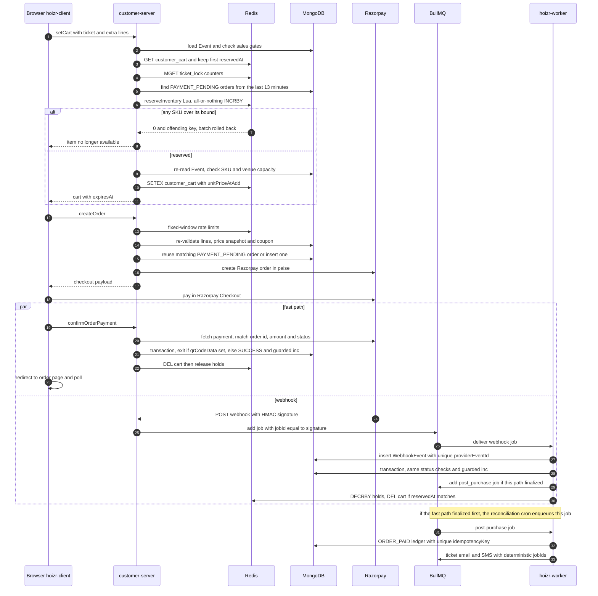

# Redis, concurrency and consistency

This chapter covers how Hoizr stops two people from buying the last ticket, why a payment is never turned into two tickets, and how background jobs avoid running twice. You will see every Redis key that is not a BullMQ queue, the Lua script behind cart holds, the MongoDB update that is the real oversell guard, and the idempotency layers around Razorpay webhooks. The chapter ends with the limitations that are still open.

## TL;DR

- **Redis holds are advisory. MongoDB is the authority.** A Lua script reserves cart quantities in Redis so the storefront can say "sold out" early. The seat itself is only taken by a conditional `$inc` (guarded by `$expr`) inside a MongoDB transaction at payment time. A paid order that loses that race becomes `INVENTORY_UNAVAILABLE_AFTER_PAYMENT` and is flagged for manual refund. It never becomes a ticket.
- **Two finalizers, one outcome.** The checkout fast path (`confirmPayment`) and the Razorpay webhook worker both finalize the same order. Each one re-reads the order inside a transaction and exits if `qrCodeData` is already set or the status is no longer `PAYMENT_PENDING`.
- **Webhooks are idempotent at three layers:** BullMQ `jobId = signature`, a `WebhookEvent` row with a unique `providerEventId`, and status-guarded handlers. Every money movement posts a ledger transaction with a unique `idempotencyKey`.
- **Background work is single-flight:** each cron tick takes a minute-bucketed `SET NX EX` lock, campaign sends take a per-campaign claim, and automations claim each recipient before sending.
- **In customer-server, rate limiting comes in two Lua shapes:** exponential backoff for small brute-force caps, and a fixed window for throughput and budget caps.

## Contents

- [Where Redis is used](#where-redis-is-used)
- [Redis key reference](#redis-key-reference)
- [Cart and inventory holds, step by step](#cart-and-inventory-holds-step-by-step)
- [Why oversell is finally prevented in MongoDB](#why-oversell-is-finally-prevented-in-mongodb)
- [The subdocument `_id`-as-string trap](#the-subdocument-_id-as-string-trap)
- [Other atomic conditional updates](#other-atomic-conditional-updates)
- [Webhook idempotency and double-charge protection](#webhook-idempotency-and-double-charge-protection)
- [Rate limiting](#rate-limiting)
- [Single-flight crons and send claims](#single-flight-crons-and-send-claims)
- [Checkout sequence: add to cart to paid order](#checkout-sequence-add-to-cart-to-paid-order)
- [Lessons learned and known limitations](#lessons-learned-and-known-limitations)

## Where Redis is used

All four backend services connect to the same Redis instance with [ioredis](https://github.com/redis/ioredis). BullMQ queue traffic is covered in [Background jobs with BullMQ](./04-background-jobs-bullmq.md). This chapter covers everything else.

| Service | Client | Non-queue uses |
|---|---|---|
| `customer-server` | One client with three custom Lua commands registered through `defineCommand` ([`src/utils/redis.ts`](https://github.com/roop37/customer-server/blob/main/src/utils/redis.ts)) | Cart, inventory holds, rate limits, refresh-token allowlists, sign-up state, config cache, claim locks |
| `main-server` | One client ([`src/utils/redis.ts`](https://github.com/roop37/main-server/blob/main/src/utils/redis.ts)) | Refresh-token allowlists, rate limits, a derived master-data cache |
| `hoizr-worker` | Singleton connection ([`src/utils/redis-connection.ts`](https://github.com/roop37/hoizr-worker/blob/main/src/utils/redis-connection.ts)) | Cron tick locks, campaign and recipient send claims, hold release after payment |
| `tracking-server` | One client | None. Redis is only the BullMQ transport for analytics events |

A few things you might expect in Redis live in MongoDB instead. OTP codes are bcrypt-hashed rows with a five-minute expiry. Sessions are stateless RS256 JWTs. Ledger, loyalty and webhook idempotency all rely on unique MongoDB indexes. Redis holds only short-lived or rebuildable state.

## Redis key reference

`{x}` marks a variable part of the key. TTLs are copied from code.

### customer-server

| Pattern | Type | TTL | Writer | Reader | Purpose |
|---|---|---|---|---|---|
| `ticket_lock:{eventId}:{ticketId}` | integer, summed across all carts | Reset on each positive write to the writing cart's remaining lifetime (13 min at most). Releases don't touch it. | `reserveInventory` Lua from [`cart.service.ts`](https://github.com/roop37/customer-server/blob/main/src/modules/cart/service/cart.service.ts); release Lua in the webhook worker | `setCart` (MGET), the Lua `GET` | Soft hold on a ticket type |
| `ticket_lock:{eventId}:extra:{extraId}` | same | same | same | same | Soft hold on an add-on |
| `customer_cart:{customerId}:{eventId}` | JSON: lines, `unitPriceAtAdd`, `reservedAt` | `SETEX` with what remains of a fixed 13-minute window that starts at the first add | `setCart`; deleted by `clearCart`, `finalizeCartForOrder` and the webhook worker | `getCart`, `createOrder` | The cart plus a price snapshot |
| `rate_limit:{bucket}` | counter | 1 h window with backoff, or a fixed window per bucket | [`rateLimit.ts`](https://github.com/roop37/customer-server/blob/main/src/utils/rateLimit.ts) | same | OTP per phone, per IP and global budget; scanner login and refresh; order creation per customer and per event |
| `rl:cust-places:{autocomplete\|details}:{customerId}` | counter | 60 s | [`customer-places.service.ts`](https://github.com/roop37/customer-server/blob/main/src/modules/customerPlaces/service/customer-places.service.ts) | same | Protects the Google Places budget |
| `config:num:{ConfigType}` | number | 300 s | [`configs-cache.ts`](https://github.com/roop37/customer-server/blob/main/src/utils/configs-cache.ts) (read-through) | Cart and order pricing, refund window | Caches fee and tax percentages from the `Config` collection |
| `customerRefreshToken:{customerId}:{deviceId}` | SHA-256 of the refresh JWT | 90 d | [`jwt.ts`](https://github.com/roop37/customer-server/blob/main/src/utils/jwt.ts) at login | Token refresh | Per-device refresh allowlist |
| `scannerRefreshToken:{scannerId}` | SHA-256 | 7 d | `jwt.ts` at login and every refresh | Scanner refresh | One active session per door scanner |
| `customerPendingSignup:{sha256(token)}` | JSON | 600 s | [`pending-signup.store.ts`](https://github.com/roop37/customer-server/blob/main/src/modules/auth/service/pending-signup.store.ts) | same | Google sign-in waiting for phone OTP |
| `loyalty_claim_lock:{rewardId}:{customerId}` | `"1"` | `SET NX EX 15` | [`loyalty.service.ts`](https://github.com/roop37/customer-server/blob/main/src/modules/loyalty/service/loyalty.service.ts) | same | Serializes reward claims (see below) |

### main-server

| Pattern | Type | TTL | Writer | Reader | Purpose |
|---|---|---|---|---|---|
| `refreshToken:{userId}:{deviceId}`, `adminRefreshToken:{adminId}:{deviceId}` | SHA-256 | 5 d | `storeRefreshToken` in [`jwt.ts`](https://github.com/roop37/main-server/blob/main/src/utils/jwt.ts) | Token refresh | Host and admin refresh allowlists |
| `artistRefreshToken:{artistId}:{deviceId}` | token string | 30 d | [`jwt-artist.ts`](https://github.com/roop37/main-server/blob/main/src/utils/jwt-artist.ts) at login and refresh | Artist refresh | Artist refresh allowlist, rotated on each refresh |
| `rate_limit:{bucket}` | counter | 1 h, then a lockout starting at 15 min | [`rateLimit.ts`](https://github.com/roop37/main-server/blob/main/src/utils/rateLimit.ts) | same | Host, admin and artist login and OTP; team verification; the public white-label form |
| `hoizr:states` | JSON array | 7 d | `getActiveStates` in [`masters.service.ts`](https://github.com/roop37/main-server/blob/main/src/modules/masters/services/masters.service.ts) | same | Distinct states derived from `cities`. Deleted on any city add or update. |

<details>
<summary>hoizr-worker claim keys, and leftover keys nothing writes</summary>

| Pattern | Type | TTL | Writer | Reader | Purpose |
|---|---|---|---|---|---|
| `cron_tick_lock:{cronName}:{epochMinute}` | `"1"` | `NX EX` 5 to 20 min | [`cron.scheduler.ts`](https://github.com/roop37/hoizr-worker/blob/main/src/workers/crons/cron.scheduler.ts) | the same `SET NX` | One replica per cron tick |
| `host_campaign_send_claim:{campaignId}` | timestamp | `NX EX 3600`, deleted when the run ends | [`host-campaigns.process.ts`](https://github.com/roop37/hoizr-worker/blob/main/src/workers/host-campaigns/host-campaigns.process.ts) | same | One runner per email campaign |
| `host_whatsapp_campaign_send_claim:{campaignId}` | timestamp | `NX EX 3600` | [`host-whatsapp-campaigns.process.ts`](https://github.com/roop37/hoizr-worker/blob/main/src/workers/host-whatsapp-campaigns/host-whatsapp-campaigns.process.ts) | same | One runner per WhatsApp campaign |
| `admin_campaign_send_claim:{campaignId}` | timestamp | `NX EX 3600` | [`admin-campaigns.process.ts`](https://github.com/roop37/hoizr-worker/blob/main/src/workers/admin-campaigns/admin-campaigns.process.ts) | same | One runner per platform-wide blast |
| `selling_fast_fired:{eventId}` | `"1"` | `NX EX` 30 d | [`sold-out-trigger.worker.ts`](https://github.com/roop37/hoizr-worker/blob/main/src/workers/sold-out-trigger/sold-out-trigger.worker.ts) | same | Fires the "selling fast" automation once per event |
| `soldout_notified:{eventId}:{ticketId\|EVENT}` | `"1"` | `SETEX` 30 d | same | `GET` before sending | Sold-out email to the organizer, once |
| `selling_fast_claim:...`, `waitlist_open_claim:...`, `new_event_followers_claim:...` | `"1"` | `NX EX` 30 d | the matching automation workers | `MGET` pre-filter, then `SET NX` | One message per recipient, per channel, per event |
| `retarget_cart_claim:{eventId}:c:{customerId}:{channel}` | `"1"` | `NX EX` 14 d | [`retarget-abandoned.cron.ts`](https://github.com/roop37/hoizr-worker/blob/main/src/workers/crons/retarget-abandoned.cron.ts) | same | Abandoned-cart reminder, once |
| `post_event_feedback_claim:{eventId}:{recipient}` | timestamp | `NX EX` 45 d | [`post-event-feedback.cron.ts`](https://github.com/roop37/hoizr-worker/blob/main/src/workers/crons/post-event-feedback.cron.ts) | same | Feedback request, once per buyer |
| `milestone_wa:{hostId}:{customerId}:{milestone}` | `"1"` | `NX EX` 365 d | [`loyalty-milestone-message.ts`](https://github.com/roop37/hoizr-worker/blob/main/src/utils/loyalty-milestone-message.ts) | same | Loyalty milestone WhatsApp, once |
| `{masterKey}:keys`, `choose:userPermissions:{id}` | n/a | n/a | nothing | `masters.service.ts` deletes or reads them | Left over from the Choose POS fork. The permission check always misses and falls back to MongoDB. |

</details>

## Cart and inventory holds, step by step

### The data model

- **Authoritative counters** live in MongoDB as subdocuments of each event: `tickets[].ticketSold` against `tickets[].ticketCapacity`, `extras[].sold` against `extras[].quantity`, plus an optional venue-wide `maxCapacity` ([`event.schema.ts`](https://github.com/roop37/hoizr-shared/blob/main/src/schemas/event.schema.ts)).
- **Soft holds** live in Redis as one integer per SKU, summed across every customer's cart. The per-customer quantities exist only in each `customer_cart:*` JSON.

### `setCart`, in order

All of this is in [`cart.service.ts`](https://github.com/roop37/customer-server/blob/main/src/modules/cart/service/cart.service.ts).

1. **Gate the event and every line.** The event must be published, visible, not paused by an admin, and inside its sales window, with per-day closure for multi-day events. Each line is checked for integer quantity, visibility, expiry, `maxTicketPerUser`, and add-on prerequisites.
2. **Keep the first `reservedAt`.** The window is `CART_TTL_SECONDS = 13 * 60`. It starts at the first add and is never extended, so editing a cart cannot hold seats forever.
3. **Compute deltas.** For every SKU in the old or new cart, `delta = desiredQty - previousQty`. Negative deltas release quantity.
4. **Snapshot current holds and pending orders.** An `MGET` reads the lock counters. A query loads `PAYMENT_PENDING` orders for the event reserved within the last 13 minutes. The `Order` schema has a dedicated `(eventId, orderStatus, reservedAt)` index because this query runs on every add-to-cart.
5. **Compute an absolute bound per SKU.** [`computeLockRemaining`](https://github.com/roop37/customer-server/blob/main/src/modules/cart/service/inventory-math.ts) returns `capacity - sold - max(0, pendingOrderQty - currentLocked)`. The bound must be system-wide because the Lua compares it with the aggregate counter. An earlier per-customer value subtracted other carts' holds twice and rejected valid adds near sell-out. A regression test covers this ([`cart-inventory-math.test.ts`](https://github.com/roop37/customer-server/blob/main/src/tests/cart-inventory-math.test.ts)).
6. **Reserve every SKU in one Lua call.** See the script below.
7. **Read back and re-check.** `assertLatestInventoryStillFits` re-reads the event and checks `sold + max(lock, pending) <= capacity` for each selected SKU. It then checks the venue-wide `maxCapacity` against total sold plus every lock on the event. Each caller reads after its own increment, so two concurrent carts cannot both pass the venue check. At worst both fail. On failure the deltas are rolled back as a best effort, and anything left over decays with the TTL.
8. **Persist the cart** with `SETEX` for the remaining window, including `unitPriceAtAdd` for every line so `createOrder` can reject a price that changed after the add.

### The `reserveInventory` Lua script

The script lives in [`customer-server/src/utils/redis.ts`](https://github.com/roop37/customer-server/blob/main/src/utils/redis.ts). It takes N keys and, for each, a `(remaining, delta)` pair plus a shared TTL. Redis runs a script atomically, so the batch is all-or-nothing: if any SKU would exceed its bound, the elided block undoes every `INCRBY` already applied in this call with `DECRBY`, then the script returns the offending key.

```lua
for i = 1, n do
  local key = KEYS[i]
  local remaining = tonumber(ARGV[2 + (i - 1) * 2 + 1])
  local delta = tonumber(ARGV[2 + (i - 1) * 2 + 2])
  local current = tonumber(redis.call('GET', key) or '0')
  if delta > 0 and (current + delta) > remaining then
    -- ...
    return {0, key}
  end
  local newVal = redis.call('INCRBY', key, delta)
  applied[#applied + 1] = {key, delta}
  if newVal <= 0 then
    redis.call('DEL', key)
  elseif ttl > 0 then
    redis.call('EXPIRE', key, ttl)
  end
end
return {1, ''}
```

Three invariants are documented above the script. A counter that reaches zero or below is deleted, so it never goes negative. `EXPIRE` is applied only to positive values, so a deleted key is never resurrected. Negative deltas reuse the same path for releases. The call site in `setCart` passes the cart's remaining lifetime as the TTL:

```ts
      const argv: string[] = [
        String(lockOps.length),
        String(remainingTtlSeconds),
      ];
      for (const op of lockOps) {
        argv.push(String(op.remaining));
        argv.push(String(op.delta));
      }
      const result = (await (redisClient as any).reserveInventory(
        lockOps.length,
        ...lockOps.map((op) => op.key),
        ...argv
      )) as [number, string];

      if (Array.isArray(result) && result[0] === 0) {
        throw new ErrorWithProps(
          "One of the selected items is no longer available in this quantity"
        );
      }
```

<!-- SCREENSHOT: customer-checkout | Storefront checkout page with the reserved cart, order summary and the pay button -->

### Release paths

| Trigger | Where | How |
|---|---|---|
| Customer clears the cart or empties it | `clearCart` in `cart.service.ts` | Delete the cart key first, then run `reserveInventory` with negative deltas and `ttl = 0` |
| Order finalized on the fast path or as a free order | `finalizeCartForOrder` | Same order of operations, using the cart's quantities |
| Webhook success, failure, or inventory-unavailable | `releaseCartLocksBestEffort` in [`razorpay-webhook.process.ts`](https://github.com/roop37/hoizr-worker/blob/main/src/workers/razorpay-webhook/razorpay-webhook.process.ts) | A small `DECRBY`-then-`DEL` Lua over the order's quantities. The cart key is deleted only if its `reservedAt` matches the order, so a fresh cart for the same event is left alone. |
| Read-back check fails | `rollbackLockOps` | Best-effort negated deltas |
| The 13-minute cart window ends | nowhere | Nothing decrements the counter. The hold lasts until the shared counter key expires (see [limitations](#lessons-learned-and-known-limitations)). |

Deleting the cart before releasing holds is deliberate. If the release fails partway, the customer sees no cart rather than a cart that no longer owns its seats.

## Why oversell is finally prevented in MongoDB

`createOrder` does not touch inventory. Every path that turns an order into a ticket runs the same guard inside one MongoDB transaction: `confirmPayment` (the checkout fast path), `finalizeFreeOrder` (free and RSVP orders), `createIssuedOfflineOrder` (box-office tickets issued by the organizer), and `finalizeSuccess` in the webhook worker.

From `confirmPayment` in [`order.service.ts`](https://github.com/roop37/customer-server/blob/main/src/modules/order/service/order.service.ts):

```ts
        for (const line of order.tickets ?? []) {
          const ticketId = String(line.ticketTypeId);
          const r = await EventModel.updateOne(
            {
              _id: order.eventId,
              "tickets._id": ticketId,
              $expr: {
                $let: {
                  vars: { t: { $arrayElemAt: [{ $filter: { input: "$tickets", as: "t", cond: { $eq: ["$$t._id", ticketId] } } }, 0] } },
                  in: { $lte: [{ $add: ["$$t.ticketSold", Number(line.quantity)] }, "$$t.ticketCapacity"] },
                },
              },
            },
            { $inc: { "tickets.$.ticketSold": Number(line.quantity) } },
            { session }
          );
          if (r.matchedCount === 0) {
            throw new ErrorWithProps(`${line.ticketName ?? "Ticket"} is no longer available`);
          }
        }
```

How it works:

- The `$expr` finds the matching ticket subdocument and checks `ticketSold + qty <= ticketCapacity` in the same single-document update that applies the `$inc`. A single-document update is atomic, so the check and the increment cannot be separated.
- `matchedCount === 0` throws, and the whole transaction aborts. The order's status flip and QR payload, written earlier in the same transaction, roll back with it. Extras use an identical block against `extras[].sold`.
- In the webhook worker the same throw is an `InventoryUnavailableError`. A separate save then marks the order `PAYMENT_FAILED` with `INVENTORY_UNAVAILABLE_AFTER_PAYMENT`, `requiresManualRefund` and `orphanCapture`, and releases its holds. The money was captured but no ticket exists, so the order goes to the admin refund queue.

**Why the fast path and the webhook can race safely.** Both transactions first re-read and save the same `Order` document. Under MongoDB's snapshot isolation, the second writer to touch a document gets a write conflict, which surfaces as a `TransientTransactionError`. `session.withTransaction` retries those automatically ([MongoDB: transactions in applications](https://www.mongodb.com/docs/manual/core/transactions-in-applications/)). On the retry the loser sees `qrCodeData` already set, or a status other than `PAYMENT_PENDING`, and exits without a second `$inc`. Two buyers racing for the same SKU conflict on the `Event` document in the same way, and the `$expr` guard is re-evaluated against the committed count.

**Commit before release.** The MongoDB commit (`sold += q`) always happens before the Redis release (`lock -= q`). For a moment the same seats are counted twice, which is the safe direction.

> [!IMPORTANT]
> Every finalize path uses multi-document transactions, which need MongoDB running as a replica set (Atlas, or a single-node local replica set). A standalone `mongod` fails at the first paid or free order. See [Local development](./09-local-development.md).

## The subdocument `_id`-as-string trap

`EventTicket._id` and `HoizrExtra._id` are declared as `@prop({ auto: true }) _id: string` in the shared schema ([`event.schema.ts`](https://github.com/roop37/hoizr-shared/blob/main/src/schemas/event.schema.ts)), and they are stored as strings. That matters because of how Mongoose casts:

- In an ordinary filter such as `{ "tickets._id": X }`, Mongoose casts `X` to the schema type, so both a string and an `ObjectId` work.
- Inside `$expr` and aggregation pipelines, nothing is cast. Comparing `$$t._id` (a string) with `new ObjectId(id)` never matches. With the guard above, that means `matchedCount === 0` on every order: every payment would be treated as "sold out" and pushed to manual refund.

The code handles this in three ways:

- Every guard converts the id with `String(line.ticketTypeId)` and compares raw strings inside `$expr`.
- main-server documents the rule where it updates a ticket by array filter (`setEventTicketVisibility` in [`event.service.ts`](https://github.com/roop37/main-server/blob/main/src/modules/event/service/event.service.ts)): "The ticket subdocument `_id` is stored as a STRING, so the array filter matches it as a plain string (no ObjectId cast)."
- A related rule: `Order.eventId` is also a `string` ([`order.schema.ts`](https://github.com/roop37/hoizr-shared/blob/main/src/schemas/order.schema.ts)). An aggregation that matches orders by `ObjectId(eventId)` returns zero rows.

## Other atomic conditional updates

The same compare-and-set idea appears wherever two actors could act on one record. Each of these is a single conditional write, so there is no read-modify-write gap.

| Operation | Guard | Source |
|---|---|---|
| Marketing-credit spend | `findOneAndUpdate({ balance: { $gte: amount } }, { $inc: { balance: -amount } })`. The balance can never go negative under concurrency. | `consumeMarketingCredit` in [`marketing-credit.service.ts`](https://github.com/roop37/main-server/blob/main/src/modules/marketingCredit/service/marketing-credit.service.ts); workers' [`marketing-credit-charge.ts`](https://github.com/roop37/hoizr-worker/blob/main/src/utils/marketing-credit-charge.ts) and [`automation-whatsapp.ts`](https://github.com/roop37/hoizr-worker/blob/main/src/utils/automation-whatsapp.ts) |
| Organizer refund claim | Claim succeeds only if the order belongs to the host, is refundable, and `paymentMeta.hostRefundInitiatedAt` is unset. Every later gate and a failed Razorpay call `$unset` the claim. | `hostRefundOrder` in [`host-order.service.ts`](https://github.com/roop37/main-server/blob/main/src/modules/hostOrders/service/host-order.service.ts) |
| Refund webhook claim | `{ razorpayPaymentId, "paymentMeta.processedRefunds": { $ne: refundId } }` plus a pipeline update that appends the id, rounds the cumulative amount, and flips to `REFUNDED` only when it reaches the total | `recordRefund` in [`razorpay-webhook.process.ts`](https://github.com/roop37/hoizr-worker/blob/main/src/workers/razorpay-webhook/razorpay-webhook.process.ts) |
| Settlement mark-paid | Status-guarded `PENDING \| PAUSED -> PAID`, and `PENDING <-> PAUSED` for pause and resume | `markSettlementPaid` in [`payout-settlement.service.ts`](https://github.com/roop37/main-server/blob/main/src/modules/payoutSettlement/service/payout-settlement.service.ts) |
| Door check-in | `checkedIn: false` for single-day tickets, `"dayCheckIns.dayId": { $ne: dayId }` for multi-day passes. The loser of a two-door race gets `ALREADY_CHECKED_IN`. | `scanTicket` in [`scanner.service.ts`](https://github.com/roop37/customer-server/blob/main/src/modules/scanner/service/scanner.service.ts) |
| Reverse check-in | Matches `checkedIn: true` and uses a pipeline `$cond` to move `CHECKED_IN` back to `PAYMENT_SUCCESS` (a refunded order stays refunded), appending an audit entry | `reverseCheckIn` in [`scanner.service.ts`](https://github.com/roop37/main-server/blob/main/src/modules/scanner/service/scanner.service.ts) (main-server) |
| Coupon redemption | `"usage.orderId": { $ne: orderId }`, then a pipeline update that deactivates the coupon at its usage cap | `recordCouponRedemption` in `order.service.ts` and [`post-purchase.worker.ts`](https://github.com/roop37/hoizr-worker/blob/main/src/workers/post-purchase/post-purchase.worker.ts) |
| Box-office ticket issue | `{ issuedOrderId: { $exists: false } }` claim in the same transaction as the guarded `$inc` | `createIssuedOfflineOrder` in `order.service.ts` |
| Loyalty reward claim | Redis `SET NX EX 15` to serialize the same customer and reward, then one transaction with `balance >= cost` and `$expr: redeemedCount < totalStock` guards | `claimLoyaltyReward` path in [`loyalty.service.ts`](https://github.com/roop37/customer-server/blob/main/src/modules/loyalty/service/loyalty.service.ts) |
| Invoice numbering | `findOneAndUpdate` with `$inc: { lastNumber: 1 }` and `upsert` per invoice type and fiscal year | [`invoice-numbering.ts`](https://github.com/roop37/hoizr-worker/blob/main/src/utils/invoice-numbering.ts) |

The loyalty claim shows why a Redis lock is sometimes still needed next to a transaction. The per-customer claim limit is a count of earlier claims. Two in-flight transactions would each see zero earlier claims under snapshot isolation, so the short lock serializes them.

<!-- SCREENSHOT: scanner-scan-result | Door scanner app showing an OK result after scanning a paid ticket, and ALREADY_CHECKED_IN on a second scan -->


## Webhook idempotency and double-charge protection

### Three layers on the Razorpay webhook

1. **Verify, enqueue, return.** `POST /webhooks/razorpay` in customer-server checks the HMAC-SHA256 of the raw body with `crypto.timingSafeEqual`, enqueues the job, and returns 200. If the enqueue fails it returns 500 so Razorpay redelivers ([`razorpay-webhook.route.ts`](https://github.com/roop37/customer-server/blob/main/src/routes/razorpay-webhook.route.ts)). The signature doubles as the job id, so a redelivery while the job still exists is a no-op:

   ```ts
           await getQueue().add(
             "RAZORPAY_WEBHOOK",
             { rawBody: bodyStr, signature },
             { jobId: signature }
           );
   ```

   The queue uses `removeOnComplete: true`, so this only dedupes while the job is waiting or running. The next two layers cover later redeliveries. The worker also re-verifies the HMAC before doing anything, so a job written straight into Redis is dropped.

2. **Event log with a unique provider id.** `persistWebhookEvent` inserts a `WebhookEvent` whose `providerEventId` has a unique index ([`webhook-event-log.ts`](https://github.com/roop37/hoizr-worker/blob/main/src/utils/webhook-event-log.ts), [`webhook-event.schema.ts`](https://github.com/roop37/hoizr-shared/blob/main/src/schemas/webhook-event.schema.ts)). A duplicate key counts as "already done" only when the earlier row finished. A row left `PENDING` or `FAILED` by a crash is processed again, which is what lets BullMQ retries work:

   ```ts
       if (err?.code === 11000) {
         const existing = await WebhookEventModel.findOne({
           providerEventId: input.providerEventId,
         })
           .select("_id processingStatus")
           .lean<{ _id?: unknown; processingStatus?: WebhookEventProcessingStatus }>();
         return {
           id: String(existing?._id ?? ""),
           isDuplicate:
             existing?.processingStatus === WebhookEventProcessingStatus.PROCESSED ||
             existing?.processingStatus === WebhookEventProcessingStatus.IGNORED,
         };
       }
   ```

3. **State-machine handlers.** `payment.captured` and `order.paid` both call `finalizeSuccess`, and the second one is a no-op because of the status check inside the transaction. `payment.failed` only flips orders still in `PAYMENT_PENDING`. Refunds use the `$ne` claim from the table above.

main-server's own `/webhooks/razorpay` (marketing-credit top-ups only) uses the same `WebhookEvent` model. It also dedupes inside a transaction on the payment reference ([`razorpay-webhook.route.ts`](https://github.com/roop37/main-server/blob/main/src/routes/razorpay-webhook.route.ts)).

### Idempotent ledger keys and job ids

Every ledger posting goes through `postLedgerTransaction` in hoizr-shared ([`post-transaction.ts`](https://github.com/roop37/hoizr-shared/blob/main/src/ledger/post-transaction.ts)). It looks up the `idempotencyKey`, then writes the header and its entries in one transaction. A duplicate-key error (11000) from a concurrent writer resolves to the winning header. The keys are deterministic:

| Event | `idempotencyKey` |
|---|---|
| Paid order | `order:{orderId}:paid` ([`paid-order-fanout.ts`](https://github.com/roop37/hoizr-worker/blob/main/src/utils/paid-order-fanout.ts)) |
| Free or RSVP order | `order:{orderId}:free_issued` |
| Refund | `order:{orderId}:refund:{refundId}` ([`order-refund-ledger.ts`](https://github.com/roop37/hoizr-worker/blob/main/src/utils/order-refund-ledger.ts)) |
| Lost chargeback | `chargeback:{disputeId}:received` |
| Razorpay settlement | `razorpay_settlement:{settlementId}:received` |
| Loyalty earn and reversal | `purchase:{orderId}:{entityType}:{entityId}`, `reversal:{orderId}:...` |

Loyalty accrual inserts every earn row before it touches any wallet, inside one transaction. A replay hits the unique index first and aborts before any `$inc`. Side-effect jobs carry deterministic BullMQ ids too: `post_purchase:{orderId}`, `order_confirm:{orderId}`, `paid_sms:{orderId}` and `refund:{refundId}`. Money is covered in depth in [Payments and money](./06-payments-and-money.md).

### Double-charge protections

| Risk | Mitigation |
|---|---|
| Double-click on "Pay" creates two Razorpay orders | `reusablePendingOrder` returns the existing `PAYMENT_PENDING` order when customer, event, `reservedAt`, total (compared in paise) and lines all match |
| Amount changed after the Razorpay order was created | `ensureRazorpayOrder` creates a new Razorpay order only when the stored amount differs |
| Price changed between cart and checkout | `unitPriceAtAdd` from the cart is compared in paise with the live price |
| A payment applied to the wrong order | The fast path fetches the payment from Razorpay and requires `payment.order_id` and `payment.amount` to match the order exactly |
| Two pending orders both get paid | `supersedeSiblingPendingOrders` marks older pending orders `SUPERSEDED`. A capture on a superseded order is flagged `orphanCapture` and `requiresManualRefund` and never becomes a ticket. |
| A capture after cancel, failure or refund | Flagged for manual refund, and the order state is left alone |

The last protection is in the storefront. Once Razorpay's checkout `handler` fires, money may already be debited, so the client always clears the cart and redirects to the order page, even if the fast-path confirm fails ([`CheckoutClient.tsx`](https://github.com/roop37/hoizr-client/blob/main/src/app/checkout/CheckoutClient.tsx)):

```ts
          handler: async (response: RazorpayPaymentResponse) => {
            // ...
            clearActiveCart();
            try {
              await gqlRequest<{ confirmOrderPayment: CustomerOrderView }>(
                CONFIRM_PAYMENT_MUTATION,
                {
                  razorpayOrderId: response.razorpay_order_id,
                  razorpayPaymentId: response.razorpay_payment_id,
                  razorpaySignature: response.razorpay_signature,
                }
              );
            } catch {
              // ...
              // nothing to track here either way. NEVER block the redirect.
            }
            router.push(`/orders/${order._id}?just_paid=1`);
            resolve();
          },
```

The comment in the source explains the reason. Leaving the buyer on the checkout button after an error invites a retry, which would mint a fresh Razorpay order and charge them again while the first capture is still being reconciled. The order page ([`OrderDetailClient.tsx`](https://github.com/roop37/hoizr-client/blob/main/src/app/orders/%5BorderId%5D/OrderDetailClient.tsx)) polls `getMyOrderById` every 2 seconds, up to 30 times, until the webhook finalizer attaches the QR.

<!-- SCREENSHOT: customer-eticket | Order page after payment showing the confirmed e-ticket with its QR code -->

## Rate limiting

| Implementation | Algorithm | Atomic | When Redis fails | Used by |
|---|---|---|---|---|
| `checkRateLimit` + `incrementRateLimit`, customer-server ([`rateLimit.ts`](https://github.com/roop37/customer-server/blob/main/src/utils/rateLimit.ts)) | Block at 5. `rateLimitIncr` Lua: 1 h window, exponential lockout past the cap. Reset on success. | The increment is one Lua call | Check fails closed | OTP request and verify per phone, scanner login and refresh |
| `enforceRateLimit`, customer-server | `fixedWindowIncr` Lua: `INCR`, `EXPIRE` on the first hit, throw if over the cap | Yes | Fails closed ("Service busy") | OTP per IP (10 per 10 min) and a platform-wide daily OTP budget; order creation (5 per customer per 10 min, 300 per event per minute) |
| Places limiter, customer-server | `INCR` then `EXPIRE`, 60 s window | No | Error propagates | Google Places autocomplete and details |
| main-server [`rateLimit.ts`](https://github.com/roop37/main-server/blob/main/src/utils/rateLimit.ts) | Block at 5. `INCR`, `EXPIRE 1h` on the first hit, then a lockout from 15 min doubling | No | Check fails closed | Host, admin and artist login and OTP, team verification, public white-label form |
| `@fastify/rate-limit` in main-server | n/a | n/a | n/a | Installed but never registered |
| tracking-server | Drops `DNT: 1` requests, filters bot user agents, caps batches at 50 events | n/a | n/a | `/track`, `/track/batch` |

Two Lua shapes exist on purpose. Exponential backoff suits small brute-force caps such as five OTP attempts. On a high-volume budget it would set a TTL of years and lock the key for good, so throughput caps use a plain fixed window ([`redis.ts`](https://github.com/roop37/customer-server/blob/main/src/utils/redis.ts)):

```lua
local key = KEYS[1]
local window = tonumber(ARGV[1])
local n = redis.call('INCR', key)
if n == 1 then
  redis.call('EXPIRE', key, window)
end
return n
```

Folding `INCR` and `EXPIRE` into one script also fixes the crash window of the older two-call pattern, where a crash between the calls left a counter with no TTL. `makeEnforceRateLimit` takes an injected client, so the limiter is unit-tested with a fake ([`rate-limit-enforce.test.ts`](https://github.com/roop37/customer-server/blob/main/src/tests/rate-limit-enforce.test.ts)).

## Single-flight crons and send claims

The worker process is meant to run as one instance, but nothing stops a deploy from starting two. Every node-cron schedule (eight of them, all in `Asia/Kolkata`) is therefore wrapped in a Redis claim keyed by cron name and wall-clock minute ([`cron.scheduler.ts`](https://github.com/roop37/hoizr-worker/blob/main/src/workers/crons/cron.scheduler.ts)):

```ts
const runCronTickExclusive = async (
  name: string,
  ttlSeconds: number,
  fn: () => Promise<void>
): Promise<void> => {
  const redis = RedisClient.getInstance();
  // Minute-bucketed key so the same scheduled tick across replicas maps
  // to one claim, while the next scheduled tick gets a fresh key.
  const minuteBucket = Math.floor(Date.now() / 60000);
  const lockKey = `cron_tick_lock:${name}:${minuteBucket}`;
  const claimed = await redis.set(lockKey, "1", "EX", ttlSeconds, "NX");
  if (claimed !== "OK") {
    logger.info(
      `Cron tick ${name} already claimed by another worker instance; skipping`
    );
    return;
  }
  await fn();
};
```

Lock TTLs are 5 or 10 minutes for the 15-minute sweeps and 20 minutes for the daily and twice-daily jobs. The key includes the minute, so the next tick always gets a fresh key. The TTL only has to outlast the tick's runtime and any overlap between replicas before the key cleans itself up, and the lock is never released early. Single-flight relies on the replicas' clocks agreeing on the minute. Each job also keeps its own item-level idempotency, such as a conditional `waitlistOpenNotifiedAt: null -> now` flip, so the lock is defense in depth.

Two more claim patterns follow the same idea:

- **Campaign send claims.** The email, WhatsApp and admin campaign processors take `SET NX EX 3600` on the campaign id before debiting any credit. The send body is not safe to retry (it debits and sends), so a BullMQ retry or a stalled redelivery finds the claim held and exits. An audience snapshot plus a `sentCount` cursor let a credit-paused campaign resume without re-sending.
- **Per-recipient claims.** Automation workers filter recipients with a non-mutating `MGET`, reserve credit for the affordable chunk with the `$gte` guard, commit each recipient with `SET NX`, then refund anything that was not sent ([`automation-whatsapp.ts`](https://github.com/roop37/hoizr-worker/blob/main/src/utils/automation-whatsapp.ts)).

## Checkout sequence: add to cart to paid order

Free and RSVP orders skip Razorpay: `createOrder` calls `finalizeFreeOrder`, which runs the same guarded `$inc` in one transaction and returns a confirmed order. The paid path looks like this.



## Lessons learned and known limitations

### What held up

- **Make the database the authority and keep Redis advisory.** The Redis layer has real gaps (listed below), but none of them can oversell a ticket type, because the guarded `$inc` decides. Redis errors cost under-selling or a manual refund, never a double-booked seat.
- **Several independent layers catch each other's failures.** The current fast path shows this. customer-server's installed BullMQ (5.76.7) rejects a custom job id that contains a colon unless it splits into exactly three parts, so `post_purchase:{orderId}` throws in `confirmPayment` after the order has already committed as `PAYMENT_SUCCESS`. The buyer still sees their ticket: the client swallows the error, redirects, and the polling page shows the QR. The webhook then sees a finalized order and exits without enqueueing, and the sold-out check for that sale is never queued. The ticket email, ledger and loyalty fan-out arrive late, roughly 15 to 30 minutes after payment, through `reconcilePostPurchaseFanout`, which re-enqueues paid orders older than 15 minutes that have no `order:{id}:paid` ledger row ([`fanout-reconciliation.cron.ts`](https://github.com/roop37/hoizr-worker/blob/main/src/workers/crons/fanout-reconciliation.cron.ts)). The workers' older BullMQ accepts that id. The fix is a one-character separator change (or pinning BullMQ). On-demand invoice generation, which uses `invoice:{orderId}`, hits the same check.
- **Write the invariant next to the code.** The Lua script, the lock-bound math and the cron lock all carry comments explaining why they exist, and the bound math has its own regression test.

### Known limitations and contribution opportunities

> [!NOTE]
> Hoizr is pre-launch. The items below are open work, ordered roughly by impact. Each one is a good place to contribute.

1. **Fast-path fan-out is delayed by a BullMQ job-id check.** Replace `:` with `_` or `-` in the `post_purchase:` and `invoice:` job ids in customer-server (details under "What held up" above).
2. **One aggregate hold counter per SKU.** Each positive write resets the shared key's TTL to the writing cart's remaining lifetime, and an expiring cart never decrements the counter. During a busy sale, abandoned quantities can stay held, which shows false "sold out" errors. A hold can also expire early, and the buyer then loses at finalize. The upgrade path is per-holder holds, for example a sorted set of `(holder, qty, expiresAt)` swept inside the Lua, or one key per hold.
3. **Nothing expires `PAYMENT_PENDING` orders**, and Razorpay orders are created without an expiry. After 13 minutes a pending order stops counting against new carts but can still be paid, and it then either wins the MongoDB guard or goes to manual refund.
4. **The venue-wide `maxCapacity` is not re-checked at finalize.** The finalize paths guard each SKU, not the venue total, and `createOrder` and box-office issuing ignore Redis holds. A venue-level conditional update in the same transaction would close this.
5. **Refund side effects run after the refund claim, outside a transaction.** If the job crashes after the claim, the retry sees the claim and stops, so the later steps (ledger, seat release, credit note) can be lost. A per-step completion marker would fix it.
6. **The refund seat release** in [`refund-inventory.ts`](https://github.com/roop37/hoizr-worker/blob/main/src/utils/refund-inventory.ts) filters on `"tickets._id"` and `"tickets.ticketSold"` separately. It should use `$elemMatch` so both conditions bind to the same subdocument.
7. **Non-atomic dedupe in a few workers.** The sold-out email uses `GET` then `SETEX` instead of `SET NX`, and `selling_fast_fired` is claimed before its enqueue, so a failed enqueue suppresses the trigger for 30 days.
8. **Redis Cluster readiness.** The multi-key `reserveInventory` call has no hash tag on `ticket_lock:{event}:...` keys, so it would fail with `CROSSSLOT` on a cluster. Queue names already use `{...}` hash tags.
9. **Hardening backlog.** Make every limiter a single atomic check-and-increment and register a request-level limiter for public operations. Persist the rotated refresh-token hash on every host and customer refresh (scanner and artist flows already do), store all refresh tokens hashed, and use `SCAN` instead of `KEYS` for revoke-all. Hash guest emails in claim key names. Add explicit invalidation for `config:num:*`.
10. **Test coverage.** Only the pure lock-bound math and the fixed-window limiter (with a fake client) have tests. An integration suite that runs the Lua scripts against a real Redis and the finalize transactions against a replica set would protect the most important code in the system.

---

**Related chapters:** [System architecture](./01-system-architecture.md) · [Domain model](./02-domain-model.md) · [Auth and RBAC](./03-auth-and-rbac.md) · [Background jobs with BullMQ](./04-background-jobs-bullmq.md) · [Payments and money](./06-payments-and-money.md) · [Local development](./09-local-development.md) · [Engineering decisions](./11-engineering-decisions.md) · [Known gaps and roadmap](./12-known-gaps-and-roadmap.md)

[Back to the walkthrough](../README.md)
