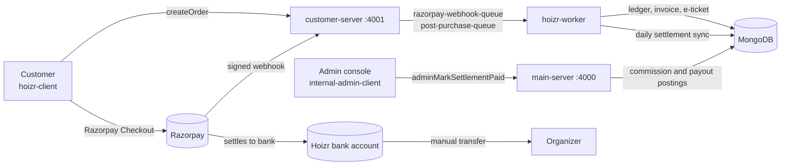
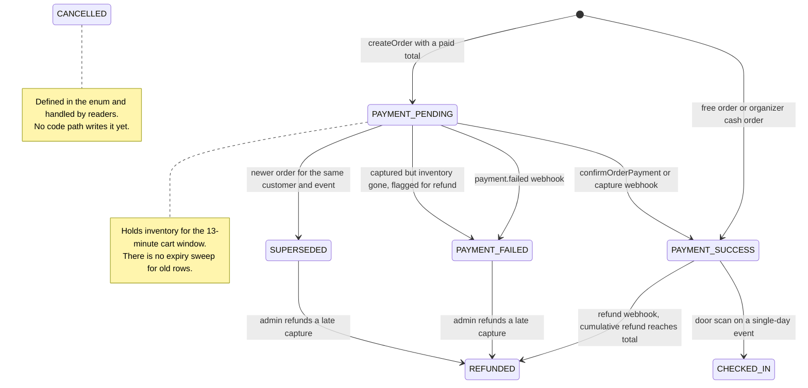
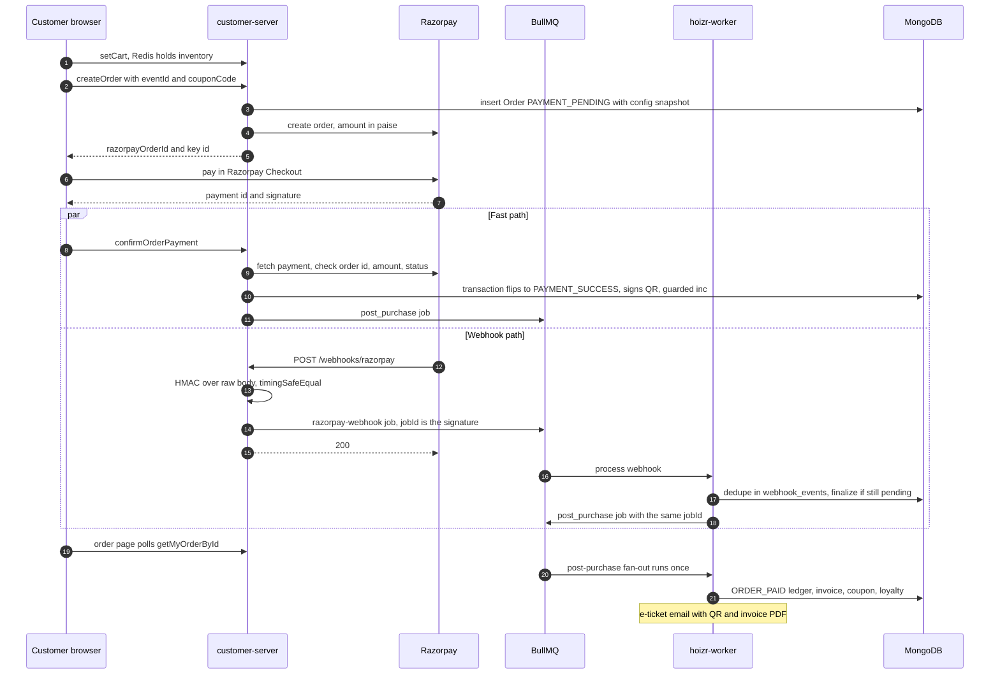
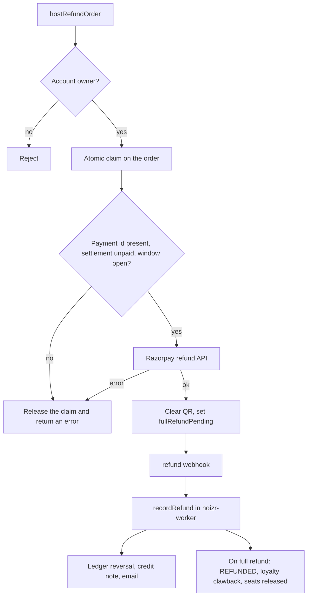

# Payments and money flow

This chapter follows a customer's payment from checkout to the organizer's bank account: server-side pricing, Razorpay checkout confirmed twice (a signed browser callback and a signed webhook) without double effects, refunds, the double-entry ledger, and the manual, checklist-gated settlement of organizer payouts. Organizers are called *hosts* in code, so expect identifiers such as `hostId` and `HOST_TICKET_PAYABLE`.

## TL;DR

- One pricing function on the server computes every amount in integer paise. The client sends ticket ids, quantities and a coupon code. It never sends a price.
- A paid order is finalized by whichever arrives first: the browser's signed confirm call or Razorpay's signed webhook. A sentinel field checked inside a MongoDB transaction turns the second arrival into a no-op.
- Ticket-payment webhooks are verified (HMAC over the raw body, constant-time compare), enqueued and acknowledged. Every side effect runs later in BullMQ workers.
- Every ticket and marketing-credit money movement is a balanced double-entry transaction with a unique idempotency key, so retries can never post twice.
- No code moves money to organizers. An admin transfers the payout from the bank. They can only mark the settlement as paid after a nine-point server-side checklist passes.

## Contents

- [The money path at a glance](#the-money-path-at-a-glance)
- [Principles](#principles)
- [Order lifecycle](#order-lifecycle)
- [Pricing engine](#pricing-engine)
- [Razorpay integration](#razorpay-integration)
- [Free, RSVP and offline orders](#free-rsvp-and-offline-orders)
- [Refunds](#refunds)
- [Double-entry ledger](#double-entry-ledger)
- [Settlement and payouts](#settlement-and-payouts)
- [Invoices](#invoices)
- [Known limitations](#known-limitations)

## The money path at a glance

Customers pay into a single Razorpay account owned by Hoizr. The money sits in a clearing account until Razorpay settles it to Hoizr's bank. After the event, an admin pays the organizer their net amount and records that in the internal console.



| Service | Money responsibilities | Start reading |
|---|---|---|
| `customer-server` | Cart, pricing, coupons, order creation, Razorpay order creation, checkout confirm fast path, webhook intake, free orders, minting organizer cash orders | [`cart-pricing.ts`](https://github.com/roop37/customer-server/blob/main/src/modules/cart/service/cart-pricing.ts), [`order.service.ts`](https://github.com/roop37/customer-server/blob/main/src/modules/order/service/order.service.ts), [`razorpay-webhook.route.ts`](https://github.com/roop37/customer-server/blob/main/src/routes/razorpay-webhook.route.ts) |
| `hoizr-worker` | Webhook processing, paid-order fan-out (ledger, invoice, e-ticket), refunds and chargebacks, loyalty points, reconciliation crons | [`razorpay-webhook.process.ts`](https://github.com/roop37/hoizr-worker/blob/main/src/workers/razorpay-webhook/razorpay-webhook.process.ts), [`paid-order-fanout.ts`](https://github.com/roop37/hoizr-worker/blob/main/src/utils/paid-order-fanout.ts) |
| `main-server` | Commission stamping, organizer refunds, offline tickets and payment links, settlements, ledger reports, marketing-credit top-ups | [`host-order.service.ts`](https://github.com/roop37/main-server/blob/main/src/modules/hostOrders/service/host-order.service.ts), [`payout-settlement.service.ts`](https://github.com/roop37/main-server/blob/main/src/modules/payoutSettlement/service/payout-settlement.service.ts) |
| `hoizr-shared` | `OrderStatus` and ledger enums, schemas, the ledger poster, settlement math, service-to-service HMAC | [`post-transaction.ts`](https://github.com/roop37/hoizr-shared/blob/main/src/ledger/post-transaction.ts), [`settlement-math.ts`](https://github.com/roop37/hoizr-shared/blob/main/src/ledger/settlement-math.ts) |
| `internal-admin-client` | Settlement console, late-capture refunds, ledger and reconciliation views | [`payoutSettlements/index.tsx`](https://github.com/roop37/internal-admin-client/blob/main/components/modules/payoutSettlements/index.tsx) |

## Principles

### Integer paise at every boundary

The pricing engine converts rupees to paise once and applies every percentage to an integer, rounding to the nearest paisa. It converts back to rupees only for the GraphQL response. A tripwire at the end throws if the components do not add up to the total, or if the rupee total does not map back to the same paise that Razorpay will charge.

```ts
const toPaise = (rupees: number): number => Math.round(Number(rupees) * 100);
// ...
const pctOfPaise = (paise: number, percent: number): number =>
  Math.round((paise * percent) / 100);
// ...
  const componentsPaise =
    taxablePaise + taxesPaise + applicationFeePaise + platformFeeGstPaise;
  const totalAmount = toRupees(totalPaise);
  if (
    componentsPaise !== totalPaise ||
    Math.round(totalAmount * 100) !== totalPaise
  ) {
    throw new Error(
      `Cart pricing reconciliation failed: components=${componentsPaise} total=${totalPaise} roundtrip=${Math.round(
        totalAmount * 100
      )}`
    );
  }
```

Source: [`customer-server/src/modules/cart/service/cart-pricing.ts`](https://github.com/roop37/customer-server/blob/main/src/modules/cart/service/cart-pricing.ts)

Razorpay amounts and ledger entries (`debitPaise`, `creditPaise`) are paise integers too. `Order` and `PayoutSettlement` documents store rupee values derived from paise. Consumers convert them back with `Math.round(x * 100)` before comparing or posting, and settlement math runs in rupees with two-decimal rounding.

### The server is the only price source

[`CreateOrderInput`](https://github.com/roop37/customer-server/blob/main/src/modules/order/interfaces/order.input.ts) has no price field. The cart holds ticket ids, quantities and a server-filled `unitPriceAtAdd` per line, and `createOrder` compares that snapshot with the live event price in paise. If an organizer changed a price mid-cart, the customer is asked to review the cart. If the recomputed total no longer matches an existing Razorpay order, `ensureRazorpayOrder` issues a fresh one, so the charge and the books always agree.

### Never trust the browser

The confirm call from the browser is only a hint. The server checks the Razorpay checkout signature, fetches the payment from Razorpay, and compares the order id, the exact amount in paise and the status:

```ts
    const signatureOk = razorpay.verifyCheckoutSignature({
      razorpayOrderId,
      razorpayPaymentId,
      razorpaySignature: razorpaySignature ?? "",
    });
    if (!signatureOk) {
      throw new ErrorWithProps("Invalid payment signature");
    }
    // ...
    if (payment?.order_id !== razorpayOrderId) {
      throw new ErrorWithProps("Payment does not match this order");
    }
    const expectedAmountPaise = Math.round(
      Number(existing.totalAmount ?? 0) * 100
    );
    if (Number(payment?.amount ?? 0) !== expectedAmountPaise) {
      throw new ErrorWithProps("Payment amount does not match this order");
    }
```

Source: `confirmPayment` in [`customer-server/src/modules/order/service/order.service.ts`](https://github.com/roop37/customer-server/blob/main/src/modules/order/service/order.service.ts)

Webhooks are verified at the HTTP edge and verified again in the worker. Customer-facing order responses go through a sanitized view ([`order.view.ts`](https://github.com/roop37/customer-server/blob/main/src/modules/order/interfaces/order.view.ts)) that leaves out internal accounting fields such as commission and gateway fees.

### Idempotent by construction

Every money step can run twice without harm. The system relies on that, because the fast path and the webhook race each other and BullMQ retries failed jobs.

| Step | What makes it idempotent |
|---|---|
| Order finalization | `qrCodeData` is set only on success and is checked inside the finalization transaction. Only `PAYMENT_PENDING` orders can move to success |
| Post-purchase fan-out | The fast path and the webhook path enqueue the same deterministic BullMQ `jobId`, `post_purchase:<orderId>` |
| Webhook intake | Each delivery is recorded in `webhook_events` with a unique `providerEventId`. Events already `PROCESSED` or `IGNORED` are skipped |
| Ledger | `LedgerTransaction.idempotencyKey` has a unique index ([`ledger.schema.ts`](https://github.com/roop37/hoizr-shared/blob/main/src/schemas/ledger.schema.ts)) |
| Refund webhooks | One pipeline update filters on `paymentMeta.processedRefunds` not containing the refund id |
| Inventory | A conditional `$inc` with an `$expr` capacity check runs inside the transaction. Zero matches aborts the transaction |

### Freeze the inputs

Every order carries a required `appliedConfigSnapshot` ([`order.schema.ts`](https://github.com/roop37/hoizr-shared/blob/main/src/schemas/order.schema.ts)). It records the fee, GST and commission rates and the organizer's GST identity as they stood at checkout, so a historical order stays explainable after an admin edits the live configuration. Settlement does not read this snapshot yet (see [Known limitations](#known-limitations)).

## Order lifecycle

`OrderStatus` lives in [`hoizr-shared/src/enums/ticket.enum.ts`](https://github.com/roop37/hoizr-shared/blob/main/src/enums/ticket.enum.ts). MongoDB stores the PascalCase values (`PaymentPending`), and GraphQL serializes the enum keys (`PAYMENT_PENDING`). The diagram uses the keys. The field on `Order` is `orderStatus`, and it defaults to `PAYMENT_PENDING`.



Transitions are written in three places:

- customer-server's [`order.service.ts`](https://github.com/roop37/customer-server/blob/main/src/modules/order/service/order.service.ts): `createOrder`, `finalizeFreeOrder`, `createIssuedOfflineOrder` and `confirmPayment`;
- the worker's [`razorpay-webhook.process.ts`](https://github.com/roop37/hoizr-worker/blob/main/src/workers/razorpay-webhook/razorpay-webhook.process.ts): `finalizeSuccess`, `finalizeFailure` and `recordRefund`;
- the door scanner in [`scanner.service.ts`](https://github.com/roop37/customer-server/blob/main/src/modules/scanner/service/scanner.service.ts). It sets `CHECKED_IN` on single-day events only; multi-day events append to `dayCheckIns` and stay `PAYMENT_SUCCESS`.

Two details matter for money. First, a partial refund keeps the order in `PAYMENT_SUCCESS` and sets `refundAmount` above zero, since there is no partial-refund status. Second, a capture that arrives for an order already `SUPERSEDED`, `PAYMENT_FAILED`, `CANCELLED` or `REFUNDED` never grants entry. The worker keeps the status and sets `requiresManualRefund`, `requiresAdminReview` and `orphanCapture` on `paymentMeta`. The order then shows up in the admin console's priority refund queue.

## Pricing engine

`computeCartPricingForLines` in [`cart-pricing.ts`](https://github.com/roop37/customer-server/blob/main/src/modules/cart/service/cart-pricing.ts) is the only pricing function, and it is pure (no database access). The cart preview, the public coupon preview, `createOrder` and organizer cash orders all call it, so a customer never sees one number and pays another. Rates come from admin-editable `Config` rows keyed by [`ConfigTypeEnum`](https://github.com/roop37/hoizr-shared/blob/main/src/enums/master.enum.ts), read through a short-lived Redis cache ([`configs-cache.ts`](https://github.com/roop37/customer-server/blob/main/src/utils/configs-cache.ts)).

### Step by step

1. **Line gross.** Unit price, read from the event on the server, times quantity, in paise. Add-ons (`extras`) are their own lines.
2. **Coupon discount.** The discount is clamped to the ticket gross and split pro rata across ticket lines. Paise left over from rounding go to lines that still have room. Add-ons are never discounted.
3. **Taxable value.** Discounted ticket lines plus add-ons. This is stored as `Order.subtotal`, so `subtotal` is post-discount. It is the base for both the customer platform fee and the organizer commission.
4. **Ticket GST.** Charged only when the organizer's primary, active, admin-verified payout account has a GSTIN and a qualifying registration type (`canHostCollectTicketGst`). Each ticket's GST setting decides its rate, and the tax is rounded per line on the post-discount amount, as an invoice would. Add-ons carry no ticket GST. Ticket GST passes through to the organizer.
5. **Platform fee.** A configured percentage of the taxable value, never of the ticket GST. GST on the fee is computed separately, also from config.
6. **Total.** Taxable value + ticket GST + platform fee + GST on the fee. The tripwire shown above asserts the sum.

The organizer commission is not part of the customer's total. It is deducted from the organizer's payout at settlement (see [Settlement and payouts](#settlement-and-payouts)).

### Coupons

Organizer coupons are evaluated by a pure function, `evaluateCoupon` in [`coupon-eval.ts`](https://github.com/roop37/customer-server/blob/main/src/modules/order/service/coupon-eval.ts). It checks validity (dates, weekdays), scope (tickets, minimum cart value), usage caps (total, per customer, sales, first order) and the discount type (capped percentage, fixed amount or free). A coupon is either tied to one event or valid across the organizer's events. Organizers fund discounts through a lower `subtotal`, so Hoizr books no discount expense.

Redemption is recorded only after payment is confirmed. `recordCouponRedemption` does a `$push` guarded by `"usage.orderId": { $ne }`, so a replay never counts twice, then a second pipeline update with `$cond` deactivates the coupon once it reaches its usage or sales limit.

### Loyalty coupons

Customers earn loyalty points on paid orders, with a separate wallet for each organizer, platform collaborator and lineup artist on the event. The post-purchase worker credits them in one transaction with unique idempotency keys. To spend points, `claimLoyaltyReward` takes a short Redis lock, then in one MongoDB transaction decrements the balance behind a `balance >= cost` guard, checks stock, mints a single-use coupon bound to the customer and writes a `REDEEM` row ([`loyalty.service.ts`](https://github.com/roop37/customer-server/blob/main/src/modules/loyalty/service/loyalty.service.ts)). At checkout that coupon goes through the normal evaluator and pricing engine, plus one guard:

```ts
export const isLoyaltyCouponUsableBy = (
  coupon: any,
  customerId?: string
): boolean => {
  if (coupon?.origin !== "loyalty") return true;
  return String(coupon?.boundCustomerId ?? "") === String(customerId ?? "");
};
```

Source: [`coupon-eval.ts`](https://github.com/roop37/customer-server/blob/main/src/modules/order/service/coupon-eval.ts). A leaked loyalty code does nothing for anyone else.

## Razorpay integration

Hoizr uses the [Razorpay API](https://razorpay.com/docs/api/), [Razorpay Checkout](https://razorpay.com/docs/payments/) and [Razorpay webhooks](https://razorpay.com/docs/webhooks/), through a small axios wrapper per service (for example [customer-server `razorpay.client.ts`](https://github.com/roop37/customer-server/blob/main/src/utils/razorpay.client.ts)).



<!-- SCREENSHOT: customer-checkout | hoizr-client checkout page with the Razorpay Checkout sheet open over the order summary -->

### Creating the order

Before any money is involved, `createOrder` checks rate limits, that the event is published and not paused by an admin, that the cart reservation is still live, bookability (sales window, waitlist gate, per-ticket rules), stale prices, per-customer purchase caps, venue capacity and the coupon. A payment-link id, if present, must belong to this event and still be awaiting payment.

A zero total is finalized on the spot (see [Free, RSVP and offline orders](#free-rsvp-and-offline-orders)). Otherwise the server reuses an identical pending order or creates a new `PAYMENT_PENDING` one. `ensureRazorpayOrder` creates the Razorpay order with the amount in paise, `receipt` set to the Hoizr order id and the order, event and customer ids in `notes`. Older pending orders from the same customer for the same event become `SUPERSEDED`.

### Checkout in the browser

[`CheckoutClient.tsx`](https://github.com/roop37/hoizr-client/blob/main/src/app/checkout/CheckoutClient.tsx) opens Razorpay Checkout with the server-issued Razorpay order id. The success `handler` follows one rule: once it fires, money may already be debited, so the customer must never land back on a "Pay" button. It clears the local cart, tries `confirmOrderPayment` (swallowing any error) and always redirects to `/orders/<id>?just_paid=1`, which polls until the order is finalized. On `payment.failed` the sheet stays open for a retry on the same Razorpay order, unless the server reports that an earlier attempt already succeeded.

### Confirming on the fast path

After the checks shown in [Never trust the browser](#never-trust-the-browser), `confirmPayment` opens a MongoDB transaction:

```ts
        if (order.qrCodeData) {
          finalized = order.toObject();
          return;
        }
        // ...
        if (order.orderStatus !== OrderStatus.PAYMENT_PENDING) {
          finalized = order.toObject();
          return;
        }
```

If the order is still pending, the transaction sets `PAYMENT_SUCCESS`, stores Razorpay's fee, signs the QR payload `hoizr:<orderId>:<paymentId>` with a versioned HMAC, increments `ticketSold` per line behind a `$expr` capacity guard and supersedes sibling pending orders. After commit it cleans up the Redis cart, records the coupon redemption and enqueues the post-purchase job.

### Webhook intake

customer-server registers `POST /webhooks/razorpay` with Fastify's raw body enabled, so the HMAC is computed over the exact bytes Razorpay signed:

```ts
const verifySignatureFastPath = (rawBody: string, signature: string): boolean => {
  const expected = crypto
    .createHmac("sha256", EnvVars.values.RAZORPAY_WEBHOOK_SECRET)
    .update(rawBody)
    .digest("hex");
  if (expected.length !== signature.length) return false;
  return crypto.timingSafeEqual(
    Buffer.from(expected, "utf8"),
    Buffer.from(signature, "utf8")
  );
};
// ...
        await getQueue().add(
          "RAZORPAY_WEBHOOK",
          { rawBody: bodyStr, signature },
          { jobId: signature }
        );
```

Source: [`customer-server/src/routes/razorpay-webhook.route.ts`](https://github.com/roop37/customer-server/blob/main/src/routes/razorpay-webhook.route.ts)

The route does no parsing and returns 200 once the job is queued, so slow downstream work never triggers gateway retries. The signature as `jobId` collapses duplicate deliveries while the first is still queued. main-server has its own, identically verified `/webhooks/razorpay` ([`razorpay-webhook.route.ts`](https://github.com/roop37/main-server/blob/main/src/routes/razorpay-webhook.route.ts)) that handles only marketing-credit top-ups.

### Processing in the worker

`processRazorpayWebhook` in [`razorpay-webhook.process.ts`](https://github.com/roop37/hoizr-worker/blob/main/src/workers/razorpay-webhook/razorpay-webhook.process.ts) re-verifies the HMAC, then records the event in `webhook_events` ([`webhook-event-log.ts`](https://github.com/roop37/hoizr-worker/blob/main/src/utils/webhook-event-log.ts)) under a unique `providerEventId`: the payload `id`, or `<event>:<entityId>` as a fallback. Already-processed duplicates stop here. The rest are routed:

| Razorpay event | Handler | Effect |
|---|---|---|
| `payment.captured`, `order.paid` | `finalizeSuccess` | Same transaction shape as the fast path, plus the late-capture safety net |
| `payment.failed` | `finalizeFailure` | Moves the order from `PAYMENT_PENDING` to `PAYMENT_FAILED` and releases the cart locks |
| `refund.created`, `refund.processed` | `recordRefund` | Cumulative refund, `REFUNDED` flip, ledger reversal (see [Refunds](#refunds)) |
| `payment.dispute.lost` | `recordChargeback` | Posts `CHARGEBACK_RECEIVED` and flags the order for admin review |
| other `payment.dispute.*` | none | Recorded as `IGNORED`, no ledger movement |

Payments whose notes mark them as artist merchandise go to separate merch handlers. If a handler throws, the event row is marked `FAILED` and BullMQ retries the job.

The post-purchase job ([`post-purchase.worker.ts`](https://github.com/roop37/hoizr-worker/blob/main/src/workers/post-purchase/post-purchase.worker.ts)) runs idempotent steps in order: sales log, auto-follows, coupon redemption, the audit row for free orders, loyalty accrual, the free-order e-ticket, the payment-link `PAID` flip, and finally `runPaidOrderFanout`. The paid fan-out posts `ORDER_PAID` only if the money went through Razorpay, then generates the customer invoice, sends the e-ticket email and fires the organizer's outbound `ORDER_PAID` webhook.

### Reconciliation

Crons run in the `Asia/Kolkata` timezone, and each tick takes a Redis `SET NX` lock keyed by cron name and minute ([`cron.scheduler.ts`](https://github.com/roop37/hoizr-worker/blob/main/src/workers/crons/cron.scheduler.ts)).

- **Fan-out safety net, every 15 minutes.** [`fanout-reconciliation.cron.ts`](https://github.com/roop37/hoizr-worker/blob/main/src/workers/crons/fanout-reconciliation.cron.ts) re-enqueues `post_purchase:<id>` for recent `PAYMENT_SUCCESS` orders with no `order:<id>:paid` or `order:<id>:free_issued` ledger row, covering a crash between the finalization commit and the enqueue.
- **Razorpay settlements, daily at 03:30 IST.** [`razorpay-settlements.cron.ts`](https://github.com/roop37/hoizr-worker/blob/main/src/workers/crons/razorpay-settlements.cron.ts) posts `RAZORPAY_SETTLEMENT_RECEIVED` for each processed Razorpay settlement, moving the gross out of `RAZORPAY_CLEARING` into `BANK`, gateway fees and GST input credit. Admins can run the same sync for a date range ([`razorpay-reconciliation.service.ts`](https://github.com/roop37/main-server/blob/main/src/modules/payoutSettlement/service/razorpay-reconciliation.service.ts)).
- **Reconciliation views.** The admin console compares one event's order totals with its ledger postings (`adminEventReconciliation`) and shows ledger account balances (`adminLedgerAccountBalances`), both served by [`ledger-reports.service.ts`](https://github.com/roop37/main-server/blob/main/src/modules/ledger/service/ledger-reports.service.ts).

<!-- SCREENSHOT: admin-ledger | internal-admin-client Government Money view with ledger account balances grouped into assets, liabilities, income and expense -->

## Free, RSVP and offline orders

### Free and RSVP orders

When the priced total is zero or less, `createOrder` calls `finalizeFreeOrder` instead of creating a Razorpay order. This covers guestlist tickets and fully discounted carts. A double-submitted RSVP returns the order that already exists. Otherwise one transaction inserts a `PAYMENT_SUCCESS` order and runs the guarded inventory `$inc`. The order gets a synthetic payment id, `free_<orderId>`, so every money query can tell it apart. The post-purchase worker then writes an `ORDER_FREE_ISSUED` ledger row with no entries, purely for the audit trail. The customer gets the QR e-ticket with no invoice.

### Organizer cash orders

An admin-verified organizer, or a collaborator they allow, can sell a ticket for cash or UPI collected in person ([`offline-ticket.service.ts`](https://github.com/roop37/main-server/blob/main/src/modules/offlineTicket/service/offline-ticket.service.ts)):

1. main-server creates an `OfflineOrder` with status `ISSUED` and calls customer-server at `POST /internal/offline-order/issue`, signed with a timestamped HMAC from the shared package ([`internal-auth.ts`](https://github.com/roop37/hoizr-shared/blob/main/src/utils/internal-auth.ts)).
2. customer-server's `createIssuedOfflineOrder` prices the lines with the same engine and mints a scannable `PAYMENT_SUCCESS` order with `source: "OFFLINE_ISSUED"` and payment id `offline_<orderId>`. It attaches to an existing customer when the phone or email matches, and never creates an account.
3. If the internal call fails, main-server marks the `OfflineOrder` `CANCELLED` so a retry starts clean.

Cash never touches Razorpay, so a cash order gets no `ORDER_PAID` posting and no tax invoice. Every money aggregation excludes these orders with one shared filter:

```ts
export const razorpayMoneyOrderMatch = {
  source: { $ne: "OFFLINE_ISSUED" },
  razorpayPaymentId: { $exists: true, $not: /^(offline_|free_)/ },
} as const;
```

Source: [`main-server/src/utils/razorpay-money-orders.ts`](https://github.com/roop37/main-server/blob/main/src/utils/razorpay-money-orders.ts). Without this filter, settlement would pay the organizer again for cash they already hold.

### Payment links

Instead of collecting cash, an organizer can send a payment link. main-server creates an `OfflineOrder` in `LINK_SENT` status with a random short code and a 45-minute expiry, and sends `/t/<code>` by email (and by WhatsApp when that channel is enabled). The customer signs in and pays through the normal `createOrder` with `offlineOrderId`. The result is an ordinary Razorpay order with `source: "OFFLINE_LINK"` at live event prices, so the platform fee applies and the order counts toward settlement. After payment, the post-purchase worker flips the `OfflineOrder` to `PAID`.

### Guest checkout

> [!NOTE]
> Guest checkout has been removed. `createOrder` sits behind `isCustomerAuthenticated`, so every online order, payment links included, needs a signed-in customer. `CreateOrderInput` still accepts optional buyer contact details (`guestInfo`), which are stored on the order. Organizer cash orders are the only orders that may lack a `customerId`, and they keep the buyer's details in `guestInfo`. The old `GuestOrderInput` class in [`order.input.ts`](https://github.com/roop37/customer-server/blob/main/src/modules/order/interfaces/order.input.ts) is no longer referenced.

## Refunds

### Who can refund, and when

| Actor | Entry point | Rules |
|---|---|---|
| Organizer account owner (not team members) | `hostRefundOrder` (main-server), behind `isAdminVerifiedHost` and an owner check | Order is `PAYMENT_SUCCESS` or `CHECKED_IN`, the event's settlement is not yet paid, and the configurable window after the event ends is open ([`refund-guards.ts`](https://github.com/roop37/main-server/blob/main/src/utils/refund-guards.ts)). Always the full order total |
| Hoizr admin | `adminRefundLateCapture` ([`late-capture-refund.service.ts`](https://github.com/roop37/main-server/blob/main/src/modules/payoutSettlement/service/late-capture-refund.service.ts)) | Only orders flagged `requiresManualRefund`. Full order total |
| Customer | `requestOrderRefund` (customer-server) | Records a request on the order; no review screen reads it yet |

### Two-step flow

The organizer's call only starts a refund. The authoritative state change comes from Razorpay's refund webhook.



The claim is a `findOneAndUpdate` that sets `paymentMeta.hostRefundInitiatedAt` only when it is unset. Two clicks therefore cannot fire two refunds. Every failure path releases the claim, and a Razorpay error is stored as `lastRefundError` ([`host-order.service.ts`](https://github.com/roop37/main-server/blob/main/src/modules/hostOrders/service/host-order.service.ts)). Clearing the QR right away means the door scanner rejects the ticket before the webhook even arrives.

### What the refund webhook does

`recordRefund` claims the refund with one `findOneAndUpdate` using an aggregation-pipeline update. In a single atomic operation it skips refund ids already in `processedRefunds` (deduping the `refund.created` and `refund.processed` pair), adds to the cumulative `refundAmount`, flags partial refunds for admin review and flips the order to `REFUNDED` once the cumulative amount reaches the total.

Booked orders (not orphan captures) then get an `ORDER_REFUND` posting and a credit note. A full refund also reverses the loyalty points the order earned ([`loyalty-clawback.ts`](https://github.com/roop37/hoizr-worker/blob/main/src/utils/loyalty-clawback.ts)), fires the organizer's `ORDER_REFUNDED` webhook and releases the seats exactly once ([`refund-inventory.ts`](https://github.com/roop37/hoizr-worker/blob/main/src/utils/refund-inventory.ts)). Every refund emails the customer.

A lost dispute (`payment.dispute.lost`) is deduplicated by dispute id. It adds to `paymentMeta.chargebackAmount`, posts `CHARGEBACK_RECEIVED` and flags the order for review.

## Double-entry ledger

Each ticket, refund, settlement and marketing-credit money movement is a `LedgerTransaction` header with two or more `LedgerEntry` rows, stored in integer paise. Debits must equal credits.

### Accounts

[`LedgerAccount`](https://github.com/roop37/hoizr-shared/blob/main/src/enums/ledger.enum.ts) is a closed enum of 16 accounts. Adding one is a design change, not a runtime setting.

| Class | Accounts |
|---|---|
| Assets | `RAZORPAY_CLEARING`, `BANK`, `CHARGEBACK_RECEIVABLE`, `GST_INPUT_ITC_RECEIVABLE`, `CUSTOMER_RECEIVABLE`, `TDS_RECEIVABLE` |
| Liabilities | `HOST_TICKET_PAYABLE`, `HOST_TICKET_GST_PAYABLE`, `GST_OUTPUT_PAYABLE`, `MARKETING_CREDIT_LIABILITY`, `REFUND_PAYABLE`, `TCS_PAYABLE` |
| Income | `HOIZR_PLATFORM_FEE_INCOME`, `HOIZR_COMMISSION_INCOME`, `HOIZR_MARKETING_REVENUE` |
| Expense | `PAYMENT_GATEWAY_EXPENSE` |

Four accounts are declared but nothing posts to them yet: `CUSTOMER_RECEIVABLE`, `TDS_RECEIVABLE`, `REFUND_PAYABLE` and `TCS_PAYABLE`.

### The poster API

`postLedgerTransaction` in [`hoizr-shared/src/ledger/post-transaction.ts`](https://github.com/roop37/hoizr-shared/blob/main/src/ledger/post-transaction.ts) is the single write path, shared by main-server and the worker. Each service passes in its own Typegoose models, because each owns its own Mongoose connection.

```ts
export type LedgerEntryInput = {
  account: LedgerAccount;
  debitPaise?: number;
  creditPaise?: number;
  lineNarration?: string;
};

export type PostTransactionInput = {
  kind: LedgerTransactionKind;
  entityType: LedgerEntityType;
  entityId: string;
  idempotencyKey: string;
  context: NarrationContext;
  entries: LedgerEntryInput[];
  postedBy?: string;
  postedAt?: Date;
};
```

The function rejects entries that carry both a debit and a credit, coerces amounts to non-negative integer paise and throws on an unbalanced transaction. Only `ORDER_FREE_ISSUED`, the audit-only marker, may have no entries. The narration is built from a typed `context` union with one variant per kind, so a missing case fails at compile time. Inside one MongoDB transaction it checks the `idempotencyKey`, creates the header and inserts the entries, so a header never exists without its entries. If two workers race on the same key, the unique index aborts the loser and the function returns the winner:

```ts
  } catch (err: any) {
    // Race: another worker committed the same key concurrently; the
    // unique index on `idempotencyKey` aborts our transaction. Re-resolve
    // to the winning header.
    if (err?.code === 11000) {
      const winner = await models.transactionModel
        .findOne({ idempotencyKey: input.idempotencyKey })
        .select("_id")
        .lean();
      if (winner) {
        return {
          transactionId: String(winner._id),
          alreadyExisted: true,
        };
      }
    }
    throw err;
```

The two services wrap the poster differently. The worker's [`ledger-poster.ts`](https://github.com/roop37/hoizr-worker/blob/main/src/utils/ledger-poster.ts) logs failures and swallows them, so a ledger error never kills a webhook job. main-server's [`ledger.service.ts`](https://github.com/roop37/main-server/blob/main/src/modules/ledger/service/ledger.service.ts) logs and rethrows.

### Postings by event

| Kind | Posted by | Debit | Credit | Idempotency key |
|---|---|---|---|---|
| `ORDER_PAID` | worker, [`paid-order-fanout.ts`](https://github.com/roop37/hoizr-worker/blob/main/src/utils/paid-order-fanout.ts) | `RAZORPAY_CLEARING` (total) | `HOST_TICKET_PAYABLE` (subtotal), `HOST_TICKET_GST_PAYABLE` (ticket GST), `HOIZR_PLATFORM_FEE_INCOME` (fee), `GST_OUTPUT_PAYABLE` (GST on fee) | `order:<id>:paid` |
| `ORDER_FREE_ISSUED` | worker, post-purchase | none | none | `order:<id>:free_issued` |
| `ORDER_REFUND` | worker, [`order-refund-ledger.ts`](https://github.com/roop37/hoizr-worker/blob/main/src/utils/order-refund-ledger.ts) | The four `ORDER_PAID` credit accounts, pro rata | `RAZORPAY_CLEARING` (refund) | `order:<id>:refund:<refundId>` |
| `CHARGEBACK_RECEIVED` | worker, [`chargeback-ledger.ts`](https://github.com/roop37/hoizr-worker/blob/main/src/utils/chargeback-ledger.ts) | `CHARGEBACK_RECEIVABLE` | `RAZORPAY_CLEARING` | `chargeback:<disputeId>:received` |
| `RAZORPAY_SETTLEMENT_RECEIVED` | worker cron, admin sync | `BANK`, `PAYMENT_GATEWAY_EXPENSE`, `GST_INPUT_ITC_RECEIVABLE` | `RAZORPAY_CLEARING` | `razorpay_settlement:<id>:received` |
| `SETTLEMENT_COMMISSION` | main-server, on mark-settled | `HOST_TICKET_PAYABLE` | `HOIZR_COMMISSION_INCOME`, `GST_OUTPUT_PAYABLE` | `settlement:<id>:commission` |
| `PAYOUT_RELEASED` | main-server, on mark-settled | `HOST_TICKET_PAYABLE`, `HOST_TICKET_GST_PAYABLE` | `BANK` | `settlement:<id>:released` |
| `MARKETING_CREDIT_PURCHASE` | main-server, top-up | `RAZORPAY_CLEARING` | `MARKETING_CREDIT_LIABILITY`, `GST_OUTPUT_PAYABLE` | `marketing_credit:<paymentRef>:purchase` |
| `MARKETING_CREDIT_CONSUMED` | worker campaigns ([`marketing-credit-ledger.ts`](https://github.com/roop37/hoizr-worker/blob/main/src/utils/marketing-credit-ledger.ts)), main-server consumption | `MARKETING_CREDIT_LIABILITY` | `HOIZR_MARKETING_REVENUE` | `campaign:<id>:marketing_credit_consumed`, `mc_consume:<entryId>` |

The `ORDER_PAID` builder refuses to post, and logs an error, if the order's components do not sum to its total. The refund reversal spreads the refund across components pro rata, and the last component absorbs any rounding so the transaction always balances:

```ts
  for (let i = 0; i < components.length; i += 1) {
    const component = components[i];
    const isLast = i === components.length - 1;
    const debitPaise = isLast
      ? refundPaise - allocated
      : Math.round((component.paise * refundPaise) / totalPaise);
    allocated += debitPaise;
    pushDebit(entries, component.account, debitPaise, component.narration);
  }
```

Source: [`hoizr-worker/src/utils/order-refund-ledger.ts`](https://github.com/roop37/hoizr-worker/blob/main/src/utils/order-refund-ledger.ts)

## Settlement and payouts

> [!IMPORTANT]
> No code moves money to organizers, and no payout API is called. An admin transfers the organizer's net amount from Hoizr's bank outside the platform. They then record it with "Mark as settled", attaching the bank reference. The platform's job is to compute the amount, enforce the release checklist and keep the books.

### Commission: one fixed rate per event

On publish, main-server stamps `Event.commissionRate` from an admin-editable config row chosen by event type ([`event.service.ts`](https://github.com/roop37/main-server/blob/main/src/modules/event/service/event.service.ts)). Re-publishing keeps the existing rate, so an admin override survives. Admins can change it with `adminUpdateEventCommissionRate` only before the event starts. The commission is never charged to the customer: it comes out of the organizer's payout, with GST on the commission on top.

### Computing a settlement

There is one `PayoutSettlement` row per event ([`payout-settlement.schema.ts`](https://github.com/roop37/hoizr-shared/blob/main/src/schemas/payout-settlement.schema.ts)), with status `PENDING`, `PAUSED` or `PAID`. A `CANCELLED` value exists in the enum but nothing writes it. An admin creates or refreshes the row with `adminRefreshPayoutSettlement`, at any time, including mid-sale. `createOrRefreshForEvent` aggregates the event's `PAYMENT_SUCCESS` and `CHECKED_IN` orders, filtered by `razorpayMoneyOrderMatch`, into gross (sum of `subtotal`), ticket GST, Razorpay fees (informational), partial refunds and chargebacks. Fully refunded orders are already `REFUNDED`, so they drop out of gross and are not subtracted a second time.

The arithmetic lives in the shared package as a pure, dependency-free function:

```ts
  const commissionBaseAmount = grossAmount;
  const hoizrCommissionTotal = round2(
    commissionBaseAmount *
      (Math.max(0, Number(input.commissionRate ?? 0)) / 100)
  );
  const hoizrCommissionGstTotal = round2(
    hoizrCommissionTotal *
      (Math.max(0, Number(input.commissionGstRate ?? 0)) / 100)
  );
  // ...
  const commissionStackNet = Math.max(
    0,
    grossAmount +
      ticketGstFlowThroughTotal -
      hoizrCommissionTotal -
      hoizrCommissionGstTotal
  );
  const netPayoutAmount = round2(
    commissionStackNet - refundsTotal - chargebacksTotal
  );
```

Source: `calculatePayoutSettlementAmounts` in [`hoizr-shared/src/ledger/settlement-math.ts`](https://github.com/roop37/hoizr-shared/blob/main/src/ledger/settlement-math.ts)

Ticket GST passes straight through to the organizer. Net can go negative after refunds and chargebacks, and the caller treats that as a shortfall. The row's `scheduledFor` date follows the event's end date plus the configured refund window and a buffer. Once the event has ended, a refresh moves the row to `PAUSED` automatically if net is zero or less, or if the organizer has no verified primary payout account. A row already marked `PAID` is never recomputed.

### The release checklist

`evaluatePayoutReleaseSnapshot` is a pure function with its own tests. It returns nine checks, which the admin console shows and the mutation enforces again:

| Check | Passes when |
|---|---|
| `NET_PAYOUT_POSITIVE` | Net payout is above zero |
| `EVENT_NOT_CANCELLED` | The event is not cancelled |
| `EVENT_ENDED` | The event's end date has passed |
| `REFUND_WINDOW_CLOSED` | `scheduledFor` has passed |
| `PAYOUT_ACCOUNT_LINKED` | The settlement points at a payout account |
| `PAYOUT_ACCOUNT_ACTIVE` | That account is active |
| `PAYOUT_ACCOUNT_VERIFIED` | An admin has verified it |
| `PAYOUT_DESTINATION_READY` | It has a UPI id, or an account number with IFSC |
| `RAZORPAY_RECONCILIATION_CLEAN` | No order on the event is flagged for admin review |

`adminMarkSettlementPaid` re-runs the checklist on the server. An optional `force` flag skips only the two time-based checks, and the admin console never sends it. The mutation then atomically moves the row from `PENDING` or `PAUSED` to `PAID`, recording who marked it, when, and the bank reference note. Finally it posts `SETTLEMENT_COMMISSION` and `PAYOUT_RELEASED` with their idempotency keys ([`payout-settlement.service.ts`](https://github.com/roop37/main-server/blob/main/src/modules/payoutSettlement/service/payout-settlement.service.ts)). Organizers can read their own settlements through `hostListPayoutSettlements` and `hostGetPayoutSettlement`, both scoped to the caller's organizer account.

<!-- SCREENSHOT: admin-payout-settlements | internal-admin-client Payout Settlements page with the release checklist and the Mark as settled confirmation showing the payout breakdown -->

The console ([`payoutSettlements/index.tsx`](https://github.com/roop37/internal-admin-client/blob/main/components/modules/payoutSettlements/index.tsx)) also offers pause and resume, a list of ended events still awaiting settlement, the priority queue for late-capture refunds and the manual Razorpay settlement sync.

## Invoices

The worker generates three of the five document types in [`InvoiceType`](https://github.com/roop37/hoizr-shared/blob/main/src/enums/invoice.enum.ts):

| Type | Generated | Notes |
|---|---|---|
| `CUSTOMER_PLATFORM_FEE_INVOICE` | Yes | Hoizr is the supplier and the customer the recipient. The only line item is the booking fee and its GST, and the ticket value is footnoted as the organizer's. Skipped for free and cash orders ([`customer-platform-fee.ts`](https://github.com/roop37/hoizr-worker/blob/main/src/utils/invoice/customer-platform-fee.ts)) |
| `REFUND_CREDIT_NOTE` | Yes | Reverses the booking-fee portion for a refund ([`refund-credit-note.ts`](https://github.com/roop37/hoizr-worker/blob/main/src/utils/invoice/refund-credit-note.ts)) |
| `MARKETING_CREDIT_INVOICE` | Yes | For organizer marketing-credit top-ups ([`marketing-credit.ts`](https://github.com/roop37/hoizr-worker/blob/main/src/utils/invoice/marketing-credit.ts)) |
| `HOST_COMMISSION_INVOICE` | No | Enum value and number prefix only |
| `HOST_PAYOUT_STATEMENT` | No | Enum value and number prefix only |

Invoice numbers look like `HOIZR/CFEE/26-27/000001`: a per-type prefix, the Indian fiscal year (April to March) and a sequence from an atomic `$inc` upsert on a per-type, per-year counter ([`invoice-numbering.ts`](https://github.com/roop37/hoizr-worker/blob/main/src/utils/invoice-numbering.ts)). [`gst-split.ts`](https://github.com/roop37/hoizr-worker/blob/main/src/utils/gst-split.ts) splits GST into CGST and SGST halves that always sum exactly, or IGST, in basis points. PDFs are private Cloudinary assets served through short-lived signed URLs ([`pdf-storage.ts`](https://github.com/roop37/hoizr-worker/blob/main/src/utils/pdf-storage.ts)). Customers can also request an invoice on demand, which enqueues the deterministic job `invoice:<orderId>`.

<!-- SCREENSHOT: customer-eticket | hoizr-client order page showing the QR e-ticket and the Download invoice action -->

## Known limitations

Hoizr is pre-launch. Each item below was traced in code and is a good contribution opportunity. The money helpers already have framework-free assertion scripts you can run with `npx ts-node <file>`, for example [`cart-pricing.service.test.ts`](https://github.com/roop37/customer-server/blob/main/src/tests/cart-pricing.service.test.ts), [`payout-release-preconditions.test.ts`](https://github.com/roop37/main-server/blob/main/src/tests/payout-release-preconditions.test.ts) and [`order-refund-ledger.test.ts`](https://github.com/roop37/hoizr-worker/blob/main/src/tests/order-refund-ledger.test.ts).

1. **The admin-review flag is never cleared.** Late captures, partial refunds and lost disputes set `paymentMeta.requiresAdminReview`, and `RAZORPAY_RECONCILIATION_CLEAN` blocks settlement while any order on the event carries it. Add an admin "resolve" action.
2. **Mark-settled flips the row to `PAID` before posting** `SETTLEMENT_COMMISSION` and `PAYOUT_RELEASED`, so a failed posting has no repair path. Post first, or add a re-post action on the same idempotency keys.
3. **Settlement reads the live commission rate,** not the order snapshot, so an admin change before the event starts re-prices earlier sales.
4. **In-sheet retries after a processed `payment.failed`** produce a capture that is flagged for manual refund instead of issuing the ticket. Keep the order pending across retries.
5. **Auto-capture is assumed.** The fast path accepts `authorized` payments and no code calls Razorpay's capture API.
6. **No expiry sweep** for `PAYMENT_PENDING` orders, and nothing writes `CANCELLED` for orders or settlements.
7. **Refund coverage.** Customer refund requests have no reviewer UI, no admin mutation refunds an ordinary order after the window, and a fully refunded `CHECKED_IN` order keeps its status, which skips the clawback, seat release and organizer webhook.
8. **Coupons** are recorded after confirmation, so concurrent checkouts can exceed `maxUsage`, and redemptions are not reversed on refund.
9. **Discount counted twice.** Loyalty accrual and the pending-order resume check both treat `subtotal` as pre-discount, but it is post-discount.
10. **Payment-link expiry is display-only.** `createOrder` does not check `linkExpiresAt`, and nothing writes `EXPIRED`.
11. **Modelled but not implemented:** inclusive GST, partial advance payment, and the `LOYALTY` and `GIFTCARD` discount types.
12. **Documents:** no organizer commission invoice or payout statement yet. Customer invoices always use the intra-state GST split because the billing state is not captured, and invoice dedupe is find-then-create without a unique index.
13. **Reconciliation:** the settlement sync reads a single page of Razorpay settlements, artist merchandise payments are not posted to the ledger, and both webhook receivers share one `webhook_events` key space that should be namespaced per receiver.
14. **Cleanup:** delete the unused `GuestOrderInput`, add a unique index on `PayoutSettlement.eventId`, and add tests for the order service, the webhook finalizer and the post-purchase worker.

---

Related chapters: [System architecture](./01-system-architecture.md) · [Domain model](./02-domain-model.md) · [Auth and RBAC](./03-auth-and-rbac.md) · [Background jobs with BullMQ](./04-background-jobs-bullmq.md) · [Redis and concurrency](./05-redis-and-concurrency.md) · [Engineering decisions](./11-engineering-decisions.md) · [Known gaps and roadmap](./12-known-gaps-and-roadmap.md) · [Third-party services](./13-third-party-services.md)

[Back to the walkthrough](../README.md)
