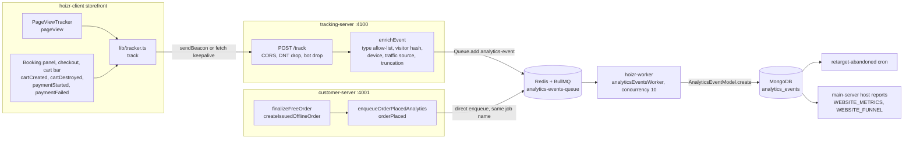
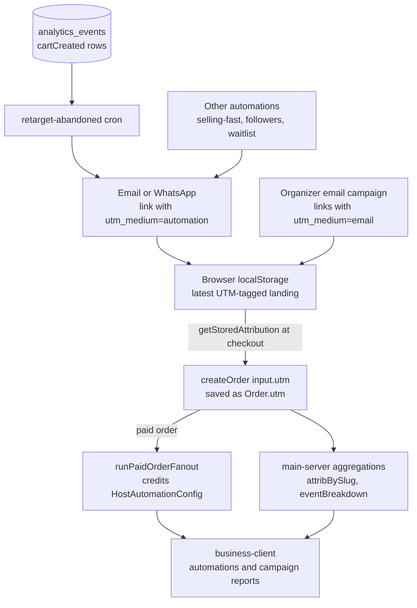

# Tracking and analytics pipeline

Hoizr runs its own small analytics pipeline. The customer storefront sends a handful of behaviour events to a dedicated ingest service, the service strips them down to a privacy-safe shape, and a BullMQ worker writes them to MongoDB, where they feed an automation and two organizer reports. This chapter follows one event from the browser to the database, shows how the ingest edge is hardened, lists every event type the system accepts, and ends with the steps for adding a new one.

## TL;DR

- The storefront ([`hoizr-client`](https://github.com/roop37/hoizr-client)) fires **five event types** (the sixth, `orderPlaced`, is emitted server-side) through a dependency-free SDK that uses `navigator.sendBeacon` and falls back to `fetch(..., { keepalive: true })`.
- [`tracking-server`](https://github.com/roop37/tracking-server) is a write-only [Fastify](https://fastify.dev/docs/latest/) service. Its only backing service is Redis. It drops Do-Not-Track and bot traffic, allow-lists event types and fields, replaces IP and User-Agent with a salted hash that rotates daily, and enqueues the event to BullMQ.
- A worker in [`hoizr-worker`](https://github.com/roop37/hoizr-worker) inserts one document per job into the `analytics_events` collection. customer-server enqueues the server-side `orderPlaced` event straight onto the same queue.
- Analytics rows drive the **abandoned-cart retargeting** automation and the organizer **Website Metrics** and **Booking Funnel** reports. Campaign and automation revenue attribution uses UTMs: the same SDK stores them, and checkout copies them onto `Order.utm`.
- Roadmap items: a retention policy, signed and rate-limited ingest, client-side batching, and `orderPlaced` on the paid checkout path.

## Contents

- [Goals](#goals)
- [The data path](#the-data-path)
- [Client SDK design](#client-sdk-design)
- [Ingest hardening](#ingest-hardening)
- [Event taxonomy](#event-taxonomy)
- [How analytics feed product features](#how-analytics-feed-product-features)
- [Privacy notes](#privacy-notes)
- [Known limitations and roadmap](#known-limitations-and-roadmap)
- [How to add a new event type](#how-to-add-a-new-event-type)

## Goals

The pipeline was designed around four constraints. Each one maps to a concrete mechanism.

| Goal | How the code meets it |
|---|---|
| **First-party** | Events go to Hoizr's own ingest service and land in Hoizr's own MongoDB. The ingest path has no third-party SDK, no geo-IP provider and no external API. |
| **Privacy-respecting** | The server *derives* what it needs and then *drops* the raw input. IP and User-Agent become a daily-rotating salted hash plus a coarse device class. The referrer is reduced to its hostname. `route` is the path only, with no query string. `DNT: 1` requests are discarded before any work happens. |
| **Cheap** | It is one small Node process that needs only Redis (4 source files). The event list is small on purpose ("every type here is a row in Mongo forever", in the source comments). Jobs are best-effort with two attempts. Each job is one `insert`, and reports aggregate raw rows on indexed fields instead of keeping rollup tables. |
| **Never break the page** | Every SDK function is wrapped in `try/catch`. The server answers `204` on internal errors so client-side `fetch().catch()` stays quiet. customer-server swallows enqueue failures so a tracking problem can never fail an order. |

The header comment in [`src/index.ts`](https://github.com/roop37/tracking-server/blob/main/src/index.ts) explains why ingest runs as its own process: it is a high-write, no-read surface that stays off the GraphQL hot path, it keeps accepting writes while the GraphQL servers deploy, and it sees raw visitor IPs, so it gets a tight allow-list of what it accepts.

> [!NOTE]
> The storefront, the organizer dashboard and the artist dashboard can also load [PostHog](https://posthog.com/docs/libraries/js) for product analytics, but only when `NEXT_PUBLIC_POSTHOG_KEY` is set. PostHog is a separate, optional channel. It never touches the pipeline described here, and nothing in this chapter depends on it. See [Third-party services](./13-third-party-services.md).

## The data path



### Browser events, step by step

1. **Emit.** A component calls `track("cartCreated", {...})`. The SDK merges in a base context (session id, browser visitor id, route, referrer, stored UTMs, client timestamp, `app: "hoizr-client"`) and posts one JSON body to `POST {NEXT_PUBLIC_TRACKING_SERVER_URL}/track` ([`src/lib/tracker.ts`](https://github.com/roop37/hoizr-client/blob/main/src/lib/tracker.ts)).
2. **Gate.** tracking-server checks CORS, drops `DNT: 1` and bot User-Agents with a `204`, and rejects unknown event types with a `400` ([`src/index.ts`](https://github.com/roop37/tracking-server/blob/main/src/index.ts)).
3. **Enrich.** `enrichEvent()` is a pure, I/O-free function. It builds the stored shape from an explicit field allow-list, computes the visitor hash, parses the User-Agent with [ua-parser-js](https://github.com/faisalman/ua-parser-js), classifies the traffic source and truncates ids, `route`, UTMs and `metadata` ([`src/utils/enrich.ts`](https://github.com/roop37/tracking-server/blob/main/src/utils/enrich.ts)).
4. **Enqueue.** The server calls `analyticsEventsQueue.add("analytics-event", enriched)` and answers `202 {ok:true}`. The queue is named `{analytics-events-queue}`; the braces are a Redis Cluster hash tag that keeps all of the queue's keys in one slot. Default job options are `attempts: 2` with exponential backoff from 2 s. Completed jobs are removed after 60 s and failed jobs after 24 h, with at most 1,000 of each kept ([`src/utils/queue.ts`](https://github.com/roop37/tracking-server/blob/main/src/utils/queue.ts)). Tracking is best-effort: a failing job is retried once and then dropped, and finished jobs don't pile up in Redis. See the [BullMQ docs](https://docs.bullmq.io/) for job option semantics.
5. **Persist.** `analyticsEventsWorker` drains the queue with concurrency 10. For each job it calls `AnalyticsEventModel.create(payload)` and rethrows on failure so BullMQ retries ([`analytics-events.worker.ts`](https://github.com/roop37/hoizr-worker/blob/main/src/workers/analytics-events/analytics-events.worker.ts), [`analytics-events.process.ts`](https://github.com/roop37/hoizr-worker/blob/main/src/workers/analytics-events/analytics-events.process.ts)).
6. **Store.** The Typegoose class `AnalyticsEvent` lives in [`hoizr-shared/src/schemas/analytics-event.schema.ts`](https://github.com/roop37/hoizr-shared/blob/main/src/schemas/analytics-event.schema.ts). It pins the collection name `analytics_events`, turns on timestamps and declares 10 indexes. Eight are `(field, createdAt -1)` compounds on `eventType`, `visitorHash`, `customerId`, `eventId`, `hostId`, `artistId`, `utmCampaign` and `sessionId`; the other two are single-field indexes on `orderId` and `createdAt`. The `eventType` and `eventId` compounds match the cron and report queries.

One small design choice is worth studying. tracking-server keeps the six event names and the queue name as **local literals** instead of importing them from `@hoizr-technology/shared`. The shared package's barrel pulls in `type-graphql`, which a lightweight ingest process does not install. The comment in [`src/utils/queue.ts`](https://github.com/roop37/tracking-server/blob/main/src/utils/queue.ts) records the incident that motivated this: a boot crash that browsers reported as a CORS error. The trade-off is that the literals must be kept byte-identical to the shared enum by hand.

### The server-side `orderPlaced` path

customer-server emits the conversion event itself, without going through tracking-server. `enqueueOrderPlacedAnalytics()` in [`order.service.ts`](https://github.com/roop37/customer-server/blob/main/src/modules/order/service/order.service.ts) builds the payload from the persisted order: `orderId`, `eventId`, `hostId` (the order's `businessId`), `customerId`, the five `utm*` fields from `Order.utm`, and `metadata { totalAmount, ticketCount, isGuest }`. It sets `app: "customer-server"`. The payload goes onto the same queue with the same job name and identical job options, so the worker treats both producers the same way. The call sits inside a `try/catch` that only logs, so an order can never fail because analytics failed.

There is no request IP or User-Agent at that point, so the event has no visitor hash, no device class and no traffic source. Today it fires from `dispatchOrderConfirmationComms()`, which runs for **free/RSVP orders** (`finalizeFreeOrder`) and **organizer-issued offline orders** (`createIssuedOfflineOrder`). The paid [Razorpay](https://razorpay.com/docs/) confirmation path does not emit it yet; see [Known limitations](#known-limitations-and-roadmap). Order and payment flow is covered in [Payments and money](./06-payments-and-money.md).

## Client SDK design

The SDK is one file, [`src/lib/tracker.ts`](https://github.com/roop37/hoizr-client/blob/main/src/lib/tracker.ts), with no dependencies. The storefront does not depend on the shared npm package, so the six event names are copied into a string-literal union, `AnalyticsEventName`.

**Off by default.** The endpoint comes from `NEXT_PUBLIC_TRACKING_SERVER_URL`. If that variable is unset, `TRACK_URL` is an empty string and `post()` returns before any request is made, so the storefront runs fine without tracking-server.

**Transport.** Each `track()` call makes one request. The body is sent with `sendBeacon` as a JSON `Blob` when it is under 60,000 characters (the beacon payload cap is 64 KB), and with `fetch(..., { keepalive: true })` otherwise. Both let the request finish even if the page unloads mid-flight, and neither blocks the UI thread. See MDN on [`navigator.sendBeacon`](https://developer.mozilla.org/en-US/docs/Web/API/Navigator/sendBeacon).

```ts
  try {
    const json = JSON.stringify(body);
    if (
      typeof navigator !== "undefined" &&
      typeof navigator.sendBeacon === "function" &&
      json.length < 60_000
    ) {
      const blob = new Blob([json], { type: "application/json" });
      navigator.sendBeacon(path, blob);
      return;
    }
    fetch(path, {
      // ...
      keepalive: true,
    }).catch(() => {});
  } catch {
    // Tracking must NEVER throw at the caller.
  }
```
<sub>Source: the body of `post()` in [`hoizr-client/src/lib/tracker.ts`](https://github.com/roop37/hoizr-client/blob/main/src/lib/tracker.ts)</sub>

**Batching.** The SDK exports `trackBatch()`, and the server accepts `POST /track/batch` with 1 to 50 events enqueued in a single `addBulk` call. No storefront code calls `trackBatch()` yet; its only caller is the unit test. Adding a small client-side queue that flushes on `pagehide` is an open roadmap item.

**Session and visitor ids.**
- `hoizr:trk:session` is a random id (`crypto.randomUUID()` where available) kept in `sessionStorage`, so it is scoped to one tab and survives reloads.
- `hoizr:trk:visitor` is a random id made the same way, kept in `localStorage` and sent as `clientVisitorId`. The server's field allow-list does not include it today, so it never reaches the database. The server-side visitor key is the daily hash described below.
- Both fall back to an in-memory id when storage throws, which happens in some private-browsing modes.

**UTM capture.** On every event, `getAttribution()` reads `utm_source`, `utm_medium`, `utm_campaign`, `utm_term` and `utm_content` from the current URL. If any is present, the full set is saved to `localStorage` under `hoizr:trk:firstTouch`, together with the referrer, the landing URL and a timestamp. Pages without UTMs reuse the stored set. The key name says "first touch", but in practice the stored value is the **most recent UTM-tagged landing**, and it is kept until another tagged link replaces it. At checkout, `getStoredAttribution()` supplies the five UTM fields to the `createOrder` mutation ([`CheckoutClient.tsx`](https://github.com/roop37/hoizr-client/blob/main/src/app/checkout/CheckoutClient.tsx)). That handoff connects browsing to revenue attribution.

**Automatic page views.** [`PageViewTracker`](https://github.com/roop37/hoizr-client/blob/main/src/components/analytics/PageViewTracker.tsx) is mounted inside a `Suspense` boundary in the root [`layout.tsx`](https://github.com/roop37/hoizr-client/blob/main/src/app/layout.tsx). It fires `pageView` whenever the App Router pathname or search params change. It keeps the last URL in a ref, so a no-op search-param update does not create a duplicate row.

**Tests.** [`tracker.test.ts`](https://github.com/roop37/hoizr-client/blob/main/src/lib/tracker.test.ts) uses `node:test` to check that `track()` and `trackBatch()` never throw when storage and `sendBeacon` are blocked.

## Ingest hardening

tracking-server is a public beacon endpoint, so it treats every request body as untrusted input. The layers below run in order.

| Layer | Behaviour | Where |
|---|---|---|
| CORS origin check | Allows `https://hoizr.com` and any `https://*.hoizr.com` origin, `localhost` origins for development, and origins listed in `TRACKING_CORS_ORIGINS` (trailing slashes stripped). This is a browser-side origin check, not authentication. A rejected origin gets `cb(null, false)` instead of a thrown error, so the browser blocks the response cleanly without a confusing 500. `credentials: true` is required because `sendBeacon` always sends credentials; the server ignores cookies. | [`src/index.ts`](https://github.com/roop37/tracking-server/blob/main/src/index.ts) |
| Security headers | `@fastify/helmet` with CSP off (the service serves no HTML) and `Cross-Origin-Resource-Policy: cross-origin`. | `src/index.ts` |
| Do-Not-Track | `DNT: 1` returns `204` and nothing is recorded. | `src/index.ts` |
| Bot filter | The User-Agent is matched against 17 substrings (crawlers, headless Chrome, uptime monitors, SEO bots) and matches return `204`. The source comment explains why: "Cheap to add a UA term here; expensive to filter at report time." | `looksLikeBot` in [`src/utils/enrich.ts`](https://github.com/roop37/tracking-server/blob/main/src/utils/enrich.ts) |
| Event-type allow-list | Only the six known types pass. Anything else gets `400 {ok:false, reason:"unknown_event_type"}`; the batch route skips unknown types silently. | `isKnownEventType` in `enrich.ts` |
| Field allow-list | The stored object is built field by field. Unknown body keys can't reach MongoDB, and raw IP, raw User-Agent, raw referrer, full URL and version strings are dropped after use. | `enrichEvent` in `enrich.ts` |
| Size limits | Ids are cut to 64 characters, `route` to 256 and each UTM to 128. `itemIds` keeps at most 50 entries of 64 characters each. `metadata` keeps at most 50 keys, with keys cut to 64 characters and string values to 1,024. Batches are capped at 50 events. The whole body is capped by Fastify's default 1 MiB `bodyLimit`. | `enrich.ts`, `src/index.ts` |
| Visitor hash | `sha256(salt \| UTC date \| ip \| userAgent)`, truncated to 32 hex characters. | `visitorHashOf` in `enrich.ts` |
| Failure contract | `202` accepted. `204` for dropped requests (DNT, bot) and internal errors. `400` only for caller bugs (unknown type, bad batch size). | `src/index.ts` |

The single-event handler shows the gate order:

```ts
      // Do-Not-Track signal — quietly accept but drop.
      const dnt = req.headers["dnt"];
      if (dnt === "1") {
        return reply.code(204).send();
      }

      const userAgent = String(req.headers["user-agent"] ?? "");
      if (looksLikeBot(userAgent)) {
        // ...
        return reply.code(204).send();
      }
      // ...
      const enriched = enrichEvent(req.body, ip, userAgent, origin);
      if (!enriched) {
        return reply.code(400).send({ ok: false, reason: "unknown_event_type" });
      }
      // ...
      return reply.code(202).send({ ok: true });
```
<sub>Source: [`tracking-server/src/index.ts`](https://github.com/roop37/tracking-server/blob/main/src/index.ts)</sub>

The visitor hash gives "unique visitors per day" without a cookie and without keeping any long-lived server-side identifier:

```ts
export const visitorHashOf = (ip: string, userAgent: string): string => {
  const day = new Date().toISOString().slice(0, 10); // YYYY-MM-DD UTC
  return crypto
    .createHash("sha256")
    .update(`${VISITOR_SALT}|${day}|${ip}|${userAgent}`)
    .digest("hex")
    .slice(0, 32);
};
```
<sub>Source: [`tracking-server/src/utils/enrich.ts`](https://github.com/roop37/tracking-server/blob/main/src/utils/enrich.ts)</sub>

The date is part of the hash input, so the same visitor gets a new hash at UTC midnight (05:30 in India). Hashes from different days can't be linked to each other. Rotating the salt also makes all past hashes unlinkable.

> [!IMPORTANT]
> The salt comes from `VISITOR_HASH_SALT`. When the variable is unset, the code falls back to a built-in default that is meant for local development only. Any real deployment must set its own secret value. The other variables are `PORT` (default 4100), `REDIS_HOST`, `REDIS_PORT`, `REDIS_PASSWORD`, `REDIS_TLS` and `TRACKING_CORS_ORIGINS` ([`.env.example`](https://github.com/roop37/tracking-server/blob/main/.env.example)).

Enrichment also derives two report dimensions:

- **`deviceType`** is `desktop`, `mobile`, `tablet`, `bot` or `unknown`, taken from the parsed User-Agent. The browser name and OS name are kept; their version strings are dropped.
- **`trafficSource`** is taken from `utm_medium` when it is recognised: `email`, `cpc`/`paid`/`ppc` (paid), `social`/`facebook`/`instagram` (social), `organic` or `referral`. Otherwise it comes from the referrer host. No referrer means `direct`. The site's own hosts mean `internal`. Search engines mean `organic`, social networks mean `social`, and anything else is `referral`.

## Event taxonomy

These are the only event types ingest accepts. Every browser event also carries the base context: `sessionId`, `clientVisitorId` (dropped at ingest), `route`, `referrer` (reduced to `referrerHost`), the five `utm*` fields, `clientTimestamp` and `app`.

| Event | Emitted where | Key fields beyond base context | Consumers |
|---|---|---|---|
| `pageView` | [`PageViewTracker`](https://github.com/roop37/hoizr-client/blob/main/src/components/analytics/PageViewTracker.tsx), on every App Router path or query change | None | Stored only. Host reports filter on `eventId`, which page views don't carry, so no report reads them yet. |
| `cartCreated` | [`EventBookingPanel.tsx`](https://github.com/roop37/hoizr-client/blob/main/src/app/events/%5Bslug%5D/EventBookingPanel.tsx), after a successful `setCart` mutation (signed-in buyers only). Also [`CheckoutClient.tsx`](https://github.com/roop37/hoizr-client/blob/main/src/app/checkout/CheckoutClient.tsx) when a cart is restored after sign-in, with `metadata.restoredAfterAuth: true`. | `eventId`, `hostId`, `itemIds` (ticket ids), `customerId` | The abandoned-cart retargeting cron. Website Metrics: "Carts created" plus the traffic-source table. Booking Funnel: "Ticket selected". |
| `cartDestroyed` | [`HCartBar.tsx`](https://github.com/roop37/hoizr-client/blob/main/src/components/hoizr-ui/HCartBar.tsx), only when the buyer dismisses the cart bar | `eventId`, `metadata.reason: "dismissed"` | Counted in the Website Metrics "Tracked events" total. |
| `paymentStarted` | `CheckoutClient.tsx`, just before the Razorpay payment sheet opens | `eventId`, `orderId` | Website Metrics: "Payment starts". Booking Funnel: "Payment started". |
| `paymentFailed` | `CheckoutClient.tsx`, in the Razorpay sheet's `ondismiss` handler | `eventId`, `orderId` | Booking Funnel: "Payment drop-off", computed as `paymentFailed / paymentStarted`. |
| `orderPlaced` | customer-server [`enqueueOrderPlacedAnalytics`](https://github.com/roop37/customer-server/blob/main/src/modules/order/service/order.service.ts), enqueued directly (free and offline-issued orders) | `orderId`, `eventId`, `hostId`, `customerId`, `utm*`, `metadata { totalAmount, ticketCount, isGuest }` | Website Metrics: the traffic-source table and the total. The funnel's "Orders placed" step counts the `orders` collection instead. |

The shared enum [`AnalyticsEventType`](https://github.com/roop37/hoizr-shared/blob/main/src/enums/analytics.enum.ts) defines a much larger catalogue: search, event detail views, artist views, auth steps and more. It reflects an earlier, broader plan. Only the six types above pass the ingest gate, and the comments in both the SDK and the server say the list is meant to stay small. Funnel steps that the `route` of a `pageView` can express are not given their own event type.

## How analytics feed product features

### Abandoned-cart retargeting

[`retarget-abandoned.cron.ts`](https://github.com/roop37/hoizr-worker/blob/main/src/workers/crons/retarget-abandoned.cron.ts) is the one automation that reads analytics rows. The scheduler in [`cron.scheduler.ts`](https://github.com/roop37/hoizr-worker/blob/main/src/workers/crons/cron.scheduler.ts) runs it every 15 minutes in the Asia/Kolkata timezone, behind a Redis single-flight lock with a 10-minute TTL. If several worker replicas are running, only one of them executes each tick.

```ts
  const pairs: Array<{ _id: { customerId: string; eventId: string } }> =
    await AnalyticsEventModel.aggregate([
      {
        $match: {
          eventType: AnalyticsEventType.CartCreated,
          customerId: { $nin: [null, ""] },
          eventId: { $nin: [null, ""] },
          createdAt: { $gte: windowStart },
        },
      },
      {
        $group: {
          _id: { customerId: "$customerId", eventId: "$eventId" },
          lastCartAt: { $max: "$createdAt" },
        },
      },
      { $match: { lastCartAt: { $lte: windowEnd } } },
      { $limit: 5000 },
    ]);
```
<sub>Source: [`hoizr-worker/src/workers/crons/retarget-abandoned.cron.ts`](https://github.com/roop37/hoizr-worker/blob/main/src/workers/crons/retarget-abandoned.cron.ts)</sub>

The window covers the last 6 hours. A `(customer, event)` pair qualifies when its latest cart activity is at least 20 minutes old. That is longer than the 13-minute Redis cart TTL in customer-server ([`src/utils/redis.ts`](https://github.com/roop37/customer-server/blob/main/src/utils/redis.ts)), so the cart has already expired when the nudge is sent. For each pair the cron then:

- skips events that are not published, have already ended, are hidden or have sales paused;
- skips customers who already hold a `PAYMENT_SUCCESS` or `CHECKED_IN` order for that event;
- reads the organizer's `HostAutomationConfig`. With no config row, email is on and WhatsApp is off, matching `defaultActive: true` and `defaultChannels` in the [automation registry](https://github.com/roop37/main-server/blob/main/src/modules/automations/registry.ts);
- claims `retarget_cart_claim:{eventId}:c:{customerId}:{channel}` with Redis `SET NX` and a 14-day TTL, then enqueues the email with a deterministic `jobId`. Each customer gets at most one nudge per event, per channel, per 14 days;
- batches WhatsApp sends per `(host, event)` through `sendAutomationWhatsApp`, which handles credit reservation and the ledger. WhatsApp goes out through MSG91 and is feature-flagged: the sender does nothing unless `WHATSAPP_ENABLED` is `true` ([`automation-whatsapp.ts`](https://github.com/roop37/hoizr-worker/blob/main/src/utils/automation-whatsapp.ts)). It also requires the customer's `whatsappMarketingOptIn` and checks the organizer's STOP list. Email reminders are Hoizr-funded; WhatsApp is charged to the organizer's marketing credit;
- increments `totalSent` on the organizer's config and per-event counters in `AutomationEventStat`.

Every message links to `/events/{slug}?utm_source=hoizr&utm_medium=automation&utm_campaign=retarget_abandoned`, which closes the attribution loop below. The queue and lock mechanics are covered in [Background jobs with BullMQ](./04-background-jobs-bullmq.md) and [Redis and concurrency](./05-redis-and-concurrency.md).

### Campaign and automation attribution

Attribution does not read `analytics_events`. It reads `Order.utm`, which is filled from the UTMs that the tracking SDK stored in the browser.



1. **Tagging.** Automations, including retargeting, selling-fast, follower and waitlist messages, set `utm_medium=automation` and `utm_campaign=<automationKey>`. Organizer email campaigns rewrite every link with `utm_medium=email` and `utm_campaign=campaignSlug(campaignName)` ([`host-campaigns.process.ts`](https://github.com/roop37/hoizr-worker/blob/main/src/workers/host-campaigns/host-campaigns.process.ts)). main-server mirrors the slug function so both sides compute the same key.
2. **Capture.** The SDK stores the UTMs on landing. Checkout sends them as `input.utm`, and customer-server saves them on the order as `Order.utm` (the `UTMData` type in [`common.types.ts`](https://github.com/roop37/hoizr-shared/blob/main/src/types/common.types.ts)).
3. **Credit at payment.** When a paid order reaches `PAYMENT_SUCCESS`, the post-purchase fan-out credits the automation that produced it:

```ts
  if (
    order.utm?.utmMedium === "automation" &&
    order.utm?.utmCampaign &&
    order.businessId
  ) {
    try {
      await HostAutomationConfigModel.updateOne(
        {
          hostId: String(order.businessId),
          automationKey: String(order.utm.utmCampaign),
        },
        {
          $inc: {
            attributedOrders: 1,
            attributedRevenue: Number(order.totalAmount ?? 0),
          },
        }
      );
      // ...
```
<sub>Source: [`hoizr-worker/src/utils/paid-order-fanout.ts`](https://github.com/roop37/hoizr-worker/blob/main/src/utils/paid-order-fanout.ts)</sub>

4. **Live breakdowns.** `eventBreakdown` in [`automation.service.ts`](https://github.com/roop37/main-server/blob/main/src/modules/automations/service/automation.service.ts) aggregates the organizer's orders where `utm.utmMedium = "automation"` and `utm.utmCampaign = key`, grouped by event. `attribBySlug` in [`host-report.service.ts`](https://github.com/roop37/main-server/blob/main/src/modules/hostReports/service/host-report.service.ts) groups paid orders by `utm.utmCampaign` and computes net sales. That figure feeds the Campaign Performance, Campaign ROI and Automation Performance reports.

The `selling_fast` automation sends tagged links, but it is triggered by orders, not analytics: every confirmed sale enqueues a check on the sold-out-trigger queue ([`sold-out-trigger.worker.ts`](https://github.com/roop37/hoizr-worker/blob/main/src/workers/sold-out-trigger/sold-out-trigger.worker.ts)). Email opens and clicks for organizer campaigns are also outside this pipeline. main-server's [`host-campaign-tracking.route.ts`](https://github.com/roop37/main-server/blob/main/src/routes/host-campaign-tracking.route.ts) records them on the campaign's own stats.

<!-- SCREENSHOT: business-automations | Automations page showing an automation card with "Revenue attributed" and conversions tiles -->

### Organizer dashboards

The `getHostReport` GraphQL query in main-server is guarded by `isAuthenticated`, `isUser` and `loadPermissions` ([resolver](https://github.com/roop37/main-server/blob/main/src/modules/hostReports/resolver/host-report.resolver.ts)). Results are always scoped to the organizer in the request context. Analytics reads are narrowed further: a helper first loads the organizer's own event ids, and every aggregation matches `eventId ∈ those ids` inside the date window. main-server registers the same collection explicitly in [`hostReports/schema/analytics-event.schema.ts`](https://github.com/roop37/main-server/blob/main/src/modules/hostReports/schema/analytics-event.schema.ts).

- **Website Metrics** (`WEBSITE_METRICS`) runs three `$group` aggregations in parallel: counts by `eventType` ("Tracked events", "Carts created", "Payment starts"), a traffic-source table over `cartCreated` and `orderPlaced`, and a device table.
- **Booking Funnel** (`WEBSITE_FUNNEL`) shows Ticket selected (`cartCreated`), then Payment started (`paymentStarted`), then Orders placed. It also reports cart-to-order conversion and payment drop-off. The orders figure comes from `OrderModel.countDocuments` over paid orders. A source comment explains why: the orders collection is authoritative, and the client-fired analytics stream is best-effort.

business-client renders both at `/reports/website-metrics` and `/reports/website-funnel` through the shared report catalogue in [`pages/reports/[reportType].tsx`](https://github.com/roop37/business-client/blob/main/pages/reports/%5BreportType%5D.tsx). The automation tiles on `/automations` read the fan-out counters. No report reads `customerId` or `visitorHash`; organizers see counts only.

<!-- SCREENSHOT: business-reports | Booking Funnel report with the ticket selected, payment started, order placed bar chart and the conversion and drop-off tiles -->

main-server's admin metrics service lists `analyticsEventsQueue` among the queues whose depth it monitors ([`admin-metrics.service.ts`](https://github.com/roop37/main-server/blob/main/src/modules/adminMetrics/service/admin-metrics.service.ts)). That way a stalled worker shows up on the internal health view.

## Privacy notes

| | Details |
|---|---|
| **Stored per event** (`analytics_events`) | `eventType`, `visitorHash` (daily), `sessionId`, `customerId` (only on `cartCreated` from a signed-in buyer, and on `orderPlaced`), `eventId`, `hostId`, `orderId`, `itemIds`, `route` (path only), `referrerHost`, `utm*`, `trafficSource`, `deviceType`, browser name, OS name, `metadata`, `clientTimestamp`, `app`, plus `createdAt`/`updatedAt` |
| **Seen by tracking-server but not stored** | Raw IP address, raw User-Agent, full referrer URL, query strings, browser and OS versions, `clientVisitorId`, and any body field outside the allow-list |
| **Never collected** | Page titles, viewport, language, timezone and geolocation. The schema has columns for some of these from an earlier design, but nothing populates them. |
| **Kept in the browser** | `hoizr:trk:session` (sessionStorage, per tab), `hoizr:trk:visitor` (localStorage, persistent random id), `hoizr:trk:firstTouch` (localStorage: UTMs, landing URL, referrer, capture time) |
| **Shown to organizers** | Aggregate counts scoped to their own events. No per-visitor or per-customer analytics are exposed. |

A few points worth knowing:

- **The visitor hash is pseudonymous, not anonymous.** It cannot link one day to the next, but on any row that also carries `customerId`, that day's hash is tied to a known account. This is why the salt has to stay secret.
- **Do-Not-Track is enforced on the server.** The SDK still sends the beacon, and tracking-server discards it. The Global Privacy Control header (`Sec-GPC`) is not checked yet.
- **Retention is currently unbounded.** No TTL index or purge job exists for `analytics_events`. In Redis, completed jobs are removed after 60 seconds and failed jobs after 24 hours.
- **The abandoned-cart email is treated as a transactional cart reminder.** It is sent only to signed-in buyers who started a cart, and it is not gated on the email marketing opt-in. WhatsApp nudges are gated on `whatsappMarketingOptIn` and the organizer's STOP list.
- **PostHog, when enabled,** captures `$pageview` with the full URL. It is configured with `person_profiles: "identified_only"` ([`PostHogProvider.tsx`](https://github.com/roop37/hoizr-client/blob/main/src/components/analytics/PostHogProvider.tsx)) and sends to PostHog US cloud by default.

## Known limitations and roadmap

These are open contribution opportunities. The [Known gaps and roadmap](./12-known-gaps-and-roadmap.md) chapter collects items across all services.

**Data lifecycle and compliance**
- Add a retention policy for `analytics_events`, either as a TTL index or as rollups followed by a purge, plus an erasure path for a single customer's rows.
- Add a consent UI to the storefront and honour `Sec-GPC` alongside `DNT`.
- Decide whether to store `clientVisitorId` or stop sending it. Today the browser creates it and the server discards it.

**Ingest trust model**
- Beacons are unauthenticated by design, because the endpoint is public and must work before sign-in. Consumers should treat body fields as untrusted. Planned hardening: signed ingest for analytics beacons, rate limiting, and moving identity-bearing events server-side.
- Make the producer fail fast when Redis is unavailable, and make `/health` ping Redis. Today `/health` returns a static response.

**Coverage and data quality**
- Emit `orderPlaced` from the paid Razorpay confirmation path as well. Today it fires only for free and organizer-issued offline orders.
- Add a client-side queue that flushes through `/track/batch` on `pagehide`.
- Give `pageView` rows an `eventId` on event pages, or derive one from `route`, so that event-page views appear in organizer reports.
- Fire `paymentFailed` from Razorpay's `payment.failed` handler as well, not only when the sheet is dismissed.
- Add `cartDestroyed` to the shared `AnalyticsEventType` enum, and let the retarget cron skip carts the buyer dismissed on purpose.
- Add an expiry window to stored UTM attribution, and pick an explicit model, first-touch or last-touch.
- Tighten traffic-source classification. Use exact or dot-suffix matching on registrable domains instead of substring checks, and add a bucket for `utm_medium=automation`. `orderPlaced` rows currently land in `unknown` because they bypass enrichment.
- Reconcile the three automation revenue figures: the fan-out counter (cumulative gross, not reduced on refund), the per-event breakdown (live gross, includes refunded orders) and the reports (net of discounts and refunds, grouped by `utm_campaign`). Campaign attribution keys on a slug of the campaign name, so renaming a campaign splits its history.

**Developer experience**
- tracking-server's `package.json` still declares `@hoizr-technology/shared`, but no source file imports it. Removing it lets contributors run `npm install` without a GitHub Packages token.
- Add `node:test` table tests for the pure functions `enrichEvent`, `looksLikeBot` and `visitorHashOf`, plus a CI job that builds and runs them on pull requests.

## How to add a new event type

The event list is hand-synchronised in three places. Plan for all of them in one change.

1. **Check whether you need a new type at all.** Every type is a permanent row per occurrence. Two cheaper options often work: a field in `metadata` on an existing type, or a page-level step that can be read from a `pageView`'s `route`.
2. **Open the ingest gate.** Add the value to the local `AnalyticsEventType` enum in tracking-server's [`src/utils/enrich.ts`](https://github.com/roop37/tracking-server/blob/main/src/utils/enrich.ts). Until you do, the server answers `400 unknown_event_type`.
3. **Add it to the SDK union.** Extend `AnalyticsEventName` in hoizr-client's [`src/lib/tracker.ts`](https://github.com/roop37/hoizr-client/blob/main/src/lib/tracker.ts) so call sites type-check.
4. **Add it to the shared enum.** Add the same string to [`AnalyticsEventType`](https://github.com/roop37/hoizr-shared/blob/main/src/enums/analytics.enum.ts) in hoizr-shared, then build, version-bump and publish the package so workers and main-server can refer to it ([Local development](./09-local-development.md) covers the GitHub Packages setup). `cartDestroyed` shows what happens if this step is skipped: ingest accepts it, but the shared enum doesn't list it.
5. **Fire it.** Call `track()` with only the fields the allow-list keeps. Include `eventId` if organizers should see the event in reports, because reports scope by event id. The existing `cartDestroyed` call is a good template:

   ```ts
   track("cartDestroyed", {
     eventId: cart.eventId,
     metadata: { reason: "dismissed" },
   });
   ```
   <sub>Source: [`hoizr-client/src/components/hoizr-ui/HCartBar.tsx`](https://github.com/roop37/hoizr-client/blob/main/src/components/hoizr-ui/HCartBar.tsx)</sub>

   For a server-side event, copy customer-server's approach. Enqueue to `QueueNames.analyticsEventsQueue` with job name `"analytics-event"` and the same job options, and wrap the call so a failure can't break the business operation.
6. **New top-level field?** Add it to the object returned by `enrichEvent()` with a truncation limit, and add a `@prop` (plus an index if you will filter on it) to the [`AnalyticsEvent` schema](https://github.com/roop37/hoizr-shared/blob/main/src/schemas/analytics-event.schema.ts). Anything else belongs in `metadata`.
7. **Add a reader.** Add a report case in main-server's `HostReportService` or a worker cron. An event nobody reads still costs storage.
8. **Verify locally.** With Redis, tracking-server and hoizr-worker running:

   ```bash
   curl -i -X POST http://localhost:4100/track \
     -H 'content-type: application/json' \
     -d '{"eventType":"pageView","route":"/","app":"hoizr-client"}'
   # expect: 202 {"ok":true}; an unlisted eventType returns 400
   ```

   Then confirm that a new document appears in `analytics_events`.

---

Related chapters: [System architecture](./01-system-architecture.md) · [Background jobs with BullMQ](./04-background-jobs-bullmq.md) · [Redis and concurrency](./05-redis-and-concurrency.md) · [Payments and money](./06-payments-and-money.md) · [Frontend architecture](./08-frontend-architecture.md) · [Known gaps and roadmap](./12-known-gaps-and-roadmap.md) · [Third-party services](./13-third-party-services.md)

[Back to the walkthrough](../README.md)
