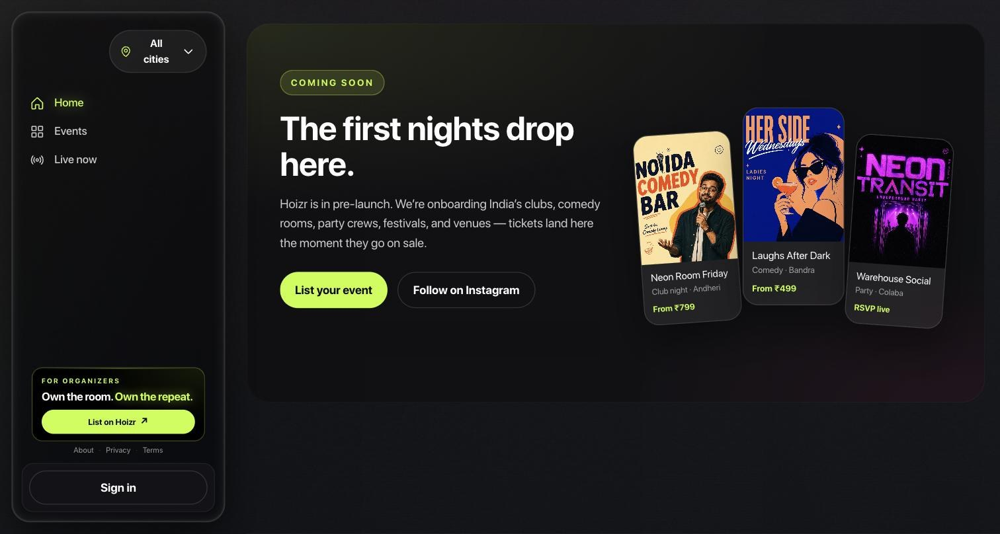
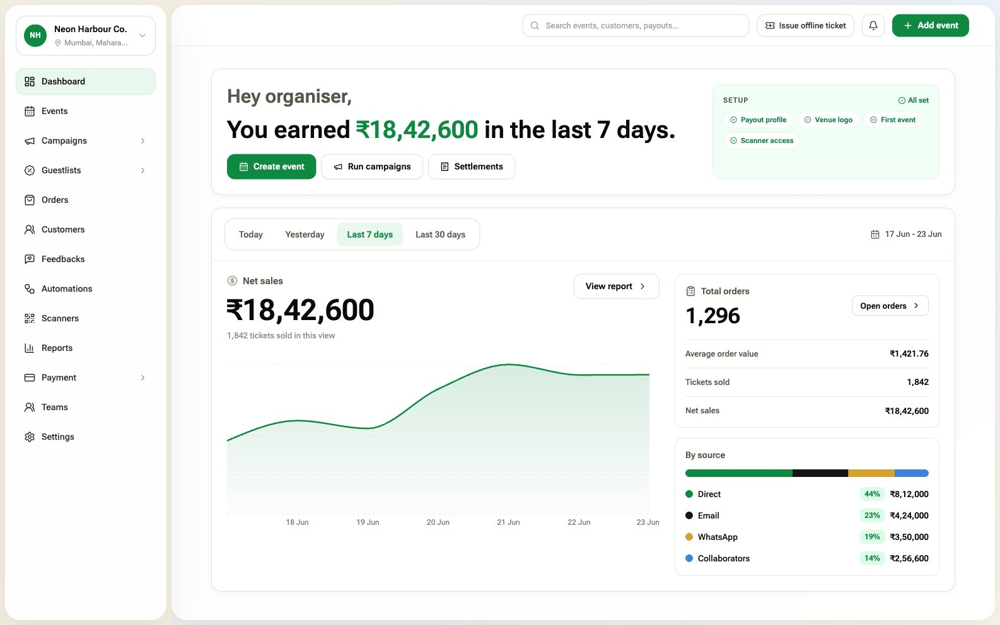
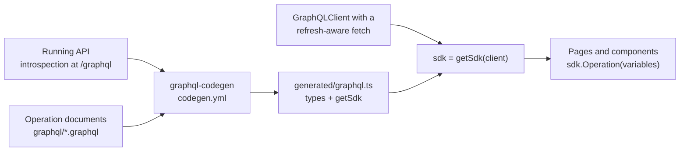
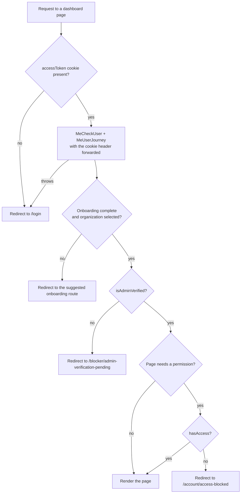
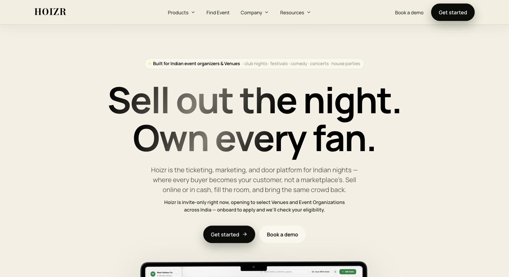
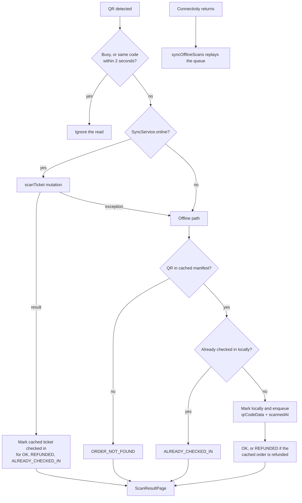

# Frontend architecture

Hoizr has five client apps: four Next.js 14 web apps and a Flutter door-scanner app. This chapter covers the patterns they share (typed GraphQL SDKs generated from operation files, a session-refreshing fetch wrapper, Zustand stores and server-side page guards), the design system each app ships, and how the scanner keeps admitting guests when the venue Wi-Fi drops.

## TL;DR

- **Four Next.js 14 apps** (fan storefront, organizer dashboard, internal admin console, artist dashboard) and **one Flutter app** for door staff. None imports the shared npm package. Each web app generates its types with GraphQL Code Generator against a live server.
- Each web app's main `GraphQLClient` has a custom `fetch`: on HTTP 401 it calls a refresh mutation and retries once. The generated SDK sits on top, so every operation inherits the refresh.
- The organizer dashboard and admin console **guard pages on the server** (cookie forwarded to `meUser` or `meAdmin`, then onboarding, verification and permission redirects). The storefront and artist app gate on the client and rely on the API's guards.
- `business-client` runs **both Next.js routers**: marketing, auth and the dashboard home on the App Router, the rest of the dashboard on the Pages Router, with one shared layout so routes can move one at a time.
- Times are **stored as UTC and shown in IST**, through `date-fns-tz` on input and `Intl.DateTimeFormat` with `Asia/Kolkata` (or a fixed +05:30 offset in Dart) on display.
- The scanner **caches the event's ticket list in SQLite**, admits from it when offline, and replays queued check-ins when the network returns.

## Contents

- [The five clients at a glance](#the-five-clients-at-a-glance)
- [The GraphQL codegen pipeline](#the-graphql-codegen-pipeline)
- [The token-refresh wrapper](#the-token-refresh-wrapper)
- [State with Zustand](#state-with-zustand)
- [SSR guards and the verification redirect](#ssr-guards-and-the-verification-redirect)
- [App Router and Pages Router in business-client](#app-router-and-pages-router-in-business-client)
- [Design systems](#design-systems)
- [Rich text handling](#rich-text-handling)
- [Timezone display](#timezone-display)
- [The admin module registry](#the-admin-module-registry)
- [The Flutter scanner app](#the-flutter-scanner-app)
- [SEO and structured data](#seo-and-structured-data)
- [Known limitations and roadmap](#known-limitations-and-roadmap)

## The five clients at a glance

| App (repo) | Users | Framework and router | Dev port | Talks to | UI kit |
|---|---|---|---|---|---|
| Storefront ([`hoizr-client`](https://github.com/roop37/hoizr-client)) | Fans discovering events and buying tickets | Next.js 14.2, App Router | 3009 | customer-server GraphQL; main-server for public artist data; tracking-server beacons | Tailwind plus a hand-written dark "glass" CSS system |
| Organizer dashboard and marketing site ([`business-client`](https://github.com/roop37/business-client)) | Venues, event organizations and their teams; visitors to `business.hoizr.com` | Next.js 14.2, App Router and Pages Router | 3000 | main-server GraphQL | shadcn/ui (Radix + Tailwind) plus the "Owner" kit |
| Internal admin ([`internal-admin-client`](https://github.com/roop37/internal-admin-client)) | Hoizr operations staff | Next.js 14.2, App Router | 5000 | main-server GraphQL | shadcn/ui (Radix + Tailwind) plus the Owner kit |
| Artist dashboard ([`hoizr-artist-client`](https://github.com/roop37/hoizr-artist-client)) | Performers managing a link-in-bio page, merch, riders, shows and guestlists | Next.js 14.2, App Router | 3004 | main-server GraphQL (artist session cookies) | Tailwind plus the editorial "MAK" components |
| Door scanner ([`hoizr-scanner-app`](https://github.com/roop37/hoizr-scanner-app)) | Door staff at an event | Flutter with `provider` | n/a (device) | customer-server GraphQL (Bearer token) | Material widgets themed with a Dart port of the Owner tokens |



<!-- SCREENSHOT: admin-dashboard | Internal admin dashboard with KPI tiles and system health badges -->


Traits shared by the four web apps:

- **The GraphQL schema is the contract.** The frontends never import `@hoizr-technology/shared`; code generation turns the schema into TypeScript ([chapter 01](./01-system-architecture.md) explains why).
- **Cookie sessions.** The API sets HTTP-only cookies and every request uses `credentials: "include"`, so no client stores a token. The scanner is the exception: it keeps its tokens in `flutter_secure_storage` and sends a Bearer header.
- **No Next.js middleware.** None of the apps has a `middleware.ts`. Guards run per page.
- **Yarn classic** lockfiles, and Next.js 14.2.4 (dashboard, admin) or 14.2.18 (storefront, artist app).

## The GraphQL codegen pipeline

Each web app keeps its operations in `.graphql` files. [GraphQL Code Generator](https://the-guild.dev/graphql/codegen/docs/getting-started) introspects a running server, validates the operations and writes one module with every type plus a `getSdk(client)` function, using the `typescript`, `typescript-operations` and [`typescript-graphql-request`](https://the-guild.dev/graphql/codegen/plugins/typescript/typescript-graphql-request) plugins. The output is committed, so a fresh clone builds without a backend.



The storefront's config points at customer-server and maps the date scalars to strings ([`codegen.yml`](https://github.com/roop37/hoizr-client/blob/main/codegen.yml)):

```yaml
overwrite: true
schema: "http://localhost:4001/graphql"
documents: "src/graphql/**/*.graphql"
generates:
  src/generated/graphql.ts:
    plugins:
      - "typescript"
      - "typescript-operations"
      - "typescript-graphql-request"
    config:
      enumsAsTypes: false
      scalars:
        DateTime: string
        Date: string
```

| App | Schema source | Operation documents | Operations |
|---|---|---|---|
| `hoizr-client` | customer-server `:4001` | 7 files in [`src/graphql/`](https://github.com/roop37/hoizr-client/tree/main/src/graphql) | 43 |
| `business-client` | main-server `:4000` | 20 files in [`graphql/`](https://github.com/roop37/business-client/tree/main/graphql) | 106 |
| `internal-admin-client` | main-server `:4000`, through a custom loader | 16 files in [`graphql/`](https://github.com/roop37/internal-admin-client/tree/main/graphql) | 76 |
| `hoizr-artist-client` | main-server `:4000` | 10 files in [`src/graphql/`](https://github.com/roop37/hoizr-artist-client/tree/main/src/graphql) | 33 |

One operation's round trip in the artist app. The document lives in [`src/graphql/links.graphql`](https://github.com/roop37/hoizr-artist-client/blob/main/src/graphql/links.graphql):

```graphql
query ArtistMyLinks {
  artistMyLinks {
    _id
    label
    url
    icon
    position
    isActive
  }
}
```

Codegen emits a typed SDK method ([`src/generated/graphql.ts`](https://github.com/roop37/hoizr-artist-client/blob/main/src/generated/graphql.ts)):

```ts
    ArtistMyLinks(variables?: ArtistMyLinksQueryVariables, requestHeaders?: GraphQLClientRequestHeaders, signal?: RequestInit['signal']): Promise<ArtistMyLinksQuery> {
      return withWrapper((wrappedRequestHeaders) => client.request<ArtistMyLinksQuery>({ document: ArtistMyLinksDocument, variables, requestHeaders: { ...requestHeaders, ...wrappedRequestHeaders }, signal }), 'ArtistMyLinks', 'query', variables);
```

And the page gets a fully typed result ([`src/app/links/LinksClient.tsx`](https://github.com/roop37/hoizr-artist-client/blob/main/src/app/links/LinksClient.tsx)):

```ts
      const data = await sdk.ArtistMyLinks();
```

Three variations to know before you touch codegen:

- **Custom schema loader in the admin console.** [`codegen.schema.js`](https://github.com/roop37/internal-admin-client/blob/main/codegen.schema.js) runs introspection itself, honours a `CODEGEN_SCHEMA_URL` override, and strips the `DIRECTIVE_DEFINITION` directive location before calling `buildClientSchema`.
- **A compatibility layer in business-client and the admin console.** Both began as a fork of an earlier restaurant point-of-sale codebase. Their `tsconfig.json` aliases `@/generated/graphql` to a `graphql-compat.ts` shim that re-exports the generated module and adds legacy names as `Proxy` objects ([`generated/graphql-compat.ts`](https://github.com/roop37/business-client/blob/main/generated/graphql-compat.ts)). The exported `sdk` in [`utils/graphqlClient.ts`](https://github.com/roop37/business-client/blob/main/utils/graphqlClient.ts) merges the generated SDK with legacy aliases, no-op stubs and hand-written operations. That kept the fork compiling while the schema changed, at the cost of an `sdk` typed `any`.
- **Typed and raw calls in the storefront.** [`src/lib/sdk.ts`](https://github.com/roop37/hoizr-client/blob/main/src/lib/sdk.ts) builds the typed SDK on the same client as the raw `gqlRequest` helper, and some screens still use hand-written query strings.

## The token-refresh wrapper

graphql-request accepts a custom `fetch`, and Hoizr uses it to make session refresh invisible to the rest of the code. The dashboard's version ([`utils/graphqlClient.ts`](https://github.com/roop37/business-client/blob/main/utils/graphqlClient.ts)):

```ts
const TOKEN_REFRESH_QUERY = "mutation TokenRefresh { tokensRefresh }";
// ...
  fetch: async (input: RequestInfo | URL, init?: RequestInit): Promise<Response> => {
    let response = await fetch(input, init);

    if (response.status === 401) {
      try {
        const client = new GraphQLClient(endpoint, { credentials: "include" });
        await client.request(TOKEN_REFRESH_QUERY, {}, init?.headers);
        response = await fetch(input, init);
      } catch (error) {
        console.error("Error refreshing tokens:", error);
        if (typeof window !== "undefined" && window.location.pathname !== "/login") {
          window.location.href = "/login";
        }
      }
    }

    return response;
  },
```

- The refresh uses a **separate** `GraphQLClient` with no custom `fetch`, so a failing refresh cannot trigger another refresh.
- The original request is **retried once**. There is no loop.
- `init?.headers` goes to the refresh call. During server-side rendering those headers carry the forwarded `cookie`.
- The redirect runs only in a browser, and never from `/login` itself.

The trigger is reliable because main-server returns a real HTTP 401 only when an access cookie is present but no longer verifies. Membership and permission failures come back as HTTP 200 with a GraphQL error, so the client never tries to refresh its way out of "forbidden" ([chapter 03](./03-auth-and-rbac.md) covers the server side).

| Client | Refresh call | Retries when | If refresh fails |
|---|---|---|---|
| `business-client`, admin console ([`util/graphqlClient.ts`](https://github.com/roop37/internal-admin-client/blob/main/util/graphqlClient.ts)) | `mutation TokenRefresh { tokensRefresh }` | the refresh request did not throw | hard redirect to `/login` |
| Storefront ([`src/lib/graphql.ts`](https://github.com/roop37/hoizr-client/blob/main/src/lib/graphql.ts)) | `customerTokenRefresh { success }` | `success === true` | the 401 stands; the page redirects after the auth store hydrates |
| Artist app ([`src/lib/graphql.ts`](https://github.com/roop37/hoizr-artist-client/blob/main/src/lib/graphql.ts)) | `artistTokenRefresh { success }` | `success` is truthy | the 401 stands; `RequireAuth` sends the artist to `/login` |
| Scanner ([`lib/services/graphql_service.dart`](https://github.com/roop37/hoizr-scanner-app/blob/main/lib/services/graphql_service.dart)) | `scannerTokenRefresh(refreshToken)` | GraphQL `extensions.code` is `UNAUTHENTICATED` or `TOKEN_EXPIRED`, once (`isRetry` guard) | the original error is shown |

Two more details. The storefront client forces `cache: "no-store"` and `Cache-Control: no-cache`, so neither the Next.js data cache nor a proxy can serve stale inventory. And every Next.js client resolves its endpoint **without throwing at import time**: the code comment notes that a missing environment variable would otherwise crash Next.js page-data collection and fail the build.

> [!NOTE]
> business-client copies this wrapper into 15 other files and the admin console into 6, each with its own `GraphQLClient` for hand-written operations. Consolidating them is listed under [known limitations](#known-limitations-and-roadmap).

## State with Zustand

All four web apps use [Zustand](https://zustand.docs.pmnd.rs/) (version 4 in the dashboard and admin console, 5 in the storefront and artist app), with no persistence middleware. Server data is fetched per page through the SDK. Stores hold the session, UI state, wizard drafts and cross-component signals.

**An auth store that hydrates once.** The storefront and artist app ask the API who is signed in at most once per page load ([`src/store/auth.ts`](https://github.com/roop37/hoizr-client/blob/main/src/store/auth.ts)):

```ts
  hydrate: async () => {
    if (get().hydrated) return;
    set({ loading: true });
    try {
      const data = await sdk.MyProfile();
      set({ profile: (data.getMyProfile ?? null) as CustomerProfile | null });
    } catch {
      set({ profile: null });
    } finally {
      set({ loading: false, hydrated: true });
    }
  },
```

After sign-in the client resets `hydrated` and calls `hydrate()` again. The artist app wraps each dashboard page in [`RequireAuth`](https://github.com/roop37/hoizr-artist-client/blob/main/src/components/RequireAuth.tsx), which shows a spinner until hydration finishes and then calls `router.replace("/login")` if no artist came back.

**A global modal bus.** business-client has 20 stores in [`store/`](https://github.com/roop37/business-client/tree/main/store). [`store/global.ts`](https://github.com/roop37/business-client/blob/main/store/global.ts) holds the toast and every app-wide modal (marketing-credit top-up, payout prompts, "organization under review", settings, run-campaign, order receipt). Any component opens one with a single call, and [`pages/_app.tsx`](https://github.com/roop37/business-client/blob/main/pages/_app.tsx) mounts them once. The store also carries a version counter that credit-dependent surfaces watch in order to refetch:

```ts
  marketingCreditVersion: 0,
  bumpMarketingCredit: () =>
    set((state) => ({ marketingCreditVersion: state.marketingCreditVersion + 1 })),
```

The admin console's global and auth stores hold the selected module and the admin's name, id and role, filled from the server-side auth result by [`ModuleRouteShell.tsx`](https://github.com/roop37/internal-admin-client/blob/main/app/%28app%29/ModuleRouteShell.tsx).

### Waiting for the selected host

A dashboard user can belong to several organizations. The selected one lives in a `hostId` cookie that main-server sets, and in `useHostsStore` ([`store/host.ts`](https://github.com/roop37/business-client/blob/main/store/host.ts)) on the client. The main layout fills the store asynchronously after mount, so a user who opens the event wizard's image uploader early would see an empty id. Instead of showing an error, the wizard waits ([`EventJourney.tsx`](https://github.com/roop37/business-client/blob/main/components/modules/events/EventJourney.tsx)):

```ts
const awaitSelectedHostId = async (timeoutMs = 4000): Promise<string> => {
  const immediate = useHostsStore.getState().selectedHostId;
  if (immediate) return immediate;
  const fromStore = await new Promise<string>((resolve) => {
    const timer = setTimeout(() => {
      unsub();
      resolve("");
    }, timeoutMs);
    const unsub = useHostsStore.subscribe((state) => {
      if (state.selectedHostId) {
        clearTimeout(timer);
        unsub();
        resolve(state.selectedHostId);
      }
    });
  });
  if (fromStore) return fromStore;
  // ... falls back to a one-shot API lookup and writes the result into the store
};
```

Read now, else subscribe with a timeout, else ask the API. A race becomes a short wait.

### The URL as state

On the event management page, four cards (guestlists, customers, offline tickets, collaborators) open full-page panels driven by `?panel=<key>` with shallow routing. The page records whether it pushed the panel itself: if so, closing calls `router.back()`; after a deep link it does a shallow replace, so Back never leaves the page by surprise ([`pages/events/[eventId]/[eventMode].tsx`](https://github.com/roop37/business-client/blob/main/pages/events/%5BeventId%5D/%5BeventMode%5D.tsx)).

## SSR guards and the verification redirect

Every protected Pages Router page in business-client runs the same chain in `getServerSideProps`. 45 pages define it, and 24 apply the verification gate.



The orders page is the canonical example ([`pages/orders/index.tsx`](https://github.com/roop37/business-client/blob/main/pages/orders/index.tsx)):

```ts
export const getServerSideProps: GetServerSideProps = async (context) => {
  const cookieHeader = context.req.headers.cookie ?? "";
  if (!cookieHeader.includes("accessToken=")) {
    return { redirect: { destination: "/login", permanent: false } };
  }
  try {
    const [userResponse, journeyResponse] = await Promise.all([
      sdk.MeCheckUser({}, { cookie: cookieHeader }),
      sdk.MeUserJourney({}, { cookie: cookieHeader }),
    ]);
    const journey = journeyResponse.meUserJourney;
    if (!journey.hostOnboardingCompleted || !journey.hostId) {
      // ... redirect to journey.suggestedRoute
    }

    const _vGate = verificationGateRedirect(journey);
    if (_vGate) return _vGate;
    // ... then hasAccess(meUser.permissions, PermissionTypeEnum.Tickets)
```

The **host verification gate** keeps an onboarded organization out of the operational dashboard until an internal admin sets `isAdminVerified`. It is one pure function ([`lib/auth/verificationGate.ts`](https://github.com/roop37/business-client/blob/main/lib/auth/verificationGate.ts)):

```ts
export const verificationGateRedirect = (journey: JourneyVerificationFields) =>
  journey.hostOnboardingCompleted && journey.hostId && !journey.isAdminVerified
    ? ({ redirect: { destination: VERIFICATION_BLOCKER_ROUTE, permanent: false } } as const)
    : null;
```

It imports nothing from `next/*` on purpose: the App Router helpers need `next/headers`, which the Pages bundle cannot import, so a pure module is the one place both routers can share. This redirect is the fail-open UI half; the API enforces the same rule with `isAdminVerifiedHost` ([chapter 03](./03-auth-and-rbac.md#host-verification-gate)). [`utils/hasAccess.tsx`](https://github.com/roop37/business-client/blob/main/utils/hasAccess.tsx) mirrors the server's alias table for renamed permissions.

On the App Router, [`lib/auth/serverAuth.ts`](https://github.com/roop37/business-client/blob/main/lib/auth/serverAuth.ts) provides `requireAuthenticatedServer` (used by [`app/(app)/layout.tsx`](https://github.com/roop37/business-client/blob/main/app/%28app%29/layout.tsx); no session sends the visitor to the marketing home with `?next=`) and `redirectIfAuthenticated` (keeps signed-in users off `/login` and `/signup`). [`app/(app)/dashboard/page.tsx`](https://github.com/roop37/business-client/blob/main/app/%28app%29/dashboard/page.tsx) repeats the onboarding, blocked and verification checks. All of them handle one subtlety: `redirect()` works by throwing `NEXT_REDIRECT`, so a blanket `catch` around an auth call swallows it. The helpers rethrow anything `isRedirectError` recognises, with a string-match fallback. The file comment records the bug this fixed: users with several organizations looped on `/login` with valid cookies.

The admin console's [`lib/auth/serverAuth.ts`](https://github.com/roop37/internal-admin-client/blob/main/lib/auth/serverAuth.ts) does the same with `getAuthenticatedAdmin`, which forwards `cookies().toString()` to `meAdmin` and redirects to `/login?next=` on failure.

**Cookie-set, then hard navigation.** After a call that sets a cookie, the clients use `window.location.assign()` rather than `router.replace()`. [`SelectHostClient.tsx`](https://github.com/roop37/business-client/blob/main/app/%28auth%29/select-host/SelectHostClient.tsx) explains why: a soft navigation can send its RSC request before the browser commits the new cookie, so the server renders with no organization and bounces the user back. The admin login, the artist OTP flow and the storefront logout follow the same rule.

## App Router and Pages Router in business-client

One deployment serves both the dashboard and the public site at `business.hoizr.com`.

| Router | What lives there | Examples |
|---|---|---|
| App Router ([`app/`](https://github.com/roop37/business-client/tree/main/app)) | Marketing site, lead forms, auth, the dashboard home, route handlers, SEO files | `/`, `/product/[slug]`, `/blog/[slug]`, `/legal/[slug]`, `/get-started`, `/login`, `/signup`, `/select-host`, `/dashboard`, `/api/forms`, `sitemap.ts`, `robots.ts` |
| Pages Router ([`pages/`](https://github.com/roop37/business-client/tree/main/pages)) | Most of the dashboard | `/events/[eventId]/[eventMode]`, `/orders`, `/customer`, `/campaigns/[campaignRoute]`, `/reports/[reportType]`, `/payment/[paymentSlug]`, `/teams`, `/scanners`, `/onboarding-host/[onBoardingRoute]` |

Why the split:

- **The marketing site needs App Router features**: typed `Metadata` with title templates and Open Graph ([`app/layout.tsx`](https://github.com/roop37/business-client/blob/main/app/layout.tsx)), generated `sitemap.ts` and `robots.ts`, server components for crawlable HTML, and route handlers for the lead forms.
- **The dashboard was built on the Pages Router**, with `getServerSideProps` guards and per-page `getLayout`. Rewriting dozens of large screens at once would be risky.
- **A shared layout makes the move incremental.** The App Router's authenticated group renders the same `MainLayout` as the Pages Router; the comment in [`app/(app)/layout.tsx`](https://github.com/roop37/business-client/blob/main/app/%28app%29/layout.tsx) says it was kept verbatim apart from swapping `useRouter()` for `usePathname()`. `/dashboard`, `/login`, `/signup` and `/select-host` have already moved.

The cost is two global shells. [`pages/_app.tsx`](https://github.com/roop37/business-client/blob/main/pages/_app.tsx) mounts the payout, top-up, settings, run-campaign and order-receipt modals, while [`app/AppGlobals.tsx`](https://github.com/roop37/business-client/blob/main/app/AppGlobals.tsx) mounts analytics, the waitlist provider, the payout modals and the toast. Check both when you add a global modal.



## Design systems

Each app's look lives in CSS custom properties, so a theme change is a token change.

- **Organizer dashboard.** [shadcn/ui](https://ui.shadcn.com/docs) on [Radix](https://www.radix-ui.com/primitives/docs/overview/introduction) and Tailwind: 35 primitives in [`components/ui/`](https://github.com/roop37/business-client/tree/main/components/ui), configured by [`components.json`](https://github.com/roop37/business-client/blob/main/components.json). On top sits the "Owner" kit in [`components/common/owner/`](https://github.com/roop37/business-client/tree/main/components/common/owner) (`PageHeader`, `Card`, `StatTile`, `PillTabs`, `Badge`, `Table`, `Button`, an INR formatter). Three token files keep three looks apart: [`owner-tokens.css`](https://github.com/roop37/business-client/blob/main/styles/owner-tokens.css) for the dashboard, `marketing-tokens.css` scoped under `.hoizr-marketing`, and `forms-tokens.css` scoped under `.pcf-root` for the dark lead forms.
- **Admin console.** The same shadcn/ui base and Owner kit, with its own [`owner-tokens.css`](https://github.com/roop37/internal-admin-client/blob/main/styles/owner-tokens.css) mapped into Tailwind. Material UI is still declared in `package.json`, but only an unused legacy table imports it.
- **Storefront.** A hand-written dark system in [`src/app/globals.css`](https://github.com/roop37/hoizr-client/blob/main/src/app/globals.css) built on `--h-*` tokens: near-black ground, a neon accent, a floating 256px sidebar. [`GlassSurface`](https://github.com/roop37/hoizr-client/blob/main/src/components/hoizr-ui/GlassSurface.tsx) is an SVG displacement-filter glass primitive based on the open-source React Bits component; Chromium gets chromatic glass, while Safari and Firefox fall back to a backdrop blur because they lack SVG filters in `backdrop-filter`. The root layout adds a global SVG filter and a canvas grain layer.
- **Artist app.** The public pages use an editorial "after-hours" system: acid chartreuse on warm near-black, a display serif with a script accent, and grain. Variables are declared at `:root`, but every visual rule is scoped under `.mak-root`, with an inverted `.mak-on-acid` scope for chartreuse sections ([`src/app/globals.css`](https://github.com/roop37/hoizr-artist-client/blob/main/src/app/globals.css), primitives in [`src/components/mak/`](https://github.com/roop37/hoizr-artist-client/tree/main/src/components/mak)). [`Reveal`](https://github.com/roop37/hoizr-artist-client/blob/main/src/components/fx/Reveal.tsx) renders a plain `<div>` under `prefers-reduced-motion`.
- **Scanner.** [`owner_theme.dart`](https://github.com/roop37/hoizr-scanner-app/blob/main/lib/theme/owner_theme.dart) ports the Owner tokens to Dart, and [`lib/widgets/`](https://github.com/roop37/hoizr-scanner-app/tree/main/lib/widgets) holds one-to-one ports of the web button, badge, card and banner.

## Rich text handling

Organizers write event descriptions, ticketing terms and refund policies in a small rich-text editor. The HTML is stored as-is and rendered on the fan site, so it is sanitised at both ends.

**On input**, [`RichTextEditor.tsx`](https://github.com/roop37/business-client/blob/main/components/common/RichTextEditor.tsx) runs every value through [DOMPurify](https://github.com/cure53/DOMPurify) with a strict allowlist (`b`, `strong`, `i`, `em`, `u`, `ul`, `ol`, `li`, `p`, `br`, no attributes). That covers clipboard pastes and values saved by older code.

**On output**, the storefront sanitises again right before `dangerouslySetInnerHTML` ([`src/lib/sanitize.ts`](https://github.com/roop37/hoizr-client/blob/main/src/lib/sanitize.ts)):

```ts
export const sanitizeRichText = (html?: string | null): string => {
  if (!html) return "";
  return DOMPurify.sanitize(html, {
    USE_PROFILES: { html: true },
    // Force-open every anchor in a new tab so users don't lose the
    // event page when a host links out to their venue/site.
    ADD_ATTR: ["target", "rel"],
  });
};
```

It uses `isomorphic-dompurify`, so it works in server components and the browser. One `.h-richtext` class styles the result on event detail, venue detail and the order page, while the collapsed "About" preview strips tags to plain text. JSON-LD blocks escape `<` as `<` so a description cannot close the `<script>` tag ([`seo/JsonLd.tsx`](https://github.com/roop37/hoizr-client/blob/main/src/components/hoizr-ui/seo/JsonLd.tsx)).

## Timezone display

The convention is **store true UTC, enter and display in IST**. India has no daylight saving, so `Asia/Kolkata` is +05:30 all year.

The event wizard keeps one zone constant and pairs every save with a matching read ([`EventJourney.tsx`](https://github.com/roop37/business-client/blob/main/components/modules/events/EventJourney.tsx)):

```ts
const IST_TZ = "Asia/Kolkata";
// ...
const toDateTimeInput = (value?: string | Date | null) => {
  if (!value) return "";
  const date = new Date(value);
  if (Number.isNaN(date.getTime())) return "";
  return formatInTimeZone(date, IST_TZ, "yyyy-MM-dd'T'HH:mm");
};
```

On save, the picker's wall-clock string goes through `fromZonedTime(value, IST_TZ)` from [date-fns-tz](https://github.com/marnusw/date-fns-tz) for start and end times, per-day dates, sales windows and ticket expiry. The preview parses the picker value as IST too, so it never drifts with the organizer's browser zone.

- **Storefront and artist app:** `Intl.DateTimeFormat("en-IN", { timeZone: "Asia/Kolkata" })` ([`src/lib/event-display.ts`](https://github.com/roop37/hoizr-client/blob/main/src/lib/event-display.ts)).
- **Admin console:** the shared table cell takes an optional `timeZone`, and the events, orders, payouts and reconciliation screens pass `Asia/Kolkata` ([`dateTimeCell.tsx`](https://github.com/roop37/internal-admin-client/blob/main/components/common/dataTable/common/dateTimeCell.tsx)).
- **Scanner:** Dart has no built-in zone database, so the app shifts by the fixed offset and labels the result "IST". The shifted `DateTime` keeps `isUtc == true`, so `DateFormat` never re-applies the phone's zone ([`ist_time.dart`](https://github.com/roop37/hoizr-scanner-app/blob/main/lib/utils/ist_time.dart)):

```dart
const Duration kIstOffset = Duration(hours: 5, minutes: 30);
// ...
DateTime toIst(DateTime dt) => dt.toUtc().add(kIstOffset);
```

## The admin module registry

The admin console has about twenty screens (organizer verification, payout settlements, the ledger, campaigns, WhatsApp templates, master data). One array drives the sidebar, the page titles and the rendering ([`accessConfig.ts`](https://github.com/roop37/internal-admin-client/blob/main/components/navigation/common/accessConfig.ts)):

```ts
const INTERNAL_ADMIN_ROLES = [
  AdminRole.Master,
  AdminRole.SuperAdmin,
  AdminRole.Admin,
  AdminRole.Normal,
];

export const modules = [
  {
    name: "Dashboard",
    href: "/dashboard",
    roles: INTERNAL_ADMIN_ROLES,
    icon: MdOutlineSpaceDashboard,
    component: Dashboard,
  },
  // ...
```

There are 19 top-level entries; the last, Masters, holds three sub-modules. The sidebar shows an entry when `roles` includes the admin's role, and a click calls `router.push(href)`. Screens with their own folder under `app/(app)/` (`dashboard`, `admin-campaigns`, `whatsapp-templates`, `automation-templates`, `masters`) render directly. Everything else lands on a catch-all that maps the slug to a module name and runs the auth guard ([`app/(app)/[moduleRoute]/page.tsx`](https://github.com/roop37/internal-admin-client/blob/main/app/%28app%29/%5BmoduleRoute%5D/page.tsx)):

```ts
const MODULE_ROUTE_MAP: Record<string, string> = {
  "admin-management": "Admin Management",
  users: "Users Management",
  hosts: "Organizers",
  events: "Events",
  // ...
};

export default async function AdminModulePage({
  params,
}: {
  params: { moduleRoute: string };
}) {
  const moduleName = MODULE_ROUTE_MAP[params.moduleRoute];
  if (!moduleName) notFound();

  const admin = await getAuthenticatedAdmin(`/${params.moduleRoute}`);
  return <ModuleRouteShell admin={admin} moduleName={moduleName} />;
}
```

[`components/navigation/layout.tsx`](https://github.com/roop37/internal-admin-client/blob/main/components/navigation/layout.tsx) then finds the module or sub-module by name and mounts its `component`. Adding a screen takes a module component, one registry entry, and a slug in the map (or a dedicated route). Every module currently lists all four admin roles, so the sidebar filter hides nothing yet; the API's `isAdmin` guard is the real boundary.

<!-- SCREENSHOT: admin-payout-settlements | Admin payout settlements screen with release-check badges and the mark-as-settled action -->

## The Flutter scanner app

Door staff sign in with a scanner email and a one-time access code the organizer created in the dashboard. Each scanner identity belongs to one event. The app talks only to customer-server, at an endpoint set at build time with `--dart-define=CUSTOMER_API_URL=...`.

**Structure.** [`lib/main.dart`](https://github.com/roop37/hoizr-scanner-app/blob/main/lib/main.dart) registers four services in a `MultiProvider`: `AuthService` (tokens and identity in `flutter_secure_storage`), `GraphqlService` (six raw operations over `package:http`, no GraphQL library), `OfflineStore` ([sqflite](https://pub.dev/packages/sqflite)) and `SyncService` (online and offline orchestration, with [connectivity_plus](https://pub.dev/packages/connectivity_plus) watching the network). A `SessionGate` widget chooses login or home, and navigation is plain `Navigator.push`.

**The offline manifest.** The home screen downloads `scannerEventManifest`: every paid, checked-in or refunded order for the event that has QR data. [`offline_store.dart`](https://github.com/roop37/hoizr-scanner-app/blob/main/lib/services/offline_store.dart) swaps it into a `tickets` table inside one SQLite transaction, indexed on `(eventId, qrCodeData)`. Only the server can check a QR's signature, so offline validity means "this exact QR string is in the downloaded list". A forged QR for an unknown order is rejected even with no network.

**The sync queue.** Offline check-ins go into a `pending` table keyed by `qrCodeData` with `ConflictAlgorithm.ignore`, so a repeat scan cannot duplicate and the first timestamp wins. When the network returns, `syncPending()` sends the queue to `syncOfflineScans`. The server replays each item through the normal scan logic as of its `scannedAt` time, so the stored check-in time is when the guest walked in ([customer-server `scanner.service.ts`](https://github.com/roop37/customer-server/blob/main/src/modules/scanner/service/scanner.service.ts)).

Every scan goes through one entry point, so the UI never branches on connectivity ([`sync_service.dart`](https://github.com/roop37/hoizr-scanner-app/blob/main/lib/services/sync_service.dart)):

```dart
    if (_online) {
      try {
        final res = await _gql.scanTicket(auth: _auth, qrCodeData: qrCodeData);
        if (res.status == ScanResultStatus.ok ||
            res.status == ScanResultStatus.refunded ||
            res.status == ScanResultStatus.alreadyCheckedIn) {
          await _store.markCheckedInLocal(
            res.order?.orderId ?? '',
            res.order?.checkedInAt ?? DateTime.now(),
          );
        }
        await _refreshCounts();
        return res;
      } catch (_) {
        // transport error mid-scan → behave as offline
      }
    }

    return _resolveOffline(eid, qrCodeData);
```



**Camera lifecycle.** Door staff once reported a camera that would not open. The scanner widget had started the camera on its own, that first start raced the operating system's permission prompt, failed, and never retried. The fix starts the camera manually and ties it to the app lifecycle ([`scan_page.dart`](https://github.com/roop37/hoizr-scanner-app/blob/main/lib/pages/scan_page.dart)):

```dart
  final MobileScannerController _controller =
      MobileScannerController(autoStart: false);
// ...
  @override
  void didChangeAppLifecycleState(AppLifecycleState state) {
    switch (state) {
      case AppLifecycleState.resumed:
        // Returning from the permission dialog (or app switch) resumes here —
        // this is the restart that makes the camera appear once the user has
        // granted access, instead of staying on the error icon.
        _restartCamera();
        break;
      case AppLifecycleState.inactive:
      case AppLifecycleState.paused:
      case AppLifecycleState.hidden:
      case AppLifecycleState.detached:
        unawaited(_controller.stop());
        break;
    }
  }
```

`_restartCamera()` has a re-entrancy flag and swallows start errors, and a custom `errorBuilder` swaps the library's bare error icon for a branded screen with a Retry button. Scans are single-flight: `_busy` stays set until the result screen closes, and the same code is ignored for two seconds, so a QR held under the lens cannot fire twice.

**Scan result states.** The server returns one of 12 `ScanResultStatus` values ([`scanner.objects.ts`](https://github.com/roop37/customer-server/blob/main/src/modules/scanner/interfaces/scanner.objects.ts)). The app maps each to a tone and a haptic ([`scan_result_page.dart`](https://github.com/roop37/hoizr-scanner-app/blob/main/lib/pages/scan_result_page.dart)), and parses an unknown value as `INVALID_QR`, the safe "do not admit" side.

| Status | Meaning | Screen |
|---|---|---|
| `OK` | Checked in now, or admitted from the offline list | Green "Welcome in", light haptic |
| `ALREADY_CHECKED_IN` | Admitted earlier, or another device won the race | Amber, medium haptic |
| `WRONG_DAY` | Multi-day ticket not valid today | Amber, medium haptic |
| `REFUNDED` | Full refund: not valid for entry, no check-in. Partial refund: the server checks the ticket in and asks staff to verify with the organizer | Red, double heavy haptic, with the server's message |
| `WRONG_EVENT`, `ORDER_NOT_FOUND`, `PAYMENT_INCOMPLETE`, `CANCELLED`, `INVALID_QR`, `SCANNER_INACTIVE`, `EVENT_NOT_STARTED`, `EVENT_ENDED` | Do not admit | Red "Do not let them in", double heavy haptic |

The result screen also lists the tickets, add-ons and any previous check-in time in IST. [Chapter 05](./05-redis-and-concurrency.md) covers the atomic server-side check-in that makes several door devices safe.

<!-- SCREENSHOT: scanner-scan-result | Scanner app showing a green verdict with the order's tickets after a successful scan -->

## SEO and structured data

**Storefront (`hoizr.com`):**

- Discovery routes (home, event listings, event detail, artist and city pages) render on the server. Event detail, artist profiles and city pages build their tags with `generateMetadata`.
- JSON-LD covers Organization, WebSite with a search action, BreadcrumbList, Event with INR offers, artists and collection pages ([`seo/JsonLd.tsx`](https://github.com/roop37/hoizr-client/blob/main/src/components/hoizr-ui/seo/JsonLd.tsx)).
- [`sitemap.ts`](https://github.com/roop37/hoizr-client/blob/main/src/app/sitemap.ts) lists city and neighbourhood pages **only when they have events**. An empty city page is `noindex` and flips back automatically when inventory appears, which keeps thin doorway pages out of the index.
- RSS at `/rss.xml` and `/feed.xml`, a [`robots.ts`](https://github.com/roop37/hoizr-client/blob/main/src/app/robots.ts), and a [`llms.txt`](https://github.com/roop37/hoizr-client/blob/main/public/llms.txt) summary for AI crawlers.
- Freshness without giving up SSR: almost every route is `force-dynamic`, GraphQL calls are `no-store`, and [`FreshnessRevalidate`](https://github.com/roop37/hoizr-client/blob/main/src/components/hoizr-ui/FreshnessRevalidate.tsx) calls `router.refresh()` when a tab regains focus (at most every 30 seconds). Crawlers get full HTML and returning fans see live availability.

**Marketing site (`business.hoizr.com`):** typed `Metadata` with an `en-IN` locale, a generated [`sitemap.ts`](https://github.com/roop37/business-client/blob/main/app/sitemap.ts), a [`robots.ts`](https://github.com/roop37/business-client/blob/main/app/robots.ts) that allows the marketing paths and disallows the dashboard and auth paths it lists, Organization and SoftwareApplication JSON-LD ([`SchemaJsonLd.tsx`](https://github.com/roop37/business-client/blob/main/components/marketing/seo/SchemaJsonLd.tsx)), RSS feeds, its own `llms.txt`, and blur placeholders generated at build time by `scripts/generate-blurhashes.mjs`.

## Known limitations and roadmap

These are open contribution opportunities; [chapter 12](./12-known-gaps-and-roadmap.md) tracks them with the rest of the backlog.

- **Upgrade to a current Next.js major.** All four apps are on 14.2. Next.js 15 makes request APIs such as `cookies()` and page `params` asynchronous ([upgrade guide](https://nextjs.org/docs/app/guides/upgrading/version-15)). The SSR guards and the admin catch-all read them synchronously, and the redirect helpers import `isRedirectError` from an internal `next/dist` path. The official codemod covers most of it, but those helpers need review.
- **One GraphQL client per app.** Fold the 15 extra wrapper copies in business-client and the 6 in the admin console into one exported client, move their hand-written operations into `.graphql` files, and retire the compatibility shim to get real types back on `sdk`.
- **Session refresh during SSR and in the storefront.** During SSR the refreshed `Set-Cookie` lands on the Node.js `fetch`, not the browser, and the retry reuses the original headers, so a hard load with an expired access token likely goes to `/login`. The storefront refreshes on HTTP 401, but customer-server reports an expired session as a GraphQL error code with HTTP 200; keying on `extensions.code`, as the scanner does, would close that gap ([chapter 03](./03-auth-and-rbac.md#hardening-roadmap) has the server half).
- **Two global shells.** Several global modals are mounted only in `pages/_app.tsx`; mounting them in the App Router shell would let App Router pages open them.
- **Admin route map drift.** The catch-all slug map is maintained by hand: two registry modules are missing from it (so they 404) and two stale entries remain. Deriving the map from the registry's `href` values would prevent this.
- **Generated enums over hand-written strings.** A few artist screens compare against hand-written values such as `"PaymentSuccess"` instead of the generated enum, whose wire value is `PAYMENT_SUCCESS`.
- **IST everywhere.** The storefront's `/live` "today" filter uses the server's zone, and some admin date-range inputs use UTC or browser-local day boundaries. Both should reuse the IST helpers.
- **Scanner hardening.** Commit the iOS host project (the repo holds only Android plus an iOS fragment) and declare the network permission in the main Android manifest, not only in the debug and profile ones. Add request timeouts and limit the offline fallback to transport errors. Let a cold start with no network use the cached manifest (today "Start scanning" waits for the online event summary), clear the SQLite cache on sign-out (sign-out wipes only secure storage), and show conflicting `syncOfflineScans` results to staff.
- **Tests and CI.** The web apps have a few `node:test` files and self-checks but no CI workflow running lint, type-check or tests, and the scanner's only test is the Flutter template. Good first targets are the pure helpers: the verification gate, `hasAccess`, the IST helpers and the scan-status parser.
- **Dependency and crawl hygiene.** Remove packages with no imports, such as Material UI in the admin console, and the stale `package-lock.json` files next to `yarn.lock`. Extend the marketing site's `robots.ts` disallow list to newer dashboard paths such as `/orders` and `/coupons`.

---

Related chapters: [System architecture](./01-system-architecture.md) · [Auth and RBAC](./03-auth-and-rbac.md) · [Redis and concurrency](./05-redis-and-concurrency.md) · [Tracking and analytics](./07-tracking-and-analytics.md) · [Local development](./09-local-development.md) · [Deployment and operations](./10-deployment-and-operations.md) · [Engineering decisions](./11-engineering-decisions.md) · [Known gaps and roadmap](./12-known-gaps-and-roadmap.md)

[Back to the walkthrough](../README.md)
