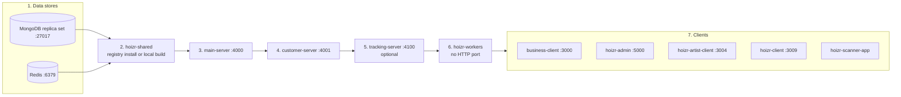

# Running Hoizr locally

Hoizr is ten separate repositories: four Node.js backends, four Next.js apps, a Flutter scanner app and a shared npm package. This chapter walks you from an empty folder to a working stack on your laptop: which tools and accounts you need, how to get the shared package, what to put in each `.env`, how to create the first admin, and how to test Razorpay payments against `localhost`. It ends with the failures people actually hit and how to fix them.

**TL;DR**

- You need Node.js 20+ (images use Node 23), npm, pnpm 9, Yarn 1.22, a **MongoDB replica set** (transactions are used everywhere money moves) and a **passwordless Redis 6.2+**.
- The backends depend on `@hoizr-technology/shared` from GitHub Packages. That needs a classic PAT with `read:packages` even for reading. You can also build `hoizr-shared` locally.
- Start order: Mongo and Redis, shared package, `main-server` :4000, `customer-server` :4001, `tracking-server` :4100, `hoizr-workers`, then the clients (:3000, :5000, :3004, :3009).
- `PUBLIC_KEY`/`PRIVATE_KEY` are **base64-encoded PEM**. `ENCRYPTION_KEY` must be **exactly 32 characters**. Several secrets must match across services.
- There is no seed-everything script and no docker-compose. You insert the first admin by hand, then use scripts and the admin console for master data.
- Paid checkout works on `localhost` without webhooks. Use a tunnel (ngrok or cloudflared) when you need Razorpay test-mode webhooks, for example to test refunds.

## Contents

- [Prerequisites](#prerequisites)
- [Clone the repositories](#clone-the-repositories)
- [Install the shared package](#install-the-shared-package)
- [Start order and ports](#start-order-and-ports)
- [Generate keys and secrets](#generate-keys-and-secrets)
- [Configure each service](#configure-each-service)
- [Bring the stack up](#bring-the-stack-up)
- [Seed data and the first admin](#seed-data-and-the-first-admin)
- [A first end-to-end loop](#a-first-end-to-end-loop)
- [GraphQL codegen in the clients](#graphql-codegen-in-the-clients)
- [Razorpay test mode and local webhooks](#razorpay-test-mode-and-local-webhooks)
- [The scanner app (optional)](#the-scanner-app-optional)
- [Troubleshooting](#troubleshooting)
- [Gaps in the local setup](#gaps-in-the-local-setup)

## Prerequisites

### Tooling

| Tool | Version | Used by |
|---|---|---|
| Node.js | 20+ (the Dockerfiles use Node 23) | every JS repo |
| npm | bundled with Node | `main-server`, `customer-server`, `tracking-server`, `hoizr-shared` |
| pnpm | 9 (lockfile v9) | `hoizr-workers` |
| Yarn classic | 1.22 (`packageManager` field in three apps) | `business-client`, `hoizr-admin`, `hoizr-artist-client`, `hoizr-client` |
| OpenSSL or Node `crypto` | any | generating keys |
| Flutter SDK | current stable, optional | `hoizr-scanner-app` ([install guide](https://docs.flutter.dev/get-started/install)) |
| Docker | optional | the quickest way to run Mongo, Redis and a mail catcher |

`business-client` and `hoizr-client` run a blurhash generator before `dev` and `build`, which needs the native `sharp` module to install on your machine.

### MongoDB: it must be a replica set

All three services that write money or inventory use multi-document transactions (`session.withTransaction`): marketing-credit top-ups in `main-server`, order finalisation in `customer-server`, webhook finalisation and loyalty accrual in `hoizr-workers`. MongoDB only supports [transactions](https://www.mongodb.com/docs/manual/core/transactions/) on a replica set, so a plain standalone `mongod` boots fine and then fails on the first checkout.

Two options:

- **MongoDB Atlas free tier.** Every Atlas cluster is a replica set. Create one ([Atlas getting started](https://www.mongodb.com/docs/atlas/getting-started/)) and use the SRV connection string Atlas gives you as `DB_URI`.
- **A local single-node replica set** in Docker:

```bash
docker run -d --name hoizr-mongo -p 27017:27017 mongo:7 --replSet rs0 --bind_ip_all
docker exec hoizr-mongo mongosh --quiet --eval \
  "rs.initiate({_id: 'rs0', members: [{_id: 0, host: 'localhost:27017'}]})"
```

Point `DB_URI` at `localhost:27017` and add the `replicaSet=rs0` and `directConnection=true` query options. `DB_NAME` is a separate variable in every backend, so keep the database name out of the URI.

### Redis: 6.2 or newer, without a password

Redis carries the BullMQ queues, cart inventory locks, OTP rate limits and refresh-token allowlists. Use Redis 7 if you can; one `customer-server` code path uses `GETDEL`, which needs 6.2.

`main-server`, `customer-server` and `hoizr-workers` build their ioredis client from `REDIS_HOST`, `REDIS_PORT` and `REDIS_TLS` only; none of them reads a password (see [`hoizr-workers/src/utils/redis-connection.ts`](https://github.com/roop37/hoizr-worker/blob/main/src/utils/redis-connection.ts)). Only `tracking-server` reads `REDIS_PASSWORD`. Run a local, passwordless Redis:

```bash
docker run -d --name hoizr-redis -p 6379:6379 redis:7
```

### Accounts and API keys

Zod checks that a variable is **present**, not that it works. A placeholder string gets a service to boot; only the feature that calls the third party then fails.

| Account | Read by | Needed to boot? | What breaks without a real one |
|---|---|---|---|
| GitHub classic PAT with `read:packages` | npm/pnpm in the four backends | Yes, to install | `npm install` of `@hoizr-technology/shared` ([GitHub Packages npm docs](https://docs.github.com/en/packages/working-with-a-github-packages-registry/working-with-the-npm-registry)) |
| [Cloudinary](https://cloudinary.com/documentation/node_integration) (free plan) | `main-server` (Zod), `business-client`, `hoizr-workers`, `customer-server` | `main-server` needs non-empty values | Organizer logo and event image uploads (an event cannot be created without a logo), invoice PDFs |
| Google Maps Platform key with the [Places API](https://developers.google.com/maps/documentation/places/web-service) | `main-server` (Zod), `customer-server` | `main-server` needs a non-empty value | Address autocomplete during onboarding and on the customer profile |
| [Razorpay](https://razorpay.com/docs/api/) in Test Mode | `customer-server` (Zod), `main-server`, `hoizr-workers` | `customer-server` needs non-empty values | Paid checkout, refunds, marketing-credit top-ups. Free events work without it |
| [Google OAuth client ID](https://developers.google.com/identity/gsi/web/guides/get-google-api-clientid) | `customer-server` (Zod), `hoizr-client` | `customer-server` needs a non-empty value | Only Google sign-in. With the client-side ID unset, the panel offers phone OTP only ([`AuthPanel.tsx`](https://github.com/roop37/hoizr-client/blob/main/src/components/auth/AuthPanel.tsx)) |
| [Resend](https://resend.com/docs), or any SMTP server such as [Mailpit](https://mailpit.axllent.org/) | `hoizr-workers`; marketing forms in `business-client` and `hoizr-artist-client` | No | Email delivery (OTP, tickets, campaigns) |
| [MSG91](https://docs.msg91.com/) | `hoizr-workers`, `main-server` | No | Real SMS and WhatsApp. Both are feature-flagged; when off, the worker logs the message instead of sending it |
| [Firebase](https://firebase.google.com/docs/cloud-messaging) | `hoizr-workers`, `hoizr-client` | No | Web push campaigns |
| Azure OpenAI | `main-server` | No | Event listing evaluation falls back to a heuristic |

## Clone the repositories

Two GitHub repo names differ from the folder names the code expects: `hoizr-worker` is cloned as `hoizr-workers`, and `internal-admin-client` as `hoizr-admin`. Keep every repo as a sibling in one folder, because `main-server`'s dedupe script and the `tsconfig.verify.json` files in `main-server` and `customer-server` look for `../hoizr-shared`.

```bash
mkdir hoizr && cd hoizr
ORG=https://github.com/roop37

git clone $ORG/hoizr-shared.git
git clone $ORG/main-server.git
git clone $ORG/customer-server.git
git clone $ORG/tracking-server.git
git clone $ORG/hoizr-worker.git hoizr-workers
git clone $ORG/business-client.git
git clone $ORG/internal-admin-client.git hoizr-admin
git clone $ORG/hoizr-artist-client.git
git clone $ORG/hoizr-client.git
git clone $ORG/hoizr-scanner-app.git      # optional, Flutter
git clone $ORG/hoizr-walkthrough.git      # optional, this guide
```

```text
hoizr/
├── hoizr-shared/          npm package @hoizr-technology/shared
├── main-server/           :4000
├── customer-server/       :4001
├── tracking-server/       :4100
├── hoizr-workers/         no HTTP port
├── business-client/       :3000
├── hoizr-admin/           :5000
├── hoizr-artist-client/   :3004
├── hoizr-client/          :3009
└── hoizr-scanner-app/     Flutter
```

From here on, services are named by their folder (`hoizr-workers`, `hoizr-admin`), because every command runs from those folders. The ports table below pairs each folder with its GitHub repo.

## Install the shared package

`main-server`, `customer-server`, `hoizr-workers` and `tracking-server` all depend on `@hoizr-technology/shared`, the package that holds the Typegoose schema classes, enums, queue names and HMAC helpers. The Next.js apps do not depend on it; they get their types from GraphQL codegen.

### Option A: install from GitHub Packages (recommended)

The package is published to GitHub Packages ([`hoizr-shared/package.json`](https://github.com/roop37/hoizr-shared/blob/main/package.json) sets `publishConfig.registry`). GitHub Packages asks for a token even to read a public package.

1. Create a **classic** personal access token with the `read:packages` scope.
2. Export it in your shell (or load it from your password manager): `export GITHUB_TOKEN=...`.
3. Put these two lines in your user-level `~/.npmrc`. Both npm and pnpm read it, and both expand `${GITHUB_TOKEN}`:

```ini
@hoizr-technology:registry=https://npm.pkg.github.com
//npm.pkg.github.com/:_authToken=${GITHUB_TOKEN}
```

The repos only carry the first line. `customer-server` commits an `.npmrc` with the registry line; the other three backends gitignore theirs. Keep the token line in your home directory so it never ends up in a commit.

Then install every repo with its own package manager:

```bash
for d in main-server customer-server tracking-server; do (cd $d && npm install); done
(cd hoizr-workers && pnpm install)
for d in business-client hoizr-admin hoizr-artist-client hoizr-client; do (cd $d && yarn install); done
```

`hoizr-admin`'s `yarn.lock` is behind its `package.json` (the `graphql` range was bumped), so `yarn install --frozen-lockfile` fails there. Plain `yarn install` works.

### Option B: build `hoizr-shared` locally

Use this when you change the schema classes, or when you cannot get a token. In that case, install the four backends with the tarball commands below instead of the Option A loop (which would hit GitHub Packages and fail), and install the four Next.js apps with `yarn install` as usual.

```bash
cd hoizr-shared && npm install && npm run build   # tsc -> dist/
```

The obvious way to consume the local build is a `file:` link (`npm install ../hoizr-shared` in a backend). npm then symlinks the package, and Node resolves the package's own imports from `hoizr-shared/node_modules`. That folder has its own `graphql`, `type-graphql`, `mongoose` and `@typegoose/typegoose` (they are dev and peer dependencies of the package). TypeGraphQL and Typegoose rely on class identity, so two physical copies break the schema build with errors like `Cannot determine GraphQL output type for '_id'`.

`main-server`, `customer-server` and `hoizr-workers` each ship a `dedupe-shared-deps.js` that runs from `predev`, `prebuild` and `prestart` and swaps those four folders for symlinks to the backend's own copies ([`main-server/scripts/dedupe-shared-deps.js`](https://github.com/roop37/main-server/blob/main/scripts/dedupe-shared-deps.js), [`customer-server/scripts/dedupe-shared-deps.js`](https://github.com/roop37/customer-server/blob/main/scripts/dedupe-shared-deps.js)). Three caveats:

- It only runs through the package scripts. Calling `ts-node-dev` directly skips it.
- With a `file:` link, every backend re-points the same `hoizr-shared/node_modules` at itself on start, so the last backend started "owns" the links. Restart order matters if you file-link more than one backend.
- `main-server`'s copy always rewires the sibling `../hoizr-shared/node_modules` when it exists, even with a registry install. The other two locate the installed package with `require.resolve`.

A packed tarball avoids the symlink entirely, because npm installs a real copy and resolves the peers from the consumer:

```bash
(cd hoizr-shared && npm run build && npm pack)                 # writes hoizr-technology-shared-<version>.tgz
for d in main-server customer-server tracking-server; do (cd $d && npm install ../hoizr-shared/hoizr-technology-shared-*.tgz); done
(cd hoizr-workers && pnpm add ../hoizr-shared/hoizr-technology-shared-*.tgz)
```

Revert `package.json` and the lockfile (`git checkout package.json package-lock.json`, or `pnpm-lock.yaml` for the workers) before you commit. `main-server` and `customer-server` also have a `tsconfig.verify.json` that maps the package to `../hoizr-shared/dist`. It is meant for type-checking a backend against your local build without installing it: `npx tsc -p tsconfig.verify.json --noEmit`.

## Start order and ports

The two API servers do not call each other at boot (`main-server` only calls `customer-server` when an organizer issues an offline ticket). The order below just makes failures easier to read: each step depends only on the steps before it.



| Step | Service | GitHub repo | Port | Package manager | Dev command | Health check |
|---|---|---|---|---|---|---|
| 1 | MongoDB, Redis | n/a | 27017, 6379 | Docker or Atlas | see above | `redis-cli ping` |
| 2 | Shared package | [hoizr-shared](https://github.com/roop37/hoizr-shared) | none | npm | `npm run build` (local build only) | n/a |
| 3 | main-server | [main-server](https://github.com/roop37/main-server) | 4000 | npm | `npm run dev` | `GET /health` returns `{"ok":true}` |
| 4 | customer-server | [customer-server](https://github.com/roop37/customer-server) | 4001 | npm | `npm run dev` | `GET /` returns a health string |
| 5 | tracking-server | [tracking-server](https://github.com/roop37/tracking-server) | 4100 | npm | `npm run dev` | `GET /health` |
| 6 | hoizr-workers | [hoizr-worker](https://github.com/roop37/hoizr-worker) | none | pnpm | `pnpm dev` | log line `Cron scheduler started` |
| 7 | business-client | [business-client](https://github.com/roop37/business-client) | 3000 | yarn | `yarn dev` | open the page |
| 7 | hoizr-admin | [internal-admin-client](https://github.com/roop37/internal-admin-client) | 5000 | yarn | `yarn dev` | open the page |
| 7 | hoizr-artist-client | [hoizr-artist-client](https://github.com/roop37/hoizr-artist-client) | 3004 | yarn | `yarn dev` | open the page |
| 7 | hoizr-client | [hoizr-client](https://github.com/roop37/hoizr-client) | 3009 | yarn | `yarn dev` | open the page |
| 7 | hoizr-scanner-app | [hoizr-scanner-app](https://github.com/roop37/hoizr-scanner-app) | n/a | flutter | `flutter run --dart-define=...` | login screen |

Minimum useful sets: `main-server` + `hoizr-workers` + `business-client` for organizer work; add `customer-server` + `hoizr-client` for anything involving tickets. `hoizr-client` also calls `main-server` directly for public artist pages.

## Generate keys and secrets

Generate these once and paste the **same** values into every service that lists them.

| Value | Must be identical in | Format |
|---|---|---|
| `PUBLIC_KEY`, `PRIVATE_KEY` | main-server, customer-server | base64 of an RSA PEM key pair |
| `ENCRYPTION_KEY` | main-server, customer-server, hoizr-workers | exactly 32 characters |
| `CLIENT_ENCRYPTION_KEY` | main-server, customer-server | exactly 32 characters |
| `COOKIE_SECRET` | main-server, customer-server | any long random string |
| `INTERNAL_SERVICE_SECRET` | main-server, customer-server | any long random string |
| `RAZORPAY_WEBHOOK_SECRET` | customer-server, hoizr-workers (reuse it for main-server's webhook) | the secret you type into the Razorpay dashboard |
| `DB_URI`, `DB_NAME`, `REDIS_*` | main-server, customer-server, hoizr-workers (Redis also in tracking-server) | your local values |

**Why base64 for the JWT keys.** Both API servers sign RS256 tokens, and both decode the env value as base64 before handing it to `jsonwebtoken`. Pasting a raw PEM (which the `.env.example` comment suggests) produces garbage after decoding. From [`main-server/src/utils/jwt.ts`](https://github.com/roop37/main-server/blob/main/src/utils/jwt.ts):

```ts
const PUBLIC_KEY = Buffer.from(
  EnvVars.values.PUBLIC_KEY || "",
  "base64"
).toString("ascii");
const PRIVATE_KEY = Buffer.from(
  EnvVars.values.PRIVATE_KEY || "",
  "base64"
).toString("ascii");
```

**Why exactly 32 characters for the encryption keys.** [`main-server/src/utils/crypt.ts`](https://github.com/roop37/main-server/blob/main/src/utils/crypt.ts) passes the env string straight to `crypto.createCipheriv("aes-256-gcm", key, iv)`. AES-256 needs a 32-byte key, so a 32-character ASCII string works and anything else throws `Invalid key length` the first time an OTP is issued. `openssl rand -hex 16` prints 32 hex characters; `openssl rand -hex 32` prints 64 and will fail.

With OpenSSL:

```bash
# RS256 key pair, base64-encoded on one line
openssl genpkey -algorithm RSA -pkeyopt rsa_keygen_bits:2048 -out jwt-private.pem
openssl rsa -in jwt-private.pem -pubout -out jwt-public.pem
echo "PRIVATE_KEY=$(base64 < jwt-private.pem | tr -d '\n')"
echo "PUBLIC_KEY=$(base64 < jwt-public.pem | tr -d '\n')"
rm jwt-private.pem jwt-public.pem

# ENCRYPTION_KEY and CLIENT_ENCRYPTION_KEY (32 characters each)
openssl rand -hex 16

# COOKIE_SECRET, INTERNAL_SERVICE_SECRET, RAZORPAY_WEBHOOK_SECRET, VISITOR_HASH_SALT
openssl rand -hex 32
```

Or with Node only:

```bash
node -e '
const { generateKeyPairSync, randomBytes } = require("crypto");
const { publicKey, privateKey } = generateKeyPairSync("rsa", {
  modulusLength: 2048,
  publicKeyEncoding: { type: "spki", format: "pem" },
  privateKeyEncoding: { type: "pkcs8", format: "pem" },
});
const b64 = (s) => Buffer.from(s).toString("base64");
console.log("PUBLIC_KEY=" + b64(publicKey));
console.log("PRIVATE_KEY=" + b64(privateKey));
console.log("ENCRYPTION_KEY=" + randomBytes(16).toString("hex"));
console.log("CLIENT_ENCRYPTION_KEY=" + randomBytes(16).toString("hex"));
console.log("COOKIE_SECRET=" + randomBytes(32).toString("hex"));
console.log("INTERNAL_SERVICE_SECRET=" + randomBytes(32).toString("hex"));
'
```

## Configure each service

In every repo except `hoizr-shared` and the scanner app, copy `.env.example` to `.env` and replace **every** value with your own. `main-server` and `customer-server` validate their environment with Zod at import time and exit with code 1 if a required variable is missing ([`main-server/src/utils/environment.ts`](https://github.com/roop37/main-server/blob/main/src/utils/environment.ts), [`customer-server/src/utils/environment.ts`](https://github.com/roop37/customer-server/blob/main/src/utils/environment.ts)). `hoizr-workers` and `tracking-server` read `process.env` directly and fall back to defaults, so a typo there fails quietly.

The tables list names only. Values for the local URLs follow after them.

<details>
<summary><strong>main-server</strong> (Zod-validated)</summary>

| Group | Variables | Notes |
|---|---|---|
| Required: data | `DB_URI`, `DB_NAME`, `REDIS_HOST`, `REDIS_PORT`, `REDIS_TLS` | `REDIS_TLS` must be present; set it to `false` locally |
| Required: auth and crypto | `PUBLIC_KEY`, `PRIVATE_KEY`, `ENCRYPTION_KEY`, `CLIENT_ENCRYPTION_KEY`, `COOKIE_SECRET` | see [Generate keys and secrets](#generate-keys-and-secrets) |
| Required: URLs and mode | `APP_URL`, `SERVER_URL`, `SERVER_ENV` | `APP_URL` is the business-client origin (used in team invite emails); `SERVER_URL` is this API's origin (tracking links) |
| Required: media and maps | `CLOUDINARY_CLOUD_NAME`, `CLOUDINARY_API_KEY`, `CLOUDINARY_API_SECRET`, `MAPS_API_KEY` | placeholders boot; uploads and autocomplete need real values |
| Optional: local wiring | `PORT`, `CORS_ORIGINS`, `CUSTOMER_APP_URL`, `CUSTOMER_SERVER_INTERNAL_URL`, `INTERNAL_SERVICE_SECRET`, `COOKIE_DOMAIN` | leave `COOKIE_DOMAIN` unset locally |
| Optional: payments | `RAZORPAY_KEY_ID`, `RAZORPAY_KEY_SECRET`, `RAZORPAY_WEBHOOK_SECRET` | the webhook secret becomes required when `SERVER_ENV=production` |
| Optional: AI | `AZURE_OPENAI_API_KEY`, `AZURE_OPENAI_RESOURCE_NAME`, `AZURE_OPENAI_DEPLOYMENT_NAME`, `AZURE_OPENAI_API_VERSION` | heuristic fallback when unset |
| Optional: WhatsApp (feature-flagged) | `WHATSAPP_ENABLED`, `MSG91_AUTHKEY`, `MSG91_WA_INTEGRATED_NUMBER`, `MSG91_WA_WEBHOOK_SECRET`, `WHATSAPP_OFFLINE_LINK_TEMPLATE`, `WHATSAPP_OFFLINE_LINK_TEMPLATE_LANG` | leave off locally |
| Ignore | `RAZORPAYX_*` in `.env.example`; `META_WHATSAPP_*`, `META_APP_SECRET`, `BUSINESS_APP_URL` in the schema | leftovers of removed integrations, never read |

</details>

<details>
<summary><strong>customer-server</strong> (Zod-validated)</summary>

| Group | Variables | Notes |
|---|---|---|
| Required: data | `DB_URI`, `DB_NAME`, `REDIS_HOST`, `REDIS_PORT`, `REDIS_TLS` | same values as main-server |
| Required: auth and crypto | `PUBLIC_KEY`, `PRIVATE_KEY`, `ENCRYPTION_KEY`, `CLIENT_ENCRYPTION_KEY`, `COOKIE_SECRET` | identical to main-server |
| Required: URLs and mode | `APP_URL`, `SERVER_ENV` | `APP_URL` is the hoizr-client origin |
| Required: payments and sign-in | `RAZORPAY_KEY_ID`, `RAZORPAY_KEY_SECRET`, `RAZORPAY_WEBHOOK_SECRET`, `GOOGLE_OAUTH_CLIENT_ID` | placeholders boot; paid checkout needs real test keys |
| Optional: local wiring | `PORT`, `CUSTOMER_CORS_ORIGINS`, `COOKIE_DOMAIN`, `INTERNAL_SERVICE_SECRET`, `CUSTOMER_APP_URL`, `LOG_LEVEL` | `INTERNAL_SERVICE_SECRET` is needed for offline tickets |
| Optional: media and maps | `CLOUDINARY_CLOUD_NAME`, `CLOUDINARY_API_KEY`, `CLOUDINARY_API_SECRET`, `MAPS_API_KEY` | invoice downloads and profile address autocomplete |
| Optional: WhatsApp OTP (feature-flagged) | `WHATSAPP_ENABLED`, `MSG91_AUTHKEY`, `MSG91_WA_INTEGRATED_NUMBER`, `WHATSAPP_OTP_TEMPLATE_NAME`, `WHATSAPP_OTP_TEMPLATE_LANG` | SMS is always queued; WhatsApp is added only when live |
| Optional: ships dark | `META_INSTAGRAM_*` (six), `META_VERIFIED`, `SWIGGY_*` (seven), `WHATSAPP_DINEOUT_CONFIRM_TEMPLATE`, `WHATSAPP_DINEOUT_REMINDER_TEMPLATE` | Instagram connect falls back to a stub when unset; the Swiggy variables drive an optional, feature-flagged restaurant-reservation integration over Swiggy's MCP API. Leave all unset |

</details>

<details>
<summary><strong>hoizr-workers</strong> (no schema; read from <code>process.env</code>)</summary>

| Group | Variables | Notes |
|---|---|---|
| Required in practice | `DB_URI`, `DB_NAME`, `REDIS_HOST`, `REDIS_PORT`, `ENCRYPTION_KEY` | `DB_NAME` silently falls back to a legacy default name if unset, so always set it |
| Required for paid orders | `RAZORPAY_WEBHOOK_SECRET` | the worker re-verifies every webhook and drops it when the secret is missing |
| Email: pick one path | `EMAIL_TRANSPORT`, `RESEND_API_KEY`, `RESEND_API_URL`, `RESEND_TIMEOUT_MS`, or `SMTP_HOST`, `SMTP_PORT`, `SMTP_USERNAME`, `SMTP_PASSWORD` | with no `RESEND_API_KEY`, mail goes to `SMTP_*`; Mailpit with empty credentials works |
| Links in emails | `SERVER_URL`, `MAIN_SERVER_URL`, `CUSTOMER_APP_URL`, `CUSTOMER_CLIENT_URL`, `HOIZR_CLIENT_URL`, `CLIENT_URL` | point them at your local origins |
| Optional: media and payments | `CLOUDINARY_CLOUD_NAME`, `CLOUDINARY_API_KEY`, `CLOUDINARY_API_SECRET`, `RAZORPAY_KEY_ID`, `RAZORPAY_KEY_SECRET`, `REDIS_TLS`, `SERVER_ENV`, `NEXT_PUBLIC_HOIZR_ENV` | invoice PDFs, daily settlement fetch, Cloudinary folder names |
| Optional: messaging (feature-flagged) | `SMS_ENABLED`, `MSG91_AUTHKEY`, `MSG91_TEMPLATE_LOGIN_OTP`, `MSG91_TEMPLATE_REGISTER_OTP`, `MSG91_TEMPLATE_CUSTOMER_LOGIN_OTP`, `MSG91_TEMPLATE_CUSTOMER_REGISTER_OTP`, `WHATSAPP_ENABLED`, `MSG91_WA_INTEGRATED_NUMBER`, `FIREBASE_SERVICE_ACCOUNT_JSON` | off by default: SMS and WhatsApp are logged, push campaigns fail with a clear status |
| Optional: ships dark | `META_INSTAGRAM_APP_ID`, `META_INSTAGRAM_APP_SECRET`, `META_INSTAGRAM_TOKEN_KEY`, `INSTAGRAM_SYNC_BATCH_SIZE`, `SWIGGY_DINEOUT_REMINDERS_ENABLED`, `DINEOUT_REMINDER_LEAD_MIN`, `WHATSAPP_DINEOUT_REMINDER_TEMPLATE` | leave unset |

</details>

<details>
<summary><strong>tracking-server</strong> (all optional, with defaults)</summary>

| Group | Variables | Notes |
|---|---|---|
| Server | `PORT` | defaults to 4100 |
| Redis | `REDIS_HOST`, `REDIS_PORT`, `REDIS_PASSWORD`, `REDIS_TLS` | must be the same Redis the workers consume |
| Privacy | `VISITOR_HASH_SALT` | set your own; the code fallback is a public literal |
| CORS | `TRACKING_CORS_ORIGINS` | any `localhost` origin is already accepted |

</details>

<details>
<summary><strong>business-client</strong></summary>

| Group | Variables | Notes |
|---|---|---|
| Required | `NEXT_PUBLIC_SERVER_BASE_URL` | main-server origin; `/graphql` is appended |
| Uploads | `NEXT_PUBLIC_CLOUDINARY_CLOUD_NAME`, `NEXT_PUBLIC_CLOUDINARY_IMAGE_PRESET`, `NEXT_PUBLIC_CLOUDINARY_RAW_PRESET` | your own cloud and an [upload preset](https://cloudinary.com/documentation/upload_presets) you created |
| Optional | `NEXT_PUBLIC_HOIZR_ENV`, `NEXT_PUBLIC_SITE_URL`, `NEXT_PUBLIC_HOIZR_WHATSAPP`, `NEXT_PUBLIC_POSTHOG_KEY`, `NEXT_PUBLIC_POSTHOG_HOST` | |
| Marketing-site forms | `RESEND_API_KEY`, `CONTACT_NOTIFY_EMAIL`, `WAITLIST_NOTIFY_EMAIL` | server-side route handlers only |
| Not used | `NEXT_PUBLIC_ENCRYPTION_KEY`, `ENCRYPTION_KEY` | listed in `.env.example`, no live callers |

</details>

<details>
<summary><strong>hoizr-admin</strong></summary>

| Group | Variables | Notes |
|---|---|---|
| Required | `NEXT_PUBLIC_SERVER_BASE_URL` | main-server origin; `/graphql` is appended |
| Optional | `NEXT_PUBLIC_HOIZR_ENV`, `CODEGEN_SCHEMA_URL` | the second overrides the codegen schema URL |

</details>

<details>
<summary><strong>hoizr-artist-client</strong></summary>

| Group | Variables | Notes |
|---|---|---|
| Required | `NEXT_PUBLIC_MAIN_API_URL` | full main-server GraphQL URL |
| Optional | `NEXT_PUBLIC_CUSTOMER_APP_URL`, `NEXT_PUBLIC_POSTHOG_KEY`, `NEXT_PUBLIC_POSTHOG_HOST` | set the first to the hoizr-client origin for "view public page" links |
| Landing-page interest form | `RESEND_API_KEY`, `IPLAB_NOTIFY_EMAIL` | server-side route handler only |
| Not used | `NEXT_PUBLIC_META_VERIFIED` | listed in `.env.example`, never read |

</details>

<details>
<summary><strong>hoizr-client</strong></summary>

| Group | Variables | Notes |
|---|---|---|
| Required | `NEXT_PUBLIC_CUSTOMER_API_URL`, `NEXT_PUBLIC_MAIN_API_URL` | full GraphQL URLs of customer-server and main-server |
| Optional: wiring | `NEXT_PUBLIC_TRACKING_SERVER_URL`, `NEXT_PUBLIC_HOIZR_ENV`, `NEXT_PUBLIC_SITE_URL`, `NEXT_PUBLIC_CUSTOMER_APP_URL` | tracking is off when the first is unset |
| Optional: services | `NEXT_PUBLIC_GOOGLE_OAUTH_CLIENT_ID`, `NEXT_PUBLIC_CLOUDINARY_CLOUD_NAME`, `NEXT_PUBLIC_CLOUDINARY_IMAGE_PRESET`, `NEXT_PUBLIC_FIREBASE_*` (six), `NEXT_PUBLIC_POSTHOG_KEY`, `NEXT_PUBLIC_POSTHOG_HOST` | Google sign-in, avatar uploads, web push, analytics |
| Optional: ships dark | `NEXT_PUBLIC_INSTA_ENABLED`, `NEXT_PUBLIC_SWIGGY_DINEOUT_ENABLED` | leave unset |

`hoizr-client` also loads `NEXT_PUBLIC_*` keys from a legacy `src/.env` when they are not set in the root `.env` ([`next.config.mjs`](https://github.com/roop37/hoizr-client/blob/main/next.config.mjs)).

</details>

In all four Next.js apps, `NEXT_PUBLIC_*` values are inlined at build time, so restart `yarn dev` after changing them.

The non-secret local wiring is the same for everyone:

```bash
# main-server/.env
SERVER_ENV=development
APP_URL=http://localhost:3000
SERVER_URL=http://localhost:4000
CUSTOMER_APP_URL=http://localhost:3009
CUSTOMER_SERVER_INTERNAL_URL=http://localhost:4001
CORS_ORIGINS=http://localhost:3000,http://localhost:3004,http://localhost:3009,http://localhost:5000
REDIS_HOST=localhost
REDIS_PORT=6379
REDIS_TLS=false

# customer-server/.env
SERVER_ENV=development
APP_URL=http://localhost:3009

# hoizr-workers/.env
SERVER_URL=http://localhost:4000
CUSTOMER_APP_URL=http://localhost:3009
# Mailpit's default SMTP port; its web UI is on :8025
SMTP_HOST=localhost
SMTP_PORT=1025

# business-client/.env and hoizr-admin/.env
NEXT_PUBLIC_SERVER_BASE_URL=http://localhost:4000

# hoizr-artist-client/.env
NEXT_PUBLIC_MAIN_API_URL=http://localhost:4000/graphql
NEXT_PUBLIC_CUSTOMER_APP_URL=http://localhost:3009

# hoizr-client/.env
NEXT_PUBLIC_CUSTOMER_API_URL=http://localhost:4001/graphql
NEXT_PUBLIC_MAIN_API_URL=http://localhost:4000/graphql
NEXT_PUBLIC_TRACKING_SERVER_URL=http://localhost:4100
```

`CORS_ORIGINS` **replaces** main-server's built-in allowlist rather than extending it, so list every local origin. The built-in list covers ports 3000, 3004 and 5000 but not 3009, which `hoizr-client` needs for artist pages ([`main-server/src/index.ts`](https://github.com/roop37/main-server/blob/main/src/index.ts)).

## Bring the stack up

Each command runs in its own terminal, from the repo folder:

```bash
cd main-server     && npm run dev    # predev runs the dedupe script, then ts-node-dev
cd customer-server && npm run dev
cd tracking-server && npm run dev    # optional
cd hoizr-workers   && pnpm dev       # tsc-watch build, copies .hbs templates, then node dist/index.js
cd business-client && yarn dev       # :3000
cd hoizr-admin     && yarn dev       # :5000
cd hoizr-artist-client && yarn dev   # :3004
cd hoizr-client    && yarn dev       # :3009
```

Smoke checks:

```bash
curl -s localhost:4000/health        # {"ok":true}
curl -s localhost:4001/              # customer-server health text
curl -s localhost:4100/health        # {"ok":true,"queue":"ready"}
```

GraphiQL is served at `/graphiql` on both API servers when `SERVER_ENV` is not `production`, which is the fastest way to poke at the schema.

> [!NOTE]
> There is no `docker-compose.yml` in any repository, and no one-command bring-up. A compose file that starts MongoDB as a single-node replica set, Redis and Mailpit, plus a small script that writes matching secrets into every `.env`, would be a good first contribution.

## Seed data and the first admin

There is no single seed script in the public repos. Here is what exists, and what you do by hand.

**1. Insert the first admin.** Admins log in to `hoizr-admin` with email + OTP, and `adminLogin` only accepts an email that already exists in the `admins` collection ([`admin.service.ts`](https://github.com/roop37/main-server/blob/main/src/modules/admin/service/admin.service.ts)). Create one with `mongosh` against your database. The fields follow the `Admin` class in [`hoizr-shared/src/schemas/admin.schema.ts`](https://github.com/roop37/hoizr-shared/blob/main/src/schemas/admin.schema.ts):

```js
// mongosh, after `use <your DB_NAME>`
db.admins.insertOne({
  firstName: "Local",
  lastName: "Admin",
  email: "<your-email>",
  role: "SuperAdmin",
  status: "Active",
  authTokenVersion: 0,
  isDeleted: false,
  createdAt: new Date(),
  updatedAt: new Date(),
});
```

**2. Run the master-data scripts** from `main-server` (they read `main-server/.env`):

```bash
cd main-server
npx ts-node scripts/seed-finance-configs.ts          # idempotent upsert of fee and tax Config rows
npx ts-node scripts/reseed-genres.ts                 # deletes and re-inserts the genre tags
npx ts-node src/scripts/language-prefill.ts          # languages for the event guide
npx ts-node src/scripts/prohibited-items-prefill.ts  # prohibited-items picker
npx ts-node scripts/seed-event-tags.ts               # optional: needs Azure OpenAI
```

Without the Config rows the services fall back to defaults hard-coded in the code, so this step is recommended but not fatal.

**3. Add the rest in the admin console.** Event categories and cities have no seed script. Log in to `hoizr-admin` and add them under the Masters modules.

**4. Permissions are optional.** If the `permissions` collection is empty, a new organizer owner gets every permission type. From [`user.service.ts`](https://github.com/roop37/main-server/blob/main/src/modules/user/services/user.service.ts):

```ts
      if (permissions.length === 0) {
        Object.values(PermissionTypeEnum).forEach((permissionType) => {
          ownerPermissions.push({
            id: permissionType,
            type: permissionType,
            status: true,
          });
        });
      } else {
        permissions.forEach((permission) => {
          ownerPermissions.push({
            id: permission._id.toString(),
            type: permission.type,
            status: permission.preselect.includes(TeamRole.OWNER),
          });
        });
      }
```

**Logging in without real SMS or email.** Both API servers accept `000000` as the OTP for any login when `SERVER_ENV=development` ([main-server `otp.service.ts`](https://github.com/roop37/main-server/blob/main/src/modules/otp/services/otp.service.ts), [customer-server `otp.service.ts`](https://github.com/roop37/customer-server/blob/main/src/modules/otp/service/otp.service.ts)). If you want to see the real code, run the workers: with `SMS_ENABLED` off, the SMS worker logs the payload it would have sent ([`msg91.client.ts`](https://github.com/roop37/hoizr-worker/blob/main/src/msg91/msg91.client.ts)), and email OTPs land in Mailpit.

> [!WARNING]
> `SERVER_ENV=development` is for your laptop only, because it enables the `000000` OTP. Any shared environment must use another value; only `production` also removes main-server's GraphiQL and the dev reset route.

**Resetting tenant data.** `main-server` mounts `POST /dev/reset` outside production. It keeps admins, permissions, configs and masters, empties everything else, and defaults to a dry run ([`dev-reset.route.ts`](https://github.com/roop37/main-server/blob/main/src/routes/dev-reset.route.ts)). It also refuses any database not on a hard-coded allowlist, so add your local `DB_NAME` to that set in your working copy before using it, and don't commit the change.

## A first end-to-end loop

A free event exercises most of the stack without Razorpay:

1. In `business-client` (:3000), sign up and complete onboarding as a Venue or Event Organization, including a logo.
2. In `hoizr-admin` (:5000), open the organizer list and mark the account verified. Until then the `isAdminVerifiedHost` guard blocks event, campaign and scanner mutations.
3. Back in `business-client`, create a free event and publish it. Paid events also need a primary payout account that an admin has verified.
4. In `hoizr-client` (:3009), sign in with a phone number and claim a ticket. The workers send the e-ticket email to Mailpit.
5. In `business-client`, create a scanner for the event and note the one-time access code. Use it in the scanner app (below).

<!-- SCREENSHOT: admin-hosts | hoizr-admin organizer list with the verify action for a newly onboarded account -->

Host and admin sessions both use a cookie named `accessToken`, and browsers scope cookies by host, not port. On `localhost`, logging in to `hoizr-admin` replaces your `business-client` session. Use a separate browser profile (or a private window) for the admin console.

## GraphQL codegen in the clients

Every Next.js app commits its generated SDK, so you only need codegen after you change a `.graphql` file in the app or the server schema. Codegen introspects a **running** server:

| App | Schema source (`codegen.yml`) | Operations | Output |
|---|---|---|---|
| business-client | `http://localhost:4000/graphql` | `graphql/**/*.graphql` | `generated/graphql.ts` |
| hoizr-admin | `http://localhost:4000/graphql` through a custom loader ([`codegen.schema.js`](https://github.com/roop37/internal-admin-client/blob/main/codegen.schema.js)), overridable with `CODEGEN_SCHEMA_URL` | `graphql/**/*.graphql` | `generated/graphql.ts` |
| hoizr-artist-client | `http://localhost:4000/graphql` | `src/graphql/**/*.graphql` | `src/generated/graphql.ts` |
| hoizr-client | `http://localhost:4001/graphql` (**customer-server**) | `src/graphql/**/*.graphql` | `src/generated/graphql.ts` |

```bash
cd business-client && yarn codegen   # main-server must be up on :4000
cd hoizr-client    && yarn codegen   # customer-server must be up on :4001
```

The schemas are code-first (TypeGraphQL), so the servers themselves have no codegen step. `main-server/schema.graphql` is a hand-kept snapshot, not generated; trust introspection over it.

## Razorpay test mode and local webhooks

Use Razorpay **Test Mode** keys everywhere. A paid ticket finalises on two converging paths:

- **Browser fast path.** After Checkout, `hoizr-client` calls `confirmOrderPayment`. `customer-server` verifies the checkout signature, fetches the payment from Razorpay and finalises the order in a transaction. This works on `localhost` with no webhook.
- **Webhook path.** Razorpay posts to `customer-server` `/webhooks/razorpay`, which verifies the HMAC, enqueues the raw body and returns 200 ([`razorpay-webhook.route.ts`](https://github.com/roop37/customer-server/blob/main/src/routes/razorpay-webhook.route.ts)). The worker re-verifies and finalises if the fast path did not ([`razorpay-webhook.process.ts`](https://github.com/roop37/hoizr-worker/blob/main/src/workers/razorpay-webhook/razorpay-webhook.process.ts)).

You need the webhook to test closed-tab payments, failed payments, disputes and **refunds**: an order only flips to `REFUNDED` when the `refund.processed` event arrives. Razorpay cannot reach `localhost`, so expose the port through a tunnel:

```bash
cloudflared tunnel --url http://localhost:4001   # or: ngrok http 4001
```

Then, in the Razorpay Dashboard in Test Mode, add a webhook ([Razorpay webhooks docs](https://razorpay.com/docs/webhooks/)):

| Setting | Value |
|---|---|
| URL | `https://<your-tunnel-host>/webhooks/razorpay` |
| Secret | your `RAZORPAY_WEBHOOK_SECRET` (same value in customer-server and hoizr-workers) |
| Events | `payment.captured`, `order.paid`, `payment.failed`, `refund.created`, `refund.processed`, and the `payment.dispute.*` events |

Marketing-credit top-ups in `business-client` go through `main-server`, which has its own `/webhooks/razorpay` for `payment.captured`. Its client-side verify path works without a webhook; to test the webhook path, open a second tunnel to port 4000 and add a second webhook entry. Each server ignores payments it did not create. Quick tunnels get a new hostname each run, so update the dashboard after restarting the tunnel.

## The scanner app (optional)

The Flutter app has no `.env`. Its only setting is a compile-time define with the full `customer-server` GraphQL URL, and the compiled-in default points at a hosted environment, so always pass it ([`graphql_service.dart`](https://github.com/roop37/hoizr-scanner-app/blob/main/lib/services/graphql_service.dart)):

```bash
cd hoizr-scanner-app
flutter pub get

# iOS Simulator shares your machine's network
flutter run --dart-define=CUSTOMER_API_URL=http://localhost:4001/graphql

# Android emulator or USB-connected device: forward the port first
adb reverse tcp:4001 tcp:4001
flutter run --dart-define=CUSTOMER_API_URL=http://localhost:4001/graphql
```

For a phone on Wi-Fi, use a tunnel URL instead. The iOS host project is not committed, so scaffold it once with `flutter create --org com.hoizr --project-name hoizr_scanner --platforms=ios .` and add the camera usage description, as the repo README describes. Log in with the scanner's email and the one-time access code from `business-client`.

## Troubleshooting

<details>
<summary><code>Cannot determine GraphQL output type for '_id'</code>, or main-server prints one line and never listens</summary>

Two copies of `graphql`, `type-graphql`, `mongoose` or `@typegoose/typegoose` are loaded, almost always because `@hoizr-technology/shared` is `file:`-linked. Start through `npm run dev` (so `predev` runs the dedupe script), check `npm ls graphql type-graphql`, or switch to the tarball install. `main-server` catches schema-build errors in `startServer()` and only logs the message, so the process stays alive without listening on 4000.

</details>

<details>
<summary>Login succeeds, then the app bounces back to <code>/login</code></summary>

Locally, main-server sets `HttpOnly` cookies with no `SameSite` or `Secure` attribute (customer-server adds `SameSite=Lax`). `SameSite=None; Secure` and a `Domain` are only added when `SERVER_ENV=production` or `COOKIE_DOMAIN` is set ([`cookie.ts`](https://github.com/roop37/main-server/blob/main/src/utils/cookie.ts)):

```ts
  if (production || domain) {
    return {
      httpOnly: true,
      sameSite: "none" as const,
      secure: true,
      ...(domain ? { domain } : {}),
      path: "/",
    };
  }

  return {
    httpOnly: true,
    path: "/",
  };
```

So: leave `COOKIE_DOMAIN` unset (the browser rejects a production domain on `localhost`), keep `SERVER_ENV=development`, and open every app as `localhost`, never as a loopback IP. Ports do not separate cookies, so `localhost:3000` sees the cookie set by `localhost:4000`; a different host name does not. The admin and business apps also read `accessToken` server-side in their route guards ([`serverAuth.ts`](https://github.com/roop37/internal-admin-client/blob/main/lib/auth/serverAuth.ts)), and admin and organizer sessions share that cookie name (see the [first loop](#a-first-end-to-end-loop)).

</details>

<details>
<summary>CORS errors in the browser console</summary>

`main-server` only allows origins in `CORS_ORIGINS`, or its built-in list when that is unset; the list has no `localhost:3009`, so artist pages in `hoizr-client` fail until you set it. `customer-server` and `tracking-server` accept any `localhost` origin. A CORS error can also be a crashed server: the browser reports a failed preflight when nothing answers, so check the server terminal first.

</details>

<details>
<summary>BullMQ: <code>maxRetriesPerRequest must be null</code>, or requests hang</summary>

BullMQ workers need an ioredis connection with `maxRetriesPerRequest: null`. Every service already sets it ([`redis-connection.ts`](https://github.com/roop37/hoizr-worker/blob/main/src/utils/redis-connection.ts)):

```ts
      RedisClient.instance = new Redis({
        host: process.env.REDIS_HOST,
        port: parseInt(process.env.REDIS_PORT ?? "6379") ?? 6379,
        maxRetriesPerRequest: null,
        enableReadyCheck: false,
        ...(process.env.REDIS_TLS === "true" && { tls: {} }),
      });
```

If you add a worker or a script, reuse that client or copy the option. The flip side: with no retry cap, commands queue forever while Redis is down, so an OTP request or a `/track` call hangs instead of failing. If requests hang, check Redis first. Also note there is no password field: point these services at a passwordless Redis. See [Redis connection settings for BullMQ](./04-background-jobs-bullmq.md#redis-connection-settings-for-bullmq).

</details>

<details>
<summary><code>Transaction numbers are only allowed on a replica set member or mongos</code></summary>

You are on a standalone `mongod`. Restart it as a replica set (see [Prerequisites](#mongodb-it-must-be-a-replica-set)) or use Atlas.

</details>

<details>
<summary><code>Invalid key length</code>, or every token fails to verify</summary>

`ENCRYPTION_KEY` or `CLIENT_ENCRYPTION_KEY` is not exactly 32 characters, or `PUBLIC_KEY`/`PRIVATE_KEY` were pasted as raw PEM instead of base64. Regenerate with the commands in [Generate keys and secrets](#generate-keys-and-secrets) and paste the same values into both API servers. Tokens signed by one server must verify on the other.

</details>

<details>
<summary><code>E401</code> or <code>E403</code> from npm.pkg.github.com</summary>

The token is missing, not exported in the shell that runs the install, or lacks `read:packages`. GitHub Packages' npm registry authenticates with classic tokens, so a fine-grained token will not work. Also check that `~/.npmrc` has both lines from [Option A](#option-a-install-from-github-packages-recommended).

</details>

<details>
<summary>Dates are off by five and a half hours, or a coupon works on the wrong day</summary>

The convention is: store true UTC, take input and show everything in `Asia/Kolkata`. `business-client` converts event times with `fromZonedTime` on save and `formatInTimeZone` on read ([`EventJourney.tsx`](https://github.com/roop37/business-client/blob/main/components/modules/events/EventJourney.tsx)), and every cron runs in `Asia/Kolkata` whatever your machine's zone ([`cron.scheduler.ts`](https://github.com/roop37/hoizr-worker/blob/main/src/workers/crons/cron.scheduler.ts)). A few paths still use the machine's local time: coupon day-of-week rules in [`coupon-eval.ts`](https://github.com/roop37/customer-server/blob/main/src/modules/order/service/coupon-eval.ts) and the invoice fiscal year in [`invoice-numbering.ts`](https://github.com/roop37/hoizr-worker/blob/main/src/utils/invoice-numbering.ts). They behave differently on an IST laptop than on a UTC server, so reproduce date bugs with `TZ=UTC` and again with `TZ=Asia/Kolkata`.

</details>

<details>
<summary>Enum values differ between GraphQL and MongoDB</summary>

TypeGraphQL serialises enum **keys**. The database stores `"PaymentSuccess"`, while GraphQL and the generated SDKs use `PAYMENT_SUCCESS`. Trust `generated/graphql.ts` in the clients, and the shared enum files on the server.

</details>

<details>
<summary>No emails, no e-tickets, nothing after checkout</summary>

`hoizr-workers` is not running, or it points at a different Redis or database (`DB_NAME` unset falls back to a legacy name). Every email, ticket, ledger post and webhook happens in the workers. Check the worker terminal for `failed` job logs and Mailpit's UI on port 8025.

</details>

## Gaps in the local setup

These are known rough edges and good first contributions:

- No docker-compose and no script that writes consistent secrets into every `.env`.
- The shared package needs a GitHub token even when public.
- No seed script for the first admin, event categories or cities.
- `main-server`, `customer-server` and `hoizr-workers` cannot authenticate to a password-protected Redis.
- `main-server`'s default CORS list lacks the storefront's dev port, and the dev reset allowlist is hard-coded rather than env-driven.
- `.env.example` files still carry variables for removed integrations, and the JWT key comment does not mention base64.

---

**Related chapters:** [01 System architecture](./01-system-architecture.md) · [02 Domain model](./02-domain-model.md) · [03 Auth and RBAC](./03-auth-and-rbac.md) · [04 Background jobs with BullMQ](./04-background-jobs-bullmq.md) · [05 Redis and concurrency](./05-redis-and-concurrency.md) · [06 Payments and money](./06-payments-and-money.md) · [07 Tracking and analytics](./07-tracking-and-analytics.md) · [08 Frontend architecture](./08-frontend-architecture.md) · [10 Deployment and operations](./10-deployment-and-operations.md) · [11 Engineering decisions](./11-engineering-decisions.md) · [12 Known gaps and roadmap](./12-known-gaps-and-roadmap.md) · [13 Third-party services](./13-third-party-services.md)

[Back to the walkthrough](../README.md)
