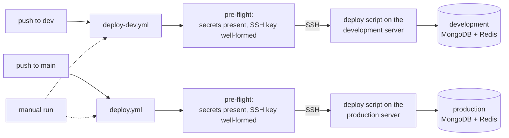
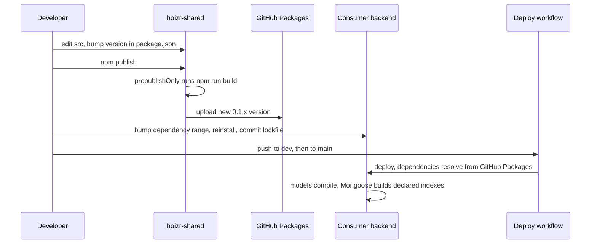

# Deployment and operations

This chapter covers how Hoizr gets from a `git push` to a running environment, and what an operator works with once it is live. You will see how branches map to environments, what the GitHub Actions workflows do, how the shared package is released, how configuration is validated at boot, which webhooks to register, what health checks and logs exist, and which runbooks are already built into the code. It ends with a production-readiness checklist for anyone self-hosting the stack.

## TL;DR

- **Two environments, chosen by branch.** A push to `dev` deploys a backend to the development environment, and a push to `main` deploys it to production. Every backend workflow can also be run by hand. tracking-server's production deploy is manual only.
- **Deploys go over SSH, not through container images.** Each workflow checks its secrets, connects over SSH and runs a deploy script that lives on the server. Two repos include `node:23-alpine` Dockerfiles, but no workflow builds them.
- **The shared package is released by hand.** Bump the version, `npm publish` to GitHub Packages, then bump and redeploy each consumer.
- **main-server and customer-server fail fast on bad config.** Both validate env vars with Zod at import time and exit with code 1. One flag, `SERVER_ENV`, switches their production behaviour.
- **Operations tooling lives in the admin console.** Payout settlement, the refund queue, Razorpay reconciliation, ledger checks and a system-health panel all run as admin-only GraphQL operations. A destructive dev reset exists only outside production.
- **Health checks are liveness-only.** Backups, readiness probes, graceful shutdown and CI quality gates are open roadmap items.

## Contents

- [Environments](#environments)
- [CI/CD: what the workflows do](#cicd-what-the-workflows-do)
- [Releasing the shared package](#releasing-the-shared-package)
- [Hosting the frontends](#hosting-the-frontends)
- [Configuration: env vars validated at boot](#configuration-env-vars-validated-at-boot)
- [Webhooks and callbacks to register](#webhooks-and-callbacks-to-register)
- [Health checks](#health-checks)
- [Logging and observability](#logging-and-observability)
- [Runbooks that exist in code](#runbooks-that-exist-in-code)
- [Scaling and backups](#scaling-and-backups)
- [Production-readiness checklist](#production-readiness-checklist)
- [Operational gaps and roadmap](#operational-gaps-and-roadmap)

## Environments

Hoizr runs two environments: **development** and **production**. They are separate deployments: the two sets of workflows target different servers through different Actions secrets, and each server carries its own env vars, so each environment has its own API hostnames, database name, Redis connection and public URLs. Inside an environment, all four backends share the same database (`DB_NAME`) and the same Redis, because queues, locks and sessions cross service boundaries (see [chapter 01](./01-system-architecture.md)).

### Branch to environment mapping

The workflow triggers define the mapping. There is no staging branch.

| Repo | Push to `dev` | Push to `main` | Manual run (`workflow_dispatch`) |
|---|---|---|---|
| [main-server](https://github.com/roop37/main-server/tree/main/.github/workflows) | `deploy-dev.yml` → development | `deploy.yml` → production | both workflows |
| [customer-server](https://github.com/roop37/customer-server/tree/main/.github/workflows) | `deploy-dev.yml` → development | `deploy.yml` → production | both workflows |
| [hoizr-worker](https://github.com/roop37/hoizr-worker/tree/main/.github/workflows) | `deploy-dev.yml` → development | `deploy.yml` → production | both workflows |
| [tracking-server](https://github.com/roop37/tracking-server/tree/main/.github/workflows) | `deploy-dev.yml` → development | no automatic deploy | production is manual only |
| [hoizr-shared](https://github.com/roop37/hoizr-shared) | n/a | n/a | published by hand (see [below](#releasing-the-shared-package)) |
| Next.js apps, scanner app | no workflow in the repo | no workflow in the repo | n/a |

### One flag decides "production"

main-server and customer-server do not use `NODE_ENV` to decide whether they are in production. They read `SERVER_ENV`, and the reason is written down in [`main-server/src/utils/helper.ts`](https://github.com/roop37/main-server/blob/main/src/utils/helper.ts):

```ts
// Production check. Reads SERVER_ENV (set by our deploy infra) rather than
// NODE_ENV because Next.js/Node tooling forces NODE_ENV=production for any
// `next start` / `node dist/...` invocation, which would flip prod gates
// on during local prod-mode testing. SERVER_ENV is the explicit signal
// from the deployment platform (staging / production / development).
export const isProduction = process.env.SERVER_ENV === "production";
```

Setting `SERVER_ENV=production` changes all of the following:

| Behaviour | Where |
|---|---|
| GraphiQL is switched off on main-server | [`main-server/src/index.ts`](https://github.com/roop37/main-server/blob/main/src/index.ts) |
| Helmet's Content-Security-Policy is switched on (main-server and customer-server) | `src/index.ts` in both |
| Unexpected GraphQL errors return a generic message instead of the raw one | main-server `errorFormatter` in `src/index.ts` |
| Auth cookies get `Secure` and `SameSite=None` | [`main-server/src/utils/cookie.ts`](https://github.com/roop37/main-server/blob/main/src/utils/cookie.ts) |
| `RAZORPAY_WEBHOOK_SECRET` becomes mandatory at boot | [`main-server/src/utils/environment.ts`](https://github.com/roop37/main-server/blob/main/src/utils/environment.ts) |
| The dev database reset route is not mounted | [`main-server/src/index.ts`](https://github.com/roop37/main-server/blob/main/src/index.ts) |
| Development-only login conveniences are disabled | OTP services in both GraphQL servers |
| Uploaded media goes to a per-environment Cloudinary folder (`hoizr/<env>/…`) | [`main-server/src/utils/cloudinary.ts`](https://github.com/roop37/main-server/blob/main/src/utils/cloudinary.ts) |
| Logger level drops from `debug` to `info`, and uncaught exceptions and rejections are logged | [`main-server/src/log/logger.ts`](https://github.com/roop37/main-server/blob/main/src/log/logger.ts) |

The frontends have a matching switch, `NEXT_PUBLIC_HOIZR_ENV=prod`. It selects production fallback endpoints and the production Cloudinary folder ([`business-client/utils/graphqlClient.ts`](https://github.com/roop37/business-client/blob/main/utils/graphqlClient.ts), [`hoizr-client/src/lib/graphql.ts`](https://github.com/roop37/hoizr-client/blob/main/src/lib/graphql.ts)).

## CI/CD: what the workflows do

Every backend workflow has the same three steps: verify configuration, connect over SSH, run a deploy script on the server. The script is not in any repository, so this chapter describes it only as "the server-side deploy script". It receives the service name and, for production, the branch.



### Triggers and concurrency

From [`main-server/.github/workflows/deploy.yml`](https://github.com/roop37/main-server/blob/main/.github/workflows/deploy.yml):

```yaml
on:
  push:
    branches: [main]
  workflow_dispatch:

concurrency:
  group: deploy-prod-${{ github.repository }}
  cancel-in-progress: false
```

`cancel-in-progress: false` queues a second deploy behind the first one, so a deploy is never killed halfway through. The development workflows use the same setting with a per-service group. The job timeout is 10 minutes for development and 25 minutes for production.

### Pre-flight checks on the SSH key

The server host, user and SSH key are Actions secrets. Before connecting, each workflow checks that all three exist and that the key still looks like a private key. A key pasted into the GitHub UI often loses its newlines, and this check turns that into a clear error instead of a vague SSH failure:

```bash
FIRST=$(printf "%s" "$SSH_KEY" | sed -n '1p')
LAST=$(printf "%s" "$SSH_KEY" | tail -n 1)
LINES=$(printf "%s" "$SSH_KEY" | wc -l | tr -d ' ')

if ! printf "%s" "$FIRST" | grep -q "BEGIN .*PRIVATE KEY"; then
  echo "::error::Key does not start with a BEGIN ... PRIVATE KEY header"
  exit 1
fi
# ...
if [ "$LINES" -lt 6 ]; then
  echo "::error::Key looks collapsed — newlines may be stripped"
  exit 1
fi
```

The SSH step uses [`appleboy/ssh-action`](https://github.com/appleboy/ssh-action). The server side is not visible in the repos. One code comment in tracking-server's [`src/utils/queue.ts`](https://github.com/roop37/tracking-server/blob/main/src/utils/queue.ts) mentions that tracking-server runs under PM2 behind an nginx proxy, and that is the only in-code evidence of the runtime.

### Container images

> [!NOTE]
> main-server and hoizr-worker each ship a multi-stage [`Dockerfile`](https://github.com/roop37/main-server/blob/main/Dockerfile) on `node:23-alpine3.20`. Both read the registry token from a BuildKit secret, prune dev dependencies and run as a non-root user. No workflow builds these images, and they predate the current `@hoizr-technology` package scope, so their `.npmrc` line needs updating before use. The worker image also declares a port it never listens on. customer-server and tracking-server have no Dockerfile, and there is no `docker-compose` file. Building and publishing an image per backend in CI is an open contribution.

Use Node.js 20 or later. The images use Node 23.

### What CI does not do

Every workflow deploys. None of them runs tests, type-checks or lint on a pull request, so a broken build first surfaces during deployment. The tests that do exist (assert-style test files in main-server, customer-server, hoizr-worker and hoizr-shared) run only by hand. A pull-request workflow that runs `tsc --noEmit` plus those scripts is the cheapest quality gate to add.

The Flutter scanner app is built locally, with the customer API URL passed in through `--dart-define=CUSTOMER_API_URL=…` (see the [scanner README](https://github.com/roop37/hoizr-scanner-app/blob/main/README.md)).

## Releasing the shared package

[`@hoizr-technology/shared`](https://github.com/roop37/hoizr-shared) holds the schema classes, enums, queue names and ledger helpers that main-server, customer-server and hoizr-worker import. It is published to GitHub Packages ([`package.json`](https://github.com/roop37/hoizr-shared/blob/main/package.json) sets `publishConfig.registry` to `https://npm.pkg.github.com`).



Step by step:

1. **Edit and build.** Change `src/**` and run `npm run build` (`tsc` to `dist/`). The package ships `dist` and `src/emails/templates`.
2. **Check consumers before publishing.** main-server and customer-server each ship a [`tsconfig.verify.json`](https://github.com/roop37/main-server/blob/main/tsconfig.verify.json) that maps `@hoizr-technology/shared` to a sibling `../hoizr-shared/dist`. Use it to type-check a consumer against your unpublished build.
3. **Bump the version by hand** in `package.json` and `package-lock.json`.
4. **Publish.** `npm publish` runs `prepublishOnly`, which builds again, then uploads. You need a token with `write:packages`.
5. **Bump each consumer.** Update the `@hoizr-technology/shared` range in main-server, customer-server and hoizr-worker, reinstall, and commit the lockfile.
6. **Deploy the consumers.** Any server that installs dependencies needs a `read:packages` token for the `@hoizr-technology` scope.
7. **Regenerate frontend types if the GraphQL schema changed.** The Next.js apps do not depend on the package. They get their types from GraphQL codegen against the running servers (see [chapter 08](./08-frontend-architecture.md)).

A few things to know about this loop:

- **0.x caret ranges only accept patch bumps.** Consumers declare `^0.1.x`, and npm reads a caret on a `0.x` version as "this minor line only". A fresh install picks up a newer 0.1 patch, but the committed lockfile pins the exact version, so bumping consumers on purpose is still the rule.
- **Additive schema changes are usually safe in any deploy order.** All three consumers share one database. A new optional field or index can roll out service by service. A rename or a type change needs an expand-then-contract release across all consumers.
- **tracking-server declares the dependency but does not import it.** Its [`queue.ts`](https://github.com/roop37/tracking-server/blob/main/src/utils/queue.ts) keeps the queue name as a local string, because the package's single entry point pulls in `type-graphql`, which tracking-server does not install.
- **The automated publish workflow does not run.** [`hoizr-shared/.github/build.yaml`](https://github.com/roop37/hoizr-shared/blob/main/.github/build.yaml) describes a build, patch-bump, tag and publish on every push to `main`, but it sits outside `.github/workflows/`, so GitHub Actions never picks it up. Moving it back, and opening bump pull requests on the consumers automatically, is a roadmap item.
- **The `file:` link alternative.** For local work you can point a backend at `file:../hoizr-shared`. main-server and customer-server run [`scripts/dedupe-shared-deps.js`](https://github.com/roop37/main-server/blob/main/scripts/dedupe-shared-deps.js) from their `predev`, `prebuild` and `prestart` hooks, and hoizr-worker runs its copy from `prebuild` and `prestart`, to avoid two copies of `graphql`, `type-graphql`, `mongoose` and Typegoose. It does nothing on a registry install. [Chapter 09](./09-local-development.md) covers this in detail.

## Hosting the frontends

The four Next.js 14 apps commit no hosting configuration: no `vercel.json`, no Dockerfile, no `output: "standalone"`. Any Next.js host that runs `next build` and `next start` works. Code comments and one runtime check assume Vercel: the storefront reads `process.env.VERCEL` to tell a hosted server render from a local one ([`hoizr-client/src/lib/graphql.ts`](https://github.com/roop37/hoizr-client/blob/main/src/lib/graphql.ts)).

Four things matter on any host:

- **`NEXT_PUBLIC_*` values are inlined at build time.** Set them in the build environment, not only at runtime.
- **Off Vercel, set the storefront API URLs explicitly.** Without `NEXT_PUBLIC_CUSTOMER_API_URL` and `NEXT_PUBLIC_MAIN_API_URL`, hoizr-client's server-side code treats a non-Vercel host as local and falls back to `localhost`.
- **Static export will not work** for business-client or the artist client. Both have App Router API routes that send email server-side ([`business-client/app/api/contact/route.ts`](https://github.com/roop37/business-client/blob/main/app/api/contact/route.ts) is one).
- **Set `NEXT_PUBLIC_HOIZR_ENV=prod`** on production builds so uploads land in the production folder.

| App | Points at | Key build-time variables |
|---|---|---|
| business-client | main-server | `NEXT_PUBLIC_SERVER_BASE_URL`, `NEXT_PUBLIC_HOIZR_ENV` |
| internal-admin-client | main-server | `NEXT_PUBLIC_SERVER_BASE_URL`, `NEXT_PUBLIC_HOIZR_ENV` |
| hoizr-artist-client | main-server | `NEXT_PUBLIC_MAIN_API_URL` |
| hoizr-client | customer-server, main-server, tracking-server | `NEXT_PUBLIC_CUSTOMER_API_URL`, `NEXT_PUBLIC_MAIN_API_URL`, `NEXT_PUBLIC_TRACKING_SERVER_URL`, `NEXT_PUBLIC_HOIZR_ENV` |

## Configuration: env vars validated at boot

main-server and customer-server each define a Zod schema for their environment and validate it the moment `environment.ts` is imported. A missing or malformed value stops the process before it opens a port. From [`main-server/src/utils/environment.ts`](https://github.com/roop37/main-server/blob/main/src/utils/environment.ts):

```ts
  public static initialize(): void {
    if (!this.envVars) {
      try {
        this.envVars = this.loadAndValidateEnvVars();
      } catch (error: any) {
        console.error("Environment Variables Error", {
          error: { message: error.errors ? error.errors : error.toString() },
        });
        process.exit(1); // Exit if the environment variables are invalid
      }
    }
  }
```

Some values are optional in development but must exist in production. main-server encodes that with a `superRefine`, because a missing Razorpay webhook secret would make payments capture while every webhook is rejected:

```ts
}).superRefine((env, ctx) => {
  // ...
  if (env.SERVER_ENV === "production") {
    if (!env.RAZORPAY_WEBHOOK_SECRET) {
      ctx.addIssue({
        code: z.ZodIssueCode.custom,
        path: ["RAZORPAY_WEBHOOK_SECRET"],
        message:
          "RAZORPAY_WEBHOOK_SECRET is required in production (webhooks would be silently dropped)",
      });
    }
  }
});
```

customer-server's [schema](https://github.com/roop37/customer-server/blob/main/src/utils/environment.ts) is stricter: Razorpay keys, the webhook secret and the Google OAuth client ID are always required. main-server also runs a boot guard that warns when `CUSTOMER_APP_URL` looks like an API origin instead of the storefront, because payment links built from it would 404.

**Not every service fails fast.** hoizr-worker and tracking-server read `process.env` directly, with fallbacks and no schema. A misconfigured worker boots and fails later, job by job. Adding a Zod schema to both is a small, self-contained contribution.

### Values that must match across services

Several secrets are shared, because one service signs what another verifies.

| Value | Must match across | Why |
|---|---|---|
| `ENCRYPTION_KEY` (32 bytes, used directly as an AES-256-GCM key) | main-server, customer-server, hoizr-worker | Ticket QR codes are HMAC-signed by customer-server and the worker and verified by customer-server. Campaign unsubscribe tokens are HMAC-signed by the worker and verified by main-server |
| `INTERNAL_SERVICE_SECRET` | main-server, customer-server | HMAC on service-to-service calls such as box-office ticket issuing |
| `RAZORPAY_WEBHOOK_SECRET` | customer-server, hoizr-worker | The route verifies the signature and the worker verifies it again before finalising an order |
| `DB_NAME`, `REDIS_*` | every backend in one environment that uses them | One database and one Redis per environment |

Both GraphQL servers also require an RS256 key pair (each PEM base64-encoded), `CLIENT_ENCRYPTION_KEY` and `COOKIE_SECRET`. Each server verifies only the tokens and cookies it issued, so these can be shared or kept separate.

<details>
<summary>Required-at-boot variables, per service</summary>

| Service | Required | Notable optional groups |
|---|---|---|
| main-server | `DB_URI`, `DB_NAME`, `REDIS_HOST`, `REDIS_PORT`, `REDIS_TLS`, `PUBLIC_KEY`, `PRIVATE_KEY`, `ENCRYPTION_KEY`, `CLIENT_ENCRYPTION_KEY`, `COOKIE_SECRET`, `APP_URL`, `SERVER_URL`, `CLOUDINARY_*`, `MAPS_API_KEY`, `SERVER_ENV` (+ `RAZORPAY_WEBHOOK_SECRET` in production) | Razorpay keys, Azure OpenAI, MSG91 WhatsApp, `CORS_ORIGINS`, `COOKIE_DOMAIN`, `CUSTOMER_APP_URL`, `INTERNAL_SERVICE_SECRET`, `CUSTOMER_SERVER_INTERNAL_URL`, `PORT` |
| customer-server | the same DB, Redis, key and cookie variables, plus `APP_URL`, `SERVER_ENV`, `RAZORPAY_KEY_ID`, `RAZORPAY_KEY_SECRET`, `RAZORPAY_WEBHOOK_SECRET`, `GOOGLE_OAUTH_CLIENT_ID` | `PORT`, `CUSTOMER_CORS_ORIGINS`, `COOKIE_DOMAIN`, `INTERNAL_SERVICE_SECRET`, `CLOUDINARY_*`, `MAPS_API_KEY`, `LOG_LEVEL`, feature-flagged integrations |
| hoizr-worker | no schema; in practice `DB_URI`, `DB_NAME`, `REDIS_*`, `ENCRYPTION_KEY`, `RAZORPAY_WEBHOOK_SECRET` | email (`EMAIL_TRANSPORT`, Resend or SMTP), SMS and WhatsApp (`SMS_ENABLED`, `WHATSAPP_ENABLED`, `MSG91_*`), push (`FIREBASE_SERVICE_ACCOUNT_JSON`), Cloudinary, Razorpay, link bases |
| tracking-server | none (defaults for everything) | `PORT`, `REDIS_HOST`, `REDIS_PORT`, `REDIS_PASSWORD`, `REDIS_TLS`, `VISITOR_HASH_SALT`, `TRACKING_CORS_ORIGINS` |

Each backend commits a `.env.example` with the variable names, for example [hoizr-worker's](https://github.com/roop37/hoizr-worker/blob/main/.env.example).

</details>

## Webhooks and callbacks to register

These inbound endpoints must be registered with each provider. All of them sit outside GraphQL.

| Provider | Path | Service | Auth | What it handles |
|---|---|---|---|---|
| Razorpay (ticket and merch payments) | `POST /webhooks/razorpay` | customer-server | HMAC-SHA256 of the raw body, `x-razorpay-signature` | Verifies, enqueues and returns 200. The worker handles `payment.captured` / `order.paid`, `payment.failed`, `refund.created` / `refund.processed` and `payment.dispute.*` |
| Razorpay (marketing-credit top-ups) | `POST /webhooks/razorpay` | main-server | Same HMAC scheme | Acts only on `payment.captured` for payments tagged as credit top-ups. It records every other event as ignored |
| MSG91 WhatsApp | `POST /webhooks/whatsapp` (and `GET` for the endpoint check) | main-server | Shared-secret header, constant-time compare | Delivery reports and inbound replies. Only relevant when `WHATSAPP_ENABLED=true` |

Sources: [customer-server `razorpay-webhook.route.ts`](https://github.com/roop37/customer-server/blob/main/src/routes/razorpay-webhook.route.ts), [main-server `razorpay-webhook.route.ts`](https://github.com/roop37/main-server/blob/main/src/routes/razorpay-webhook.route.ts), [`whatsapp-webhook.route.ts`](https://github.com/roop37/main-server/blob/main/src/routes/whatsapp-webhook.route.ts), and the worker's [`razorpay-webhook.process.ts`](https://github.com/roop37/hoizr-worker/blob/main/src/workers/razorpay-webhook/razorpay-webhook.process.ts). The full payment path is in [chapter 06](./06-payments-and-money.md).

The WhatsApp route shows a useful operational pattern. Once WhatsApp is live, a missing secret is treated as a misconfiguration and the route fails closed. It answers 503 rather than 4xx, so the provider keeps retrying while someone fixes the config:

```ts
  app.post("/webhooks/whatsapp", async (request, reply) => {
    const secret = EnvVars.values.MSG91_WA_WEBHOOK_SECRET;
    const waLive = EnvVars.values.WHATSAPP_ENABLED === "true";
    if (waLive && !secret) {
      // 503 (not 4xx) so MSG91 retries rather than auto-pausing the webhook
      // while the operator fixes the missing secret.
      reply.code(503).send({ ok: false });
      return;
    }
    // ...
```

Three more things touch the outside world:

- **Email tracking links.** main-server serves open pixels, click redirects and unsubscribe links under `/track/email/…`, `/host-campaign/…` and `/admin-campaign/…` ([`host-campaign-tracking.route.ts`](https://github.com/roop37/main-server/blob/main/src/routes/host-campaign-tracking.route.ts)). main-server and the campaign workers build those links from `SERVER_URL`, so set it to main-server's public URL in both.
- **OAuth callbacks.** customer-server registers OAuth start and callback routes for its feature-flagged integrations. Register their redirect URIs with the provider only if you turn the matching flag on.
- **Outbound host webhooks.** hoizr-worker delivers signed `ORDER_PAID`, `ORDER_REFUNDED` and `ORDER_CANCELLED` events to hosts' own URLs, with retries and an [SSRF guard](https://github.com/roop37/hoizr-worker/blob/main/src/utils/ssrf-guard.ts) that rejects private addresses. The worker host needs outbound HTTPS.

## Health checks

| Service | Endpoint | Response | Checks dependencies |
|---|---|---|---|
| main-server | `GET /` | `Healthcheck Working` | No |
| main-server | `GET /health` | `{ ok: true }` | No, by design ("no DB hit") |
| customer-server | `GET /` | a plain-text "healthy" string | No |
| tracking-server | `GET /`, `GET /health` | text, and `{ ok: true, queue: "ready" }` | No. The `queue` field is static |
| hoizr-worker | none | no HTTP server | n/a |

From [`main-server/src/index.ts`](https://github.com/roop37/main-server/blob/main/src/index.ts):

```ts
    // Register routes
    app.get("/", async (_req, res) => {
      res.status(200).send(`Healthcheck Working`);
    });
    // Dedicated /health endpoint for container orchestrators (k8s
    // probes, Render/Fly health checks). Stays cheap — no DB hit.
    app.get("/health", async () => ({ ok: true }));
```

These are **liveness** checks: they prove the HTTP server is listening. The only check that touches dependencies is the admin-only `getSystemHealth` GraphQL query ([`admin-metrics.service.ts`](https://github.com/roop37/main-server/blob/main/src/modules/adminMetrics/service/admin-metrics.service.ts)). It reports MongoDB's connection `readyState`, a Redis `PING` with its latency, and waiting, active, delayed, failed and completed job counts for a fixed list of queues. The result is cached in memory for 60 seconds, and the admin dashboard renders it ([`dashboard/index.tsx`](https://github.com/roop37/internal-admin-client/blob/main/components/modules/dashboard/index.tsx)). The payload also has `cronFreshness` and `webhookFreshness` fields, which are currently always empty.

<!-- SCREENSHOT: admin-dashboard | Internal admin dashboard showing KPIs and the system-health panel with Mongo, Redis and queue depths -->

A health check only helps if the process exits when it is broken, and boot is not fully fail-fast yet:

- main-server and customer-server exit when env validation fails or MongoDB cannot connect. If a later step in `startServer()` throws, such as the GraphQL schema build, the error is printed but the process stays alive without listening. A process manager will not restart it. Only an HTTP health probe notices.
- hoizr-worker logs a MongoDB connection failure and keeps running ([`mongodb-connection.ts`](https://github.com/roop37/hoizr-worker/blob/main/src/utils/mongodb-connection.ts)).

A `/ready` endpoint that pings MongoDB and Redis, a worker heartbeat key in Redis, and `process.exit(1)` on any boot failure would close these gaps.

## Logging and observability

All three HTTP servers create Fastify with `logger: false`, so there is no per-request access log in the app. Put your proxy's access log in front of them. Application logs go to stdout:

| Service | Logger | Format |
|---|---|---|
| main-server | [winston](https://github.com/winstonjs/winston) ([`src/log/logger.ts`](https://github.com/roop37/main-server/blob/main/src/log/logger.ts)) | JSON with timestamp and stack; `info` in production, `debug` otherwise |
| customer-server | winston ([`src/log/logger.ts`](https://github.com/roop37/customer-server/blob/main/src/log/logger.ts)) | Colourised single-line text; level from `LOG_LEVEL` |
| hoizr-worker | winston ([`src/utils/logger.ts`](https://github.com/roop37/hoizr-worker/blob/main/src/utils/logger.ts)) | JSON tagged `service: "hoizr-workers"`, with exception and rejection handlers |
| tracking-server | `console` | Plain text |

What gets logged on purpose:

- **Every GraphQL error, with its stack.** main-server's `errorFormatter` logs each error with its path and extensions before it decides what the client may see. customer-server logs every error that is not a deliberate user-facing one.
- **Every failed job.** hoizr-worker attaches one listener to all of its workers ([`src/index.ts`](https://github.com/roop37/hoizr-worker/blob/main/src/index.ts)):

  ```ts
  for (const { name, worker } of workers) {
    worker.on("failed", (job: any, err: any) => {
      logger.error({
        message: err?.message ?? "Worker job failed",
        stack: err?.stack,
        jobId: job?.id,
        worker: name,
      });
    });
  }
  ```

- **Cron ticks.** The scheduler logs when it skips a tick because another instance holds the single-flight lock, and when a tick throws ([`cron.scheduler.ts`](https://github.com/roop37/hoizr-worker/blob/main/src/workers/crons/cron.scheduler.ts)).
- **Webhook signature mismatches and CORS rejections**, as warnings.

Some operational records are durable rows in MongoDB rather than log lines:

- **`WebhookEvent`** stores every inbound Razorpay event with a unique provider event ID, the raw payload and a `processingStatus` of `PENDING`, `PROCESSED`, `FAILED` or `IGNORED` ([schema](https://github.com/roop37/hoizr-shared/blob/main/src/schemas/webhook-event.schema.ts)). It is the first place to look when a payment did not finalise.
- **`WebhookDelivery`** stores each outbound host webhook with its attempt count, last response code, last error and next retry time.
- **`ActivityLog`** records host team actions, written through the activity-log queue.

There is no error tracker, metrics exporter or tracing in the backends. main-server declares an Axiom winston transport, but it is commented out. The Next.js apps include PostHog for product analytics, which is not operational monitoring.

## Runbooks that exist in code

### Dev database reset

main-server has a destructive reset for the development database. It wipes tenant data and keeps the platform spine: admins, permissions, configs and master data. The route is never registered in production ([`src/index.ts`](https://github.com/roop37/main-server/blob/main/src/index.ts)):

```ts
    // DEV-ONLY destructive DB reset. Never mounted in production so the route
    // simply does not exist there. See dev-reset.route.ts for the gate model.
    if (EnvVars.values.SERVER_ENV !== "production") {
      registerDevResetRoute(app);
    }
```

Inside the handler, three more gates run on every request ([`dev-reset.route.ts`](https://github.com/roop37/main-server/blob/main/src/routes/dev-reset.route.ts)):

```ts
    // Gate 1: never in production.
    if (serverEnv === "production") {
      return reply.code(403).send({ ok: false, error: "Disabled in production." });
    }
    // Gate 2: only against an explicitly allow-listed dev database.
    if (!DEV_DB_ALLOWLIST.has(dbName)) {
      // ...
    }
    // Gate 3: caller must name the exact DB they intend to wipe.
    if (query.confirm !== dbName) {
      // ...
    }
```

The default is a dry run, which returns the collections it would keep and the ones it would clear. Nothing is deleted unless `execute=true` is also passed. Collections are emptied with `deleteMany({})`, not dropped, so their indexes survive.

> [!WARNING]
> The reset route is mounted whenever `SERVER_ENV` is anything other than `production`, and other development conveniences key off the same flag. Set `SERVER_ENV=production` on every internet-facing deployment.

### Payout settlement

Hosts are paid by a manual settlement process (see [chapter 06](./06-payments-and-money.md)). The admin console drives it through admin-only operations in [`payout-settlement.resolver.ts`](https://github.com/roop37/main-server/blob/main/src/modules/payoutSettlement/resolver/payout-settlement.resolver.ts):

| Operation | Use |
|---|---|
| `adminListPayoutReleaseReadiness`, `adminGetPayoutReleaseReadiness` | See which settlements are ready to release and which gates still block them |
| `adminListEndedUnpaidEvents` | Find ended events that have not been paid out |
| `adminRefreshPayoutSettlement` | Create or recompute the settlement for one event |
| `adminPausePayoutSettlement`, `adminResumePayoutSettlement` | Hold a payout while something is investigated |
| `adminMarkSettlementPaid` | Record a bank transfer made outside the platform: status goes to `PAID` and ledger entries are posted. `force` skips only the two time gates (event ended, refund window closed). Every other readiness gate still applies |

<!-- SCREENSHOT: admin-payout-settlements | Admin payout settlements list with readiness gates, pause/resume and mark-paid actions -->

### Refunds that need a human

When a payment is captured but cannot be honoured (for example, it lands on an order that was already superseded, failed or cancelled), the webhook worker flags the order `paymentMeta.requiresManualRefund`. `adminOrdersNeedingRefund` lists those orders as a priority queue ([`admin-orders.module.ts`](https://github.com/roop37/main-server/blob/main/src/modules/adminOrders/admin-orders.module.ts)). `adminRefundLateCapture` triggers the Razorpay refund, and the ledger entry and customer email follow when the `refund.processed` webhook arrives.

### Razorpay settlement reconciliation

A daily cron in hoizr-worker pulls Razorpay settlements into the ledger. If it misses a window, `adminTriggerRazorpaySettlementReconcile` runs the same reconciliation for a chosen time range. It is idempotent on the Razorpay settlement ID, so re-running a window changes nothing.

### Self-healing fan-out

Every 15 minutes, [`fanout-reconciliation.cron.ts`](https://github.com/roop37/hoizr-worker/blob/main/src/workers/crons/fanout-reconciliation.cron.ts) looks for paid orders older than a grace window that have no `ORDER_PAID` ledger entry. It re-enqueues their post-purchase fan-out. This covers a crash between committing the order and enqueuing the follow-up work. The deterministic job ID and per-step idempotency keys make it a no-op for healthy orders ([chapter 04](./04-background-jobs-bullmq.md)).

### Ledger checks

`adminLedgerAccountBalances`, `adminGstOutputBreakdown` and `adminEventReconciliation` ([`ledger.resolver.ts`](https://github.com/roop37/main-server/blob/main/src/modules/ledger/resolver/ledger.resolver.ts)) let an operator check account balances and reconcile a single event's money end to end.

<!-- SCREENSHOT: admin-ledger | Admin ledger view with account balances and per-event reconciliation -->

### Rotating the QR signing key

Ticket QR codes are HMAC-signed, and each order stores the key version it was signed with ([`customer-server/src/utils/qr-hash.ts`](https://github.com/roop37/customer-server/blob/main/src/utils/qr-hash.ts)):

```ts
export const CURRENT_QR_HASH_VERSION = 1;

const qrKeyForVersion = (version: number): string => {
  switch (version) {
    case 1:
      return EnvVars.values.ENCRYPTION_KEY;
    default:
      // Unknown version — return an empty key so verification fails
      // closed (an attacker can't force a fallback to a guessable key).
      return "";
  }
};
```

To rotate, add a version 2 key, bump `CURRENT_QR_HASH_VERSION`, and make the same change in hoizr-worker's QR helper. Both services sign, and only customer-server verifies. Old tickets keep scanning during the overlap. Two other rotations are blunter. `ENCRYPTION_KEY` also encrypts stored fields, so replacing it without a migration makes those fields unreadable. The JWT tokens carry no key ID, so rotating the RS256 pair signs every user out at once.

### Scripts

- [`scripts/seed-finance-configs.ts`](https://github.com/roop37/main-server/blob/main/scripts/seed-finance-configs.ts) upserts every finance and tax config row. It is idempotent, so run it once against a new database.
- [`scripts/diagnose-marketing-credit.ts`](https://github.com/roop37/main-server/blob/main/scripts/diagnose-marketing-credit.ts) prints a host's marketing-credit summary and ledger rows next to a failing campaign's IDs. It is read-only.

## Scaling and backups

What the code already supports:

- **API servers keep no session state in process.** Refresh-token allowlists, cart inventory locks, OTP counters and rate limits live in Redis ([chapter 05](./05-redis-and-concurrency.md)). In principle, main-server and customer-server can run as several instances behind a load balancer. The admin KPI and health caches are per process, which is acceptable for a 60-second cache.
- **Cron ticks are safe to run on several workers.** Each scheduled job takes a Redis `SET NX` lock keyed by job name and minute, so only one worker instance runs a given tick. Adding worker instances also multiplies BullMQ concurrency.
- **Queue names are Redis Cluster-ready.** Every name is wrapped in `{…}` hash tags ([`queue.ts`](https://github.com/roop37/hoizr-shared/blob/main/src/queue/queue.ts)). The clients currently connect to a single Redis node.
- **Ingest runs outside the GraphQL processes.** tracking-server is a separate process with no MongoDB connection. It only enqueues to Redis, and the worker writes the events to MongoDB.
- **MongoDB must be a replica set.** Order finalisation, loyalty, marketing credits and merch orders use multi-document transactions (`withTransaction`). A standalone `mongod` fails those paths. Each backend that connects to MongoDB opens a Mongoose pool of 10 connections.

Not in the code, and therefore roadmap:

- **Backups.** Nothing in the repos schedules or tests MongoDB backups or Redis snapshots. Use your MongoDB provider's continuous backup, or a scheduled `mongodump`, and turn on Redis persistence.
- **Graceful shutdown.** No service handles `SIGTERM`. In-flight jobs rely on BullMQ's stalled-job recovery after a restart, and the idempotency keys keep reprocessing safe.
- **Autoscaling, Redis high availability and multi-region** are not designed yet.

## Production-readiness checklist

For anyone deploying their own copy. Each item maps to a mechanism described above.

**Secrets and keys**

- [ ] Generate fresh values for every secret. Never reuse example or development values.
- [ ] Create an RS256 key pair for each GraphQL server (or one shared pair) and base64-encode each PEM for `PUBLIC_KEY` / `PRIVATE_KEY`.
- [ ] Set `ENCRYPTION_KEY` to exactly 32 bytes and give it the same value on main-server, customer-server and hoizr-worker. Plan rotation before launch (see [Rotating the QR signing key](#rotating-the-qr-signing-key)).
- [ ] Give main-server and customer-server the same `INTERNAL_SERVICE_SECRET`, and set `CLIENT_ENCRYPTION_KEY` and `COOKIE_SECRET` on both.
- [ ] Set tracking-server's `VISITOR_HASH_SALT` so the code fallback is never used.
- [ ] Store secrets in your platform's secret store, not in files in the repo.

**Environment flags**

- [ ] Set `SERVER_ENV=production` on every public backend and `NEXT_PUBLIC_HOIZR_ENV=prod` on every production frontend build. hoizr-worker's SMTP fallback still reads `NODE_ENV` to decide on implicit TLS, so set `NODE_ENV=production` on the worker too if you send email over SMTP.
- [ ] Disable GraphiQL on both GraphQL servers in production. main-server already gates it on `SERVER_ENV`. Apply the same gate on customer-server.
- [ ] Keep `SMS_ENABLED` and `WHATSAPP_ENABLED` off until your MSG91 sender and templates are approved. Pick `EMAIL_TRANSPORT` (Resend or SMTP) and configure it.
- [ ] Run `seed-finance-configs.ts` once against the new database.

**Network, CORS and cookies**

- [ ] Serve every API and frontend over HTTPS. Production cookies are `Secure` and `SameSite=None`.
- [ ] Set `COOKIE_DOMAIN` to your parent domain (for example `.example.com`) so the API and frontend subdomains share auth cookies.
- [ ] Set `CORS_ORIGINS` on main-server. It replaces the built-in defaults. Set `CUSTOMER_CORS_ORIGINS` on customer-server, which adds to its defaults, and `TRACKING_CORS_ORIGINS` on tracking-server. customer-server and tracking-server also carry built-in allowlists in `src/index.ts`, so a fork on another domain should edit them there.
- [ ] Match Fastify's `trustProxy` setting to your proxy chain, and make sure the proxy overwrites `X-Forwarded-For`. Per-IP rate limits depend on it.
- [ ] Set `SERVER_URL` to main-server's public URL on main-server and hoizr-worker, and `CUSTOMER_APP_URL` to the storefront origin.

**Webhooks**

- [ ] Register both Razorpay webhook endpoints and subscribe to the events listed in [Webhooks and callbacks to register](#webhooks-and-callbacks-to-register).
- [ ] Give customer-server and hoizr-worker the same `RAZORPAY_WEBHOOK_SECRET` as the customer-server endpoint. Give main-server the secret of its own endpoint.
- [ ] If WhatsApp is enabled, set `MSG91_WA_WEBHOOK_SECRET` and configure the same header value in MSG91.

**Data stores**

- [ ] Run MongoDB as a replica set, with automated backups and a tested restore.
- [ ] Build indexes on purpose. Indexes are declared on the shared schema classes, and Mongoose builds them when models compile. On large collections, create them ahead of a release rather than at boot.
- [ ] Run Redis with persistence (AOF) and `maxmemory-policy noeviction`, as [BullMQ's production guide](https://docs.bullmq.io/guide/going-to-production) recommends. Redis holds queued jobs, sessions and locks.
- [ ] Keep Redis on a private network and use `REDIS_TLS=true` where it crosses hosts. Password and ACL support in the main, customer and worker clients is an open item. tracking-server already reads `REDIS_PASSWORD`.

**Processes**

- [ ] Run each backend under a supervisor that restarts on exit, and probe `GET /health` (main-server), `GET /` (customer-server) or `GET /health` (tracking-server) over HTTP.
- [ ] Watch failed-job counts in the admin system-health panel, and ship stdout logs somewhere searchable.
- [ ] If you use the Dockerfiles, update their registry scope to `@hoizr-technology` first.

## Operational gaps and roadmap

These are the operational gaps, each one a contribution opportunity. [Chapter 12](./12-known-gaps-and-roadmap.md) tracks them with the rest.

- A pull-request CI workflow that type-checks and runs the existing tests in every repo.
- Container images built in CI for all four backends, plus a `docker-compose` file for local and single-host deploys.
- Running the shared-package publish workflow from `.github/workflows/`, with automatic bump pull requests on consumers.
- Zod env schemas for hoizr-worker and tracking-server, and `process.exit(1)` on every boot failure.
- Readiness endpoints that check MongoDB and Redis, a worker heartbeat, and filled-in `cronFreshness` / `webhookFreshness` data.
- `SIGTERM` handlers that close Fastify, BullMQ workers and database connections cleanly.
- Uniform JSON logs with request IDs, plus an error tracker and metrics.
- An admin tool to replay a stored `WebhookEvent` payload.
- Documented backup and restore procedures.

---

**Related chapters:** [01 System architecture](./01-system-architecture.md) · [04 Background jobs with BullMQ](./04-background-jobs-bullmq.md) · [05 Redis and concurrency](./05-redis-and-concurrency.md) · [06 Payments and money](./06-payments-and-money.md) · [08 Frontend architecture](./08-frontend-architecture.md) · [09 Local development](./09-local-development.md) · [12 Known gaps and roadmap](./12-known-gaps-and-roadmap.md) · [13 Third-party services](./13-third-party-services.md)

[Back to the walkthrough](../README.md)
