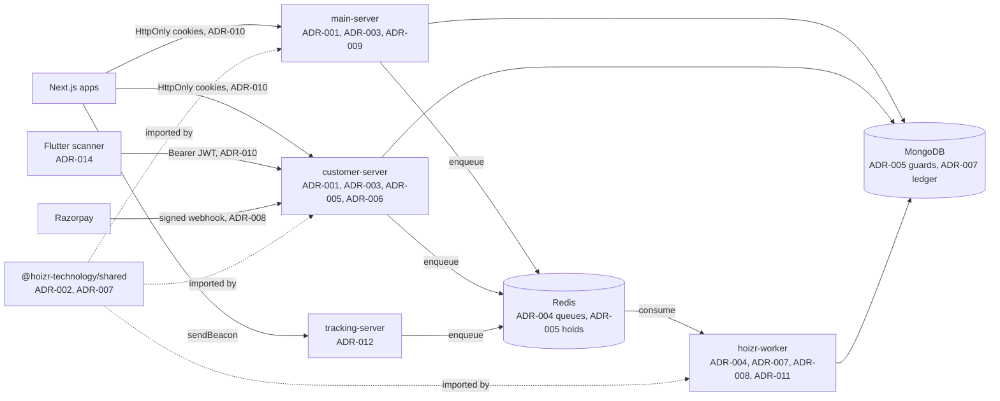

# Engineering decisions (ADR log)

This chapter records the fourteen architectural decisions that shape Hoizr, one Architecture Decision Record each. For every decision you will see the problem it answered, what the code does, what it costs, and the files where it lives. Read it to understand why the system looks the way it does before you change it.

## TL;DR

- **Two GraphQL APIs, one database, one worker process.** `main-server` serves hosts, artists and admins. `customer-server` serves fans and door scanners and is the only service that creates ticket orders. Every slow or failure-prone side effect runs in `hoizr-worker` through BullMQ.
- **One class, many uses.** Each Typegoose class in the shared package is both the MongoDB schema and the GraphQL type, so the database and the API cannot drift apart.
- **Money is defensive by construction.** Prices are computed on the server in integer paise, inventory is guarded by conditional MongoDB writes inside transactions, and money movements post balanced, idempotent double-entry ledger transactions.
- **Webhooks are verified, queued and acknowledged.** Processing happens later in a worker that verifies again and records each event in a durable inbox.
- **Settlement with hosts is deliberately manual.** An admin wires the money and marks it settled; no code path calls a payout API.
- **Operational choices favour India and the door.** Times are stored in UTC and shown in IST everywhere, SMS and WhatsApp go through MSG91 behind feature flags, and the scanner keeps working offline.

## Contents

- [How to read these records](#how-to-read-these-records)
- [Decision index](#decision-index)
- [Where the decisions live](#where-the-decisions-live)
- [Platform and API shape](#platform-and-api-shape) (ADR-001 to ADR-004)
- [Inventory and money](#inventory-and-money) (ADR-005 to ADR-009)
- [Identity, messaging and data](#identity-messaging-and-data) (ADR-010 to ADR-014)

## How to read these records

An Architecture Decision Record (ADR) is a short note that captures one significant decision: the forces at play, the choice made and its consequences. The format comes from the 2011 post [Documenting Architecture Decisions](https://cognitect.com/blog/2011/11/15/documenting-architecture-decisions) on the Cognitect blog. The community site [adr.github.io](https://adr.github.io/) collects templates, including the lighter [MADR](https://adr.github.io/madr/) style this chapter borrows from.

Each record has a **Status** (all are *Accepted*: the code implements them today, with notes where an earlier design was replaced), the **Context** that forced a choice, the **Decision** as implemented, its **Consequences** (gains and accepted trade-offs) and a **See** line with the files. The records were written after the fact from the code as it stands, so they carry no dates. Hoizr is pre-launch and was built by a very small team over many revisions. Where a trade-off has not been addressed yet, the record says so and points to [Known gaps and roadmap](./12-known-gaps-and-roadmap.md).

## Decision index

| ADR | Decision |
|---|---|
| [ADR-001](#adr-001-fastify-mercurius-and-typegraphql-for-the-graphql-apis) | Fastify, Mercurius and TypeGraphQL for the GraphQL APIs |
| [ADR-002](#adr-002-one-typegoose-class-is-the-mongodb-schema-and-the-graphql-type) | One Typegoose class is the MongoDB schema and the GraphQL type, published as a package |
| [ADR-003](#adr-003-two-graphql-apis-split-by-audience-over-one-database) | Two GraphQL APIs split by audience, over one database |
| [ADR-004](#adr-004-every-side-effect-runs-in-a-separate-bullmq-worker-process) | Every side effect runs in a separate BullMQ worker process |
| [ADR-005](#adr-005-redis-soft-holds-in-front-mongodb-conditional-writes-as-the-oversell-guard) | Redis soft holds in front, MongoDB conditional writes as the oversell guard |
| [ADR-006](#adr-006-price-on-the-server-in-integer-paise-and-freeze-what-was-charged) | Price on the server in integer paise, and freeze what was charged |
| [ADR-007](#adr-007-an-append-only-idempotent-double-entry-ledger) | An append-only, idempotent double-entry ledger |
| [ADR-008](#adr-008-webhook-intake-is-verify-enqueue-acknowledge) | Webhook intake is verify, enqueue, acknowledge |
| [ADR-009](#adr-009-a-fixed-per-event-commission-with-manual-admin-verified-settlement) | A fixed per-event commission with manual, admin-verified settlement |
| [ADR-010](#adr-010-rs256-jwts-in-httponly-cookies-with-hashed-refresh-tokens-and-global-revoke) | RS256 JWTs in HttpOnly cookies, hashed refresh tokens, global revoke |
| [ADR-011](#adr-011-msg91-for-sms-and-whatsapp-behind-feature-flags-resend-or-smtp-for-email) | MSG91 for SMS and WhatsApp behind feature flags, Resend or SMTP for email |
| [ADR-012](#adr-012-first-party-event-tracking-with-a-salted-daily-rotating-visitor-hash) | First-party event tracking with a salted, daily-rotating visitor hash |
| [ADR-013](#adr-013-store-utc-enter-and-display-in-ist) | Store UTC, enter and display in IST |
| [ADR-014](#adr-014-an-offline-first-door-scanner-with-an-on-device-manifest) | An offline-first door scanner with an on-device manifest |

## Where the decisions live

The diagram places each decision on the system map from [System architecture](./01-system-architecture.md). ADR-013 (UTC storage, IST display) applies to every box.



## Platform and API shape

### ADR-001: Fastify, Mercurius and TypeGraphQL for the GraphQL APIs

**Status:** Accepted.

**Context.** Four Next.js clients (organizer dashboard, admin console, artist dashboard, fan storefront) and a Flutter scanner each need a different slice of the same domain objects. The team wanted one typed contract per API that clients could turn into a typed SDK, on a lean HTTP server that could also host raw-body webhook routes.

**Decision.** Both API servers run [Fastify](https://fastify.dev/docs/latest/) 5 with [Mercurius](https://mercurius.dev/) as the GraphQL plugin, and build their schema code-first with [TypeGraphQL](https://typegraphql.com/) 2.0 (a release candidate). Every resolver class is registered in one list per server and passed to `buildTypeDefsAndResolvers`. Mercurius gets a `queryDepth: 7` limit and a `context` function that reads cookies and verifies tokens once per request. Authorization is explicit middleware on each operation, applied left to right:

```ts
  @Mutation(() => Boolean)
  @UseMiddleware([isAuthenticated, isUser, loadPermissions, isAdminVerifiedHost])
  async deleteEvent(
    @Arg("id") id: string,
    @Ctx() ctx: Context
  ): Promise<boolean> {
    return await this.service.deleteEvent(id, ctx);
  }
```

**Consequences.**

- Positive: the schema is generated from TypeScript classes, so the four Next.js apps generate typed SDKs with GraphQL Code Generator instead of hand-writing types.
- Positive: guard chains are visible at the call site. A reviewer can read who may call an operation without opening another file.
- Positive: webhooks, email-tracking pixels and health checks are ordinary Fastify routes in the same process. `fastify-raw-body` is enabled only on the routes that need the exact request bytes for HMAC checks.
- Trade-off: TypeGraphQL 2.0 is still a release candidate. Its class-identity checks are also why duplicate copies of `graphql` or `type-graphql` break schema builds (see ADR-002).
- Trade-off: per-method guards rely on discipline. A new operation without a guard is public. There is no class-level default and no `authChecker`.

**See:** [`main-server/src/index.ts`](https://github.com/roop37/main-server/blob/main/src/index.ts), [`main-server/src/resolvers/index.resolver.ts`](https://github.com/roop37/main-server/blob/main/src/resolvers/index.resolver.ts), [`main-server/src/middlewares/authorisation.ts`](https://github.com/roop37/main-server/blob/main/src/middlewares/authorisation.ts), [`main-server/src/modules/event/resolver/event.resolver.ts`](https://github.com/roop37/main-server/blob/main/src/modules/event/resolver/event.resolver.ts), [`customer-server/src/index.ts`](https://github.com/roop37/customer-server/blob/main/src/index.ts).

### ADR-002: One Typegoose class is the MongoDB schema and the GraphQL type

**Status:** Accepted.

**Context.** Three Node services (`main-server`, `customer-server`, `hoizr-worker`) read and write the same MongoDB collections. If each kept its own copy of the `Order` or `Event` shape, a field added in one place would silently be missing in another, and the GraphQL type could disagree with what is stored.

**Decision.** The domain model lives in one npm package, [`@hoizr-technology/shared`](https://github.com/roop37/hoizr-shared), published to GitHub Packages. Each class carries both [Typegoose](https://typegoose.github.io/typegoose/) `@prop` decorators (the MongoDB schema) and TypeGraphQL `@Field` decorators (the GraphQL type). The package defines classes only. Each consumer creates its own Mongoose model on its own connection, choosing the collection name:

```ts
import { getModelForClass } from "@typegoose/typegoose";
import { LedgerEntry, LedgerTransaction } from "@hoizr-technology/shared";

export const LedgerTransactionModel = getModelForClass(LedgerTransaction, {
  schemaOptions: { timestamps: true, collection: "ledger_transactions" },
});

export const LedgerEntryModel = getModelForClass(LedgerEntry, {
  schemaOptions: { timestamps: true, collection: "ledger_entries" },
});
```

**Consequences.**

- Positive: the stored shape and the API shape come from one definition. A field that must never reach a client simply gets `@prop` without `@Field`; `authTokenVersion` on `User` and `Customer` is an example.
- Positive: enums, queue names (ADR-004), the ledger poster (ADR-007), settlement math (ADR-009) and the inter-service HMAC helpers ship in the same package, so every service shares one contract.
- Trade-off: a schema change is a release. You edit the package, bump its version by hand, publish, then bump and reinstall it in each backend. The publish workflow in the repo sits outside `.github/workflows/`, so it never runs.
- Trade-off: installing from GitHub Packages needs a token with `read:packages`, even for a public package ([Local development](./09-local-development.md) shows the `.npmrc`).
- Trade-off: linking the package locally with `file:` brings a second copy of `graphql`, `type-graphql`, `mongoose` and Typegoose, which breaks class identity. Each backend runs `scripts/dedupe-shared-deps.js` before `dev`, `start` and `build` to symlink those back to the consumer's copies.

**See:** [`hoizr-shared/src/schemas/ledger.schema.ts`](https://github.com/roop37/hoizr-shared/blob/main/src/schemas/ledger.schema.ts), [`main-server/src/modules/ledger/schema/ledger.schema.ts`](https://github.com/roop37/main-server/blob/main/src/modules/ledger/schema/ledger.schema.ts), [`hoizr-shared/package.json`](https://github.com/roop37/hoizr-shared/blob/main/package.json), [`main-server/scripts/dedupe-shared-deps.js`](https://github.com/roop37/main-server/blob/main/scripts/dedupe-shared-deps.js).

### ADR-003: Two GraphQL APIs split by audience, over one database

**Status:** Accepted.

**Context.** Hosts, artists and internal admins work in permission-heavy dashboards. Fans and door scanners hit a small, hot surface: event pages, cart, checkout and scans. Checkout spikes at on-sales must not compete with dashboard reports, and the ordering rules (inventory, pricing, QR signing) should live in exactly one place.

**Decision.** The backend is split by audience, not by domain. [`main-server`](https://github.com/roop37/main-server) serves host, admin and artist operations. [`customer-server`](https://github.com/roop37/customer-server) serves customers and scanners, and it is the ordering authority: it is the only service that creates `Order` documents. When a host issues a box-office ticket in the dashboard, `main-server` does not write the order itself. It calls `POST /internal/offline-order/issue` on `customer-server`, signed with an HMAC over `${timestamp}.${rawBody}` and a shared secret. Both services, and the workers, use the same MongoDB database through the shared classes from ADR-002.

**Consequences.**

- Positive: each API can be scaled, rate-limited and secured for its own audience. The customer surface stays small enough to reason about under load.
- Positive: one code path creates orders, so inventory guards (ADR-005) and pricing (ADR-006) are never duplicated.
- Positive: the internal call is idempotent. A replay inside the five-minute timestamp window gets the already-issued order back.
- Trade-off: one shared database couples the services' data models. A collection change touches every service that reads it, which is why the shared package exists.
- Trade-off: the storefront talks to both APIs. It reads public artist profiles from `main-server` and everything else from `customer-server`, so CORS and environment configuration must cover both.

**See:** [`hoizr-shared/src/utils/internal-auth.ts`](https://github.com/roop37/hoizr-shared/blob/main/src/utils/internal-auth.ts), [`main-server/src/utils/internal-client.ts`](https://github.com/roop37/main-server/blob/main/src/utils/internal-client.ts), [`customer-server/src/routes/internal-offline-order.route.ts`](https://github.com/roop37/customer-server/blob/main/src/routes/internal-offline-order.route.ts), [`hoizr-client/src/lib/graphql-main.ts`](https://github.com/roop37/hoizr-client/blob/main/src/lib/graphql-main.ts).

### ADR-004: Every side effect runs in a separate BullMQ worker process

**Status:** Accepted. The Redis Cluster part is forward-looking: every service uses a single-node Redis client today.

**Context.** A paid order triggers slow, failure-prone work: finalising the order, writing ledger rows, rendering ticket and invoice PDFs, sending email, SMS and WhatsApp, and calling host webhooks. Inside a GraphQL request that work makes checkout slow and turns a flaky email provider into a failed checkout. Scheduled jobs also need a home outside the API servers.

**Decision.** The API servers and `tracking-server` only enqueue jobs on [BullMQ](https://docs.bullmq.io/) queues in Redis. One Node process, [`hoizr-worker`](https://github.com/roop37/hoizr-worker) (local folder `hoizr-workers`), boots all 25 BullMQ workers and all 8 `node-cron` schedules. Cron schedules run in `Asia/Kolkata`, and each tick first takes a Redis `SET NX` lock keyed by job name and minute, so a second worker replica skips a tick that is already running. Producers and the consumer agree on queue names through one registry in the shared package, and every name is wrapped in braces:

```ts
  // Razorpay webhook: customer-server enqueues raw payload, worker
  // verifies signature again and runs the full finalisation flow.
  static readonly razorpayWebhookQueue = "{razorpay-webhook-queue}";

  // Lifecycle / post-purchase fan-out: pushes EventTicketSale, applies
  // auto-follows, enqueues confirmation comms after a successful order.
  static readonly postPurchaseQueue = "{post-purchase-queue}";
```

The braces are a Redis Cluster [hash tag](https://redis.io/docs/latest/operate/oss_and_stack/reference/cluster-spec/#hash-tags). BullMQ spreads one queue over several keys and updates them together in Lua scripts; the hash tag keeps them in one cluster slot, so a later move to Cluster needs no queue rename.

**Consequences.**

- Positive: API latency is independent of email, SMS, PDF and webhook latency, and a provider outage becomes retries in a queue rather than errors at the checkout button.
- Positive: deterministic job ids (`post_purchase:<orderId>`, `order_confirm:<orderId>` and others) plus unique keys in MongoDB make re-delivery safe. A cron re-enqueues post-purchase work for paid orders that still have no ledger row after fifteen minutes, which recovers enqueues that were lost.
- Trade-off: one process hosts every worker, so a large marketing campaign shares an event loop and a Mongo pool with payment finalisation. Splitting workers by priority is a roadmap item.
- Trade-off: job options are set per producer. Some worker-side producers keep completed jobs forever and do not retry. [Background jobs with BullMQ](./04-background-jobs-bullmq.md) lists them.
- Trade-off: a few queue names are still hand-copied string literals (for example in `tracking-server`), and nothing checks them against the registry.

**See:** [`hoizr-worker/src/index.ts`](https://github.com/roop37/hoizr-worker/blob/main/src/index.ts), [`hoizr-worker/src/workers/crons/cron.scheduler.ts`](https://github.com/roop37/hoizr-worker/blob/main/src/workers/crons/cron.scheduler.ts), [`hoizr-worker/src/workers/crons/fanout-reconciliation.cron.ts`](https://github.com/roop37/hoizr-worker/blob/main/src/workers/crons/fanout-reconciliation.cron.ts), [`hoizr-shared/src/queue/queue.ts`](https://github.com/roop37/hoizr-shared/blob/main/src/queue/queue.ts), [`tracking-server/src/utils/queue.ts`](https://github.com/roop37/tracking-server/blob/main/src/utils/queue.ts), [`main-server/src/utils/redis.ts`](https://github.com/roop37/main-server/blob/main/src/utils/redis.ts).

## Inventory and money

### ADR-005: Redis soft holds in front, MongoDB conditional writes as the oversell guard

**Status:** Accepted.

**Context.** Popular events go on sale to many buyers at once. A buyer who adds tickets to a cart should see "sold out" early rather than after paying, yet the cart cannot take a database lock for the thirteen minutes a checkout may last. Under no circumstance may two payments together exceed a ticket type's capacity.

**Decision.** Two layers, with different jobs.

1. **Soft holds in Redis (advisory).** `setCart` reserves every ticket and add-on in the cart with one Lua script, `reserveInventory`. The script increments one counter per ticket type, checks it against the remaining capacity and rolls back every increment in the batch if any line would overflow. Holds expire after the cart window.
2. **Conditional writes in MongoDB (authoritative).** `ticketSold` changes only when an order is finalised. Every finalise path (free orders, box-office orders, the browser confirmation and the webhook worker) runs a filtered `updateOne` per line inside a multi-document [transaction](https://www.mongodb.com/docs/manual/core/transactions/). The filter only matches if `sold + quantity <= capacity`:

```ts
        for (const line of order.tickets ?? []) {
          const ticketId = String(line.ticketTypeId);
          const r = await EventModel.updateOne(
            {
              _id: order.eventId,
              "tickets._id": ticketId,
              $expr: {
                $let: {
                  vars: { t: { $arrayElemAt: [{ $filter: { input: "$tickets", as: "t", cond: { $eq: ["$$t._id", ticketId] } } }, 0] } },
                  in: { $lte: [{ $add: ["$$t.ticketSold", Number(line.quantity)] }, "$$t.ticketCapacity"] },
                },
              },
            },
            { $inc: { "tickets.$.ticketSold": Number(line.quantity) } },
            { session }
          );
          if (r.matchedCount === 0) {
            throw new ErrorWithProps(`${line.ticketName ?? "Ticket"} is no longer available`);
          }
        }
```

A zero match aborts the whole transaction. If a captured payment loses this race in the webhook worker, the order is flagged for a manual refund instead of being fulfilled.

**Consequences.**

- Positive: oversell protection does not depend on Redis being correct. The database is the only source of truth for sold counts.
- Positive: the browser path and the webhook path can race safely. Both write the same order document first, so MongoDB's write-conflict retry makes the second one see a finalised order and stop.
- Trade-off: transactions need a MongoDB replica set, including in local development.
- Trade-off: ticket subdocument ids are strings and `$expr` does not cast types, so the guard must compare raw strings. Comparing with an `ObjectId` silently matches nothing.
- Trade-off: the Redis counter is one aggregate per ticket type, so an abandoned cart can keep seats held a little longer than its own window, and the event-wide capacity is not re-checked at finalise. [Redis and concurrency](./05-redis-and-concurrency.md) covers both and the upgrade path.

**See:** [`customer-server/src/utils/redis.ts`](https://github.com/roop37/customer-server/blob/main/src/utils/redis.ts), [`customer-server/src/modules/cart/service/cart.service.ts`](https://github.com/roop37/customer-server/blob/main/src/modules/cart/service/cart.service.ts), [`customer-server/src/modules/order/service/order.service.ts`](https://github.com/roop37/customer-server/blob/main/src/modules/order/service/order.service.ts), [`hoizr-worker/src/workers/razorpay-webhook/razorpay-webhook.process.ts`](https://github.com/roop37/hoizr-worker/blob/main/src/workers/razorpay-webhook/razorpay-webhook.process.ts), [`customer-server/src/tests/cart-inventory-math.test.ts`](https://github.com/roop37/customer-server/blob/main/src/tests/cart-inventory-math.test.ts).

### ADR-006: Price on the server in integer paise, and freeze what was charged

**Status:** Accepted.

**Context.** A ticket total combines the ticket price, a host-funded coupon, ticket GST (only for GST-registered hosts), the customer platform fee and GST on that fee. Floating-point rupees drift by a paisa, and a paisa of drift between the order, the payment gateway, the invoice and the ledger turns into reconciliation work. Fee and tax rates are admin-editable configuration, so a later change must not rewrite history.

**Decision.** One pure function, `computeCartPricingForLines`, prices every cart preview, coupon preview and order. It converts rupees to integer paise at the edge, does every step in paise with explicit rounding per operation, and ends with a tripwire that throws if the parts do not add up to the total:

```ts
// rupees → integer paise (nearest paise; handles any fractional input).
const toPaise = (rupees: number): number => Math.round(Number(rupees) * 100);
// integer paise → rupees, exact for a paise integer.
const toRupees = (paise: number): number => paise / 100;
// ...
const pctOfPaise = (paise: number, percent: number): number =>
  Math.round((paise * percent) / 100);
// ...
  const componentsPaise =
    taxablePaise + taxesPaise + applicationFeePaise + platformFeeGstPaise;
  const totalAmount = toRupees(totalPaise);
  if (
    componentsPaise !== totalPaise ||
    Math.round(totalAmount * 100) !== totalPaise
  ) {
```

The client never sends a price. The cart stores the unit price seen at add time, and `createOrder` rejects the order if the live price has changed since. Each order stores a required `appliedConfigSnapshot` with the rates used, and the Razorpay order is created for the total in paise.

**Consequences.**

- Positive: the amount charged, the amount in the invoice and the amount in the ledger agree to the paisa, and a refactor that breaks that fails loudly.
- Positive: a fee or tax change in configuration applies to new orders only; existing orders keep their snapshot.
- Trade-off: two units coexist. Orders and settlements store rupees with two-decimal rounding, while the ledger and invoices store integer paise (`*Paise` fields). You must know which one you are in.
- Trade-off: settlement currently recomputes commission from the event's current rate rather than reading each order's snapshot (see ADR-009).
- Trade-off: inclusive GST and partial advance payment are modelled in the schema but not priced yet.

**See:** [`customer-server/src/modules/cart/service/cart-pricing.ts`](https://github.com/roop37/customer-server/blob/main/src/modules/cart/service/cart-pricing.ts), [`customer-server/src/tests/cart-pricing.service.test.ts`](https://github.com/roop37/customer-server/blob/main/src/tests/cart-pricing.service.test.ts), [`customer-server/src/modules/order/service/order.service.ts`](https://github.com/roop37/customer-server/blob/main/src/modules/order/service/order.service.ts), [`hoizr-shared/src/schemas/order.schema.ts`](https://github.com/roop37/hoizr-shared/blob/main/src/schemas/order.schema.ts).

### ADR-007: An append-only, idempotent double-entry ledger

**Status:** Accepted.

**Context.** Hoizr collects ticket money on behalf of hosts, keeps a fee, owes GST on that fee, passes ticket GST through to hosts and later pays hosts out. Order documents alone cannot answer "how much do we owe this host right now" or "how much GST did we collect this month". Webhooks and jobs are retried, so any money record must be safe to write twice.

**Decision.** A money movement posts one `LedgerTransaction` header with N `LedgerEntry` lines through a single shared helper, `postLedgerTransaction`. The helper converts amounts to integer paise, rejects lines with both sides set, refuses an unbalanced transaction and writes the header and entries in one MongoDB transaction. A unique `idempotencyKey` (for example `order:<id>:paid` or `settlement:<id>:released`) makes a second post a no-op:

```ts
  if (!isAuditOnly && debitTotal !== creditTotal) {
    throw new Error(
      `Ledger transaction unbalanced: debit=${debitTotal} credit=${creditTotal} kind=${input.kind} key=${input.idempotencyKey}`
    );
  }
  // ...
    await session.withTransaction(async () => {
      const existing = await models.transactionModel
        .findOne({ idempotencyKey: input.idempotencyKey })
        .select("_id")
        .session(session)
        .lean();
      if (existing) {
        result = {
          transactionId: String(existing._id),
          alreadyExisted: true,
        };
        return;
      }
```

If two posters race past the `findOne`, the unique index aborts one of them with error 11000, and the helper returns the winner. Accounts and transaction kinds are closed enums in the shared package. Corrections are new compensating transactions; `ORDER_REFUND` reverses `ORDER_PAID` pro rata.

**Consequences.**

- Positive: account balances, GST owed and per-event reconciliation come from summing entries, and the internal admin console builds its finance views from them.
- Positive: retries, duplicate webhooks and the reconciliation cron can all call the poster without double counting.
- Positive: narration strings come from a typed discriminated union, so a new transaction kind without a narration fails to compile.
- Trade-off: the ledger is only as complete as its callers. Some flows (for example merch payments) are not posted yet, and a few account types are defined but unused.
- Trade-off: the worker-side wrapper logs and swallows posting errors so one bad post does not block an e-ticket email. A missed post then has to be found through reconciliation, not through a failed job.

**See:** [`hoizr-shared/src/ledger/post-transaction.ts`](https://github.com/roop37/hoizr-shared/blob/main/src/ledger/post-transaction.ts), [`hoizr-shared/src/enums/ledger.enum.ts`](https://github.com/roop37/hoizr-shared/blob/main/src/enums/ledger.enum.ts), [`hoizr-worker/src/utils/ledger-poster.ts`](https://github.com/roop37/hoizr-worker/blob/main/src/utils/ledger-poster.ts), [`hoizr-worker/src/utils/paid-order-fanout.ts`](https://github.com/roop37/hoizr-worker/blob/main/src/utils/paid-order-fanout.ts).

### ADR-008: Webhook intake is verify, enqueue, acknowledge

**Status:** Accepted.

**Context.** [Razorpay webhooks](https://razorpay.com/docs/webhooks/) are the authoritative signal that a payment was captured, failed, refunded or disputed. The gateway retries when it does not get a fast 2xx, and it can deliver the same event more than once. Finalising an order involves a transaction, QR signing and several follow-up jobs, which is too much to do while the gateway waits.

**Decision.** The receiver in `customer-server` does three things: it checks the `x-razorpay-signature` HMAC over the raw body with a constant-time compare, it enqueues the raw body with the signature as the BullMQ job id, and it returns 200. If the enqueue fails it returns 500 so the gateway retries.

```ts
      if (!verifySignatureFastPath(bodyStr, signature)) {
        logger.warn("Razorpay webhook signature mismatch");
        return reply.status(400).send({ error: "Invalid signature" });
      }

      try {
        await getQueue().add(
          "RAZORPAY_WEBHOOK",
          { rawBody: bodyStr, signature },
          { jobId: signature }
        );
        return reply.status(200).send({ received: true });
      } catch (err: any) {
        logger.error(
          `Razorpay webhook enqueue failed: ${err?.message ?? err}`
        );
        return reply.status(500).send({ error: "Internal error" });
      }
```

The worker verifies the signature again, then writes a `WebhookEvent` row with a unique provider event id. That row is a durable inbox: an existing row marked `PROCESSED` or `IGNORED` means "already done", while `PENDING` or `FAILED` rows are processed again so BullMQ retries work. Each handler is also idempotent by state: only a `PAYMENT_PENDING` order can become `PAYMENT_SUCCESS`, and refunds are claimed per refund id. `main-server` runs the same verify-and-record pattern for marketing-credit top-ups.

**Consequences.**

- Positive: the gateway always gets a fast answer, and slow downstream work never causes a webhook storm.
- Positive: three independent layers (job id, inbox row, state machine) make duplicate deliveries harmless.
- Positive: a job placed in Redis without a valid signature is ignored, because the worker re-verifies.
- Trade-off: there is no dead-letter tooling. A job that exhausts its retries leaves a `FAILED` inbox row, with its error message, for someone to inspect.
- Trade-off: the fast path in the browser and the webhook can both finalise an order. That is safe because of ADR-005, but it means two code paths to keep in step.

**See:** [`customer-server/src/routes/razorpay-webhook.route.ts`](https://github.com/roop37/customer-server/blob/main/src/routes/razorpay-webhook.route.ts), [`hoizr-worker/src/utils/webhook-event-log.ts`](https://github.com/roop37/hoizr-worker/blob/main/src/utils/webhook-event-log.ts), [`hoizr-worker/src/workers/razorpay-webhook/razorpay-webhook.process.ts`](https://github.com/roop37/hoizr-worker/blob/main/src/workers/razorpay-webhook/razorpay-webhook.process.ts), [`main-server/src/routes/razorpay-webhook.route.ts`](https://github.com/roop37/main-server/blob/main/src/routes/razorpay-webhook.route.ts), [`hoizr-worker/src/tests/webhook-event-log.test.ts`](https://github.com/roop37/hoizr-worker/blob/main/src/tests/webhook-event-log.test.ts).

### ADR-009: A fixed per-event commission with manual, admin-verified settlement

**Status:** Accepted. It replaced an earlier design that automated host payouts through a payout API; that code was removed before launch.

**Context.** Fans pay into Hoizr's single Razorpay account. After the event, each host is owed their ticket revenue and ticket GST, minus Hoizr's commission and GST on it, minus refunds and chargebacks. Before launch, with few hosts, the priority is that the amount is right and that a human checks it before money leaves the bank.

**Decision.** Commission is one fixed rate per event, `Event.commissionRate`. It is stamped at publish from an admin-editable configuration row chosen by event type, and an internal admin can override it per event until the event starts:

```ts
      // Stamp the fixed commission rate at publish. Existing rate is
      // preserved on re-publish so an admin override isn't clobbered.
      const commissionRate =
        typeof event.commissionRate === "number"
          ? event.commissionRate
          : await this.resolveCommissionRateForEvent(
              event.eventType as EventType[]
            );
```

Settlement is bookkeeping. An admin computes a `PayoutSettlement` row for an event with the shared pure function `calculatePayoutSettlementAmounts`. The row becomes due once the event has ended and its refund window plus a buffer day has passed. A server-side readiness checklist must pass (event ended, refund window closed, verified payout account, nothing awaiting review). The admin transfers the money from the bank outside the platform, then calls `adminMarkSettlementPaid`, which flips the row to `PAID` with an atomic status-guarded update and posts the `SETTLEMENT_COMMISSION` and `PAYOUT_RELEASED` ledger transactions. The schema comment states the rule plainly: no code moves money.

**Consequences.**

- Positive: no bug, leaked credential or retry loop can send money out of the bank, because no code can.
- Positive: hosts see one rate per event that does not change after the event starts.
- Positive: paid events cannot be published without a verified primary payout account, so a settlement always has a destination.
- Trade-off: settlement is manual work for the operations team and will not scale to many hosts without a reviewed automation step.
- Trade-off: settlement reads the event's current rate, not the per-order snapshot from ADR-006. Since the rate is frozen at event start this rarely matters, but the two can disagree for orders taken before an override.
- Trade-off: a few release gates can be blocked by flags that only a database edit clears today. [Payments and money](./06-payments-and-money.md) and [Known gaps and roadmap](./12-known-gaps-and-roadmap.md) list them.

**See:** [`main-server/src/modules/event/service/event.service.ts`](https://github.com/roop37/main-server/blob/main/src/modules/event/service/event.service.ts), [`main-server/src/modules/payoutSettlement/service/payout-settlement.service.ts`](https://github.com/roop37/main-server/blob/main/src/modules/payoutSettlement/service/payout-settlement.service.ts), [`hoizr-shared/src/ledger/settlement-math.ts`](https://github.com/roop37/hoizr-shared/blob/main/src/ledger/settlement-math.ts), [`hoizr-shared/src/schemas/payout-settlement.schema.ts`](https://github.com/roop37/hoizr-shared/blob/main/src/schemas/payout-settlement.schema.ts), [`main-server/src/tests/payout-release-preconditions.test.ts`](https://github.com/roop37/main-server/blob/main/src/tests/payout-release-preconditions.test.ts).

<!-- SCREENSHOT: admin-payout-settlements | Internal admin Payout Settlements module showing the readiness checklist and the Mark as settled action -->

## Identity, messaging and data

### ADR-010: RS256 JWTs in HttpOnly cookies, with hashed refresh tokens and global revoke

**Status:** Accepted. Persisted refresh-token rotation exists in the artist and scanner realms; extending it to every realm is on the roadmap.

**Context.** Hoizr has five kinds of signed-in principal (host users, internal admins, artists, customers and scanner devices) across two servers and five front ends. The dashboards live on sibling subdomains and should share a session. Tokens must not be readable by page scripts, and an admin needs a way to end every session for an account at once.

**Decision.** Sessions are a short-lived access token plus a longer-lived refresh token, both [JSON Web Tokens](https://datatracker.ietf.org/doc/html/rfc7519) signed with RS256. Browsers receive them as `HttpOnly` cookies, which are `Secure`, `SameSite=None` and scoped to a configured parent domain in production. The Flutter scanner sends a Bearer header instead. Refresh tokens are allowlisted in Redis, keyed by principal and device. The host, admin, customer and scanner realms store them as SHA-256 hashes. Every principal document carries an `authTokenVersion` counter that each verification compares with the token's `version` claim:

```ts
const hashToken = (token: string): string =>
  crypto.createHash("sha256").update(token).digest("hex");
// ...
    const payload = jwt.verify(aToken, PUBLIC_KEY, {
      algorithms: ["RS256"],
    }) as jwt.JwtPayload & JwtAuthPayload;
    // ...
      const user = await UserModel.findById(payload.user)
        .select("_id role authTokenVersion")
        .lean<User>();

      if (!user || user.authTokenVersion !== payload.version) {
        return null;
      }
```

"Log out everywhere" deletes the other refresh keys and increments `authTokenVersion` with `$inc`, which invalidates every outstanding access token for that user at its next request.

**Consequences.**

- Positive: dashboard sessions (hosts, admins, artists) live only in `HttpOnly` cookies that page scripts cannot read, and a Redis dump does not reveal usable refresh tokens.
- Positive: global revoke is one counter increment, with no token blacklist to maintain.
- Trade-off: every authenticated request does a small MongoDB read to compare the version. That is the price of instant revoke.
- Trade-off: one keypair signs every realm, and realms are told apart by claim shape. Adding token-type and audience claims is a listed hardening item.
- Trade-off: the customer API also returns tokens in its login responses, and cross-subdomain cookies need `SameSite=None`. Cookie-only delivery and CSRF defences on the GraphQL endpoints are on the hardening list in [Auth and RBAC](./03-auth-and-rbac.md).

**See:** [`main-server/src/utils/jwt.ts`](https://github.com/roop37/main-server/blob/main/src/utils/jwt.ts), [`main-server/src/utils/cookie.ts`](https://github.com/roop37/main-server/blob/main/src/utils/cookie.ts), [`main-server/src/modules/user/services/user.service.ts`](https://github.com/roop37/main-server/blob/main/src/modules/user/services/user.service.ts), [`customer-server/src/utils/jwt.ts`](https://github.com/roop37/customer-server/blob/main/src/utils/jwt.ts).

### ADR-011: MSG91 for SMS and WhatsApp behind feature flags, Resend or SMTP for email

**Status:** Accepted. SMS and WhatsApp sending are switched off unless their flags are set.

**Context.** Indian SMS needs DLT-registered templates, and WhatsApp business messaging needs approved templates, so an India-focused provider simplifies both. Provisioning takes time, and nobody wants a developer laptop to text real phone numbers. Email needs a transport that can change without a code change.

**Decision.** All outbound messaging runs in the worker process (ADR-004).

- **SMS and WhatsApp** go through [MSG91](https://docs.msg91.com/). Each client has a live check. When the flag is off or keys are missing, the client logs the payload and returns a synthetic success instead of calling MSG91:

  ```ts
  export const isWhatsAppLive = (): boolean =>
    process.env.WHATSAPP_ENABLED === "true" &&
    !!process.env.MSG91_AUTHKEY &&
    !!integratedNumber();
  ```

  SMS uses the same pattern with `SMS_ENABLED`. Template ids are mapped from job names in one place in the SMS worker, so producers never know template ids.
- **Customer OTP** goes out by SMS always, and by WhatsApp in parallel when WhatsApp is live. MSG91 accepts a WhatsApp send before it knows whether it was delivered, and a missed login code means a locked-out customer.
- **Email** goes through [Resend](https://resend.com/docs) or a plain SMTP server, chosen by environment variables: `EMAIL_TRANSPORT=resend` uses Resend's HTTP API, and otherwise Nodemailer sends over SMTP. This is a configuration switch, not automatic failover.

**Consequences.**

- Positive: a fresh clone runs end to end without provider keys, and messages appear in the worker log.
- Positive: going live on SMS or WhatsApp, or switching email providers, is an environment change, not a code change.
- Trade-off: until a template is registered, a transactional SMS job is accepted and then skipped. Only the OTP templates are mapped today.
- Trade-off: the `isWhatsAppLive` check is duplicated in `customer-server` and the worker, so both environments must agree on the flags.
- Trade-off: sending OTPs on two channels costs a little more per login.

**See:** [`hoizr-worker/src/msg91/whatsapp.client.ts`](https://github.com/roop37/hoizr-worker/blob/main/src/msg91/whatsapp.client.ts), [`hoizr-worker/src/msg91/msg91.client.ts`](https://github.com/roop37/hoizr-worker/blob/main/src/msg91/msg91.client.ts), [`hoizr-worker/src/workers/sms/sms.process.ts`](https://github.com/roop37/hoizr-worker/blob/main/src/workers/sms/sms.process.ts), [`hoizr-worker/src/email/email-utils.ts`](https://github.com/roop37/hoizr-worker/blob/main/src/email/email-utils.ts), [`customer-server/src/modules/otp/service/otp.service.ts`](https://github.com/roop37/customer-server/blob/main/src/modules/otp/service/otp.service.ts). Provider details are in [Third-party services](./13-third-party-services.md).

### ADR-012: First-party event tracking with a salted, daily-rotating visitor hash

**Status:** Accepted. The Next.js apps can also load PostHog for product analytics when a key is set; that is a separate, optional channel and is not part of this pipeline.

**Context.** Hosts need a funnel for their own events (ticket selected, payment started, orders placed), and the abandoned-cart automation needs to know who started a cart and did not buy. That data drives emails to real customers, so it has to live in Hoizr's own database. Counting unique visitors should not require a long-lived cross-site identifier.

**Decision.** A small, write-only service, [`tracking-server`](https://github.com/roop37/tracking-server), accepts beacons from the storefront's dependency-free tracker. It drops requests that send `DNT: 1` and requests from known bots, accepts only six event types, derives a few coarse fields and enqueues the result for the worker to store. It has no MongoDB connection. Visitors are counted with a hash that changes every UTC day:

```ts
export const visitorHashOf = (ip: string, userAgent: string): string => {
  const day = new Date().toISOString().slice(0, 10); // YYYY-MM-DD UTC
  return crypto
    .createHash("sha256")
    .update(`${VISITOR_SALT}|${day}|${ip}|${userAgent}`)
    .digest("hex")
    .slice(0, 32);
};
```

The raw IP address, user agent, full URL and referrer are used to derive the hash, the traffic source and the device class, and are then dropped before the event is queued.

**Consequences.**

- Positive: analytics data stays first-party and joins directly with orders, automations and host reports.
- Positive: the stored record has no IP address and no stable anonymous visitor id, and the ingest service honours Do Not Track.
- Positive: ingest is its own small service that never touches MongoDB, so analytics traffic does not load the API servers.
- Trade-off: unique visitors are per day only, and two people behind one IP address with the same browser count as one.
- Trade-off: beacons are not signed. Signed ingest and a retention policy (TTL) for `analytics_events` are roadmap items.
- Trade-off: the tracker still keeps a random visitor id in `localStorage` that the server ignores. Removing it is a small cleanup.

**See:** [`tracking-server/src/utils/enrich.ts`](https://github.com/roop37/tracking-server/blob/main/src/utils/enrich.ts), [`tracking-server/src/index.ts`](https://github.com/roop37/tracking-server/blob/main/src/index.ts), [`hoizr-client/src/lib/tracker.ts`](https://github.com/roop37/hoizr-client/blob/main/src/lib/tracker.ts). The full pipeline is in [Tracking and analytics](./07-tracking-and-analytics.md).

### ADR-013: Store UTC, enter and display in IST

**Status:** Accepted.

**Context.** Every Hoizr event happens in India, and hosts type times as Indian wall-clock times. Servers, browsers and phones may run in any timezone. A door-staff phone set to another zone would show the wrong door time, and an earlier version of the event form mixed local parsing with UTC reads, which shifted every day of a multi-day event by the timezone offset.

**Decision.** MongoDB stores true UTC instants. Every place that turns a human time into an instant, or an instant into text, does so explicitly in `Asia/Kolkata`. The organizer dashboard parses picker values as IST with `date-fns-tz` and renders stored instants back in IST:

```ts
// Platform timezone. Hosts enter event wall-clock times in IST and we store true
// UTC instants; every interpret/display goes through this single zone (India has
// no DST). See toDateTimeInput / fromZonedTime usages below.
const IST_TZ = "Asia/Kolkata";
```

The storefront and the worker's ticket PDF format with `timeZone: "Asia/Kolkata"`, the cron schedules run in `Asia/Kolkata` (ADR-004), and the Flutter scanner adds a fixed +05:30 offset, which is safe because India has no daylight saving time.

**Consequences.**

- Positive: a time means the same thing on every screen, PDF and email, whatever the device setting.
- Positive: stored data stays timezone-neutral, so a future market only needs new display rules.
- Trade-off: the rule is a convention, not a type. Every new date field must pair an explicit IST parse on save with an explicit IST format on read, and a bare `new Date(string)` in a browser is a bug.
- Trade-off: a few calculations still use server-local time (for example coupon day-of-week checks), which is correct only while servers run in IST or the check is migrated.

**See:** [`business-client/components/modules/events/EventJourney.tsx`](https://github.com/roop37/business-client/blob/main/components/modules/events/EventJourney.tsx), [`hoizr-client/src/lib/format.ts`](https://github.com/roop37/hoizr-client/blob/main/src/lib/format.ts), [`hoizr-worker/src/utils/pdf/ticket-renderer.ts`](https://github.com/roop37/hoizr-worker/blob/main/src/utils/pdf/ticket-renderer.ts), [`hoizr-scanner-app/lib/utils/ist_time.dart`](https://github.com/roop37/hoizr-scanner-app/blob/main/lib/utils/ist_time.dart).

### ADR-014: An offline-first door scanner with an on-device manifest

**Status:** Accepted.

**Context.** Venue basements and crowded festival grounds often have no usable mobile data, and the door cannot stop while a phone waits for a network. A ticket QR is an HMAC signature that only the server can verify, so the phone cannot validate a QR on its own.

**Decision.** The Flutter app downloads a manifest of the event's paid orders (`scannerEventManifest`) into a local SQLite database through `sqflite`. Membership in that manifest is the offline validity check. When the device is online, the server is authoritative and the local cache is updated. When it is offline, or the request fails in transit, the app checks the manifest, admits the guest, marks the ticket locally and queues the scan:

```dart
    // Online: trust the server (authoritative claim). Server validation
    // failures come back as a result (not an exception); only a transport
    // failure throws → fall through to the offline path.
    if (_online) {
      try {
        final res = await _gql.scanTicket(auth: _auth, qrCodeData: qrCodeData);
        if (res.status == ScanResultStatus.ok ||
            res.status == ScanResultStatus.refunded ||
            res.status == ScanResultStatus.alreadyCheckedIn) {
          await _store.markCheckedInLocal(
            res.order?.orderId ?? '',
            res.order?.checkedInAt ?? DateTime.now(),
          );
        }
        await _refreshCounts();
        return res;
      } catch (_) {
        // transport error mid-scan → behave as offline
```

When connectivity returns, the app replays the queue through `syncOfflineScans`. The server runs each queued scan through the same `scanTicket` logic with the original scan time, so its atomic check-in update decides the final result.

**Consequences.**

- Positive: doors keep moving through network drops, and every offline admission is eventually recorded on the server.
- Trade-off: two offline devices can each admit the same ticket once before they sync. The second shows up as `ALREADY_CHECKED_IN` on replay, after the guest is inside.
- Trade-off: the manifest reflects the moment it was downloaded, so a refund issued after that is not seen until the device refreshes or goes online.
- Trade-off: the manifest holds guest names and phone numbers on the device. Encrypting the offline cache at rest is on the hardening list.

**See:** [`hoizr-scanner-app/lib/services/sync_service.dart`](https://github.com/roop37/hoizr-scanner-app/blob/main/lib/services/sync_service.dart), [`hoizr-scanner-app/lib/services/offline_store.dart`](https://github.com/roop37/hoizr-scanner-app/blob/main/lib/services/offline_store.dart), [`customer-server/src/modules/scanner/service/scanner.service.ts`](https://github.com/roop37/customer-server/blob/main/src/modules/scanner/service/scanner.service.ts).

<!-- SCREENSHOT: scanner-scan-result | Flutter scanner showing a scan result with the offline indicator and pending-sync count -->

---

Related chapters: [System architecture](./01-system-architecture.md) · [Domain model](./02-domain-model.md) · [Auth and RBAC](./03-auth-and-rbac.md) · [Background jobs with BullMQ](./04-background-jobs-bullmq.md) · [Redis and concurrency](./05-redis-and-concurrency.md) · [Payments and money](./06-payments-and-money.md) · [Tracking and analytics](./07-tracking-and-analytics.md) · [Frontend architecture](./08-frontend-architecture.md) · [Local development](./09-local-development.md) · [Deployment and operations](./10-deployment-and-operations.md) · [Known gaps and roadmap](./12-known-gaps-and-roadmap.md) · [Third-party services](./13-third-party-services.md)

[Back to the walkthrough](../README.md)
