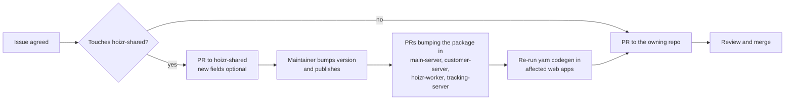

# Known gaps, roadmap and how to contribute

Hoizr is pre-launch software, and this chapter is a plain map of where it stands. It covers which parts are built end to end and which are flag-gated or scaffolded, then lists the known gaps by theme, each linked to the code. It ends with scoped first issues, the contribution flow, and larger projects that would move the platform forward.

## TL;DR

- **The core ticketing loop is built end to end.** That covers events, the Redis-held cart, Razorpay checkout finalised by webhook, e-tickets, door scanning (online and offline), guestlists, campaigns, automations, manual payout settlement and a double-entry ledger.
- **Some integrations are built but stay off until configured:** SMS and WhatsApp through MSG91, web push, Instagram connect, and a restaurant-reservation integration. Sign in with Apple and a public Open API gateway are scaffolded, not enabled.
- **The biggest gaps are in engineering hygiene, not features.** No CI job runs tests, lint or type checks. Tests are plain assert scripts over pure functions. There is no docker-compose stack, and installing the shared package needs a GitHub token.
- **Most gaps are good first contributions.** The [Good first issues](#good-first-issues) table lists 19 scoped, code-verified tasks across all 10 repos.
- **Start with the org [CONTRIBUTING.md](https://github.com/roop37/hoizr-dotgithub/blob/main/CONTRIBUTING.md).** Report vulnerabilities privately through [SECURITY.md](https://github.com/roop37/hoizr-dotgithub/blob/main/SECURITY.md), never in a public issue.

## Contents

- [Project status](#project-status)
- [Known gaps by theme](#known-gaps-by-theme)
  - [Testing and CI](#testing-and-ci)
  - [Local development ergonomics](#local-development-ergonomics)
  - [Installing the shared package](#installing-the-shared-package)
  - [Framework and dependency upgrades](#framework-and-dependency-upgrades)
  - [Documentation drift and stale snapshots](#documentation-drift-and-stale-snapshots)
  - [Observability and operations](#observability-and-operations)
  - [Data retention](#data-retention)
  - [Scanner app platform gaps](#scanner-app-platform-gaps)
  - [Dead code from the original fork](#dead-code-from-the-original-fork)
  - [Code health](#code-health)
  - [Security hardening backlog](#security-hardening-backlog)
- [Good first issues](#good-first-issues)
- [How to contribute](#how-to-contribute)
- [Ideas for bigger contributions](#ideas-for-bigger-contributions)

## Project status

A very small team built Hoizr and revised it many times. The codebase started as a fork of an earlier restaurant point-of-sale product and was rebuilt for live events in India. Along the way the payment provider changed to Razorpay. Some features were built and later removed: AI-priced commission offers and automated bank payouts gave way to a fixed per-event commission rate and admin-confirmed manual settlement. That history explains most of the leftover code listed below.

Status of each area in the current code:

| Area | Status | Notes |
|---|---|---|
| Events, multi-day tickets, publishing | Built | Six-step event wizard in [business-client](https://github.com/roop37/business-client), publish gated on admin verification of the organizer |
| Cart, checkout, payment finalisation | Built | Inventory holds in Redis, Razorpay orders, webhook finalisation and post-purchase fan-out. See [Payments and money](./06-payments-and-money.md) |
| E-tickets, invoices, transactional email | Built | Rendered and sent by [hoizr-worker](https://github.com/roop37/hoizr-worker) through Resend or SMTP |
| Door scanning | Built for Android | Online and offline modes. The iOS host project is not committed, and offline mode has known limits ([below](#scanner-app-platform-gaps)) |
| Guestlists, waitlists, loyalty points | Built | Modules in [main-server](https://github.com/roop37/main-server/tree/main/src/modules) and customer-server |
| Email campaigns and marketing automations | Built | Automations are host-configurable, and most start switched off |
| Manual payout settlement and ledger | Built | An admin marks a settlement paid after release checks pass. No automated payouts |
| Internal admin console | Built | Two sidebar links currently 404 (a [good first issue](#good-first-issues)) |
| Analytics pipeline | Built | Six event types. See [Tracking and analytics](./07-tracking-and-analytics.md) |
| SMS and WhatsApp through MSG91 | Flag-gated | Off unless `SMS_ENABLED` / `WHATSAPP_ENABLED` are `true` and keys are set; otherwise the [clients log the message](https://github.com/roop37/hoizr-worker/blob/main/src/msg91/whatsapp.client.ts) instead of sending |
| Web push campaigns | Needs configuration | The [push worker](https://github.com/roop37/hoizr-worker/blob/main/src/workers/host-push-campaign/host-push-campaign.worker.ts) fails with a clear status until a Firebase service account is set |
| Instagram connect | Not enabled | Falls back to a deterministic stub when its environment is unset |
| Restaurant reservations | Flag-gated, off by default | An optional, feature-flagged restaurant-reservation integration over Swiggy's MCP API |
| Google sign-in on the storefront | Hidden in the UI | The server flow exists; the button is commented out in [`AuthPanel.tsx`](https://github.com/roop37/hoizr-client/blob/main/src/components/auth/AuthPanel.tsx) |
| Sign in with Apple | Scaffolded, not enabled | The resolver throws `APPLE_NOT_CONFIGURED` ([`auth.resolver.ts`](https://github.com/roop37/customer-server/blob/main/src/modules/auth/resolver/auth.resolver.ts)) |
| Open API for organizers | Partial | API keys ([`hostApiKey`](https://github.com/roop37/main-server/tree/main/src/modules/hostApiKey)) and signed webhook deliveries are built; the public gateway that would accept those keys is not in these repos |
| Venue grader, promoters | Placeholders | The venue grader is a [schema](https://github.com/roop37/hoizr-shared/blob/main/src/schemas/event-venue-grader-report.schema.ts) and a queue name with no producer or consumer. The [promoter schema](https://github.com/roop37/hoizr-shared/blob/main/src/schemas/promoter.schema.ts) is commented out |
| AI-priced offers, automated bank payouts | Removed | Stale generated types remain in one client ([below](#documentation-drift-and-stale-snapshots)) |

## Known gaps by theme

Each gap below has a one-line reason it matters and a link to where it lives. Many of them are also listed as [Good first issues](#good-first-issues).

### Testing and CI

Nothing runs automatically on a pull request. The only workflows in the four backend repos are SSH deploy jobs ([main-server's](https://github.com/roop37/main-server/tree/main/.github/workflows), for example). The four web apps and the scanner app have no `.github/` folder at all. The [shared package's publish workflow](https://github.com/roop37/hoizr-shared/blob/main/.github/build.yaml) sits outside `.github/workflows/`, so GitHub never runs it.

The tests that exist are plain scripts using `node:assert` (some use `node:test`), aimed at pure functions such as pricing math, ledger entries, cookie flags and payout gates:

| Repo | Test files | How they run | Notes |
|---|---|---|---|
| [main-server](https://github.com/roop37/main-server/tree/main/src/tests) | 11 assert scripts | `npx ts-node --transpile-only <file>` | `test:unit` points at a deleted file. The Playwright specs are fully commented out |
| [customer-server](https://github.com/roop37/customer-server/tree/main/src/tests) | 19 | `npx ts-node <file>` | Cart math, pricing, cookies, rate limiting; 14 cover the reservation integration. No test script |
| [hoizr-worker](https://github.com/roop37/hoizr-worker/tree/main/src/tests) | 9 (six in `src/tests/`, three beside the code in `src/utils/`) | `npx ts-node <file>` | Ledger builders, refund inventory, SSRF classifier, loyalty math |
| [tracking-server](https://github.com/roop37/tracking-server) | 0 | none | |
| [hoizr-shared](https://github.com/roop37/hoizr-shared/tree/main/scripts) | 4 | `node scripts/<file>` after a build | Two have npm scripts. Nothing covers the ledger poster |
| [hoizr-client](https://github.com/roop37/hoizr-client) | 9 | two `yarn test:*` scripts | Seven `node:test` files are not wired to any script |
| [business-client](https://github.com/roop37/business-client) | 2 | not wired | One `node:test` file and a lead-form self-check |
| [internal-admin-client](https://github.com/roop37/internal-admin-client) | 0 | none | |
| [hoizr-artist-client](https://github.com/roop37/hoizr-artist-client/tree/main/scripts) | 2 | `yarn test:*` | One asserts an older signup form and fails against the current one |
| [hoizr-scanner-app](https://github.com/roop37/hoizr-scanner-app/blob/main/test/widget_test.dart) | 1 | `flutter test` | The unmodified `flutter create` template; it pumps a `MyApp` class that no longer exists, so it does not compile |

The broken script is a typical example. It survived because no job ever runs it ([`package.json`](https://github.com/roop37/main-server/blob/main/package.json)):

```json
    "test:unit": "ts-node --transpile-only src/tests/offer-validator.service.test.ts",
    "test:artist-claim-input": "ts-node --transpile-only src/tests/artist-claim-input.test.ts",
    "test:publish-payout": "ts-node --transpile-only src/tests/publish-payout-precondition.test.ts",
    "test:e2e": "playwright test"
```

**Why it matters:** order finalisation, refunds, scanning and settlement have no integration tests. A broken build is first noticed by the deploy script, not by a PR check.

### Local development ergonomics

| Gap | Why it matters | Where |
|---|---|---|
| No docker-compose file in any repo | A first run means installing MongoDB and Redis by hand. MongoDB must run as a replica set, because the backends use multi-document transactions | [`order.service.ts`](https://github.com/roop37/customer-server/blob/main/src/modules/order/service/order.service.ts), [`post-transaction.ts`](https://github.com/roop37/hoizr-shared/blob/main/src/ledger/post-transaction.ts) |
| The two Dockerfiles are stale | Both write an `.npmrc` for a legacy npm scope instead of `@hoizr-technology`, so the shared package would not resolve. The worker image exposes a port although the worker has no HTTP server. customer-server and tracking-server have no Dockerfile | [main-server](https://github.com/roop37/main-server/blob/main/Dockerfile), [hoizr-worker](https://github.com/roop37/hoizr-worker/blob/main/Dockerfile) |
| No Node.js version pin | No repo has `.nvmrc` or `engines`. Fastify 5 needs Node 20 or newer, and contributors have to guess | every `package.json` |
| Two lockfiles in two Yarn repos | `package-lock.json` sits next to `yarn.lock`, so `npm install` silently drifts from the canonical tree | [hoizr-client](https://github.com/roop37/hoizr-client), [hoizr-artist-client](https://github.com/roop37/hoizr-artist-client) |
| main-server's default dev CORS list omits port 3009 | The storefront runs on 3009 and calls main-server for artist pages, which fail locally until you set `CORS_ORIGINS` | [`src/index.ts`](https://github.com/roop37/main-server/blob/main/src/index.ts) |
| No ESLint config in two web apps, no Prettier anywhere | `yarn lint` prompts interactively in hoizr-client and hoizr-artist-client, and formatting varies between repos | [hoizr-client `package.json`](https://github.com/roop37/hoizr-client/blob/main/package.json) |

The [Local development](./09-local-development.md) chapter has the full bring-up order.

### Installing the shared package

main-server, customer-server, hoizr-worker and tracking-server depend on `@hoizr-technology/shared`, which is published to GitHub Packages. GitHub Packages asks for a token even for public packages, so a fresh clone cannot `npm install` until you create a classic PAT with `read:packages` and add the registry lines to `~/.npmrc` (see [CONTRIBUTING.md](https://github.com/roop37/hoizr-dotgithub/blob/main/CONTRIBUTING.md#installing-hoizr-technologyshared)).

Three related gaps:

- **tracking-server installs the package but never imports it.** Dropping the dependency would remove the token requirement for that repo entirely ([`package.json`](https://github.com/roop37/tracking-server/blob/main/package.json)).
- **Releases are manual.** The [publish workflow](https://github.com/roop37/hoizr-shared/blob/main/.github/build.yaml) never runs (see [Testing and CI](#testing-and-ci)), so each version is bumped and published by hand.
- **The package is one heavy barrel.** [`src/index.ts`](https://github.com/roop37/hoizr-shared/blob/main/src/index.ts) re-exports everything, so importing a single constant loads `type-graphql` and the Typegoose decorators. tracking-server learned this the hard way ([`src/utils/queue.ts`](https://github.com/roop37/tracking-server/blob/main/src/utils/queue.ts)):

```ts
/**
 * Queue name — kept as a LOCAL literal on purpose. Importing it from
 * `@hoizr-technology/shared` pulls that package's barrel, which transitively
 * `require`s `type-graphql` (via its GraphQL enums). tracking-server is a
 * lightweight ingest process that does NOT install type-graphql, so any shared
 * import crashes it on boot (MODULE_NOT_FOUND) → PM2 crash-loop → nginx 502 →
 * the browser surfaces it as a "CORS error". Keep this string byte-identical to
 * `QueueNames.analyticsEventsQueue` in hoizr-shared so the worker drains it.
 */
const ANALYTICS_EVENTS_QUEUE = "{analytics-events-queue}";
```

The web apps work around it the same way: `ALL_DAYS_TICKET` is copied into [hoizr-client](https://github.com/roop37/hoizr-client/blob/main/src/lib/event-days.ts) and [business-client's event wizard](https://github.com/roop37/business-client/blob/main/components/modules/events/EventJourney.tsx) rather than imported from [`src/constants/event-days.ts`](https://github.com/roop37/hoizr-shared/blob/main/src/constants/event-days.ts). **Why it matters:** every hand copy is a contract that can drift without anyone noticing. Decorator-free subpath exports would fix it ([bigger contributions](#ideas-for-bigger-contributions)).

### Framework and dependency upgrades

| Gap | Why it matters | Where |
|---|---|---|
| All four web apps are on Next.js 14.2 with React 18 (14.2.4 in business-client and internal-admin-client, 14.2.18 in hoizr-client and hoizr-artist-client) | Newer majors move to React 19 and make request APIs such as `cookies()`, `headers()` and page `params` asynchronous. That is a mechanical but wide change; see the official [version 15 upgrade guide](https://nextjs.org/docs/app/guides/upgrading/version-15) and its codemods | each app's `package.json` |
| `type-graphql` is a 2.0 release candidate, pinned as a peer by the shared package | Every backend has to move in lockstep with the shared package's pin | [hoizr-shared `package.json`](https://github.com/roop37/hoizr-shared/blob/main/package.json) |
| TypeScript strictness varies: full `strict` in four repos, `noImplicitAny` only in three, `strictNullChecks` only in two | Null bugs in money and inventory code surface at runtime in the looser repos | each `tsconfig.json` |
| main-server imports three date libraries (moment, luxon, date-fns) and declares dependencies it never imports (`square`, `@vercel/sdk`) | Bigger installs, and three ways to get IST arithmetic wrong | [main-server `package.json`](https://github.com/roop37/main-server/blob/main/package.json) |
| The shared package declares `date-fns` but never imports it | It installs for nothing in every backend | [hoizr-shared `package.json`](https://github.com/roop37/hoizr-shared/blob/main/package.json) |
| The scanner allows Flutter 3.22 in `pubspec.yaml`, its lockfile is gitignored, and it calls `Color.withOpacity` eight times | Contributors can resolve a different dependency graph from the maintainers, and newer Flutter releases deprecate `withOpacity` in favour of `withValues` | [`pubspec.yaml`](https://github.com/roop37/hoizr-scanner-app/blob/main/pubspec.yaml) |

### Documentation drift and stale snapshots

| Gap | Why it matters | Where |
|---|---|---|
| `schema.graphql` is a hand-kept snapshot last updated in May 2026. It predates the guestlist, API-key and webhook modules | Anyone who reads it, or points a tool at it, sees part of the API and thinks it is all of it. Generate it from the running server or delete it | [main-server `schema.graphql`](https://github.com/roop37/main-server/blob/main/schema.graphql) |
| The artist client's generated SDK still contains types for the removed AI Boost feature | Generated types read like live features. Regenerating against the current main-server fixes it | [`src/generated/graphql.ts`](https://github.com/roop37/hoizr-artist-client/blob/main/src/generated/graphql.ts) |
| main-server's `.env.example` still lists the removed payout-provider variables (`RAZORPAYX_*`) | Contributors configure things that nothing reads | [`.env.example`](https://github.com/roop37/main-server/blob/main/.env.example) |
| Seven migration notes at the worker repo root describe a migration that finished months ago | Newcomers read them as current plans | [hoizr-worker root](https://github.com/roop37/hoizr-worker) |
| customer-server commits its `dist/` folder (73 files) although `.gitignore` lists it | The compiled output lags the source and confuses code search | [`dist/`](https://github.com/roop37/customer-server/tree/main/dist) |
| The scanner README's default API endpoint disagrees with the compiled default | Contributors point the app at the wrong server | [scanner `README.md`](https://github.com/roop37/hoizr-scanner-app/blob/main/README.md), [`graphql_service.dart`](https://github.com/roop37/hoizr-scanner-app/blob/main/lib/services/graphql_service.dart) |

### Observability and operations

| Gap | Why it matters | Where |
|---|---|---|
| Logs go to stdout only. The hosted-log transport in main-server and file rotation in the worker are commented out | Logs last only as long as the process manager keeps them | [main-server logger](https://github.com/roop37/main-server/blob/main/src/log/logger.ts), [worker logger](https://github.com/roop37/hoizr-worker/blob/main/src/utils/logger.ts) |
| No request IDs or trace context across GraphQL → BullMQ → worker | Following one paid order through three processes means matching timestamps by hand | all backends |
| No tracing, metrics or error-tracking SDK in any `package.json` | Queue latency, failed-job rates and resolver errors are invisible until someone looks | all repos |
| None of the four Node services handles `SIGTERM` | A deploy kills in-flight work mid-step. BullMQ hands the job to another worker only after its lock expires and the stalled-job check runs | [worker `src/index.ts`](https://github.com/roop37/hoizr-worker/blob/main/src/index.ts) |
| When main-server fails to boot after env validation (a MongoDB connect or schema build error), it logs the error and does not exit | A failed start looks like a hung process instead of a crash the process manager can restart | [`src/index.ts`](https://github.com/roop37/main-server/blob/main/src/index.ts) |
| The admin health panel reports MongoDB, Redis and queue depths, but `cronFreshness` and `webhookFreshness` are always empty | A stuck cron or a silent payment webhook is not visible on the dashboard | [`admin-metrics.service.ts`](https://github.com/roop37/main-server/blob/main/src/modules/adminMetrics/service/admin-metrics.service.ts) |
| tracking-server's `/health` always says the queue is ready, without touching Redis | A load balancer keeps routing to an instance that cannot enqueue | [`src/index.ts`](https://github.com/roop37/tracking-server/blob/main/src/index.ts) |

See [Deployment and operations](./10-deployment-and-operations.md) for how the services run today.

### Data retention

No schema in the codebase declares a TTL index, and no job archives old rows. The [`analytics_events`](https://github.com/roop37/hoizr-shared/blob/main/src/schemas/analytics-event.schema.ts) collection grows by one document per tracked event, forever. The same holds for webhook delivery logs, activity logs and AI operation logs in [`src/schemas/`](https://github.com/roop37/hoizr-shared/tree/main/src/schemas).

**Why it matters:** storage cost and privacy obligations both grow with time. A retention policy is a product decision, but carrying it out is mostly a few index declarations plus an archival job.

The scanner app has a device-side version of the same gap. Its offline ticket manifest (attendee details) stays in on-device SQLite after staff sign out, because [`AuthService.clear()`](https://github.com/roop37/hoizr-scanner-app/blob/main/lib/services/auth_service.dart) wipes only secure storage. Door devices are often shared, so sign-out should clear that cache.

### Scanner app platform gaps

| Gap | Why it matters | Where |
|---|---|---|
| The iOS host project is not committed (no Xcode project, `Info.plist` or Podfile) | iOS contributors must run `flutter create --platforms=ios .` and add the camera usage description by hand | [`ios/`](https://github.com/roop37/hoizr-scanner-app/tree/main/ios) |
| `android.permission.INTERNET` is declared only in the debug and profile manifests | A release APK may be unable to reach the API. Verify with a release build and add it to the main manifest | [`AndroidManifest.xml`](https://github.com/roop37/hoizr-scanner-app/blob/main/android/app/src/main/AndroidManifest.xml) |
| Release builds are signed with the debug keystore (the template TODO is still there) | The app cannot ship to a store as configured | [`build.gradle.kts`](https://github.com/roop37/hoizr-scanner-app/blob/main/android/app/build.gradle.kts) |
| GraphQL calls have no HTTP timeout | On captive or dead Wi-Fi, a scan can hang for the OS TCP timeout before the offline fallback kicks in | [`graphql_service.dart`](https://github.com/roop37/hoizr-scanner-app/blob/main/lib/services/graphql_service.dart) |
| Offline mode validates against a cached manifest, so some server checks are unavailable offline (multi-day "wrong day" matching, guestlist passes). Per-item results from syncing offline scans are not shown to staff | Door staff get less information offline than online, and a two-device conflict goes unreported | [`sync_service.dart`](https://github.com/roop37/hoizr-scanner-app/blob/main/lib/services/sync_service.dart) |
| A cold start without network leaves "Start scanning" disabled, even with a cached manifest | Offline mode only works if the app reached the server earlier in the same session | [`home_page.dart`](https://github.com/roop37/hoizr-scanner-app/blob/main/lib/pages/home_page.dart) |

### Dead code from the original fork

| Leftover | Where |
|---|---|
| Stripe-era schemas (subscription, subscription invoice, grace period, Stripe integration, Stripe event log) | [hoizr-shared `src/schemas/`](https://github.com/roop37/hoizr-shared/tree/main/src/schemas), also registered as models in [the worker](https://github.com/roop37/hoizr-worker/blob/main/src/models/index.ts) |
| Restaurant-era email templates (`restaurant-*.hbs`, `welcome-restaurant.hbs`, `subscription-*.hbs`) | [worker `templates/transactional/`](https://github.com/roop37/hoizr-worker/tree/main/src/email/templates/transactional) |
| Playwright page objects for a POS (`cms`, `menu`, `pos`, `payment`) and two fully commented-out specs | [main-server `src/tests/page-models/`](https://github.com/roop37/main-server/tree/main/src/tests/page-models) |
| `choose:`-prefixed Redis cache keys next to `hoizr:` ones | [main-server `src/utils/redis.ts`](https://github.com/roop37/main-server/blob/main/src/utils/redis.ts) |
| A legacy default database name when `DB_NAME` is unset | [worker `mongodb-connection.ts`](https://github.com/roop37/hoizr-worker/blob/main/src/utils/mongodb-connection.ts) |
| A Stripe integration page that calls an operation missing from the generated SDK, plus onboarding components that nothing imports | [`pages/account/stripe-integration`](https://github.com/roop37/business-client/tree/main/pages/account/stripe-integration), [`components/modules/onboarding/`](https://github.com/roop37/business-client/tree/main/components/modules/onboarding) |
| Placeholder workers: host denormalization only touches a timestamp, and one feedback branch only logs | [`host-denormalization.worker.ts`](https://github.com/roop37/hoizr-worker/blob/main/src/workers/host-denormalization/host-denormalization.worker.ts) |

**Why it matters:** dead code costs reading time, makes search results misleading, and keeps unused dependencies in the install. Most of it can be deleted in small, safe PRs. Run the build after each one.

### Code health

| Gap | Why it matters | Where |
|---|---|---|
| Very large files: the event wizard is 6,309 lines, and the order service is 2,373 lines with three near-identical inventory-increment blocks | Hard to review, and easy to fix a bug in one copy but not the others | [`EventJourney.tsx`](https://github.com/roop37/business-client/blob/main/components/modules/events/EventJourney.tsx), [`order.service.ts`](https://github.com/roop37/customer-server/blob/main/src/modules/order/service/order.service.ts) |
| Duplicated GraphQL clients: 17 files in business-client and 7 in internal-admin-client construct their own `GraphQLClient`, and all but one carry their own copy of the token-refresh logic | A fix to the refresh path has to be repeated in every copy | [business-client `utils/`](https://github.com/roop37/business-client/tree/main/utils), [internal-admin-client `util/`](https://github.com/roop37/internal-admin-client/tree/main/util) |
| The IST convention (store UTC, display Asia/Kolkata) is followed in most places, but some date math still uses server-local or browser-local time: coupon day rules, the storefront's "tonight" page, admin date inputs and the invoice fiscal-year tag | Off-by-one-day bugs between midnight and 05:30 IST on a UTC server | [`coupon-eval.ts`](https://github.com/roop37/customer-server/blob/main/src/modules/order/service/coupon-eval.ts), [`live/page.tsx`](https://github.com/roop37/hoizr-client/blob/main/src/app/live/page.tsx), [`invoice-numbering.ts`](https://github.com/roop37/hoizr-worker/blob/main/src/utils/invoice-numbering.ts) |
| The artist client sends and compares enum *values* (`"PaymentSuccess"`, `"Tech"`), but TypeGraphQL puts enum *keys* (`PAYMENT_SUCCESS`, `TECH`) on the wire | Merch order counts and rider uploads are likely broken, and `as` casts hide it from `tsc` | [`src/types/artist.ts`](https://github.com/roop37/hoizr-artist-client/blob/main/src/types/artist.ts) |

### Security hardening backlog

The items below are general hardening work, listed without detail on purpose. If you find a specific weakness, report it privately as described in [SECURITY.md](https://github.com/roop37/hoizr-dotgithub/blob/main/SECURITY.md). Do not open a public issue.

- Consistent rate limiting on every public operation in both API servers.
- Cookie-only delivery of auth tokens to browsers.
- GraphiQL and introspection gated by environment in both API servers.
- Signed, rate-limited ingest for analytics beacons.
- Secret scanning and dependency audit in CI for every repo.

## Good first issues

Each item below was checked against the code. They are small, self-contained and mostly need no running payment provider. Comment on the matching GitHub issue (or open one) before you start, so two people do not build the same thing.

| Repo | Issue | Difficulty | Pointers |
|---|---|---|---|
| hoizr-worker | Fix follower targeting for lineup artists and collaborators | Easy | Four audience builders read `artistId` and `businessId`, but the shared schema fields are `artistLinkId` and `businessLinkId`. Files: [`selling-fast.worker.ts`](https://github.com/roop37/hoizr-worker/blob/main/src/workers/selling-fast/selling-fast.worker.ts), [`event-followers.worker.ts`](https://github.com/roop37/hoizr-worker/blob/main/src/workers/event-followers/event-followers.worker.ts), [`host-campaigns.process.ts`](https://github.com/roop37/hoizr-worker/blob/main/src/workers/host-campaigns/host-campaigns.process.ts), [`host-whatsapp-campaigns.process.ts`](https://github.com/roop37/hoizr-worker/blob/main/src/workers/host-whatsapp-campaigns/host-whatsapp-campaigns.process.ts). Extract one helper and add an assert test (worked example below) |
| hoizr-worker | Send the dual-receipt ticket email to both addresses | Easy | Every recipient is enqueued with the same `jobId: order_confirm:<orderId>`, so BullMQ drops the second add. Put the normalised recipient in the job id ([`dispatch-order-confirmation.ts`](https://github.com/roop37/hoizr-worker/blob/main/src/utils/invoice/dispatch-order-confirmation.ts)) |
| hoizr-worker | Replace hard-coded queue names with `QueueNames` | Easy | The cloudinary-deletion, customer-profile-pic and [webhook-delivery](https://github.com/roop37/hoizr-worker/blob/main/src/workers/webhook-delivery/webhook-delivery.worker.ts) workers keep string literals; the installed shared version already exports all three |
| main-server | Repair the test scripts | Easy | Replace the dead `test:unit` entry with a script that runs every `src/tests/*.test.ts` plus `key-crypto.test.ts` ([`package.json`](https://github.com/roop37/main-server/blob/main/package.json)) |
| customer-server | Apply price filters before pagination | Medium | `getPublishedEvents` filters `minPrice` / `maxPrice` after `skip` / `limit`, so `total` and page sizes are wrong. Move the filter into the query ([`event.service.ts`](https://github.com/roop37/customer-server/blob/main/src/modules/event/service/event.service.ts)) |
| customer-server | Evaluate coupon day rules in IST | Easy | Replace `now.getDay()` with an `Intl.DateTimeFormat` weekday in `Asia/Kolkata`, and add a test for an order at 01:00 IST ([`coupon-eval.ts`](https://github.com/roop37/customer-server/blob/main/src/modules/order/service/coupon-eval.ts)) |
| customer-server | Swap the local `CustomerInstagram` class for the shared one | Easy | Resolves the only TODO in `src/`; the shared package now exports the class ([`customer-instagram.schema.ts`](https://github.com/roop37/customer-server/blob/main/src/modules/customerInstagram/schema/customer-instagram.schema.ts)) |
| tracking-server | Remove the unused `@hoizr-technology/shared` dependency | Easy | Nothing in `src/` imports it; removing it makes `npm install` work without a GitHub token ([`package.json`](https://github.com/roop37/tracking-server/blob/main/package.json)) |
| tracking-server | Match traffic sources by exact host | Easy | `classifyTrafficSource` uses `includes` and `endsWith`, so `reddit.com` matches `t.co` and is labelled social. Use exact or dot-suffix matching, guard `new URL(origin)`, add a table-driven `node:test` ([`enrich.ts`](https://github.com/roop37/tracking-server/blob/main/src/utils/enrich.ts)) |
| hoizr-shared | Add a PR check workflow | Easy | Add a `test` script that builds and runs all four `scripts/*.test.js`, and a new pull-request workflow under `.github/workflows/` that runs it. Leave the publish workflow ([`build.yaml`](https://github.com/roop37/hoizr-shared/blob/main/.github/build.yaml), which bumps versions and publishes) and its location to the maintainers |
| hoizr-shared | Add a unique `(type, fiscalYear)` index to `InvoiceNumberCounter` | Easy | Prevents two counter documents on a first-of-year race. Model the test on `scripts/guestlist-indexes.test.js` ([`invoice.schema.ts`](https://github.com/roop37/hoizr-shared/blob/main/src/schemas/invoice.schema.ts)) |
| hoizr-client | Make the "tonight" page IST-aware | Easy | [`live/page.tsx`](https://github.com/roop37/hoizr-client/blob/main/src/app/live/page.tsx) compares `toDateString()` in server time; reuse `todayIST` from [`src/lib/dineout.ts`](https://github.com/roop37/hoizr-client/blob/main/src/lib/dineout.ts) |
| hoizr-client | Strip HTML from meta descriptions | Easy | `generateMetadata` slices raw organizer HTML ([`events/[slug]/page.tsx`](https://github.com/roop37/hoizr-client/blob/main/src/app/events/%5Bslug%5D/page.tsx)). Move the tag-stripping in [`EventDetailClient.tsx`](https://github.com/roop37/hoizr-client/blob/main/src/components/hoizr-ui/EventDetailClient.tsx) into `src/lib/` and reuse it |
| business-client | Check Resend's `error` result in two form routes | Easy | The Resend SDK returns `{ data, error }` rather than throwing. [`/api/forms`](https://github.com/roop37/business-client/blob/main/app/api/forms/route.ts) checks it; [`/api/contact`](https://github.com/roop37/business-client/blob/main/app/api/contact/route.ts) and [`/api/waitlist`](https://github.com/roop37/business-client/blob/main/app/api/waitlist/route.ts) do not, so a failed send still returns success |
| business-client | Fix `redirectPathFromStatus` | Easy | It switches on `UserStatus.OnboardingPending` and `InternalVerificationPending`, which are not in the generated enum, so neither case can match. Map the first to `HostOnboardingPending`, delete the second, and decide the right destination for `SubUserEmailVerificationPending` ([`redirectPathFromStatus.ts`](https://github.com/roop37/business-client/blob/main/utils/redirectPathFromStatus.ts)) |
| internal-admin-client | Fix two sidebar links that 404 | Easy | `/whitelabel-requests` and `/automation-suggestions` are missing from `MODULE_ROUTE_MAP`, and `ai-boosts` and `blogs` are dead entries. Better: derive the map from [`accessConfig.ts`](https://github.com/roop37/internal-admin-client/blob/main/components/navigation/common/accessConfig.ts) ([`[moduleRoute]/page.tsx`](https://github.com/roop37/internal-admin-client/blob/main/app/%28app%29/%5BmoduleRoute%5D/page.tsx)) |
| hoizr-artist-client | Use the generated enums | Medium | Replace the hand-written values in [`src/types/artist.ts`](https://github.com/roop37/hoizr-artist-client/blob/main/src/types/artist.ts) and the `as` casts in the Orders, Riders, Links and Welcome screens with members of `src/generated/graphql.ts` |
| hoizr-artist-client | Rewrite the stale signup test | Easy | [`artist-claim-form.test.js`](https://github.com/roop37/hoizr-artist-client/blob/main/scripts/artist-claim-form.test.js) asserts first-name, last-name and email fields that the stage-name plus phone signup no longer has |
| hoizr-scanner-app | Replace the template test and fix the status badge | Easy | Swap [`widget_test.dart`](https://github.com/roop37/hoizr-scanner-app/blob/main/test/widget_test.dart) for tests that pump `HoizrScannerApp` and cover status parsing. The badge in [`scan_result_page.dart`](https://github.com/roop37/hoizr-scanner-app/blob/main/lib/pages/scan_result_page.dart) upper-cases camelCase enum names, so it renders "ALREADYCHECKEDIN" |

### Worked example: follower targeting

The first issue in the table shows what most of these fixes look like: one module got the field names right and its siblings did not. The post-purchase worker reads the shared schema fields correctly ([`post-purchase.worker.ts`](https://github.com/roop37/hoizr-worker/blob/main/src/workers/post-purchase/post-purchase.worker.ts)):

```ts
  if (event.hostId) platformBusinesses.add(event.hostId);
  for (const collab of event.eventCollaborationBusiness ?? []) {
    if (collab.businessLinkId) platformBusinesses.add(collab.businessLinkId);
    else if (collab.name) phantomBusinesses.add(collab.name);
  }
  for (const artist of event.lineup ?? []) {
    if (artist.artistLinkId) platformArtists.add(artist.artistLinkId);
    else if (artist.tempArtistId) phantomArtists.add(artist.tempArtistId);
    else if (artist.name) phantomArtists.add(artist.name);
  }
```

The selling-fast worker reads fields that do not exist on `EventLineupArtist` or `EventBusinessPartner` ([`selling-fast.worker.ts`](https://github.com/roop37/hoizr-worker/blob/main/src/workers/selling-fast/selling-fast.worker.ts)):

```ts
    // Follower targets: the host + event collaborators; plus lineup artists.
    const followerTargets = new Set<string>([hostId]);
    const lineupArtistIds = (Array.isArray(event.lineup) ? event.lineup : [])
      .map((a: any) => a?.artistId)
      .filter((id: any): id is string => typeof id === "string" && !!id);
    for (const c of Array.isArray(event.eventCollaborationBusiness)
      ? event.eventCollaborationBusiness
      : []) {
      const cid = c?.businessId || c?.hostId;
      if (typeof cid === "string" && cid) followerTargets.add(cid);
    }
```

The `any` casts are why `tsc` stays quiet, and the effect is that only the organizer's own followers are reached. The fix: write one `resolveFollowerTargets(event)` helper with the post-purchase logic, use it in all four builders, and add a `node:assert` script that feeds it an event with a linked artist and a linked collaborator.

## How to contribute

The full guide is the shared [CONTRIBUTING.md](https://github.com/roop37/hoizr-dotgithub/blob/main/CONTRIBUTING.md). The short version:

1. **Pick an issue** from the table above or the [`good first issue` search](https://github.com/search?q=user%3Aroop37+label%3A%22good+first+issue%22+state%3Aopen&type=issues). Comment before you start. For anything bigger than a bug fix, agree on the approach in an issue first.
2. **Set up the repo** you are changing with the [Local development](./09-local-development.md) chapter. That includes the GitHub Packages token for the backends.
3. **Fork, branch from `main`**, and keep the PR to one logical change. Commit messages follow [Conventional Commits](https://www.conventionalcommits.org/en/v1.0.0/), for example `fix(worker): target lineup followers by artistLinkId`.
4. **Add a test for any logic change** (money, inventory, permissions, dates, parsing). A small assert script in the style of its neighbours is enough. Run the build, and lint where ESLint is configured, because no CI will do it for you yet.
5. **Open the PR against `main`** using the template. For a change that spans repos, open one PR per repo, link them, and state the merge order.

A change to a schema, enum or queue name in `hoizr-shared` travels through the other repos in a fixed order:



**Security issues follow a different path.** Do not open a public issue or PR. Use GitHub private vulnerability reporting, or email `contact@hoizr.com` with a `[SECURITY]` subject, as [SECURITY.md](https://github.com/roop37/hoizr-dotgithub/blob/main/SECURITY.md) describes.

## Ideas for bigger contributions

These are larger projects. Open an issue to discuss the design before starting any of them.

| Idea | What it enables | Where to start |
|---|---|---|
| **Publish the shared package publicly** on the npm registry, with decorator-free subpath exports (`./queue`, `./constants`, `./event-days`) | Clone-and-install without a token, and tracking-server plus the web apps can import queue names and constants instead of copying them | [hoizr-shared `package.json`](https://github.com/roop37/hoizr-shared/blob/main/package.json), [`src/index.ts`](https://github.com/roop37/hoizr-shared/blob/main/src/index.ts) |
| **A docker-compose dev stack**: a single-node MongoDB replica set, Redis, a local SMTP catcher, the four backends, and seed scripts | First run in one command. Fixing the two stale Dockerfiles and adding ones for customer-server and tracking-server comes with it | [main-server `Dockerfile`](https://github.com/roop37/main-server/blob/main/Dockerfile), [Local development](./09-local-development.md) |
| **CI for every repo**: build or type-check, lint and tests on each PR, plus secret scanning | Regressions caught before review, and the deploy workflows stop being the first build | the existing [deploy workflows](https://github.com/roop37/main-server/tree/main/.github/workflows) show the repo layout |
| **Integration test suites** against an in-memory MongoDB replica set and a real Redis: order finalisation, refunds, settlement release, scanner verdicts | The money paths get tested end to end, not just their pure helpers | [`order.service.ts`](https://github.com/roop37/customer-server/blob/main/src/modules/order/service/order.service.ts), [`post-transaction.ts`](https://github.com/roop37/hoizr-shared/blob/main/src/ledger/post-transaction.ts) |
| **OpenTelemetry tracing** across Fastify, BullMQ and MongoDB, with trace context carried in job data, plus request IDs and graceful shutdown | One trace per paid order across customer-server, Redis and the worker | [main-server `src/index.ts`](https://github.com/roop37/main-server/blob/main/src/index.ts), [worker `src/index.ts`](https://github.com/roop37/hoizr-worker/blob/main/src/index.ts) |
| **Next.js upgrade** for the four web apps, one app at a time, with the official codemods | Current React, current security patches, and async request APIs before they become mandatory | [hoizr-client `package.json`](https://github.com/roop37/hoizr-client/blob/main/package.json) |
| **A retention policy** with TTL indexes or archival for analytics and log collections | Bounded storage and a clear privacy story | [`analytics-event.schema.ts`](https://github.com/roop37/hoizr-shared/blob/main/src/schemas/analytics-event.schema.ts) |
| **A complete iOS scanner build**: committed host project, release signing, a CI build | Door staff on iPhones | [hoizr-scanner-app](https://github.com/roop37/hoizr-scanner-app) |
| **Split the two largest files** and consolidate the duplicated GraphQL clients into one helper per app | Reviewable diffs and one token-refresh path per app | [`EventJourney.tsx`](https://github.com/roop37/business-client/blob/main/components/modules/events/EventJourney.tsx), [business-client `utils/graphqlClient.ts`](https://github.com/roop37/business-client/blob/main/utils/graphqlClient.ts) |
| **A public Open API gateway** that accepts the organizer API keys main-server already issues | Organizers can build on Hoizr without scraping the dashboard | [`hostApiKey`](https://github.com/roop37/main-server/tree/main/src/modules/hostApiKey), [`hostWebhook`](https://github.com/roop37/main-server/tree/main/src/modules/hostWebhook) |

---

**Related chapters:** [01 System architecture](./01-system-architecture.md) · [02 Domain model](./02-domain-model.md) · [03 Auth and RBAC](./03-auth-and-rbac.md) · [04 Background jobs with BullMQ](./04-background-jobs-bullmq.md) · [05 Redis and concurrency](./05-redis-and-concurrency.md) · [06 Payments and money](./06-payments-and-money.md) · [07 Tracking and analytics](./07-tracking-and-analytics.md) · [08 Frontend architecture](./08-frontend-architecture.md) · [09 Local development](./09-local-development.md) · [10 Deployment and operations](./10-deployment-and-operations.md) · [11 Engineering decisions](./11-engineering-decisions.md) · [13 Third-party services](./13-third-party-services.md)

[Back to the walkthrough](../README.md)
