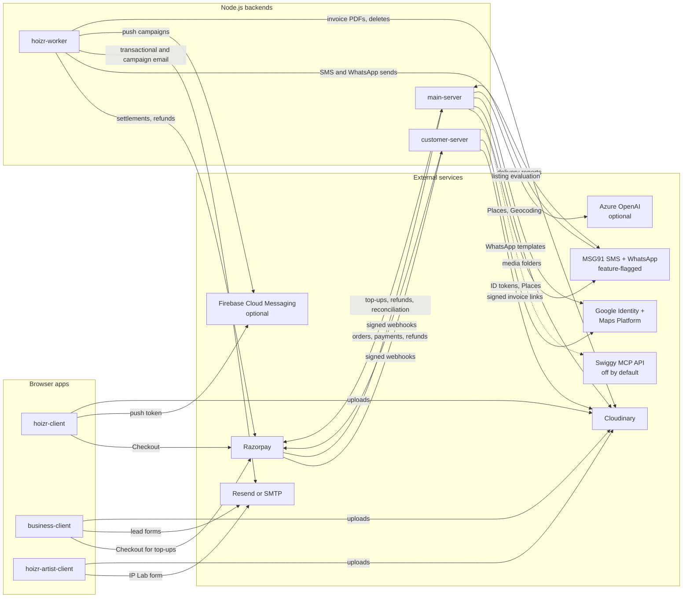

# Third-party services and stack reference

Use this chapter as the lookup table for the rest of the walkthrough. It lists every framework and library that shapes Hoizr, with the version each repository's manifest asks for and a link to the matching documentation. It then lists every external service the code talks to, what Hoizr uses it for and whether that path is live, behind a flag, optional or only scaffolded. The last section covers the documentation practices these chapters are organised around.

## TL;DR

- **Backends** are TypeScript on Node.js 20+, built with Fastify 5, Mercurius and TypeGraphQL 2 (still a release candidate). They sit on MongoDB (Mongoose 8, Typegoose 12) and Redis (ioredis, BullMQ 5).
- **Frontends** are four Next.js 14 apps using Tailwind CSS 3, Zustand, graphql-request and GraphQL Code Generator. The door scanner is a Flutter app.
- **Money and media are live.** Razorpay handles Checkout, the Orders, Payments, Refunds and Settlements REST APIs, and signed webhooks. Cloudinary holds media and invoice PDFs. Email goes through Resend or any SMTP server, chosen by environment variables.
- **Messaging is opt-in.** MSG91 SMS and WhatsApp only log until a flag is switched on and keys are set. Firebase push, Azure OpenAI and PostHog are optional, and the code degrades cleanly without them.
- **Delivery** uses GitHub Packages for the shared npm package (installing it needs a token) and deploy-only GitHub Actions over SSH. Dockerfiles exist but nothing builds them.
- **Not part of the running system:** Stripe, RingCentral, Meta's WhatsApp Cloud API, Instagram, Razorpay Route and RazorpayX. [In the code but not in use](#in-the-code-but-not-in-use) explains the leftovers.

## Contents

- [How to read the tables](#how-to-read-the-tables)
- [Stack reference](#stack-reference)
  - [Backend](#backend)
  - [Data and queues](#data-and-queues)
  - [Frontend](#frontend)
  - [Mobile](#mobile)
  - [Tooling and delivery](#tooling-and-delivery)
- [External services](#external-services)
  - [Who calls what](#who-calls-what)
  - [Keys you need just to boot locally](#keys-you-need-just-to-boot-locally)
  - [How integrations are switched on](#how-integrations-are-switched-on)
  - [Smaller services in the code](#smaller-services-in-the-code)
  - [In the code but not in use](#in-the-code-but-not-in-use)
- [Upgrade notes](#upgrade-notes)
- [Further reading](#further-reading)

## How to read the tables

- **Versions** are the ranges in each repository's `package.json` or `pubspec.yaml`, not lockfile-resolved versions. Each repository has its own lockfile, so one library can carry different ranges in different repos.
- **Used in** uses GitHub repository names. The workers repo is [`hoizr-worker`](https://github.com/roop37/hoizr-worker) and the admin console is [`internal-admin-client`](https://github.com/roop37/internal-admin-client), even though local clones are often named `hoizr-workers` and `hoizr-admin`.
- **Docs** links point at the installed major version wherever the project publishes one.
- **Status** (external services only):
  - **Live**: called in normal operation once credentials are set.
  - **Feature-flagged**: the code ships, but a flag that defaults to off has to be turned on.
  - **Optional**: Hoizr works without it, and a fallback or no-op takes over.
  - **Scaffolded**: files exist, but nothing runs them or the feature is not enabled.

> [!NOTE]
> Node.js is not pinned in any manifest (no `engines` field, no `.nvmrc`). Use Node.js 20 or later. The two Dockerfiles use `node:23-alpine`.

## Stack reference

### Backend

| Technology | Version | Used in | Docs |
|---|---|---|---|
| TypeScript | `^5.7.3`; `^5` in business-client and internal-admin-client | every JavaScript repo | [TypeScript handbook](https://www.typescriptlang.org/docs/) |
| Fastify | `^5.1.0` | main-server, customer-server, tracking-server | [Fastify v5.1 docs](https://fastify.dev/docs/v5.1.x/) |
| Fastify plugins: `@fastify/cookie`, `@fastify/cors`, `@fastify/helmet`, `fastify-raw-body` | `^11.0.1`, `^10.0.1`, `^12.0.1`, `^5.0.0` | main-server, customer-server; tracking-server uses cors and helmet only | [Fastify ecosystem](https://fastify.dev/ecosystem/) |
| Mercurius (GraphQL for Fastify) | `^15.1.0` | main-server, customer-server | [Mercurius](https://mercurius.dev/) |
| TypeGraphQL | `^2.0.0-rc.1`; pinned to `2.0.0-rc.2` as a peer in hoizr-shared | main-server, customer-server, hoizr-worker, hoizr-shared | [TypeGraphQL docs](https://typegraphql.com/docs/introduction.html) |
| graphql (graphql-js) | `^16.14.0`; `^16.9.0` in hoizr-artist-client | both GraphQL servers and all four Next.js apps | [GraphQL.js](https://graphql.org/graphql-js/) |
| jsonwebtoken (RS256 tokens) | `^9.0.2` | main-server, customer-server | [node-jsonwebtoken](https://github.com/auth0/node-jsonwebtoken) |
| bcrypt (OTP and access-code hashes) | `^5.1.1` | main-server, customer-server | [node.bcrypt.js](https://github.com/kelektiv/node.bcrypt.js) |
| Zod (env validation at boot) | `^3.23.8` | main-server, customer-server | [Zod 3 docs](https://v3.zod.dev/) |
| Nodemailer + nodemailer-express-handlebars | `^6.10.0` + `^7.0.0` | hoizr-worker | [Nodemailer](https://nodemailer.com/), [Handlebars guide](https://handlebarsjs.com/guide/) |
| PDFKit (tickets, tax invoices, credit notes) | `^0.18.0` | hoizr-worker | [PDFKit](https://pdfkit.org/) |
| qrcode | `^1.5.4` | main-server, customer-server, hoizr-worker, hoizr-client | [node-qrcode](https://github.com/soldair/node-qrcode) |
| winston (JSON logs) | `^3.17.0` | main-server, customer-server, hoizr-worker | [winston](https://github.com/winstonjs/winston) |

Each server's environment schema is the place to look for what a backend needs. See [`main-server/src/utils/environment.ts`](https://github.com/roop37/main-server/blob/main/src/utils/environment.ts) and [`customer-server/src/utils/environment.ts`](https://github.com/roop37/customer-server/blob/main/src/utils/environment.ts). [Chapter 09](./09-local-development.md) turns them into a setup checklist.

### Data and queues

| Technology | Version | Used in | Docs |
|---|---|---|---|
| MongoDB (server) | not pinned; transactions need a replica set | main-server, customer-server, hoizr-worker | [MongoDB manual](https://www.mongodb.com/docs/manual/) |
| Mongoose | `^8.4.1`; `^8.10.0` in hoizr-worker; peer `^8.0.0` in hoizr-shared | main-server, customer-server, hoizr-worker, hoizr-shared | [Mongoose 8 docs](https://mongoosejs.com/docs/8.x/docs/index.html) |
| Typegoose | `^12.10.1`; `^12.11.0` in hoizr-worker; peer `^12.0.0` in hoizr-shared | main-server, customer-server, hoizr-worker, hoizr-shared | [Typegoose quick start](https://typegoose.github.io/typegoose/docs/guides/quick-start-guide/) (the current site documents 13.x) |
| Redis (server) | not pinned | main-server, customer-server, hoizr-worker, tracking-server | [Redis docs](https://redis.io/docs/latest/) |
| ioredis | `^5.4.1`; `^5.5.0` in hoizr-worker | main-server, customer-server, hoizr-worker, tracking-server | [ioredis](https://github.com/redis/ioredis) |
| BullMQ | `^5.34.5` in the GraphQL servers; `^5.40.2` in hoizr-worker; `^5.13.2` in tracking-server | main-server, customer-server, hoizr-worker, tracking-server | [BullMQ docs](https://docs.bullmq.io/) |
| node-cron (schedules in `Asia/Kolkata`) | `^3.0.3` | hoizr-worker | [node-cron](https://github.com/node-cron/node-cron) |
| `@hoizr-technology/shared` (schemas, enums, queue names, ledger and HMAC helpers) | `0.1.121`; consumers ask for `^0.1.121`, tracking-server for `^0.1.119` (declared, not imported) | main-server, customer-server, hoizr-worker, tracking-server | [hoizr-shared repo](https://github.com/roop37/hoizr-shared) |

### Frontend

| Technology | Version | Used in | Docs |
|---|---|---|---|
| Next.js | `14.2.4` exact in business-client and internal-admin-client; `14.2.18` exact in hoizr-client and hoizr-artist-client | all four web apps | [App Router (v14)](https://nextjs.org/docs/14/app), [Pages Router (v14)](https://nextjs.org/docs/14/pages) |
| React + React DOM | `^18`; `^18.3.1` in hoizr-client and hoizr-artist-client | all four web apps | [react.dev](https://react.dev/) |
| Tailwind CSS | `^3.4.1`; `^3.4.15` in hoizr-client and hoizr-artist-client | all four web apps | [Tailwind CSS v3](https://v3.tailwindcss.com/docs/installation) |
| shadcn/ui on Radix UI primitives | Radix packages `^1.x` and `^2.x`; components live in `components/ui/` | business-client, internal-admin-client | [shadcn/ui (Tailwind v3)](https://v3.shadcn.com/docs), [Radix Primitives](https://www.radix-ui.com/primitives/docs/overview/introduction) |
| Zustand | `^4.5.2` in business-client and internal-admin-client; `^5.0.2` in hoizr-client and hoizr-artist-client | all four web apps | [Zustand](https://zustand.docs.pmnd.rs/), [v4 to v5 migration](https://zustand.docs.pmnd.rs/reference/migrations/migrating-to-v5) |
| graphql-request | `^7.0.1`; `^7.1.2` in hoizr-client and hoizr-artist-client | all four web apps | [graffle (formerly graphql-request)](https://github.com/graffle-js/graffle) |
| GraphQL Code Generator (`typescript`, `typescript-operations`, `typescript-graphql-request`) | CLI `^5.0.2` to `^5.0.7`; graphql-request plugin `^6.2.0` to `^6.4.0` | all four web apps | [Getting started](https://the-guild.dev/graphql/codegen/docs/getting-started), [graphql-request plugin](https://the-guild.dev/graphql/codegen/plugins/typescript/typescript-graphql-request) |
| TanStack Table | `^8.20.5` | business-client, internal-admin-client | [TanStack Table v8](https://tanstack.com/table/v8/docs/introduction) |
| React Hook Form | `^7.52.0` | business-client, internal-admin-client | [React Hook Form](https://react-hook-form.com/docs) |
| Recharts | `^2.15.0`; `^2.15.1` in internal-admin-client | business-client, internal-admin-client | [Recharts API](https://recharts.github.io/en-US/api/) |
| Framer Motion | `^11.2.x` in business-client and internal-admin-client; `^12.40.0` in hoizr-client and hoizr-artist-client | all four web apps | [Motion docs](https://motion.dev/docs) |
| date-fns + date-fns-tz (IST input and display) | `^4.1.0` + `^3.2.0` | business-client | [date-fns](https://date-fns.org/docs), [date-fns-tz](https://github.com/marnusw/date-fns-tz) |
| DOMPurify (rich-text sanitising) | `dompurify ^3.2.2`; `isomorphic-dompurify ^2.16.0` | business-client; hoizr-client | [DOMPurify](https://github.com/cure53/DOMPurify), [isomorphic-dompurify](https://github.com/kkomelin/isomorphic-dompurify) |

[Chapter 08](./08-frontend-architecture.md) explains how these pieces fit together in each app.

### Mobile

| Technology | Version | Used in | Docs |
|---|---|---|---|
| Flutter SDK | `>=3.22.0` | hoizr-scanner-app | [Flutter docs](https://docs.flutter.dev/) |
| Dart SDK | `>=3.4.0 <4.0.0` | hoizr-scanner-app | [Dart docs](https://dart.dev/) |
| mobile_scanner (camera and QR detection) | `^5.2.3` | hoizr-scanner-app | [mobile_scanner](https://pub.dev/packages/mobile_scanner) |
| sqflite + path (offline manifest and check-in queue) | `^2.3.3` + `^1.9.0` | hoizr-scanner-app | [sqflite](https://pub.dev/packages/sqflite) |
| connectivity_plus (auto-sync when the network returns) | `^6.0.5` | hoizr-scanner-app | [connectivity_plus](https://pub.dev/packages/connectivity_plus) |
| flutter_secure_storage (token storage) | `^9.2.2` | hoizr-scanner-app | [flutter_secure_storage](https://pub.dev/packages/flutter_secure_storage) |
| provider (state and dependency injection) | `^6.1.2` | hoizr-scanner-app | [provider](https://pub.dev/packages/provider) |
| http (plain GraphQL-over-HTTP, no GraphQL client) | `^1.2.2` | hoizr-scanner-app | [http](https://pub.dev/packages/http) |
| intl, google_fonts | `^0.19.0`, `^6.2.1` | hoizr-scanner-app | [intl](https://pub.dev/packages/intl), [google_fonts](https://pub.dev/packages/google_fonts) |

All of these are declared in [`pubspec.yaml`](https://github.com/roop37/hoizr-scanner-app/blob/main/pubspec.yaml).

### Tooling and delivery

| Technology | Version | Used in | Docs |
|---|---|---|---|
| npm | `package-lock.json` | main-server, customer-server, tracking-server, hoizr-shared | [npm docs](https://docs.npmjs.com/) |
| pnpm | `pnpm-lock.yaml` | hoizr-worker | [pnpm](https://pnpm.io/) |
| Yarn classic | `yarn@1.22.22` in `packageManager` (business-client, internal-admin-client, hoizr-artist-client) | business-client, internal-admin-client, hoizr-artist-client, hoizr-client; hoizr-client and hoizr-artist-client also carry a `package-lock.json` | [Yarn classic](https://classic.yarnpkg.com/) |
| ts-node-dev / ts-node | `^2.0.0` / `^10.9.2` | main-server, customer-server, tracking-server (ts-node-dev); ts-node also in hoizr-worker | [ts-node-dev](https://github.com/wclr/ts-node-dev) |
| tsc-watch + cpx (watch build, copy `.hbs` templates) | `^6.2.1` + `^1.5.0` | hoizr-worker | [tsc-watch](https://github.com/gilamran/tsc-watch) |
| ESLint + eslint-config-next | `^8` / `^8.57.1`; config pinned to each app's Next.js version | all four web apps | [ESLint](https://eslint.org/docs/latest/) |
| sharp + blurhash (image placeholders at `predev` and `prebuild`) | `^0.34.5` + `^2.0.5` | hoizr-client, business-client | [sharp](https://sharp.pixelplumbing.com/), [BlurHash](https://blurha.sh/) |
| Playwright | `^1.51.1` | main-server (installed, but its specs predate Hoizr and are not maintained) | [Playwright](https://playwright.dev/docs/intro) |
| flutter_lints, flutter_launcher_icons, flutter_native_splash | `^4.0.0`, `^0.14.1`, `^2.4.1` | hoizr-scanner-app | [flutter_lints](https://pub.dev/packages/flutter_lints) |

GitHub Packages, GitHub Actions and Docker are listed with the external services below.

## External services

| Service | What Hoizr uses it for | Status | Repos | Official docs |
|---|---|---|---|---|
| Razorpay Checkout | Browser payment sheet for tickets and artist merch on the storefront ([`CheckoutClient.tsx`](https://github.com/roop37/hoizr-client/blob/main/src/app/checkout/CheckoutClient.tsx), [`MerchBuyButton.tsx`](https://github.com/roop37/hoizr-client/blob/main/src/app/artist/%5BidOrSlug%5D/MerchBuyButton.tsx)) and for marketing-credit top-ups in the organizer dashboard ([`GlobalTopUpModal.tsx`](https://github.com/roop37/business-client/blob/main/components/common/topup/GlobalTopUpModal.tsx)) | Live | hoizr-client, business-client | [Standard Checkout](https://razorpay.com/docs/payments/payment-gateway/web-integration/standard/) |
| Razorpay Orders, Payments, Refunds and Settlements APIs | Server-side orders with amounts in paise, payment lookups and refunds. A daily cron pulls settlement reports into the ledger. All three backends call the REST API with axios and HTTP Basic auth ([customer-server](https://github.com/roop37/customer-server/blob/main/src/utils/razorpay.client.ts), [main-server](https://github.com/roop37/main-server/blob/main/src/utils/razorpay.client.ts), [hoizr-worker](https://github.com/roop37/hoizr-worker/blob/main/src/utils/razorpay-payments-client.ts)) | Live | customer-server, main-server, hoizr-worker | [API reference](https://razorpay.com/docs/api/), [Settlements](https://razorpay.com/docs/api/settlements/) |
| Razorpay Webhooks | `POST /webhooks/razorpay` on two servers. On customer-server (ticket payments) it checks the HMAC on the raw body, enqueues the payload and returns 200; [the worker](https://github.com/roop37/hoizr-worker/tree/main/src/workers/razorpay-webhook) verifies again before finalising. On main-server (credit top-ups) it verifies, records the event and credits the wallet | Live | customer-server, main-server, hoizr-worker | [Webhooks](https://razorpay.com/docs/webhooks/), [Validate and test](https://razorpay.com/docs/webhooks/validate-test/) |
| Cloudinary | Media for events, venues and artists: browser uploads from business-client, hoizr-client and hoizr-artist-client, server-side folder management, deletes through a [worker queue](https://github.com/roop37/hoizr-worker/tree/main/src/workers/cloudinary-deletion), and private invoice PDFs ([`pdf-storage.ts`](https://github.com/roop37/hoizr-worker/blob/main/src/utils/pdf-storage.ts)) served through short-lived signed links ([`cloudinary.ts`](https://github.com/roop37/customer-server/blob/main/src/utils/cloudinary.ts)) | Live | main-server, customer-server, hoizr-worker, business-client, hoizr-client, hoizr-artist-client | [Node.js SDK](https://cloudinary.com/documentation/node_integration) |
| Resend | Transactional and campaign email from the worker, over Resend's HTTP API or its SMTP endpoint ([`email-utils.ts`](https://github.com/roop37/hoizr-worker/blob/main/src/email/email-utils.ts)). Also the contact, waitlist and lead forms on the marketing site ([`app/api/contact/route.ts`](https://github.com/roop37/business-client/blob/main/app/api/contact/route.ts)) and the artist IP Lab form ([`route.ts`](https://github.com/roop37/hoizr-artist-client/blob/main/src/app/api/ip-lab/route.ts)) | Live | hoizr-worker, business-client, hoizr-artist-client | [Send email API](https://resend.com/docs/api-reference/emails/send-email) |
| SMTP, for example Amazon SES | The worker's alternative email transport, selected with `EMAIL_TRANSPORT=smtp` and the `SMTP_*` settings. Any SMTP server works; there is no SES-specific code | Optional | hoizr-worker | [Amazon SES SMTP](https://docs.aws.amazon.com/ses/latest/dg/send-email-smtp.html), [Nodemailer SMTP](https://nodemailer.com/smtp) |
| MSG91 SMS | DLT-template SMS for OTPs and transactional messages. The servers only enqueue jobs; the worker sends them ([`msg91.client.ts`](https://github.com/roop37/hoizr-worker/blob/main/src/msg91/msg91.client.ts)) | Feature-flagged (`SMS_ENABLED`) | hoizr-worker; jobs enqueued by main-server and customer-server | [MSG91 docs](https://docs.msg91.com/) |
| MSG91 WhatsApp | Template and text sends for OTPs, tickets, campaigns and automations ([`whatsapp.client.ts`](https://github.com/roop37/hoizr-worker/blob/main/src/msg91/whatsapp.client.ts)). Also template submission ([`whatsapp-template.service.ts`](https://github.com/roop37/main-server/blob/main/src/modules/whatsappTemplate/service/whatsapp-template.service.ts)), a 15-minute [approval-status sync](https://github.com/roop37/hoizr-worker/blob/main/src/workers/crons/whatsapp-template-sync.cron.ts) and delivery reports at `/webhooks/whatsapp` ([route](https://github.com/roop37/main-server/blob/main/src/routes/whatsapp-webhook.route.ts)) | Feature-flagged (`WHATSAPP_ENABLED`) | hoizr-worker, main-server, internal-admin-client (template screens) | [MSG91 docs](https://docs.msg91.com/) |
| Google Identity (Sign in with Google) | customer-server verifies Google ID tokens with `google-auth-library` ([`oauth-verifier.ts`](https://github.com/roop37/customer-server/blob/main/src/modules/auth/service/oauth-verifier.ts)). The storefront wraps `@react-oauth/google`, but the button is currently commented out in [`AuthPanel.tsx`](https://github.com/roop37/hoizr-client/blob/main/src/components/auth/AuthPanel.tsx), so phone OTP is the only visible sign-in | Built; UI entry point hidden | customer-server, hoizr-client | [GIS overview](https://developers.google.com/identity/gsi/web/guides/overview), [Verify the ID token](https://developers.google.com/identity/gsi/web/guides/verify-google-id-token) |
| Google Maps Platform | Places API (New) autocomplete and place details, plus Geocoding, for venue and customer addresses ([main-server](https://github.com/roop37/main-server/blob/main/src/modules/places/services/index.service.ts), [customer-server](https://github.com/roop37/customer-server/blob/main/src/modules/customerPlaces/service/customer-places.service.ts)) | Live | main-server, customer-server | [Places API](https://developers.google.com/maps/documentation/places/web-service), [Geocoding API](https://developers.google.com/maps/documentation/geocoding) |
| Azure OpenAI | Event listing evaluation (score, SEO suggestions, spelling) and optional description drafts through the chat completions REST API ([`eval-advisor.service.ts`](https://github.com/roop37/main-server/blob/main/src/modules/eventEval/service/eval-advisor.service.ts)) | Optional (heuristic fallback) | main-server | [Azure OpenAI reference](https://learn.microsoft.com/en-us/azure/foundry/openai/reference) |
| Firebase Cloud Messaging | Web push. The storefront registers a token with the Firebase JS SDK and a [service worker](https://github.com/roop37/hoizr-client/blob/main/public/firebase-messaging-sw.js) ([`web-push.ts`](https://github.com/roop37/hoizr-client/blob/main/src/lib/web-push.ts)), customer-server stores it, and the worker sends host push campaigns with `firebase-admin` ([worker](https://github.com/roop37/hoizr-worker/blob/main/src/workers/host-push-campaign/host-push-campaign.worker.ts)) | Optional (needs `FIREBASE_SERVICE_ACCOUNT_JSON`) | hoizr-client, customer-server, hoizr-worker | [Cloud Messaging](https://firebase.google.com/docs/cloud-messaging), [Admin SDK setup](https://firebase.google.com/docs/admin/setup) |
| PostHog | Product analytics with manual App Router pageviews ([`PostHogProvider.tsx`](https://github.com/roop37/hoizr-client/blob/main/src/components/analytics/PostHogProvider.tsx)). It loads only when `NEXT_PUBLIC_POSTHOG_KEY` is set and is separate from Hoizr's own [tracking pipeline](./07-tracking-and-analytics.md) | Optional | hoizr-client, business-client, hoizr-artist-client | [posthog-js](https://posthog.com/docs/libraries/js) |
| GitHub Packages (npm) | Hosts `@hoizr-technology/shared` ([`publishConfig`](https://github.com/roop37/hoizr-shared/blob/main/package.json)). Backends install it from the registry, which needs a token even for public packages. Releases are bumped and published by hand | Live (manual publish) | hoizr-shared, main-server, customer-server, hoizr-worker, tracking-server | [Working with the npm registry](https://docs.github.com/en/packages/working-with-a-github-packages-registry/working-with-the-npm-registry) |
| GitHub Actions | Deploy-only workflows: a push to a deploy branch SSHes into the server with `appleboy/ssh-action` and runs a deploy script ([`deploy.yml`](https://github.com/roop37/main-server/blob/main/.github/workflows/deploy.yml)). tracking-server's production deploy is manual. hoizr-shared's publish workflow sits at [`.github/build.yaml`](https://github.com/roop37/hoizr-shared/blob/main/.github/build.yaml), outside `.github/workflows/`, so it never runs. No workflow runs tests or lint | Live (deploy only) | main-server, customer-server, hoizr-worker, tracking-server | [GitHub Actions](https://docs.github.com/en/actions), [ssh-action](https://github.com/appleboy/ssh-action) |
| Docker | Multi-stage images on `node:23-alpine` that run as a non-root user ([main-server](https://github.com/roop37/main-server/blob/main/Dockerfile), [hoizr-worker](https://github.com/roop37/hoizr-worker/blob/main/Dockerfile)). No workflow builds them, and they still reference an older package scope | Scaffolded | main-server, hoizr-worker | [Docker docs](https://docs.docker.com/) |
| Swiggy MCP API | An optional, feature-flagged restaurant-reservation integration over Swiggy's MCP API. It is off by default, and a customer has to connect their own Swiggy account before any call is made | Feature-flagged (off by default) | customer-server, hoizr-client | [Model Context Protocol](https://modelcontextprotocol.io/) |
| Sign in with Apple | The resolver exists but throws `APPLE_NOT_CONFIGURED` ([`oauth.service.ts`](https://github.com/roop37/customer-server/blob/main/src/modules/auth/service/oauth.service.ts)) | Scaffolded, not enabled | customer-server | [Sign in with Apple](https://developer.apple.com/sign-in-with-apple/) |

<!-- SCREENSHOT: customer-checkout | Storefront checkout with the order summary and the Razorpay payment sheet open in test mode -->

### Who calls what



In words: Razorpay and MSG91 are the two services with traffic in both directions:

- **Razorpay.** Browsers open Checkout and all three backends call its REST API. It posts signed webhooks back to customer-server (tickets) and main-server (credit top-ups).
- **MSG91.** hoizr-worker sends SMS and WhatsApp through it, and main-server manages WhatsApp templates there. MSG91 posts delivery reports back to main-server.

Every message the backends send leaves through hoizr-worker: email to Resend or SMTP, SMS and WhatsApp to MSG91, and push to Firebase. The only exceptions are the form handlers in business-client and hoizr-artist-client, which call Resend directly.

Cloudinary is the one service nearly every repo touches. Google's keyed APIs and Azure OpenAI are called only from the two GraphQL servers.

internal-admin-client, tracking-server and the scanner app call no third-party API directly, apart from web fonts. The admin console reaches Razorpay and MSG91 through main-server.

### Keys you need just to boot locally

Most integrations are optional at boot, but two Zod schemas are stricter:

- **customer-server** requires `RAZORPAY_KEY_ID`, `RAZORPAY_KEY_SECRET`, `RAZORPAY_WEBHOOK_SECRET` and `GOOGLE_OAUTH_CLIENT_ID`. Razorpay test-mode keys are enough.
- **main-server** requires `CLOUDINARY_CLOUD_NAME`, `CLOUDINARY_API_KEY`, `CLOUDINARY_API_SECRET` and `MAPS_API_KEY`. Its Razorpay webhook secret becomes required only when `SERVER_ENV` is `production`.

Everything else can stay unset while you work:

- MSG91 logs payloads instead of sending them.
- Push campaigns fail with a clear "FCM not configured" status.
- Listing evaluation uses its heuristic.
- PostHog never loads.

The worker still needs some email transport before emails leave the machine. Any SMTP server works, including a local mail catcher.

> [!IMPORTANT]
> Installing any backend pulls `@hoizr-technology/shared` from GitHub Packages, which asks for a token even for public packages. You need a classic personal access token with `read:packages`. [Chapter 09](./09-local-development.md) has the exact `.npmrc` lines and the alternative of building the package locally.

### How integrations are switched on

Three patterns repeat across the integrations, and a new provider should follow one of them.

#### Flags that default to silence

MSG91 SMS and WhatsApp can't send anything by accident. Each client checks a master flag and its credentials. If either is missing, it logs the payload and returns a synthetic success, so callers behave the same in development and production. The WhatsApp client does the same with `WHATSAPP_ENABLED`, the auth key and the integrated sender number. From [`src/msg91/msg91.client.ts`](https://github.com/roop37/hoizr-worker/blob/main/src/msg91/msg91.client.ts):

```ts
const isLive = (): boolean =>
  process.env.SMS_ENABLED === "true" && !!process.env.MSG91_AUTHKEY;

export const sendFlowSms = async ({
  // ...
}: SendFlowSmsInput): Promise<Msg91SendResult> => {
  // ...
  if (!isLive()) {
    logger.info({
      message:
        "[SMS DEV] would send MSG91 flow (SMS_ENABLED!=true or no authkey) — not calling MSG91",
      body,
    });
    return { ok: true, dev: true };
  }
  // ...
```

The live path also separates a rejected request (bad template or recipient, not retried) from a transport failure (retried by BullMQ). [Chapter 04](./04-background-jobs-bullmq.md) covers the retry side.

#### A transport switch, not a failover

Email has three modes, chosen by environment variables:

- `EMAIL_TRANSPORT=resend` sends through Resend's HTTP API. Nodemailer's JSON transport renders the Handlebars template first, so templates don't change.
- With `RESEND_API_KEY` set and no `EMAIL_TRANSPORT`, Nodemailer sends over Resend's SMTP endpoint.
- `EMAIL_TRANSPORT=smtp` always uses the `SMTP_*` settings, for example Amazon SES or a local catcher.

Nothing fails over automatically from one provider to another. From [`src/email/email-utils.ts`](https://github.com/roop37/hoizr-worker/blob/main/src/email/email-utils.ts):

```ts
const sendWithConfiguredTransport = async (
  smtpTransporter: HbsTransporter,
  renderTransporter: HbsTransporter,
  mailOptions: MailOptions
) => {
  if (!shouldSendWithResend()) {
    // Existing SMTP/SES path. When SES SMTP keys are ready, keep
    // EMAIL_TRANSPORT=smtp and SMTP_* envs; no template changes needed.
    await smtpTransporter.sendMail(mailOptions);
    return;
  }

  // Temporary launch path. To go back to SMTP, set EMAIL_TRANSPORT=smtp
  // and remove/comment RESEND_API_KEY. This branch can then be deleted
  // without touching the SMTP block above.
  await sendWithResend(renderTransporter, mailOptions);
};
```

#### A fallback instead of an outage

The only AI feature is listing evaluation, and it never blocks an organizer. If the three `AZURE_OPENAI_*` values are missing, or the call fails or returns something that isn't JSON, the service returns a deterministic heuristic result. That result is labelled `heuristic-fallback` so admins can tell it apart. From [`eval-advisor.service.ts`](https://github.com/roop37/main-server/blob/main/src/modules/eventEval/service/eval-advisor.service.ts):

```ts
  private isConfigured(): boolean {
    return Boolean(
      EnvVars.values.AZURE_OPENAI_RESOURCE_NAME &&
        EnvVars.values.AZURE_OPENAI_DEPLOYMENT_NAME &&
        EnvVars.values.AZURE_OPENAI_API_KEY
    );
  }
  // ...
    if (!this.isConfigured()) {
      logger.warn(
        "AZURE_OPENAI_* env vars not set — using heuristic eventEval fallback"
      );
      return this.heuristicFallback(input);
    }
  // ...
    } catch (err: any) {
      logger.error(
        `Event eval failed (${err?.message ?? err}); using heuristic fallback`
      );
      return this.heuristicFallback(input);
    }
```

### Smaller services in the code

These appear in the frontends and carry no business logic:

| Service | What it does here | Repos | Docs |
|---|---|---|---|
| Unlayer email editor | Drag-and-drop campaign email builder (`react-email-editor ^1.7.11`), loaded with `next/dynamic` ([editor](https://github.com/roop37/business-client/blob/main/components/modules/campaignOnboarding/unlayerEmailTemplateEditor.tsx)) | business-client | [react-email-editor](https://github.com/unlayer/react-email-editor) |
| Google Fonts | Display and body typefaces through `next/font/google` or a CSS import; the scanner fetches Inter at runtime with `google_fonts` | hoizr-client, internal-admin-client, hoizr-artist-client, hoizr-scanner-app | [Google Fonts](https://fonts.google.com/) |

### In the code but not in use

Hoizr grew out of an earlier codebase, and some of that codebase's integrations are still in the code. They are not part of the running system:

- **Stripe.** business-client still has Stripe-era screens (for example `pages/account/stripe-integration/`) and an unused `@stripe/stripe-js` dependency. hoizr-shared still exports Stripe-era schema classes. No server has a Stripe SDK or a Stripe webhook route. Payments are Razorpay only.
- **RingCentral.** No code; only a stale comment mentions it. SMS is MSG91.
- **Meta WhatsApp Cloud API.** main-server's env schema still declares `META_WHATSAPP_*` names that nothing reads. The MSG91 client replaced it with the same exported signatures.
- **Instagram.** A customer "connect Instagram" flow sits behind flags that default to off. It is not live.
- **Razorpay Route and RazorpayX.** Not used. Host payouts are settled manually by an admin; see [chapter 06](./06-payments-and-money.md).
- **Declared but never imported.** These include `square` and `@vercel/sdk` (main-server), `square` (business-client), the `razorpay` SDK (customer-server, which calls the REST API through axios) and MUI in internal-admin-client (one orphaned component). Pruning them is a good first contribution.

## Upgrade notes

Read these before changing dependencies. [Chapter 12](./12-known-gaps-and-roadmap.md) tracks the work.

- **Next.js 14 is outside the [Next.js support policy](https://nextjs.org/support-policy).** All four apps should move to a supported major, and meanwhile take the latest 14.2 patch.
- **TypeGraphQL 2.0 is still a release candidate.** The servers ask for `^2.0.0-rc.1`, and hoizr-shared pins `2.0.0-rc.2` as a peer, so upgrade all of them together.
- **Typegoose's current docs describe 13.x**, which targets Mongoose 9. Hoizr runs Typegoose 12 on Mongoose 8, and both move together.
- **The Zod, Tailwind CSS and shadcn/ui sites document newer majors.** Use the v3 sites linked above.
- **Zustand is split** between v4 (business-client, internal-admin-client) and v5 (hoizr-client, hoizr-artist-client). The [migration guide](https://zustand.docs.pmnd.rs/reference/migrations/migrating-to-v5) covers the differences.
- **node-cron's latest major is v4**, which changes the API. The worker's v3 usage still works.
- **mobile_scanner 6.0 removed `autoStart`.** The scanner relies on it in [`scan_page.dart`](https://github.com/roop37/hoizr-scanner-app/blob/main/lib/pages/scan_page.dart) (`MobileScannerController(autoStart: false)`), so an upgrade needs a small rewrite of camera start-up.
- **ioredis is in maintenance mode.** Hoizr keeps it because BullMQ is built on it.
- **Azure OpenAI is called on a dated API version** (`AZURE_OPENAI_API_VERSION`, default `2024-10-21`); a newer v1 API now exists.

## Further reading

These references shaped how the walkthrough is organised:

| Reference | What it is | Where it shows up here |
|---|---|---|
| [C4 model](https://c4model.com/) ([diagram types](https://c4model.com/diagrams)) | Architecture diagrams at four zoom levels: context, container, component and code | [Chapter 01](./01-system-architecture.md) draws the system context and container levels. They are plain Mermaid flowcharts, because [Mermaid's C4 syntax](https://mermaid.js.org/syntax/c4.html) is still experimental |
| [Diátaxis](https://diataxis.fr/) | A framework that separates tutorials, how-to guides, reference and explanation | Chapters that explain how and why the system works are kept apart from how-to material such as [local development](./09-local-development.md) and from reference material such as this chapter |
| Architecture Decision Records: [the 2011 Cognitect post](https://www.cognitect.com/blog/2011/11/15/documenting-architecture-decisions), [adr.github.io](https://adr.github.io/), [MADR](https://adr.github.io/madr/) | Short records of one decision each: context, decision, status and consequences | [Chapter 11](./11-engineering-decisions.md) is the ADR log |
| [standard-readme](https://github.com/RichardLitt/standard-readme/blob/main/spec.md) | A spec for README sections and their order, with the license last | The checklist for the per-repository READMEs |
| [Creating diagrams on GitHub](https://docs.github.com/en/get-started/writing-on-github/working-with-advanced-formatting/creating-diagrams) | How GitHub renders Mermaid in Markdown | Every diagram in the walkthrough |
| [Open Source Guides: Starting a project](https://opensource.guide/starting-a-project/) and [Make a README](https://www.makeareadme.com/) | Practical guidance on launch files and README content | The community files and READMEs across the organisation |

---

Related chapters: [System architecture](./01-system-architecture.md) · [Auth and RBAC](./03-auth-and-rbac.md) · [Background jobs with BullMQ](./04-background-jobs-bullmq.md) · [Payments and money](./06-payments-and-money.md) · [Tracking and analytics](./07-tracking-and-analytics.md) · [Frontend architecture](./08-frontend-architecture.md) · [Local development](./09-local-development.md) · [Deployment and operations](./10-deployment-and-operations.md) · [Known gaps and roadmap](./12-known-gaps-and-roadmap.md)

[Back to the walkthrough](../README.md)
